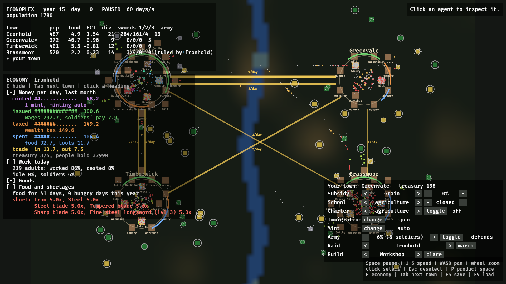
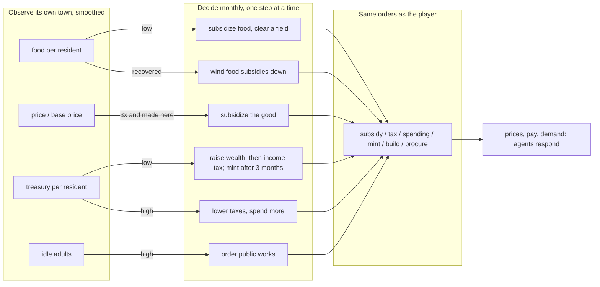

# Econoplex

A strategy game where every person is an economic agent. Skills, minds, bodies and
needs are vectors, so production, learning, decisions and culture become linear
algebra over thousands of agents. Inspired by agent-based modelling and Hidalgo's
economic complexity: capabilities live in people, spread through apprenticeship,
and towns diversify along the product space.

You rule one town among several. Nothing is scripted: prices, trades, wars and
migration all follow from what people need, what they can do and what their town
holds. You steer with the same levers the AI governors use (taxes, subsidies,
schools, armies, buildings) and the people respond.

The repository holds a headless simulation, a command line tool to run and measure
it, and two clients on the same simulation: a 3D view (`game3d`) and a simpler 2D
view (`game`) that doubles as a test bench.

## Quick start

Requires Rust 1.97.1 or newer.

```bash
# The 3D client (generated world, live simulation, day and night, weather)
cargo run --release -p game3d

# The 2D client (policy panel, economy panel, product space)
cargo run --release -p game

# Start the 2D client from a save (F5 quicksaves to saves/quicksave.bin, F9 loads it)
cargo run --release -p game -- --load game.ron

# Headless: 30 years, metrics per year
cargo run --release -p sim_cli -- --years 30

# Bigger world (~12,000 agents), CSV export
cargo run --release -p sim_cli -- --years 20 --scale 10 --csv metrics.csv

# Change a parameter for one run, and see where the time goes
cargo run --release -p sim_cli -- --years 20 --set military.tribute_share=0.3 --profile

# Parameter sweep: every value on 8 seeds, in parallel, one summary row per setting
cargo run --release -p sim_cli -- --years 30 --seeds 8 \
    --sweep military.tribute_share=0.1,0.2,0.4 --sweep market.free_land=3,6 --csv sweep.csv

# Give player orders from the command line (day:order, repeatable)
cargo run --release -p sim_cli -- --years 25 --order "0:immigration Greenvale encouraged" \
    --order "0:school Greenvale woodworking 40"

# Save after 10 years, then continue the same game for 5 more
cargo run --release -p sim_cli -- --years 10 --save game.ron
cargo run --release -p sim_cli -- --load game.ron --years 5

# Fight one battle, or the same battle on 200 seeds for win rates
cargo run --release -p sim_cli -- --battle "cavalry*20 vs spearmen*30"
cargo run --release -p sim_cli -- --battle "swordsmen*45,archers*20 vs walls spearmen*30" --seeds 200

# Event log, monthly history and weather as CSV
cargo run --release -p sim_cli -- --years 10 --events events.csv --history history.csv --weather weather.csv

# The product space derived from the skill graph
cargo run --release -p sim_cli -- --embedding

# The technology tree as a Mermaid flowchart (kept in docs/tech-tree.mmd; CI checks it is current)
cargo run --release -p sim_cli -- --tech-tree > docs/tech-tree.mmd

# The final state hash, for determinism checks
cargo run --release -p sim_cli -- --years 5 --hash

# Tests (content validation, models, determinism)
cargo test --release
```

The first build compiles Bevy and takes a while. `econoplex-sim --help` lists every
option and order.

### 3D client controls

| Key | Action |
| --- | --- |
| W A S D | Move the camera |
| Q / E | Turn the camera |
| Mouse wheel | Zoom |
| Home | Back to the starting view |
| Space | Pause |
| , and . | Slower and faster |
| Left click | Inspect a person or a town |
| Esc | Deselect |
| V | Cycle the map overlays (trade, culture, product space) |
| H | Show or hide the panels |

The options of `econoplex3d` (seed, number of towns, season, weather, screenshots)
are listed at the top of `crates/game3d/src/main.rs`.
The shader work behind the look is written up step by step in `docs/shaders/`.

### 2D client controls

| Key | Action |
| --- | --- |
| Space | Pause |
| 1 to 5 | Speed: 5 min, 1 min, 12 s of real time per simulated day, then 1 and 4 days per second |
| WASD or arrows | Pan |
| Mouse wheel | Zoom |
| Left click | Inspect an agent (skills, mind, physique vs. genetic potential, state, guild, family) |
| P | Product space overlay: skill graph, brightness = selected agent's (or average) proficiency |
| Esc | Deselect |
| E | Economy panel and trade flows on the map (on at start) |
| Tab | Next town in the economy panel |
| F5 / F9 | Quicksave to `saves/quicksave.bin` (compact binary) / load it again |

Agents are colored by their best skill domain; brightness shows how good they are.
Children are grey and follow a working parent as apprentices.

You govern Greenvale (marked `*`; set `player` in `scenario.ron` to pick another
town). The panel at the bottom right holds its levers: pick a product with `<` `>`
and change its subsidy with `-` `+`, pick a school subject and add or remove seats
in steps of 10, toggle a guild charter, and cycle immigration between open,
encouraged and closed. Army sets the share of adults under arms and whether your
squad raids on its own or only defends (it starts out defending). Raid picks a town
and marches on it as soon as the squad is big enough. Build picks a building type;
press place, then click the map where it should stand. Every click queues an order
that takes effect the next day.

## Workspace

| Crate | Purpose |
| --- | --- |
| `sim_data` | Content model (skills, products, recipes, nature) loaded from RON, validation, skill embedding |
| `sim_core` | Headless simulation on `bevy_ecs`: agent vector store, entities, tick pipeline, pluggable models, metrics |
| `sim_cli` | `econoplex-sim`: run N years headless, print metrics, export CSV, inspect the embedding |
| `game` | `econoplex`: 2D Bevy client that runs the simulation in `FixedUpdate` and renders it |
| `game3d` | `econoplex3d`: 3D client (terrain, towns, crowds, day and night, weather, battles) and the shader playground |

All tunable data lives in `assets/`:

- `assets/content/*.ron`: skills, products, recipes, natural resources. Files load
  alphabetically; later files can add or override entries by id (the modding hook).
- `assets/config/models.ron`: every formula constant, plus which model variant to use.
- `assets/config/scenario.ron`: towns, populations, land, buildings, seed.

Design notes for the larger systems are in `docs/design/`: the needs ladder, agent
decisions, the town market, firms, time and weather, and graphics and UI.

### Which models run by default

Some systems can be switched between variants in `models.ron`. These are the
ones that shape a default run:

| System | Default | What it means |
| --- | --- | --- |
| Consumption (`market.consumption`) | `Needs` | Households buy food, clothes, firewood and a home to fill nine needs on five rungs |
| Firms (`market.firms`) | `Treasury` | The town market buys all output and pays wages from the treasury |
| Trade (`market.caravans`) | `Balance` | Caravans carry goods from where they are cheap to where they are dear |
| Climate and weather (`climate`, `weather`) | `Seasonal`, `Fronts` | A year has seasons, and weather fronts cross the map |

These always run, with their parameters in `models.ron`:

| System | Parameters | What it means |
| --- | --- | --- |
| Decisions | `decision` | People choose by what improves their needs most |
| Prices | `market.pricing` | Prices follow how many days of demand the stock covers |
| Building value | `market.building_value` | A new building is worth what it would add |
| Food | `market.granary_spoilage` | The ruler sets how much food is held back |
| Farming | `farming` | Crops are sown and harvested by season, with frost and rot |
| Working day | `time.day_length` | People work outdoors while it is light |
| Battles | `battle` | Squads with their own kit, skill and morale fight on a field |
| Marching | `military.march_speed` | Rain and snow slow an army |
| Kit | `military.levy_reserve` | Towns want weapons and armour for the soldiers they have |

## How the simulation works

### Agents are vectors

Each agent has an index into `AgentStore`, which keeps every block in contiguous arrays:

| Block | Size | Meaning |
| --- | --- | --- |
| Capability | one per skill (rounded up to 8), latent | Skills and know-how |
| Mind | 8, named | ambition, diligence, curiosity, sociability, risk (personality, from genes); tradition, faith, liberty (ideology, social) |
| Physique | 6, named | strength, endurance, agility, dexterity, perception, constitution |
| State | 4, named | hunger, fatigue, happiness, health |
| Genome | fixed | physique potential, temperament, learning aptitude |

### Skills come from the skill graph

Skills form a DAG through prerequisites. Each skill's vector is its prerequisite
closure (itself plus ancestors, weighted by `0.5^depth`), normalized. The dot product
between two skills counts shared prerequisites, so the product space falls out of the
geometry.

Capability vectors are sized at load time: one dimension per skill, rounded up to a
multiple of 8, so the product space stays exact however
far the content grows. `embedding.dims` in `models.ron` can set a size instead. With
fewer dimensions than skills, NMF compresses the space while keeping vectors
nonnegative. A save records its dimension and is refused if the game now uses another.

At about 12,500 agents a tick costs about 7.2 ms at 32 dimensions (6.95 ms with the
earlier fixed 32-wide arrays), 7.8 ms at 40 and 9.0 ms at 64.

### The technology tree

The full chart is [docs/tech-tree.mmd](docs/tech-tree.mmd), written by
`econoplex-sim --tech-tree` (GitHub draws it when you open the file).

The content (`assets/content/*.ron`) spans five eras: **wood and grain**, **stone,
clay and cloth**, **bronze**, **iron and steel**, and **early industry**. Each file
adds skills, goods, workplaces, recipes and natural resources:

| File | Adds |
| --- | --- |
| `05_nature.ron` | quarries, clay pits, pastures, flax fields, copper, tin and silver veins, coal seams |
| `12_husbandry_textiles.ron` | wool and flax to yarn, cloth and clothes (weaving shed); ale (brewery) |
| `15_masonry.ron` | stone and cut stone (mason's yard), clay, pots and bricks (kiln), chisels |
| `35_bronze.ron` | copper and tin smelting, bronze casting, bronze spears |
| `55_industry.ron` | coal and coke, the blast furnace, machine parts (machine shop), roller and textile mills, ploughs |
| `60_money.ron` | silver refining, the mint and its coins (silver, copper, iron) |

Each era's buildings are made from the eras before it. Kilns need stone and clay,
breweries bricks, the blast furnace bricks, cut stone and iron, and the mills
machine parts. The scenario spreads the resources:

- Ironhold: iron ore, coal, stone
- Greenvale: sheep, flax, clay
- Timberwick: tin, clay
- Brassmoor: copper, silver, stone

No town can cast bronze alone, so caravans carry ore and metal between towns.
Products name their `era`. A town counts as having reached an era once that era's
goods are at least 2% of what it makes by value, so digging up raw ore doesn't count.
The HUD shows each town's era, and `econoplex-sim` prints the year each town first
reached each era.

Eras are only a label for the player. No mechanic reads them: nothing unlocks by
era, and AI towns don't choose buildings or work by it. What a town can make follows
bottom up from the agent-based simulation: what its people can do, what it holds or
can buy, and which buildings it has. The era only reports where that has got to, so
a town can also slip back. The
`eras_are_only_a_label_and_never_change_the_simulation` test relabels every
product's era and checks that the run is unchanged.

Some buildings are `starter` buildings (workshop, mill, bakery, furnace, smithy):
towns can begin with them, which breaks bootstrap loops such as planks needing a
workshop. Validation checks that every good and building can be made from natural
resources and starter buildings, through recipes whose inputs and buildings can
themselves be made. `econoplex-sim --tech-tree` prints the tree as a Mermaid chart.

### A day in the simulation

A year is 12 simulated days, one per month: each is the month's representative
day and counts for its 10 days (`time.days_per_month`), so a month of meals, work
and growth happens in one simulated day and generations show in short runs. A day
is cut into `time.steps_per_day` economy steps (300 by default, any value from 1
with `--set time.steps_per_day=N`), and the whole economy runs every step; each
step stands for 1/30 of a day of time and does the work that falls in its hours.
Production is a flow: inputs go in as a team works, and each whole run's output
goes to market when its progress bar fills. At the clients' default speed of 5
minutes a simulated day, a step comes about once a real second. See
`docs/design/time-and-weather.md`. Each step runs these systems in order:

| Step | What happens |
| --- | --- |
| sense | Hunger, cold and fatigue rise; households eat from their larder and buy what their needs call for at the town market; health and happiness update |
| decide | Each idle adult weighs a sample of open jobs and resting by how much each would improve their needs (the needs ladder, `docs/design/needs-ladder.md`). Jobs fill up: nature, inputs and building slots limit how many can take each one |
| assign | Agents choosing the same job form teams; inputs and nature are reserved; task entities spawn; children join a working parent |
| produce | Teams pool capabilities (element-wise max minus coordination cost); success = sigmoid(k·(effective − difficulty)); quality is the weakest link of step and inputs. The town buys the output and pays wages from its treasury; finished construction becomes a new building |
| learn | Practice with diminishing returns; master-to-apprentice diffusion along the skill direction only |
| socialize | Bounded-confidence alignment on the ideological axes between coworkers and random townspeople |
| body | Norm budget and forgetting on capability; physique trains toward the genetic potential |
| settle | Prices follow stock vs. per-capita targets; buildings are priced by how full they are; food spoils; wealth tax and public spending; caravans trade goods and tools between towns; nature regrows |
| organize | Guild membership and roles from domain proficiency; guild members buy matching tools (on credit if needed) |
| military | Musters (recruit, release, arm with longswords), soldier pay and drill, raids, battles, captives, conquest, tribute and uprisings |
| migrate | Every month some idle adults compare towns; households move where they are better off |
| lifecycle | Aging and Gompertz mortality, bequests, partnering by mind affinity, births with genetic inheritance |
| metrics | Yearly: diversity, RCA, economic complexity index, specialization, culture |

The needs ladder has nine needs on five rungs: food, warmth and rest; shelter, health
and savings; belonging; esteem; growth. A higher rung only starts to matter once the
rungs below are mostly met. Skills are never inherited: children of smiths become
smiths only by working next to their parents.

### Money

Every town starts with `starting_coins` in its treasury. After that, new money comes
only from a **mint** (see below); otherwise money is never created or destroyed.
Money is counted in whole thousandths of a coin (`coin.rs`), so it adds up exactly.
`econoplex-sim` prints the total each year, and the `money_is_conserved` test checks
that it changes by exactly what the mints struck. Money moves between agents' wealth
and town treasuries:

| Flow | From → to |
| --- | --- |
| Wages: the town market buys each finished output and pays the team `wage_share` of the value added | treasury → workers |
| Food, eaten at the town price (agents with no money still eat) | eater → treasury |
| Tools, bought by guild members, on credit up to `tool_credit` | member → treasury |
| Caravans: the buying town pays the destination price | buyer treasury → seller treasury |
| Wealth tax on savings above `tax_free_wealth` | agent → treasury |
| Public spending of a treasury above its per-capita reserve | treasury → residents |
| Bequests: partner, else children, else the town | dead agent → heirs |

When a treasury runs dry, wages for that day are cut, so pay follows what people
actually spend. All rates are in the `market` section of `models.ron`.

#### Mints

A mint (`content/60_money.ron`) is a building of 12 cut stone and 12 planks, put up by
builders like any other. Working it is a trade like any other. Up to four minters
strike coin from silver (150 coins an ingot), copper (50 coins from two ingots and
charcoal) or, as a fallback, iron (60 coins from one ingot and charcoal), whichever
pays best, at three person-days a batch. Struck coin is
not stocked; it goes into the treasury as new money and is paid out from there as
wages and the rest. Each town's `minting` policy decides when:

- **auto** (default): the town builds a mint, and keeps it working, while its
  treasury holds less than `mint_below_per_capita` per resident
- **on**: strike coin whenever the mint has workers and metal
- **off**: never (no mint is built unless ordered)

Minting is limited by labor and by metal. Silver is the best coin metal and only
Brassmoor has it; towns without coin metal buy it, or mint iron and compete with
their smiths for it. Change it with `mint TOWN auto|on|off`, or
with the Mint row of the policy panel.

Every one of these payments is booked in the town's ledger (`ledger.rs`), read with a
credit-first eye: what the treasury pays out puts money into people's hands
(**issued**: wages, subsidies, fees, soldiers' pay, public spending, grants), what it
takes back by right is **taxed** (wealth tax, estates without heirs), and what people
hand back by choice at the town market is **spent** (food, tools). Coin struck at a mint
is **minted**. Trade, tribute and plunder move money between towns. The ledger keeps a monthly average for the game and
yearly totals for the CSV (`minted`, `issued`, `taxed`, `spent`, `external_in`, `external_out`),
and the `the_ledger_accounts_for_every_treasury_change` test checks that it explains
every change in every treasury.

### The economy on screen



The economy panel (E; Tab cycles towns, starting with yours) shows for one town, in
sections you can fold by clicking their headings (Goods starts folded):

- money per day over the last month: minted, issued, taxed and spent as bars, with
  the town's mint and minting policy and the biggest items under each, plus trade in
  and out, the treasury and what people hold
- how many adults worked, rested or idled today, and how many are soldiers
- its foods and main products with stock, price and price against base price (red at
  1.5 times base or more)
- how many days its food lasts, hungry days this year, and the goods in short supply

On the map, a ring around each town splits the month's money into minted (violet),
issued (green), taxed (orange) and spent (blue); the busiest town gets a full ring. Gold arrows are
caravan routes, wider and brighter the more value they carry, labeled per day.

### Winning a match

A scenario can set a goal. The default scenario has none (endless play), for example:

```ron
goal: Some((product: "longsword_3", amount: 5.0, max_starving: 0.02, years: 40)),
```

The first town that has made `amount` of `product` in total wins, checked at each
year end, if it pays tribute to nobody and spent at most `max_starving` of that
year's person-days starving. After `years`, the free town closest to the goal wins
(ties go to the higher ECI). With a goal, the HUD gains a `goal` column for the race, and
`econoplex-sim` prints it at the end. Fine steel longswords need ore, charcoal,
steel, blades, hilts and skilled smiths, so no town gets there alone. Left alone,
Ironhold makes five in about 33 to 35 years on some seeds and fewer than five by
year 40 on others. Greenvale has no ore and must trade or conquer to compete. Leave
`goal` out for endless play.

### Food

Grain becomes flour in the mills, and flour and wood become bread in the bakeries.
Eaten as bread, a harvest feeds about six times as many people as eaten raw. Crops
follow the seasons: fields, flax and pasture grow through the warm months and are
harvested before winter, frost costs part of a standing crop, and stored food rots
faster when it is wet. A town therefore has to carry its harvest through the winter.
Three rules keep towns from crashing into their ceiling:

- **Gluts stop production.** Nobody makes a good once the town holds `glut_factor`
  times its target stock. Mills stop turning edible grain into flour the bakeries
  can't use.
- **Food comes first.** Grain, flour and wood for `food_reserve_days` of the town's
  food need are held back while the ruler orders it (`reserve TOWN on`; AI
  governors do). Hungry people don't eat the mills' grain, and charcoal
  burners and carpenters only get wood beyond what the bakeries need.
- **Births look ahead.** Parents judge the food stock `food_foresight_days` ahead at
  its recent trend. Births slow while the stores are still full but shrinking, so the
  population levels off near what the land can feed instead of overshooting it.

The CLI's `starve` column is the share of residents' days spent starving.

### Land

Towns can raise their ceiling. A cleared field and a woodlot are buildings
(`45_land.ron`) whose product `opens` a nature kind: when the crew finishes, the town
gains a new field or forest site instead of a workplace. The site starts bare and grows
in at the normal regrowth rate. Land is priced like any other building: it is worth
opening while the town's sites of that kind are worn down past `land_threshold` and
what they yield sells above base price. Each town has `free_land` plots (6 by default),
and the CLI lists every town's sites and how many plots are left. Land is short from the
start, so towns use most of their free plots within the first few years.

### Construction

Buildings are products with `slots`: how many people can work in one at a time. When a
building type's slots have been about `build_threshold` full for a month and the goods
it makes sell above base price, the town offers to pay for another one, and a crew
with the Construction skill builds it from planks, wood and (for a smithy) iron. A
town also offers a discounted price for a building type it lacks, which is how a town
can enter a new line of work. Construction recipes live in
`assets/content/40_construction.ron`; one crew builds each building type at a time.

### Squads and raids

Every town keeps a squad of up to `soldier_share` of its adults, as many as its
treasury can pay for a month. Recruits are the most ambitious, risk-loving and
physically strong idle adults. Soldiers stop working, are paid `soldier_pay` a day,
take the best weapons and armour in the armory, and learn the Fighting skill by drilling.

Once a muster, a town that raids on its own weighs each neighbor a road leads to: it
simulates the fight a few times against the soldiers at home and the militia, and
sets the chance of winning times the haul (what the survivors could carry, a share
of the treasury, a first tribute if the win would conquer) against wages and rations
for the trip and a year's pay for each soldier expected to die. It marches on the
best neighbor worth it, unless deep snow or a storm says wait. The squad marches
along the road in daylight, slower in rain and snow, carrying its rations, and
fights on arrival.

A battle is fought between squads on a field (`battle.rs`). Each squad has a kit
(spearmen, swordsmen, archers, cavalry, levy, heavy infantry, horse archers), a
size, skill and morale. Kits counter each other, and a squad that loses heart breaks
before it is wiped out. `econoplex-sim --battle` fights any line-up directly, and
with `--seeds N` reports win rates, which is how the battle model is tuned.

A winning raid takes `loot_share` of the defender's treasury at once and carries the
same share of its stores home. It also takes `captive_share` of the defender's idle
adults (at most `captives_per_soldier` per surviving soldier), who march home with
the squad and then live and work in the captor's town. Fallen fighters die, so their
skills die with them; captives take theirs to the winner. The settings are in the
`military` and `battle` sections of `models.ron`.

### Conquest

A winning raid that was `conquest_margin` times stronger than the defense conquers the
defender. Every `tribute_interval` days a conquered town pays its ruler
`tribute_share` of its treasury. It may keep only `vassal_soldier_share` of its adults
under arms, and its ruler's soldiers at home help defend it (`ruler_aid`). Rulers
don't raid their tributaries, and tributaries of the same ruler don't raid each other.
A tributary is free again when:
- it beats its ruler in battle,
- its own soldiers outmatch its share of the ruler's squad (`garrison_strength`, split
  among all the ruler's tributaries), so a ruler with many tributaries or a beaten
  army loses them, or
- by chance, at `independence_rate` a year.

Conquering a town frees the towns it ruled. The CLI shows each town's ruler at year
end, and the CSV adds conquests, uprisings and tribute.

### Migration

Every `interval` days, each idle adult has a `consider` chance to weigh the other
towns. A town's appeal adds up food per head, what the agent's own trade sells for
there compared with the average over towns, how close its people are in outlook, and
a penalty if it was raided this year; the road costs `distance_cost` per 1000 map
units. When another town beats home by `min_gain`, the household moves: the agent,
an idle partner and their young children. They keep their skills, wealth and tools
and join the guild of their new town, so a trade that is better paid elsewhere draws
its practitioners there. The settings are in the `migration` section of `models.ron`,
and the CLI reports arrivals and departures per town each year.

### Terrain and roads

The map is a grid of 20-unit cells, described in the `terrain` section of
`scenario.ron`. Each cell has a travel cost per unit of distance: 1 on open ground,
up to `1 + hill_cost` on the highest hills (deterministic value noise from the
scenario seed), and impassable on a river except at its fords. Land around each
town is level and dry. Leaving `terrain` out gives flat open ground.

For every town one flow field is computed at the start (Dijkstra from the town over
the grid): each cell holds the cost of the cheapest road from there to the town. A
walker heading home steps to the neighboring cell with the lowest value, so any
number of people share one field instead of each searching for a path. The same
fields give the road between every pair of towns, and the simulation uses those
roads instead of straight lines:

- a raid marches about `road / march_speed` days each way in fair weather, along
  the road, and no squad sets out for a town no road reaches;
- migrants weigh the road, not the crow's flight;
- caravans lose `transport_cost` of the price per 1000 units of road, so goods flow
  easily between towns on the same bank and less across the river;
- nothing can be built in the river.

In the default scenario a river runs between the western and the eastern towns
with one ford in the north and one far to the south. Ironhold and Greenvale are
about 1050 apart by road, Timberwick and Brassmoor about 1600. Over 30 years on 8
seeds, compared with the same towns on flat ground, households move a third less
often (805 against 1197 arrivals) and fewer towns are conquered (4.1 against 5.8).
The game draws the river, the fords and the hills, and agents walk along the flow
fields around the water.

### Trust

Every agent keeps up to eight personal ties, each a trust value between -1 and 1.
Each finished job raises trust between all its coworkers by `cowork_gain`, or by
`failure_factor` of that if the job failed. Chance meetings in town raise trust
between people with similar views and lower it between people far apart. Ties fade
by `fade` a day without contact, and a stronger new tie pushes out the weakest one.
Trust then works back on the economy:

- **Teams** form around the first person to pick a job, who brings the coworkers they
  trust most. A team's proficiency rises by up to `team_bonus` with its cohesion,
  which is the mean trust members place in each other.
- **Teaching:** an apprentice or junior coworker learns up to `1 + teaching_bonus`
  times faster from a master they trust.
- **Squads** fight up to `loyalty` harder at full cohesion. This counts in raids, in
  defense and in a ruler's hold on its tributaries.
- **Migration:** trusted people in a town count toward its appeal, so households tend
  to stay near their friends or follow them.

Ties form mostly at work, so about four in five of them link members of the same
guild, and cultural groups turn into groups of skill. Over 30-year runs on eight
seeds, trust gives about 5% more masters, fewer raids and conquests, and
about a third as many moves as the same rules with every trust effect set to zero. The
CLI shows each town's mean trust per adult and that same-guild share as
`trust/trade`. The settings are in the `trust` section of `models.ron`.

### Player levers

The player never changes the world directly. Orders go into a queue, and the first
system of the next tick applies them in order and logs them with the tick, so a game
can be replayed from its order log and later kept in lockstep over a network. The
CLI's `--order` and the game's policy panel both use this queue. The levers act on a
town's policy:

- **Subsidy** (`subsidy TOWN PRODUCT SHARE`): makers of the product get a share of
  its base price on top of the market price, paid from the treasury while it lasts.
  The town also keeps buying the product up to a stock that much larger.
- **School** (`school TOWN DOMAIN SEATS`, or `school TOWN off`): up to SEATS children
  between `school_age` and the apprentice age practice the domain each day and learn
  from the town's best teacher in it. The teacher is paid `school_fee` per pupil and
  day from the treasury.
- **Guild charter** (`charter TOWN DOMAIN on|off`): the domain's masters teach
  `charter_teaching` faster.
- **Immigration** (`immigration TOWN open|encouraged|closed`): closed borders turn
  migrants away. Encouraged immigration adds `immigration_bonus` to the town's appeal
  and pays each newcomer a `settlement_grant` from the treasury.
- **Army** (`army TOWN SHARE|auto`, `war TOWN auto|defend`): the share of adults the
  town keeps under arms (up to `max_army_share`, and only as many as the treasury
  can pay), and whether its squad raids on its own judgment or only when ordered.
- **Raid** (`raid TOWN TARGET`): the squad marches on the target as soon as it is at
  home, rested and at least `min_raid_squad` strong, whatever the odds.
- **Construction** (`build TOWN BUILDING [X Y]`): the town pays full price for the
  building, so builders take the job as soon as materials allow, and it goes up at
  the given spot (or the next free one).
- **Taxes** (`tax TOWN wealth RATE|auto`, `tax TOWN income RATE|auto`): the town's
  own wealth-tax rate on savings above the allowance, and an income tax: the
  treasury keeps that share of every wage it pays (booked as taxed).
- **Wages** (`wages TOWN SHARE|auto`): the share of value added the town market pays
  its makers. A higher share draws people into better-paid work, but empties the
  treasury faster, and pay is capped by what the treasury holds.
- **Spending** (`spending TOWN RATE|auto`): how much of the treasury above its
  reserve goes back to residents each year.
- **Government orders** (`procure TOWN PRODUCT AMOUNT`, 0 cancels): the town wants
  that many more of a good. The order raises the stock its market aims for, so the
  good's price, and its makers' pay, rise. Workers take the job on their own until
  the order is delivered, and delivered goods go to public use. A scarce good is
  taken from what residents would have bought: a large bread order can leave a
  town hungry.
- **Minting** (`mint TOWN auto|on|off`): see Mints above.

Every lever is a `Policy` field that AI towns have too. Each one only
changes prices, wages, demand or who pays whom; no lever sets an outcome. The economy
panel's Levers section shows each town's settings and orders, and its money lines
compare this month with last year. In the game the panel at the bottom right sets
them for your town. `--player NAME` picks the town you govern, and `--order TEXT`
gives an order on day 0.

### AI town governments

Every town but the player's has a governor (`governor.rs`). Each day it watches
moving averages of the town's own numbers: food per resident, treasury per resident,
the share of adults idle, and each good's price against its base. Every month it
pulls the same levers the player has, by queuing the same orders:



Thresholds and step sizes are in the `governor` section of `models.ron`, along with
personalities (frugal, balanced, expansionist) that scale how soon a town taxes and
how boldly it subsidizes. A town's personality is set with `governor:` in
`scenario.ron`. The economy panel shows who runs each town and its latest decisions
with their reasons, and `econoplex-sim` lists each town's orders. Set
`governor.enabled` to false to switch them off, or `governor.govern_player_town` to
let an AI govern the player's town too in headless runs.

Over 25 years on six seeds, applying one lever to Greenvale from day 0 changed its
results this way:

| Greenvale after 25 years | population | food per head | masters | arrivals |
| --- | --- | --- | --- | --- |
| no levers | 383 | 30.4 | 185 | 20 |
| immigration encouraged | 640 | 23.0 | 317 | 96 |
| immigration closed | 334 | 35.8 | 172 | 0 |
| plank subsidy 50% | 421 | 34.5 | 212 | 17 |
| woodworking school, 40 seats | 349 | 32.3 | 175 | 19 |

A school changes what the next generation can do more than the town's totals: its
pupils come out far better at the subject than other children, which the
`a_school_teaches_its_subject_and_pays_the_teacher` test checks. The settings are in the `policy` section of `models.ron`.

### Swapping a formula

Every model is a trait in `crates/sim_core/src/models.rs` (`TeamPooling`,
`SuccessModel`, `QualityModel`, `LearningRule`, `DiffusionRule`, `CapacityRule`,
`SocialInfluence`). To try a new one, implement the trait, add a variant to the matching
enum in `config.rs`, and select it in `models.ron`. For example, change

```ron
team_pooling: ElementwiseMax(coordination_cost: 0.04),
```

to

```ron
team_pooling: LeaderPlusAssistants(assist: 0.2, coordination_cost: 0.04),
```

### Sweeps

`--set path=value` overrides any value in `models.ron` by its dotted path, including
fields of a selected formula (`success.steepness`). `--sweep path=a,b,c` runs every
value, and several sweeps form a grid; `--seeds N` repeats each setting on N
consecutive seeds. Runs go out to all cores and each comes back as one row:
population, starvation, food, diversity, the ECI range between towns, specialization,
masters, swords, wealth and its Gini between towns, raids, conquests, revolts, the
share of town-years under a ruler, migrants and milliseconds per simulated day. The table shows
the mean and spread per setting; `--csv` writes every run.

### Health bands

`assets/config/health_bands.ron` gives the range that population, starvation, food
per head and diversity are expected to stay in for a default run. With
`--bands FILE` a batch checks each setting's means against it and exits with an
error when one is outside. CI runs this on 8 seeds over 30 years, so a change that
breaks the economy fails its checks. A change that is meant to move a result
changes the band in the same pull request.

### Determinism

The tick schedule runs single-threaded in a fixed order, every system draws from its
own RNG stream derived from the seed and tick, and nothing iterates hash maps. Same
seed, same state hash (`econoplex-sim --hash`, and the `same_seed_same_state` test).
The hash covers everything a save file holds.

### Saving

`sim_core::save` writes the whole changing state as RON: clock, agent store, towns,
orders, logs, metrics and every simulation entity, plus the model parameters and
scenario the game started from. Content is not stored; it is reloaded from the
assets and checked against a fingerprint, and everything derived (content database,
models, terrain) is rebuilt. Entities get new ids on load and every reference is
remapped. A loaded game has the same state hash and continues exactly as the saved
one would have (the `a_saved_game_loads_and_continues_identically` test). A save of
about 12,000 agents is roughly 20 MB and loads in under a second.

## What a 30-year run shows

With the default scenario (four towns, 1,200 people) on eight seeds, the population
grows to about 1,500 over 30 years. People spend about 1.2% of their days starving,
most of it in a famine in the second year, when the starting stores are used up
before production has found its level. Towns hold about two days of food per head
at year end and make about 24 different goods each.

Towns specialize differently from identical rules: the towns with ore, a furnace and
a smithy become the weapon makers with the highest complexity scores, and the town
without a smithy becomes the breadbasket and buys its tools. The weapon towns field
the largest squads and raid their neighbors. Crushing wins make tributaries, which
usually rise up again within a few years; one town rarely rules all the others. A
few percent of each town's people move every year, more of them toward towns with
food to spare.

`--profile` shows where the time goes, and `docs/profiling.md` has measurements.

## Known limitations

- Food is not yet secure: every town goes hungry in its second year, and the food
  reserve is days where it should be months.
- The town treasury is the only buyer of production. Workshops that pay from their
  own sales exist behind a switch (`docs/design/firms.md`) but are not in use.
- People choose a job afresh each day. There are no careers yet.
- Belonging and esteem are held at a neutral value until there are goods and
  institutions that serve them.
- Battles are decided squad by squad. Individual soldiers, formations and terrain on
  the battlefield are not simulated, and walls do not yet count.
- A conquered town keeps its own people and economy and only pays tribute. There is
  no exploration and no founding of new towns.
- Buildings never wear out or get demolished.
- Terrain is fixed: roads are not built or improved, and rivers cannot be bridged.
- Each town's land is a fixed budget of plots that it uses up early.
- The 2D client does not yet show everything the 3D client does.
- A year is 12 representative days, one per month, so generations are visible in
  short runs; within a month nothing happens in order.
