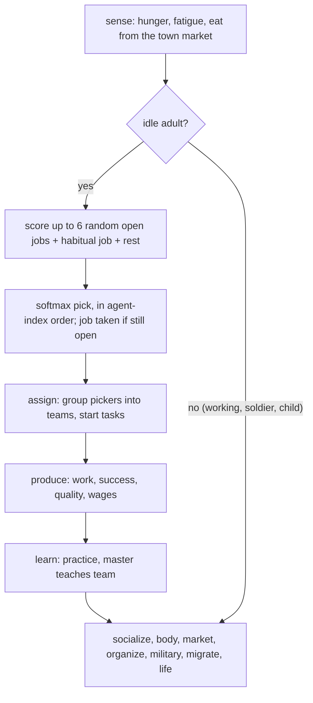
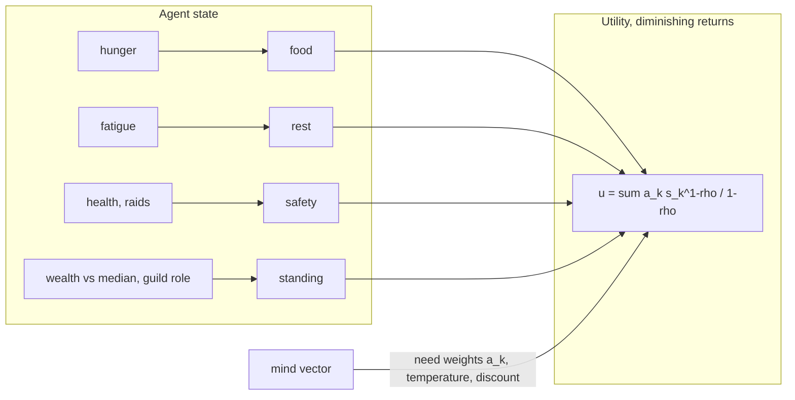
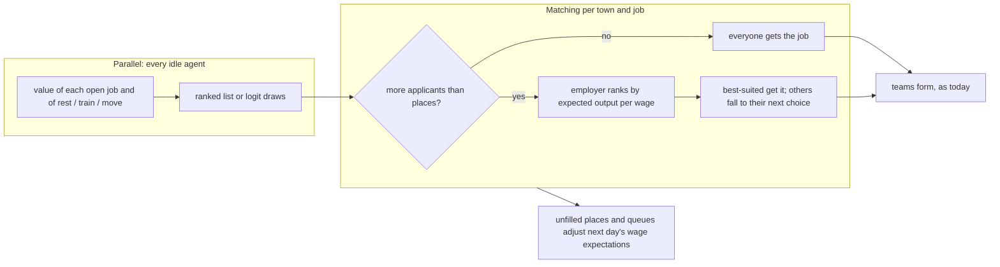
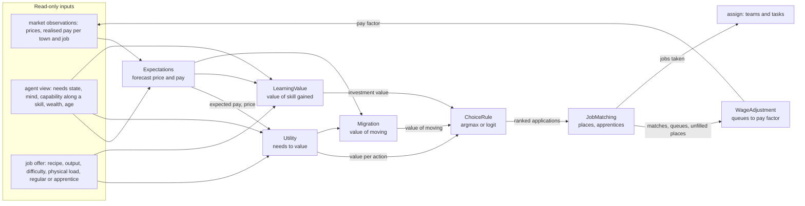
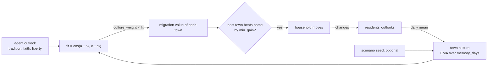

# Agent decisions: how they work today, and a more principled replacement

Status: **agreed direction** (2026-11-09). Nils's decisions are under "Decisions"
at the end; implementation follows the migration plan in (d).

## Summary

Today an idle agent picks a job by scoring a handful of random job openings with a
hand-built feature vector (value, skill, effort, novelty, social, need). It weights
the features with a matrix of magic constants, samples by softmax, and then takes the
job if it is still open, in agent-index order. It works, and the economy is believable,
but it has three problems:

- The numbers have no economic meaning. "Value 1.2 + ambition × 1.0" can't be checked
  against anything.
- Different decisions (work, rest, learning, moving, eating) use unrelated rules, so
  they can't be traded off against each other.
- First-come picking means agent 0 gets first choice every day.

The proposal replaces this with one principle:

- **Each agent maximises expected utility over a short horizon.**
  - Utility comes from explicit needs (food, rest, safety, standing), each with
    diminishing returns.
  - Expected income is wage × the agent's own productivity, both read from the
    simulation (capability vectors, prices).
  - Learning is an investment that pays off later, discounted.
- **Choice is bounded-rational:** a logit, whose temperature and discount rate come
  from the agent's mind vector.
- **Jobs clear in a matching step,** not first-come.

The new model would arrive behind a switch in `models.ron` (`decision.model: Features |
Utility`), in small PRs, with tests comparing the two.

---

## (a) How decisions work today

### The daily loop



### Job choice (`systems/decide.rs`)

For each idle adult:

1. **Candidates:** `candidates = 6` random jobs from the town's open jobs, plus the
   agent's last recipe if still open, plus **rest**. A job is open when its inputs,
   nature and building slots allow at least one more worker.
2. **Features** of each job (one row each):

   | Feature | Formula | What it stands for |
   | --- | --- | --- |
   | value | `tanh((profit_per_day − town mean) / value_scale) × σ(6·margin)` | money, if you can do it |
   | skill | `σ(6·margin) − 0.5` | fit: chance of success, centred |
   | effort | `−(0.3 + physical load) × (0.5 + fatigue)` | tiredness cost |
   | novelty | `(1 − proficiency/mastery) × (margin > −0.3 ? 1 : 0.2)` | room to learn |
   | social | 1 if in the domain's guild, `charter_pull` if chartered | belonging |
   | need | `food_out × 0.25 × food scarcity × (0.5 + hunger)` | feeding the town |

   Here `margin = (capability · skill + physique bonus) × state factor − difficulty`.
   Rest has its own feature row: `[0, 0, 1.5·fatigue, 0, 0, fatigue]`.
3. **Weights:** `w = bias + mind_weights · mind + state_weights · state`, a 6×8 and a
   6×4 matrix of hand-set constants (`models.ron`, `decision`).
4. **Pick:** softmax over `w · features` with `temperature = 0.25`, using the agent's
   own random stream.

Since #20, every agent scores every open job in parallel. The picks then happen in
agent-index order. A job that fills up drops out for everyone later in line.

### Other decisions, each with its own rule

| Decision | Rule today | Where |
| --- | --- | --- |
| Eat | if hunger > `eat_threshold`, eat the best food in stock, pay the price if you can | `needs.rs` |
| Rest | an option in job choice; resting recovers fatigue | `decide.rs`, `needs.rs` |
| Learn | never chosen: a side effect of working (practice) and being taught | `work.rs` |
| Join a guild / buy a tool | proficiency over a threshold; buy the best affordable tool, on credit | `organize.rs` |
| Migrate | 5% of idle adults a month compare towns: food, own trade's price, outlook, danger, distance, trusted people; move if gain > `min_gain` | `migrate.rs` |
| Have children | food foresight and age, not a choice | `life.rs` |
| Soldier | recruited by the town, not a choice | `military.rs` |

### Known artefacts

- **Magic constants with no units:**
  - 66 weights in two matrices, plus `value_scale`, `temperature`, and the 0.25,
    0.3, 6.0 and 1.5 inside the features.
  - Tuning one changes everything, and none can be checked against data.
- **Value is relative to the town mean,** squashed by `tanh`. An agent can't tell a
  job that pays 3× from one that pays 30×.
- **Money is not utility:**
  - Wealth never enters the job choice. A rich agent works as hard as a poor one.
  - Savings only matter through the wealth tax.
- **Learning is accidental:** "novelty" rewards unfamiliar jobs, but nothing
  compares the cost of being bad at a job now with the pay of being good at it later.
  Schools and guilds do the real work.
- **First-come picking:**
  - Agent 0 picks first every day.
  - Popular jobs fill with whoever happens to be early, not with the best-suited
    workers.
  - Wages don't adjust to how many people want a job; only capacity limits it.
- **Separate rules can't trade off:** an agent can't decide to move to a richer town
  *instead of* retraining, or to rest because it is rich.
- **Temperature is global:** every agent is equally noisy. The mind vector only tilts
  the weights.

---

## (b) A principled replacement

### Utility from needs

Each agent `i` has needs `k ∈ {food, rest, safety, standing}` with satisfaction
levels `s_k ∈ [0, 1]` derived from its state:

- food = 1 − hunger
- rest = 1 − fatigue
- safety = health, and no raid this year in its town
- standing = wealth relative to the town's median, plus guild role

Utility is a weighted sum with **diminishing marginal utility** (constant relative
risk aversion):

```text
u(s) = Σ_k a_k · (s_k^(1−ρ) − 1) / (1 − ρ)        (ρ > 0; log at ρ = 1)
```

- `a_k` are need weights from the mind vector. For example, ambition raises
  standing, and sociability raises standing through guild membership.
- `ρ` sets how strongly a short need dominates. A starving agent cares about little
  but food.

Money matters only through what it buys: next period's food (at the town's price),
rest (not working), and standing. That puts wealth into every decision, consistently.



### Expected value of an action over a short horizon

An action is: work at job `j`, rest, train (study or apprentice), or move to town
`m`. Its value is the expected utility over a horizon `H` of a few weeks, discounted
by `β` per day:

```text
V(action) = Σ_{d=0..H} β^d · E[ u(s_{d+1}) | action ]
```

with a simple forecast of the state:

- **Expected income from job j:**
  `E[pay] = p_success(i, j) × wage_j × output_j`.
  - `p_success` comes from the capability vector (the sigmoid already used in
    `produce`).
  - `wage_j` is the agent's *expectation* of pay per unit of value, learned from
    experience (below).
  - `output_j` is the recipe's output at the agent's *expected* price.
- **Effort:** working adds fatigue `(0.5 + physical load)`, so the rest need falls,
  and its marginal utility rises with fatigue.
- **Learning as investment:**
  - Working at `j`, or training, raises the capability along `j`'s skill by the
    known practice rule.
  - The value of that is the discounted extra income it brings in the jobs the agent
    expects to do later: `Σ β^d × Δp_success × wage × output`, for the best of those
    jobs.
  - This replaces "novelty". Young agents (long horizon, low `β` discounting) invest;
    old agents don't.
- **Moving:**
  - The same income forecast with the destination's prices and food, minus a one-off
    utility cost for the road and leaving ties.
  - This replaces migration's separate weights, and lets an agent compare moving with
    retraining.
- **Eating:** stays mechanical (hunger above a threshold), but buying food now
  competes with saving for standing. A poor agent eats; a rich one also eats, because
  food utility dominates when hungry.

**Adaptive expectations:** each agent keeps smoothed expectations of the prices and
pay it has seen (exponential moving averages: `E_t+1 = E_t + λ (observed − E_t)`, with
`λ` from curiosity). Agents react to market signals with a lag, and agents in
different towns can disagree. That is a source of realistic mistakes.

### Bounded rationality: logit choice from the mind

```text
P(action) ∝ exp(V(action) / τ_i),     τ_i = τ_0 × (1 + risk − diligence)
```

- Diligent agents choose sharply; risk-takers explore.
- Discount `β_i` comes from ambition (patient, long-horizon agents invest in skills).
- The 66 constants shrink to a handful with meaning:
  - need weights per mind axis
  - `ρ`
  - `τ_0`
  - `H`
  - `β` range
  - `λ`

### Job matching instead of first-come



- **Deferred acceptance** (Gale–Shapley) between agents (by their logit-sampled
  preference order) and job openings (by applicants' expected output). Results don't
  depend on agent index, and the best-suited workers get scarce places.
- **Wage signal:** queues for a job and unfilled places feed back into everyone's
  expected wage for it. That gives a soft labour-market clearing, and nobody sets a
  wage directly.

---

## (c) What changes, what stays, and what it costs

**Stays:**
- capability vectors, practice and teaching
- recipes, prices and the money ledger
- teams, trust and guilds
- every player and AI lever (they act on prices, pay and demand, which now feed
  expected utility directly)

**Changes in emergent behaviour (expected):**
- **Wealthier agents rest more and work less;** poor and hungry ones take any work.
  Income inequality now affects labour supply.
- **Young agents invest in skills** where future pay is high. Old agents stay put.
  Schools and charters still matter, now as cheaper or faster learning.
- **Migration and retraining compete:** depressed towns lose young skilled workers
  first.
- **Better matching:** a scarce smithy slot goes to the best smith, not the first in
  line. Production quality should rise somewhat. It's not guaranteed: if expectations
  are wrong, matching can be worse.
- **Wage and price lag:** agents chase last month's prices, so cobweb cycles become
  possible. We'll need to watch for oscillation, as with the AI governors.

**Determinism and parallelism:**
- Values for all idle agents are computed in parallel from a snapshot, with each
  agent's counter-based random stream, as today.
- Matching is a deterministic algorithm over sorted lists. It is per town and job, so
  towns can run in parallel.
- Same seed gives the same hash, whatever the thread count, as now.

**Performance at 50k agents (estimate):**
- **Today:** decide takes about 8–9 ms per tick, roughly 3 ms scoring and 5 ms
  picking.
- **Valuing actions:**
  - About 50 open jobs × a short horizon. With the horizon solved in closed form (a
    geometric series), each job costs about as much as today's feature row.
  - Plus about 4 non-job actions.
  - So roughly 3–5 ms in parallel.
- **Deferred acceptance:** O(applications) per town, about 30k agents × a few
  proposals. Roughly 2–4 ms single-threaded, less per town in parallel.
- **Expectations:** a small array per agent (prices of goods it cares about). Memory
  is about 50k × 47 floats ≈ 9 MB; cap it to the goods of the agent's town if needed.
- **Net: likely similar to today,** about 6–10 ms. I'll measure at each PR.

---

## Module boundaries

Decision-making is built from separate components, each behind a trait in
`sim_core::decision`. Each is chosen in `models.ron`, the same way the existing models
(`team_pooling`, `learning`, `diffusion`, ...) are today, and each has its own params
block and its own unit tests. A component sees only its inputs below. It doesn't
reach into the agent store or another component's internals. The decide, matching
and wage systems wire them together.



| Component | Trait input | Trait output | Implementations |
| --- | --- | --- | --- |
| Expectations | the agent's last expectation, an observed price or pay, the agent's curiosity | the new expectation | `Fixed` (use the current price), `Adaptive` (EMA with rate from curiosity) |
| Utility | needs state, need weights from the mind, a planned change to the needs (food bought, fatigue added, standing gained) | utility value | `Crra { rho }` |
| LearningValue | skill gain along a skill, expected pay of jobs using it, horizon, discount | present value | `None`, `Discounted { horizon_days, discount }` |
| ChoiceRule | values per option, the agent's temperature, a random stream | chosen option, or a ranked list for matching | `Argmax`, `Logit { base_temperature }` |
| WageAdjustment | applicants, places, current factor | new factor | `Fixed`, `ExcessDemand { step, min, max }` |
| JobMatching | ranked applications per agent, places per job, apprentice places | matches | `FirstCome` (today's), `DeferredAcceptance { apprentice_wage, apprentice_share_min, apprentice_share_max }` |
| Migration | the value of staying vs. moving to each town | value of each move | `Weighted` (today's migrate rule), `Utility` |
| Subsistence | a finished food run, the workers, their larders | food kept per household, food cover of a food job | `None`, `Keep { share, larder_meals }` |
| Crowding | a town's land plots, buildings and residents | daily rent per adult | `None`, `Rent { base, per_plot, per_building, rate, exponent, sticky_days }` |
| Culture | an agent's outlook, a town's culture vector | fit, -1..1; the town's culture after a day | centred cosine; EMA over `memory_days` |

**Today's model stays as one implementation:**
- `decision.model: Features` keeps the current feature-matrix scoring, with
  `JobMatching::FirstCome`, `WageAdjustment::Fixed` and `Migration::Weighted`.
- `decision.model: Utility` composes the new components.
- Components can be mixed: for example `Features` scoring with `DeferredAcceptance`
  matching, to test one change at a time.

All seven implementation PRs keep this structure: each adds or changes one component
(plus its params block and tests) and the wiring that uses it.

## (d) Migration plan

Everything is behind `decision.model: Features | Utility` in `models.ron`. `Features`
stays the default until `Utility` wins on the comparisons below.

1. **Expectations:** per-agent price and pay expectations (EMA). They are recorded in
   both models but not yet used by `Features`. Test: expectations converge to steady
   prices.
2. **Utility function and needs:** `u(s)` with need weights and `ρ` from the mind,
   pure functions with unit tests (monotone, concave, starving dominates).
3. **Utility job choice:** value = expected income utility + effort, logit with the
   mind temperature, still picked first-come. Tests:
   - side by side with `Features` over 40 years on 3 seeds
   - population, hunger, ECI, eras and output within agreed bands
   - wealthier agents work fewer days
4. **Learning as investment:** the discounted skill-gain term. Test: young agents take
   more training jobs than old ones, and schools still beat no school.
5. **Matching:** deferred acceptance replaces first-come in both models. Tests:
   - order-independence: shuffling agent indices gives the same set of matches, up
     to equal-score ties
   - scarce places go to higher expected output
6. **Moving as an action:** fold migration into the same valuation (behind its own
   switch). Test: migrants still follow demand; closed borders still keep them out.
7. **Switch the default** to `Utility` if the comparisons hold, and remove the old
   matrices a release later.

Each step is a small PR with its own tests and a before/after table, merged when CI is
green.

---

## Decisions (2026-11-09)

1. **Horizon: weeks.** Agents plan a few weeks ahead (`H` ≈ 30 days), plus the
   discounted skill-investment term for learning.
2. **Hiring: apprentice places, the rest by expected output.**
   - Workplaces (a town's buildings of one kind, or the guild of their domain) offer
     **apprentice places** besides their regular places.
   - Apprentices are paid less: an `apprentice_wage` factor in `models.ron`, e.g. 0.4
     of the regular pay for the job. They also learn faster from the masters they
     work beside (teaching already exists).
   - **How many apprentice places is the workplace's own economic choice,** within
     `apprentice_share_min`..`apprentice_share_max` from `models.ron`. Each month it
     compares:
     - **cheap labour now:** an apprentice's expected output × price − the
       apprentice wage, against a regular worker's output − the regular wage
     - **a skilled worker later:** the discounted extra output once trained, counted
       only for the share expected to stay in the town (trust and guild ties raise
       it)
     - It adds apprentice places while that sum is positive and the town is short of
       skilled hands in the domain, and removes them otherwise.
   - Applicants say whether they apply as apprentice or regular worker. That is
     their own utility choice: lower pay now, faster skill growth, better pay later.
     It falls out of the learning-as-investment term.
   - **Regular places** go to the applicants with the highest expected output;
     **apprentice places** go to the applicants with the most to gain (lowest current
     skill, highest aptitude), so beginners get a way in.
3. **Pay follows market forces.**
   - Each job's pay is no longer a fixed share of value added.
   - A per-town, per-recipe **wage factor** multiplies the town's base wage share.
     Every day it moves by a small step against the excess demand for regular places
     ((applicants − places) / places), clamped to a range in `models.ron`.
   - A job with a queue pays less. A job with unfilled places pays more, up to its
     value added.
   - Apprentice pay is `apprentice_wage` × that job's current pay, so it follows the
     market too.
   - The player's and governors' `wages` lever sets the **base** share; the market
     factor rides on top.
   - Agents' expected pay learns from realised pay: queue → wage → expectation →
     choice.

The migration plan changes accordingly:

- **5. Flexible pay:** wage factor per town and job. Tests:
  - a queued job's pay falls, an understaffed job's pay rises
  - the ledger still balances
  - pay stays in range
- **6. Matching with apprentice places:**
  - deferred acceptance for regular places by expected output
  - apprentice places by gain, at `apprentice_wage`
  - the workplace's monthly choice of its apprentice share
  - Tests:
    - order-independence
    - scarce regular places go to higher expected output
    - apprentice share stays within its bounds and grows when trained workers are
      short and worth more
    - beginners get into trades they couldn't enter by output alone

## Subsistence, crowding and culture (2026-11-09)

Three additions came from comparing the utility model with today's. With all three
in place, Utility + matching + subsistence matches today's population with no
hunger (PRs #30, #31 and the culture PR).

- **Subsistence** (`decision.subsistence`): food workers' households keep a share of
  each edible output in a small larder and eat from it before buying. Kept food is
  pay in kind: it counts as produced, the team is paid only for what it delivered,
  overflow goes to the town, and a dead agent's larder returns to the town. In the
  utility valuation, a food job also covers the worker's own food need.
- **Crowding** (`decision.crowding`): a town's housing comes from its land and its
  buildings. Each adult pays rent that rises with residents per place to live, into
  the treasury (ledger flow `Rent`). Rents are sticky (they follow crowding over
  about two months). Job choice values wealth after the coming weeks' rent, and
  utility migration counts rent against pay.
- **Culture** (`decision.culture`):
  - **The agent's culture vector** is the ideological block of its mind (tradition,
    faith, liberty). These axes already change through social influence, pass to
    children and steer partner choice, so culture is what people believe, not a
    label. New ideological axes added to the mind block become culture axes
    automatically.
  - **A town's culture vector** is bottom-up. Every day it moves toward the average
    outlook of its residents, with a time constant of `memory_days` (365). A town
    therefore keeps its character when newcomers arrive and changes only as they
    settle in. A scenario may seed it per town (`culture: Some([t, f, l])`), and the
    founding residents are drawn around the seed.
  - **Fit** is the centred cosine of the two vectors, each measured from the neutral
    point 0.5. It is 1 for the same outlook, 0 for unrelated or neutral, and -1 for
    opposite.
  - **One culture term in migration.** Fit replaces the old "outlook closeness"
    (1 − Euclidean distance to the residents' current mean) in both migration
    rules, with its own weight (`culture_weight`).



### Migration rework

**Utility migration has four weighted terms** (`decision.migration: Utility((...))`):

V(town) = economy_weight × E + culture_weight × fit + social_weight × S + safety_weight × Z + welcome − distance_cost × road / 1000

- **E, economic strength:** the utility of the agent's needs there. It uses wealth
  plus (pay of the agent's own trade − rent) over the horizon, and food per head
  against `food_reference`. Crowding enters here through rent, not as a separate
  term.
- **fit:** culture fit (above).
- **S, social network** = 1 − exp(−(trust in people there + `kin_tie` × family
  there)). Family means parents and children outside the household. Friends and
  family at home make leaving costly.
- **Z, safety:** a raid lost this year and people lost (fallen or carried off, per
  resident) threaten a town; its soldiers (against `guard_share` per resident)
  halve the threat at full strength.
- Defaults: economy 1.0, culture 1.0, social 0.4, safety 0.4. Economic strength and
  culture are the main terms. `min_gain` (0.3 per adult) and the road's cost are the
  threshold against hopping.

**Households decide as a unit (both rules).**
- The household is the agent, an idle partner at home and their dependent children.
- Each member values each town with its own outlook, ties, trade and needs.
- The household sums the values, with children weighted by `child_weight` (1).
- It moves to the best town it knows if the sum beats home by `min_gain` per adult.

**Limited knowledge** (`decision.knowledge: Limited(...)`, the default for both
rules). Agents only weigh towns they know at least `min_known`. Knowledge is the
largest of:
- their social network there
- trade between home and the town (hearsay, at most `trade_known` = 0.4)
- the memory of having lived there, which fades over `memory_days`

Estimates of pay and food are off by up to `noise` × (1 − knowledge), one draw per
household and town. `All` restores full knowledge.

Optional, not built yet (only if the numbers need them): move propensity falling
with age and owned workshops or guild rank, and admission caps from the immigration
lever and free housing.

**Results (20 years, 4 seeds):**

| setup | pop | starve % | gini | moves |
| --- | --- | --- | --- | --- |
| default (Weighted), agent decides alone, all towns known (#33) | 1989 | 0 | 0.60 | 196 |
| default (Weighted), household + knowledge | 1984 | 0 | 0.65 | 60 |
| Utility + matching + subsistence + four-term migration | 2008 | 0 | 0.34 | 65 |
| same, crowding Rent(rate 0.3) | 2054 | 0 | 0.37 | 720 |

In the utility setup, town sizes at year 20 (seed 42) are 517 / 503 / 512 / 412:
no town absorbs everyone.

Moving is rare once households decide together. Both partners must gain on
average, and home holds their friends, family and culture. Lowering `min_gain`
barely changes this, because most households simply see no better town.

Rent at rate 0.3 is too strong against typical wealth under utility migration and
causes heavy hopping, so crowding stays off.
