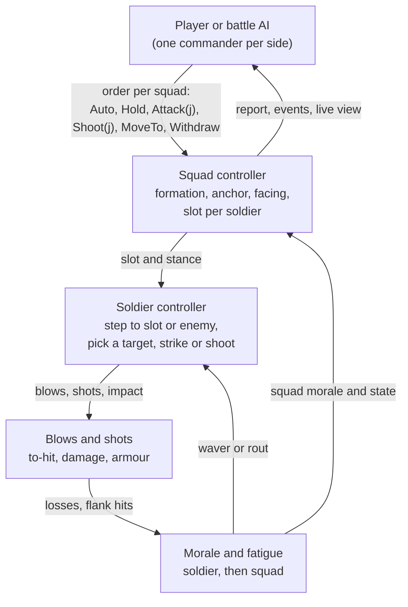

# Per-soldier battles

Design note for Phase 6, step 1: a headless battle in which every soldier is
simulated. It is written for review, and none of it is built yet.

## Goal

Today's battle (`sim_core/src/battle/`, squad battles since PR #94) moves
squads as discs and settles each step with dice per squad. Flanks, fronts and
formations exist only as flags: a squad is "flanked" when an enemy it does not
face is in contact, and its front is `min(alive, frontage / spacing)`.

The war redesign note ("Econoplex war redesign", 13 Nov) chose squads as the
unit of war, and set direction A aside: "per-fighter duels stay out unless
squads prove too coarse". Phase 6 brings A back as a **second battle model**
under the same squads:

- Squads stay the unit the player and the AI command, raise, feed and pay. Only
  the battle inside them changes.
- Every soldier has a place, a facing, a morale, a fatigue and their own kit.
  A flank attack, a broken line, a tired army and a wedge come out of those
  positions, not out of a flag.
- The model aims at thousands of soldiers (the plan's target) at the speed of
  the live battle.

The rules of the squad model carry over unchanged in spirit: kit gives reach,
damage and armour; experience counts heavily; morale starts from needs; a
braced spear wall turns a charge; walls narrow the front to the breach. The
existing matchup tests must still pass on the new model.

## Where it sits

The new model lives in `sim_core/src/battle/soldiers/`, next to the squad model.
It takes the same inputs and gives the same outputs:

- **In:** `BattleParams`, `Field`, `Vec<SquadSpec>`, a seed, and orders between
  steps.
- **Out:** `Report`, `ReplayFrame`, `LiveView` and the members read back with
  their health and experience.

So `systems/military` (raids, the planner, live battles), `--battle` and both
clients do not change in step 1.

`models.ron` chooses the model with `battle.model: Squads | Soldiers`. This
follows the standing rule that a component stays swappable, so a seed sweep can
compare the two models. The default stays `Squads` until the budget below has
been measured on real raids.

`Battle` becomes an enum over the two models with the same methods. That is not
a compatibility shim: both models stay real options.

## Data per soldier

Soldiers are stored in arrays indexed by soldier: the fields every substep
reads of each soldier in one 64-byte struct per soldier (`Soldier`: place,
facing, velocity, morale, fatigue, cooldown, body, slot, kit, squad, arrows,
state and side), the rest in an array each (see "Packed soldiers" below). A
soldier is never an ECS entity: the battle runs outside the world, as today.

| Field | Type | Meaning |
| --- | --- | --- |
| `pos` | `Vec2` (m) | position on the field |
| `facing` | `Vec2`, unit | where they look. Kept as a vector, so the hot path needs no `sin` or `cos`. |
| `vel` | `Vec2` (m/s) | last step's velocity, used for charges and impact |
| `health` | `f32` | the share of hit points left: 1 is unhurt, ≤ 0 is down, ≤ −1 is dead outright; the rest of the down roll after the battle (see "Combat rules", as `Member.health`) |
| `morale` | `f32` 0..1 | the soldier's own nerve. It starts at the squad's morale. |
| `fatigue` | `f32` 0..1 | 0 is rested, 1 is spent. It starts from the person's `fatigue` state. |
| `kit` | `u16` | index into the battle's kit table (below) |
| `squad` | `u16` | the squad they belong to |
| `slot` | `u16` | their place in the squad's formation (file and rank) |
| `bonus` | `f32` | attack bonus before exhaustion: proficiency + the weapon's quality (see "Combat rules") |
| `max_hp` | `f32` | hit points unhurt: `hit_points` + `hp_per_experience` · ln(1 + battles) |
| `seasoned` | `f32` | initiative from experience: `initiative_experience` · ln(1 + battles) |
| `restrained` | `bool` | in a crush last substep (pressed by `crush_bodies` bodies or more) |
| `target` | `u32` or none | the enemy they are fighting |
| `cooldown` | `f32` (s) | time until their next blow or shot |
| `arrows` | `u16` | arrows left |
| `state` | `u8` | Formed, Engaged, Wavering, Routing, Down, Fled |

That is about 72 bytes a soldier, so 4,000 soldiers take under 300 KB.

**Kit.** Each person's kit comes from their own items through
`Kit::from_gear`, as `setup_field_battle` already reads them per person. Kits
that are the same are stored once in a kit table, so a squad with mixed
equipment keeps the difference. A squad then has the best and worst swords, not
an average. The kit table also holds:

- **weight**, which feeds fatigue;
- **mass**, for charges: a horse and rider is about 600 kg, a man about 80 kg.

**Damage types.** The soldier model uses the same split as the squad model,
from the content's `fight` values (PR #178):

- **A blow and a shot have a type.** A weapon's melee `damage_type` and its
  missile `shot_type` are each `Pierce`, `Slash` or `Blunt`. Spears, lances
  and arrows pierce, swords slash, clubs and maces are blunt. Fists are blunt.
- **Armour resists some types:** a piece's `resist` list halves those types
  and its `vulnerable` list doubles them (`FightDef::taken`); layers multiply
  per type, as in `Kit::from_gear`. Armour also adds to armour class (see
  "Combat rules").
- **The damage of a hit** is the weapon's dice times what the armour lets
  through of its type, as in `Kit::blow` and `Kit::shot`. A charge's extra
  hit points split in the same shares as the blow.

The squad model has to average a squad's weapons into one share per type. The
soldier model needs no average: each soldier's blow carries their own
weapon's type and lands on one target's own armour. Each kit-table entry holds:

- `dice`, `charge_dice` and `damage_type` for a blow, `shot_dice` and
  `shot_type` for an arrow, and the means per type (`damage`, `shot_damage`)
  the squad model uses;
- `ac`, `shield` and `taken` per type.

Phase 4 of a substep takes the striker's dice and the target's armour from
the kit table, so a blow costs an attack roll, a roll of the dice and one
multiplication, with no more lookups. The tests in the squad model ("mail turns swords better than spears",
"blunt beats slash against plate") also run on the soldier model.

**Fatigue.** This is new, because the squad model has none. It rises each
second by:

- `fatigue_run` × (1 + weight / `carry_kg`) while running;
- `fatigue_fight` while striking;
- `fatigue_walk` while marching.

It falls by `fatigue_rest` while standing out of contact.

Fatigue slows a soldier: their top speed and attack rate are multiplied by
(1 − `fatigue_effect` · fatigue), and each fifth of fatigue is a level of
exhaustion, a point off their attack rolls. A spent soldier also loses
morale faster.

An army that arrives after a forced march, or one whose soldiers did not sleep,
starts tired. This comes from the store's `fatigue` state, which
`setup_field_battle` passes through a new `Member.fatigue` field.

## The time step

- The soldier model steps in **substeps of 0.25 battle seconds**. A blow takes
  about a second, and a running man covers 0.75 m in a substep, less than the
  1 m spacing between soldiers. With 1 s substeps, runners would pass through
  each other.
- `Battle::step()` still advances one battle second: 4 substeps. `params.dt`
  stays the battle second that callers count in.
- The live battle (`live_battle.rs` in the 2D client, `BATTLE_SPEED = 6`)
  still steps 6 battle seconds per real second: 24 substeps. A paused game steps
  nothing, as today.
- Replays still record a frame every 5 battle seconds (`run_recorded(5.0)`).
  Each frame holds each squad's centre and the soldiers it has left, so the
  clients keep working. A later step can add per-soldier frames for the 3D
  crowd.

One substep runs in six phases. Phases 2 to 4 only read last substep's state
and write into per-soldier buffers, so they can run in parallel. Phases 3 and
4 run in one pass: each soldier's blow is rolled right after their plan.

1. **Grid.** Rebuild the spatial grid (below).
2. **Squad controllers.** Each squad's controller sets its formation, anchor and
   facing from its order, and gives every soldier their slot.
3. **Soldier controllers.** Each soldier picks where to step (their slot, an
   enemy, or away from the enemy) and whom to strike.
4. **Blows and shots.** Each strike rolls to hit and adds its damage to the
   target's incoming buffer. The roll uses the striker's own random stream.
5. **Apply.** In soldier order: damage, movement with collision, morale,
   fatigue and state.
6. **Squads.** Recount each squad's soldiers and morale, and give events to the
   `Report` (contact, charge, wavering, routing, out of arrows, fled).

## The spatial grid

A uniform grid of **4 m cells** covers the field: 600 × 400 m is 150 × 100
cells. A 3 m spear reaches no further than the neighbouring cells, so a melee
query reads at most 3 × 3 cells.

The grid is rebuilt every substep by a counting sort:

- count the soldiers in each cell;
- turn the counts into prefix sums;
- write the soldier indices into one array.

This costs O(n), needs no allocation after the first substep, and visits each
cell's soldiers in index order, so the result never depends on hashing or
thread timing.

The grid answers three queries:

- **Neighbours within 1 m**, for collision: soldiers push apart, and friends
  give way to the front rank.
- **The nearest enemy within reach**, for melee. Each cell is split by side,
  with the enemy side stored first.
- **Who stands where an arrow lands**, for shots. A shot aims at a point with
  scatter that grows with range and falls with skill, then hits whoever is in
  that cell. A shot into a melee can then hit friends. That replaces today's
  "never shoot into a melee" rule. It can be switched off with
  `friendly_fire: false`.

Walls are a line of blocked cells with a gap of `breach_width`. Attackers can
only reach the defenders through the gap. So the breach narrows the front
because the attackers cannot fit through it, not because a front count is
capped.

## Controllers and formations

Command has four levels. Each level only sets goals for the level below it, and
the soldier level is where blows land.



**Commander, one per side.** This is the player in a live battle, or the auto
commander, which is today's `auto_goal` judgment lifted to the side. Orders are
`Order`, a list per squad carried out in turn, shaped for RTS control (step 5,
"Battle controls"). Going round a squad's side and setting a front are moves
(`MoveTo` with a facing and a width), not orders of their own. A side's
doctrine sets how the auto commander goes about it.

**Squad controller.** It turns the order into an **anchor** (the centre of the
front rank), a **facing** and a **formation**. Each soldier's slot is then:

> anchor + rotate(facing) · (file · spacing, −rank · spacing)

| Formation | Shape | Who uses it on Auto |
| --- | --- | --- |
| Line | `frontage` wide, as many ranks as it takes | infantry |
| Column | 4 wide | marching to a goal far away |
| Wedge | a triangle, point at the front | cavalry charging |
| Braced | Line, with the front ranks kneeling and facing the threat | spears under `Hold`, or when riders come within 200 m |
| Loose | Line at 3 m spacing | archers and skirmishers, or any squad in loose order |

When soldiers fall, the controller fills the front from the rear rank: slots are
reassigned by a stable sort on rank, then on file. So a squad gets thinner and
shorter, but no gap stays open in its front unless the whole squad is gone.

The squad controller also judges as today: archers stand and shoot in range,
riders steer clear of a spear wall, a routing squad runs for its edge of the
field.

**Soldier controller.** This is a small state machine per soldier:

- **Formed.** Steer to the slot.
- **Engaged.** An enemy is within reach, or within 2 m of the slot. Turn to them
  and strike when the cooldown allows. Hold the slot within 2 m unless the
  enemy steps back.
- **Wavering.** Fight at the morale factor, as today.
- **Routing.** Turn and run from the nearest enemy, toward their own edge of the
  field. A routing soldier does not parry.
- **Down.** Lie where they fell. The squad keeps their health for
  `settle_field_battle`.

**Where flanks come from.** A blow is a flank blow when it comes from more than
90° off the target's facing, and a rear blow beyond 135°:

- a flank blow meets no shield and no parry;
- a rear blow also does more damage;
- each blow from the side or rear drains the target's morale by `flank_drain`.

There is no "flanked" flag. A squad hit in the side loses its outer files and
its nerve from that side inward.

**Charges.** On first contact, the impact comes from the charger's mass and
closing speed. A braced spear in front of the charger strikes first, with that
speed: today's rule, but per soldier, and only where a spear point actually
meets the horse. So a charge that hits a braced wall in the flank goes through.

**Morale.** A soldier's morale falls when:

- they are hit, or hit from the side;
- friends within 5 m fall or rout;
- their fatigue rises.

It rises again when they stand quiet next to formed friends, or within 15 m of
the squad's leader (its most experienced member).

The squad's morale is the mean of its soldiers' morale. A squad routs when it
falls below `rout_at`, as today. Single soldiers can also break earlier, so a
squad frays before it breaks.

## Randomness

- Every random draw comes from a counter-based stream: SplitMix64, as
  `AgentRng` already is. It is seeded by battle seed, substep, soldier index
  and purpose (to-hit, damage, scatter, where they step). A ChaCha stream is no
  longer shared across the battle.
- So a draw depends only on who draws it and when, never on the order soldiers
  are processed in or on threads. Phases 2 to 4 can run on rayon and give the
  same battle as a single thread. A test checks this.
- Damage is summed into per-soldier buffers and applied in soldier order in
  phase 5. Two blows on one soldier in the same substep give the same result in
  any order.
- Floats stay deterministic on one binary and one platform. The hot path uses
  only `+ − × ÷`, `sqrt`, `min` and `max`. The to-hit curve uses `exp`, as
  today, which can differ between platforms in the last bit. The state hash is
  compared on the same platform, as today.
- Same seed and same orders give the same battle. Tests run many seeds, never
  one lucky seed.

## Performance budget

**Today's squad model, measured.** These are release builds of
`econoplex-sim --battle`, 50 seeds each, wall time per battle including start-up:

| Line-up | Soldiers | Battle lasts | Per battle | Per battle second |
| --- | --- | --- | --- | --- |
| `swordsmen*30 vs spearmen*30` | 60 | 4 min | 0.2 ms | ~1 µs |
| 3 mixed squads of 40 a side | 240 | 6 min | 0.7 ms | ~2 µs |
| 5 squads of 40 swordsmen a side | 400 | 4 min | 1.5 ms | ~6 µs |
| `swordsmen*400 vs swordsmen*400` | 800 | 8 min | 3.8 ms | ~8 µs |
| `swordsmen*2000 vs swordsmen*2000` | 4,000 | 27 min | 77 ms | ~48 µs |

The squad model's cost grows with the hits, because `hit()` collects the
standing members for each one. That is why 4,000 soldiers cost 48 µs a second,
not 8.

The table also shows something the soldier model should fix. Equal single
squads of 400 or 2,000 are not even: the defenders win 48 and 49 of 50,
although both sides advance on `Auto`. The cause is not known yet. Five squads
of 40 a side split 23 to 27.

**Budget for the soldier model.** It must hold these on one core, with a
4,000-soldier battle (2,000 a side, about 50 squads of 40) as the yardstick:

| Use | Battle time | Budget | Per soldier per substep |
| --- | --- | --- | --- |
| Live battle, 6 battle s per real s | 1 battle s | **≤ 1 ms** (6 ms of every real second) | ≤ 60 ns |
| `--battle`, one auto-resolved battle | about 30 min | ≤ 2 s | same |
| `--battle --seeds 50` | 50 × 30 min | ≤ 2 min single-threaded, ≤ 20 s on 8 threads | same |

So the soldier model may cost about 20 times the squad model at 4,000 soldiers.
It must not cost more than 1 ms per battle second.

**What stays on the squad model.** The war planner's forecasts (`FORECASTS =
3` per possible raid, every muster) and the economy's auto-resolved raids stay
on squads, because they are cheap. A forecast is a guess, so it may use the
cheaper model. Whether auto-resolve moves to soldiers waits for a 40-year
comparison of time per tick and of outcomes.

**How it is measured.** `econoplex-sim --battle L --profile` prints:

- soldiers;
- substeps;
- ms per battle second, for each phase (3 and 4 together, as they run in one
  pass);
- the squad model's figure for the same line-up.

A test in `sim_core/tests/battle_budget.rs` checks the 4,000-soldier budget,
the best of three runs on one core. It runs with `cargo test --release`; debug
builds skip it. It is an integration test so that it times the library as it
ships, not the build of it that carries the unit tests.

## `--battle`

- The line-up syntax stays as it is. `--battle-model squads|soldiers`
  overrides `models.ron`.
- `--compare` runs both models on the same seeds and prints both win rates.
  That is the tool for checking that the soldier model keeps the squad model's
  matchups.
- Two new squad suffixes:
  - `%F`, starting fatigue 0..1 (`swordsmen*100%0.8` is a tired squad);
  - `#flank` or `#rear`, which deploys the squad on the enemy's side or behind
    them, already facing in.
- `--profile` prints the timings above. `--seeds N` prints win rates, as today.

Example:

```
econoplex-sim --battle "swordsmen*100,swordsmen*100#flank vs swordsmen*100,swordsmen*100" \
              --battle-model soldiers --seeds 50 --compare
```

## Tests

These are new, in `battle/soldiers/tests.rs`. Each runs many seeds and checks a
rate with room for chance:

- **Equal armies win about half the time.**
  - `swordsmen*200 vs swordsmen*200`, both sides on `Auto`, deployed as mirror
    images: over 100 seeds, side 0 wins 35 to 65.
  - With the sides swapped, the rate stays within 10 of that.
  - The same holds at 2,000 a side, which the squad model fails today.
- **A flank beats a frontal attack.** Two squads of 100 swordsmen a side.
  - Frontal: side 0's second squad attacks beside its first.
  - Flank: it starts with `#flank` and attacks into the enemy's side.
  - Over 50 seeds, side 0 wins at least 40 battles with the flank and at
    least 15 more than frontally on the same seeds, and the enemy loses more
    soldiers. (The frontal attack is a mirror, so it wins about 25 of 50; a
    margin of 25 would ask the flank to win every battle.)
- **Rested beats exhausted.** `swordsmen*100 vs swordsmen*100%0.8`: the rested
  side wins at least 40 of 50. At fatigue 0.4 it still wins more than half.
- **The squad model's matchups still hold on the soldier model:**
  - a spear wall stops a charge;
  - cavalry rides down archers;
  - arrows break a levy;
  - swords get inside spears;
  - veterans beat more recruits;
  - walls hold the breach;
  - hungry squads break first;
  - routed squads leave the field;
  - orders change the battle.

  These are today's tests in `battle/tests.rs`, run on both models.
- **Determinism:**
  - same seed, same battle;
  - the same battle on 1 thread and on 8;
  - stepping 1 s at a time gives the same battle as `run()`.
- **Formations:** a squad that loses its front rank refills it from the rear. A
  braced line facing riders turns to face them.
- **Budget:** 4,000 soldiers stay within 1 ms per battle second (release
  builds only).

## Build order

1. **This note.** Then the model on its own: data, grid, controllers, blows,
   morale and fatigue, behind `battle.model`. Add `--battle-model`, `--compare`
   and `--profile`, and the tests above. No client changes.
2. Tune until `--compare` keeps the squad model's matchups and the equal-armies
   test holds at every size.
3. Live battles on the soldier model, in both clients: the panels stay, and the
   squads are drawn from their soldiers' positions.
4. Per-soldier replay frames, for the 3D crowd (`crowd.rs` can take one
   record per soldier). Done: see "Steps 4 and 5" below.
5. Going round a flank and setting a front from the battle panels. Done, as
   an order API for RTS control (see "Battle controls").
6. A 40-year comparison of auto-resolve on soldiers against squads. Switch the
   default only if it is affordable and the outcomes make sense.

## Where steps 1 and 2 stand

The model is in `battle/soldiers/`, behind `battle.model` (default `Squads`).
Tuning added a few rules that the note above did not name:

- A squad starts facing the enemy army as a whole, not the nearest squad, so
  `#flank` meets an enemy that has to wheel.
- A soldier turns at `soldier_turn` radians per second. A blow from a side
  they have not turned to yet is a flank blow.
- Any steady soldier who arrives at a run charges, not only one who is still
  formed. Before this, only the point of a wedge charged.
- Seeing a foe break gives a soldier heart (`foe_breaks`). Without it, two
  squads often broke together, and a draw goes to the defenders: mirror images
  split 37 to 63.
- Two counts per squad. Cohesion counts only the fallen, so a rout does not
  feed on itself. Refilling the ranks counts everyone who left the line.
- Defenders on a wall strike over twice the breach width, and a man climbing
  through it cannot parry.

`--compare`, 50 seeds, side 0's wins (squads / soldiers):

| Line-up | Squads | Soldiers |
| --- | --- | --- |
| `cavalry*20 vs spearmen*30` | 0 | 1 |
| `cavalry*20 vs archers*30` | 50 | 47 |
| `levy*40 vs archers*30` | 0 | 0 |
| `swordsmen*30 vs spearmen*30` | 50 | 50 |
| `swordsmen*25+20 vs swordsmen*30` | 50 | 50 |
| `swordsmen*45 vs walls spearmen*30` | 0 | 0 |
| `swordsmen*30!0.3 vs swordsmen*30!0.9` | 0 | 0 |
| `swordsmen*100 vs swordsmen*100%0.8` | 22 | 50 |
| two squads a side, frontal | 29 | 24 |
| the same with `#flank` | 19 | 48 |
| `swordsmen*200 vs swordsmen*200` | 25 | 24 |
| `swordsmen*2000 vs swordsmen*2000` | 26 | 27 |

The equal-armies test holds at 200 and at 2,000 a side, also with the sides
swapped. The flank wins 46 to 48 of 50, 19 to 25 more than frontally, over
four sets of 50 seeds. The first bar, a margin of 25, could not be met: with the
frontal mirror near 25 of 50 it asked the flank to win every battle, so the
test now asks for 40 of 50 and a margin of 15.

**Cost.** Measured on a shared 4-core VM, timings vary about 15% from run to
run. The yardstick is 50 squads of 40 a side, a 6.4-minute battle:

| Measure | Budget | Measured |
| --- | --- | --- |
| ms per battle second, one core | ≤ 1 | 0.85 (best of 6) |
| ns per soldier per substep | ≤ 60 | 53 |
| one battle | ≤ 2 s | 0.33 s |

The soldier controllers and blows take 55% of the time, apply and the grid
15% each, the squad controllers and the recount 7% each. What brought it
within budget, from 1.24 ms and 77 ns on the same machine:

- A soldier standing in their slot with nobody to fight, or out of contact
  and within half a pace of it, does not look for friends to push off. The
  formation keeps them apart. This is the one change that moves soldiers:
  `--compare` over 200 seeds stays within chance (`swordsmen*200` a side 93
  then 101 of 200, `swordsmen*400` 97 then 102, `cavalry*20 vs archers*30`
  186 then 182).
- A soldier's blow is rolled in the same pass as their plan, and only blows
  that reach somebody are kept, in soldier order.
- The grid keeps a copy of each soldier's position in cell order, so a search
  reads positions in a row, and builds in one list with no clearing.
- Neighbour searches skip candidates beyond their radius before any other
  work, and use a closure rather than an iterator chain.
- A squad that is not in contact does not tally whom it fights.

## Step 3: live battles on soldiers

- `battle.live_model` in `models.ron` picks the model for battles the player
  watches and commands, apart from `battle.model`, which still fights
  auto-resolved raids, the planner's forecasts and `--battle`. It defaults to
  `Soldiers`, so watched battles fight soldier by soldier while auto-resolve
  stays on squads (`prepare_live_battle`).
- `LiveView` carries every soldier of each squad on the soldier model
  (`soldiers`, empty on the squad model): where they stand, the way they face,
  and whether they stand, run, lie fallen or have left the field.
- The squad's place in the frame is its soldiers' centre, so the panels and
  everything that reads the frame keep working.
- **3D:** each figure of a live battle stands where its soldier stands, facing
  their way. The fallen lie where they fell, runners grey, and those who left
  the field are gone. Replays keep the block formation until step 4.
- **2D:** zoomed in (below a zoom of 0.3, where a metre of field is over a
  pixel), every soldier is a dot where they stand. The fallen are a small
  cross, runners grey and blinking. Zoomed out, a block per squad at its
  soldiers' centre, as before. "Look at the field" zooms in that far, and the
  zoom now goes down to 0.05.
- Both clients take `--shot FILE --shot-battle S`: the screenshot waits for a
  live battle fought S battle seconds and looks at its field. The 3D client
  also takes `--order TEXT`, as the 2D one does, so a raid can be scripted.

## Steps 4 and 5: soldier replays, and orders for RTS control

**Replays.** A frame of a battle on the soldier model holds every soldier
(`ReplayFrame.soldiers`, empty on the squad model), so the live view and
replays share one form:

- each soldier is a `FrameSoldier` of six bytes: position to a tenth of a
  metre (two `i16`, so ±3.2 km), facing to 1/256 of a turn, and state;
- frames are still recorded every 5 battle seconds (`run_recorded(5.0)`);
- the clients play a soldier between two frames along the line, turning the
  short way (`Replay::soldiers_at`). The 3D client walks a figure per
  soldier (battles.rs `play_battles`, not `crowd.rs`: the battle figures are
  their own entities, and a replay holds a few hundred soldiers at once). The
  2D client draws dots when zoomed in, as for a live battle.

**Size.** Replays are not in saves: the battle log lives in memory and goes
to the view, and `save.rs` writes the simulation's entities only. So
`SAVE_VERSION` stays at 16. In memory, a soldier replay costs
6 bytes × soldiers × frames, plus 24 bytes per squad per frame. Measured
with `cargo test -p sim_core replay_size -- --ignored --nocapture` (seed 1):

| Battle | Soldiers | Battle time | Frames | Soldiers' bytes |
| --- | --- | --- | --- | --- |
| a raid, `swordsmen*30 vs spearmen*20` | 50 | 4.9 min | 60 | 21 KB |
| `swordsmen*200 vs swordsmen*200` | 400 | 6.9 min | 85 | 208 KB |
| the yardstick, 50 squads of 40 a side | 4,000 | 6.4 min | 78 | 2.1 MB |

The battle log keeps the newest 16 (`BattleLog::KEEP`), so even 16 yardstick
battles stay near 33 MB. Auto-resolved raids are on the squad model by
default (`battle.model`), so a default game records no soldiers at all.

**Orders.** Step 5 first added `Flank` and `Form` as orders of their own.
They were replaced before it was merged by an order API that the mouse
controls of an RTS (Total War) map onto directly (module `battle::control`,
"Battle controls" below). A squad takes a **list** of orders and carries
them out in turn (`Battle::set_orders`):

- `MoveTo { anchor, facing, width, run }`: go to `anchor` (the centre of
  the front rank), and stand there facing `facing`, `width` metres wide,
  from now on. `None` keeps the way it came and the width it has. A move it
  has reached (within 1 m) gives way to the next order.
- `Attack(j)`, `Shoot(j)`, `Hold`, `Withdraw` and `Auto`, as before.

Going round an enemy and taking a formation are no longer orders. They are
ways of making moves:

- **Flank** is `LiveView::flank(q, j)`: a move out to a lane 20 m clear of
  `j`'s end on the side nearer `q` (at a slant, halfway along, if `q` is still
  in front of it), a move to that lane a little behind `j`'s front, facing in,
  then `Attack(j)`. With the mouse, the same is shift-queued right-clicks
  and a right-click on the enemy.
- **Form** is `LiveView::reform(q, files)`: a move to where the front stands
  now, `files` wide, then the orders it had. With the mouse, it is a
  right-drag in place. The panels offer four fronts (`LiveView::FRONTS`):
  column (4 files), deep (10), line (20) and wide (40).
- The squad controller still picks the shape. Riders charge in a wedge,
  spears brace, a long march goes in column unless the player set a width,
  and a squad stands loose if it is in loose order. The formation is no
  longer part of the API.
- On the squad model a move goes to `anchor` and ignores the facing and the
  width, since a disc has neither. The panels do not offer the flank or the
  fronts there (`LiveView::on_soldiers`).

Both clients also take `--battle LINEUP`, fought on `battle.model`, and
`--set PATH=VALUE`, as the CLI does: `--set battle.model=Soldiers --battle
"swordsmen*60 vs spearmen*40"` plays a soldier replay at start.

## Battle controls

Battles are to be fought with standard RTS controls, as in Total War. This PR
adds the sim's side of all of it (`battle::control`), and the clients' panel
buttons sit on it. The clients' mouse controls come next, in two PRs, each in
both clients.

| Feature | Control | What the sim gives |
| --- | --- | --- |
| Select squads | click, shift-click, box-drag, control groups | (client only) |
| Move, attack | right-click ground, right-click an enemy | `Order::MoveTo`, `Attack`, `Shoot` |
| Set the line | right-drag: position, facing and width | `MoveTo { anchor, facing, width }` |
| Run | double-click | `MoveTo { run: true }` |
| Group move keeping formation | right-click with several selected | `LiveView::group_shift`: each squad keeps its place, facing and width |
| Group line | right-drag with several selected | `LiveView::group_line`: one line along the drag, each squad a share by its front |
| Queued waypoints | shift-right-click | the order list: moves give way in turn |
| Pause to give orders | pause | the battle steps only when told (`Battle::step`) |
| Stances: fire | archers skirmish or hold fire | `Stance.fire`: `AtWill`, `Hold`, `Skirmish` (back away from enemies within `battle.skirmish_distance`, 40 m) |
| Stances: order | loose or tight | `Stance.spacing`: `Own`, `Tight` (shoulder to shoulder, stands up to a charge), `Loose` (`soldiers.loose_spacing`: fewer are hit where an arrow lands) |
| Pursuit of routers | kill, take prisoners, let go | `Stance.pursuit`: `Kill`, `Capture`, `LetGo`. A squad that lets go strikes nobody who runs and chases nobody; one that captures chases routers and takes them instead of striking them (`Member.captured`), and they leave the fight |
| Deployment | before the battle, in your own half | `Battle::deploy` (or `Command::Deploy`): only before the first step, only in `deploy_zone` (your half; defenders behind a wall stay inside it) |
| Ghost line | the dragged line, with arrival time | `LiveView::preview(q, orders)`: every soldier's slot where the moves leave them, and the seconds to get there at the squad's pace now (`LiveView.paces`) |
| Matchup hints | hover an enemy | `LiveView::matchup(a, b)`, `Kit::against`: health per blow and per arrow, per damage type, after armour and shield, and per second of one fighter |
| Morale and fatigue overlay | a toggle | `LiveView.condition`: each soldier's morale and fatigue (soldier model only; the squad model has `LiveView.morale` per squad) |
| Town doctrine | governance: cautious, balanced or aggressive, and a prisoner policy | `Doctrine { posture, prisoners }`, `Battle::set_doctrine(side, ..)`: on their own judgment a cautious side holds until an enemy is within `battle.cautious_wait` (120 m), an aggressive one runs in from twice `charge_distance`; every squad of the side takes `prisoners` as its pursuit |

Messenger delay for orders was considered and is not planned.

The clients tell a squad what to do with one call, `command_live_battle(world,
squad, Command)`, where a `Command` is `Orders(list)`, `Stance(stance)` or
`Deploy { anchor, facing, width }`. It returns an error when the command is not
taken: the squad is not the player's, the battle has started, or the point is
outside the deployment zone.

On the squad model, every control does the nearest thing a disc can:

- a move runs if told to, and its facing and width change nothing;
- the spacing stance changes nothing;
- holding fire, skirmishing, pursuit and doctrine work as on the soldier
  model;
- a preview lays out a ghost from the squad's centre.

**Build order.**

- **A.** In both clients:
  - mouse control: selection, control groups, right-click and right-drag,
    double-click to run, group moves, and pause to give orders;
  - stances in the panel;
  - the ghost line with its arrival time;
  - pursuit, including prisoners who become captives in the town economy
    (the sim's `Capture`);
  - matchup hints;
  - the morale and fatigue overlay.
- **B.** In both clients:
  - queued waypoints (shift-right-click);
  - the deployment phase before a live battle starts;
  - town doctrine in governance, saved with the town (a `SAVE_VERSION`
    bump), and used by auto-resolved battles.

## Where build A stands

Build A is in both clients, on shared logic in `battle::rts` (tested there
headlessly: selection, groups, the click and drag to command mapping, the
ghost, stances, matchup words and the overlay's colour). Each client only
turns the mouse into field metres and draws.

**Controls.** While a live battle waits for the player:

| Input | Does |
| --- | --- |
| left-click, shift-click, drag a box | select your squads (empty ground: none); Esc selects none |
| right-click | with squads selected: move there (several keep their formation, `group_shift`), or attack the enemy squad under it (archers with arrows shoot) |
| right-drag | with squads selected: lay out the line along the drag (one squad: `MoveTo` with its width; several: `group_line`); the ghost and its arrival time follow the pointer |
| double right-click | the same, running |
| Ctrl+1–9, 1–9 | make the selection a group; select it, and a second tap within 0.4 s looks at it |
| Z, X, C / V, B, N | with squads selected: fire at will, hold fire, skirmish / tight, loose, own order |
| O | the morale and fatigue overlay |
| hover an enemy squad | the matchup hint, e.g. "weak: their mail turns your blades" |
| Space | pauses the battle; orders still go in |

Pursuit (kill, capture, let go) is in the battle panel only, beside the
stance buttons, which show the selection's stance. With the overlay on, a
legend at the foot of the screen says what the colours mean. In the 2D
client the summary, economy and policy panels fold away while a battle
waits, so nothing lies under the battle panel.

**Conflicts with the camera and other keys.** The battle reads input
before anything else (`PreUpdate`) and clears the presses it takes. Without
a selection, or off the field, right-drag still turns the 3D camera, and
the stance letters do what they always do (2D: C culture; 3D: X tilt-shift,
C the clock, V overlays, B bloom, N glow). The number keys are the battle's
while it waits (otherwise 2D game speed, 3D shader views), and O too (3D
outlines). WASD, the wheel and middle-drag keep moving the camera.

**Prisoners.** A capturing squad marks routers it reaches as captured
(squad model: a share of its front per second; soldier model: a blow that
takes instead of striking). When a live battle is settled
(`take_prisoners`), each captured soldier of the losing side changes sides:
their kit goes to the winner's armory, they leave their squad and their
raid. Taken by a winning raid, they march home with it as `Captive`, as
raid captives do, and become the town's people there; taken by winning
defenders, they join the town at once (there is no town-held captive state
to keep them in). Since build B, auto-resolved battles take prisoners too,
when a side's doctrine says capture.

## Where build B stands

Build B is in both clients, on the same shared logic.

**Queued waypoints.** With shift held as the right button comes up, a
right-click or right-drag is queued after the squad's moves
(`rts::queued`); what followed the last move (its own judgment, holding, an
attack) is replaced, since only a move gives way to the next order. Each
squad of the player's with a queue has its path drawn, from its front
through each waypoint (a marker at each) to the enemy it is sent against
last, brighter when selected (`rts::queued_path`). Backspace, or "Clear
queue" in the panel, keeps only the order in force (`rts::clear_queue`).
The ghost of a shift-drag shows where the queue ends and when.

**Deployment.** A live battle now waits before its first step
(`LiveBattle::started`, `LiveView::deploying`): the player's half
(`deploy_zone`) is drawn as a hatched green zone, and the same clicks and
drags stand the selected squads there (`rts::deployed`: each move's end as a
`Command::Deploy`, pulled inside the zone; attacks are dropped). "Start
battle" (`start_live_battle`) begins it; "Fight it out" resolves it deployed
or not. Auto-resolved battles never wait. A scripted screenshot
(`--shot-battle S`) starts the battle itself, except `--shot-battle 0`,
which shows the deployment.

**Town doctrine.** `Policy::doctrine` holds each town's posture (cautious,
balanced, aggressive) and prisoner policy (kill, capture, let go), set by
the order `doctrine <town> <posture> <prisoners>` from the governance
panel of either client, and saved (`SAVE_VERSION` 17). Every town starts
from `military.doctrine` in models.ron (balanced, kill). Every battle a
town fights starts from it: `setup_field_battle` sets both sides'
doctrines, so auto-resolved raids and the raid planner's forecasts fight by
them on either model, and a live battle's squads start with the doctrine's
pursuit as their stance. Prisoners of an auto-resolved battle go to the
winners as those of a live battle do (`take_prisoners`), and are counted
in `WarCounters::prisoners_taken` (the batch table's `prisn` column;
`captv` counts every captive carried off).

**What it does to the runs.** With every town left at balanced and kill,
the battles are fought as before (the health bands pass at 16 seeds, 30
years). With every town on capture (`--set
military.doctrine.prisoners=Capture`), 16 seeds over 30 years, means per
run:

| Doctrine | pop | raids | captives | of them prisoners |
| --- | --- | --- | --- | --- |
| balanced, kill (default) | 2780 | 70.4 | 356 | 0 |
| balanced, capture | 2774 | 74.0 | 411 | 31 |

Prisoners are few next to the civilians raids carry off (only routers a
squad reaches are taken), and population stays within the seeds' spread
(about 120 either way).

## Obstacles: battles in towns

A raid is fought on a field that reaches from outside the defenders' town
into it (`layout::battle_field`), and the town's workplaces and houses stand
on it. Nothing that walks passes through them.

**Where the armies meet.** The field lies so far out from the town that its
nearest building or house begins 60 % of the way across
(`layout::TOWN_FRONT`), and the defenders form up 15 m in front of it
(`Field::defenders_x`; never on the attackers' half). Both sides meet formed
on open ground with the town at the defenders' backs. When the field
reached 60 map units out and the defenders formed up three quarters across,
they stood among the houses. Whichever side came through the streets arrived
in column, a squad at a time, and lost to a formed line. Single-line mirrors
went from 0–30 % to 100 % depending on who had to walk through the town.
Now equal armies split between 42 % and 58 % over 60 seeds on both models.
A town still has its cost: a beaten defender's men rout through the streets,
and squads in the second line come up between the houses.

**One layout for everyone.** `sim_core::layout` says where each building and
house stands, how it is turned and how much ground it covers:

- workplaces stand where the simulation put them, their front toward the
  town centre, covering their kind's `footprint` (content, map units, the
  walls as the 3D client draws them; validation asks every workplace for
  one);
- houses (`Town::houses`, one per house the town has) stand on a spiral
  round the centre, off water, off workplaces, building sites and the next
  building places, and off the roads into and out of the town.

The 2D and 3D clients draw from it (`TownView::layout`), battles take it as
obstacles, and walkers in both clients keep out of it. One map scale,
`battle::MAP_PER_METRE`, puts a battle on the map in both clients.

**The obstacle layer** (`battle/nav.rs`), shaped for town walls to come:

- `Field::obstacles` is a list of `Obstacle { id, shape, passage }`;
- `shape` is `Shape::Rect { centre, half, axis }` or `Shape::Segment { a,
  b, half_width }` (a wall);
- `id` links it to its building (a workplace's entity bits, or the house's
  town and number);
- `passage` is `Blocked`, `Open` (a breach, a gate standing open) or
  `Gate(side)` (only that side passes).

`Battle::set_passage(id, ..)` and `Battle::remove_obstacle(id)` change the
layer during a battle. Either builds the `Nav` again with a higher
`version`, so every squad's cached route and both sides' flow fields are
found again. Town walls use it (see "Town walls" below).

**What uses it.** A field without obstacles has no `Nav`, so an open-field
battle runs exactly as before.

- `Nav` holds the exact shapes in buckets (8 m) and a 1 m grid of them,
  grown by 1 m, per side.
- Each squad's way is found once on that grid (weighted A*, the corners
  pulled tight) and cached in its `Route`. A moving goal (an enemy squad)
  only moves the last leg while it stays in sight (checked once a battle
  second), so there are one or two searches per battle second in a
  4,000-soldier town battle.
- Routers flee down a per-side flow field to their own edge.
- Soldiers step round a building by its nearer corner (`steer`) and never
  into one (`resolve`, `push_out`, all scaled by the step).
- A line narrows to the street it is in: once a battle second a moving
  squad measures the room either side of its anchor and takes fewer files.
  It widens again once there is room.
- The squad model approximates the same: squads follow the same routes, and
  a squad's front is no wider than the room where it stands.
- Orders onto a building (`MoveTo`, deployment) go to the nearest free spot.
- The ghost line (`LiveView::preview`) follows the route, and its arrival
  time is the route's length at the squad's pace. Both clients draw it.

**Cost.** Release builds, one core, 50 squads of 40 a side, the best of
three runs (`--profile` and `battle_budget.rs`; this machine varies by
about a third from run to run):

| Battle | ms per battle second |
| --- | --- |
| open field, whole battle | 1.0–1.1 (1,500 substeps) |
| in a town (`vs town`), whole battle | 1.8 (1,748 substeps: it lasts longer) |
| open field, first 400 s | 1.0–1.1 |
| in a town, first 400 s | 1.9 |

The obstacle queries themselves are cheap: about 0.6 shape queries and 0.1
corner choices per soldier and substep. The extra time is the fighting a town
makes: soldiers pressed out of their slots and squads jammed in the streets
fight longer and closer, and routers find their way out between the houses.
So a town battle gets its own budget, three times the open battle's cost timed
in the same run (`battle_budget.rs`), and the open-field budget stays at 1 ms.

**`--battle`.** `town` before the defenders (`"swordsmen*40 vs town
spearmen*40"`) puts a sample town on their half: eight workplaces and sixty
houses (`TownLayout::sample`). The clients' `--battle` places it in the
player's town instead, with that town's real layout.

## Combat rules

Both models settle every blow and arrow by one set of rules
(`battle::rules`), in terms a new player may already know. The mechanics
follow the ideas of the open fifth-edition System Reference Document (an
attack roll against armour class, damage dice, resistance, advantage,
conditions); none of its text is used.

**The attack roll.** A blow or an arrow hits when d20 + the attack bonus
reaches the target's armour class (AC). A natural 20 always hits and is a
critical hit: the damage dice are rolled twice. A natural 1 always misses.

- **Attack bonus** = proficiency + the weapon's `quality` − exhaustion.
  Proficiency is `proficiency` (2) for a fighter of skill 0.5 who has fought
  no battle, `skill_bonus` (4) more per unit of skill above that, and
  `experience_bonus` (1) per ln(1 + battles survived). A recruit with an
  iron spear has +3; a veteran of 20 battles with the same spear has about +6.
  An arrow loses up to `range_penalty` (8) with range, and the squad model
  gives `rider_target` (+2) against riders, who are bigger targets.
- **Armour class** = 10 + armour + shield. A shield counts only from the
  front. A defender on the wall has cover against arrows from below it
  (`wall_cover`, +2).

**Damage.** Each weapon has damage dice and a damage type in the content
(`dice`, `damage_type`, `shot_dice`), and its `quality` adds to the damage
as well as to the attack roll. A lance rolls `charge_dice` in a charge; any
charge adds its impact (`charge_damage` hit points per m/s of closing
speed).

| Item | Dice | Type | Quality | Speed | AC | Resists |
| --- | --- | --- | --- | --- | --- | --- |
| bronze spear | 1d6 | piercing (reach 3 m) | 0 | 0 | | |
| iron spear | 1d6 | piercing (reach 3 m) | +1 | 0 | | |
| pike | 1d8 | piercing (reach 4.5 m) | 0 | 0 | | |
| lance | 1d8, 1d12 on a charge | piercing | +1 | 0 | | |
| longsword (lvl 1, 2, 3) | 1d8 | slashing | 0, +1, +2 | 0 | | |
| war axe | 1d8 | slashing | +1 | −2 | | |
| mace | 1d6 | bludgeoning | +1 | −2 | | |
| bow (arrows; knife in melee) | 1d6 (1d4) | piercing (slashing) | 0 | +2 (the knife) | | |
| crossbow (bolts; knife in melee) | 1d8 (1d4) | piercing (bludgeoning) | +1 | +2 (the knife) | | |
| padded coat | | | | | +1 | bludgeoning |
| bronze scale | | | | | +4 | slashing |
| mail shirt | | | | | +5 | slashing |
| plate armour | | | | | +8 | slashing, piercing |
| shield, iron-rimmed shield | | | | | +2, +3 (front) | |

Resisted damage is halved and a vulnerable piece doubles it (`resist`,
`vulnerable`; no item in the content is vulnerable yet). Layers of armour
add their AC and multiply what they let through.

**Hit points.** A townsperson has `hit_points` (8), and `hp_per_experience`
(2) more per ln(1 + battles survived): about 14 after 20 battles. `health`
in 0..1 is still the share of hit points left, so the rest of the code and
the views read it as before.

**Initiative.** Blows struck in the same moment (the same substep on the
soldier model) do not all land: when two men's blows meet, each rolls his
own d20 + agility + his weapon's `speed` (`rules::initiative`), and the
higher lands first. A man downed by a blow that lands before his own does
not strike. Rolls are per man, never per side, so neither side and neither
end of the soldier list goes first.

- *Agility* is `initiative_experience` (1) per ln(1 + battles survived),
  less a point per level of exhaustion (`rules::agility`).
- *Weapon speed* is the content's `speed`: a knife +2, a sword or a spear
  0, an axe or a mace −2 (table above). A spear, or any weapon a good half
  metre longer, adds `reach_initiative` (+2) against a man coming into its
  reach.
- *A charge* strikes first, whatever the dice say (`rules::FIRST`), unless
  it runs onto braced spears: then the spears' blow, which carries the
  horse's speed, lands first.
- *The soldier model* sorts the substep's blows by initiative, highest
  first. Blows of exactly the same initiative land together, and who is
  still up is read before any of them lands. So the order the blows were
  booked in never matters, and nobody is struck after he is down: the
  damage past zero is that of the blows that downed him.
- *The squad model* has no single blows to sort. When both squads strike
  each other in a step, the share of a squad's blows lost is the chance its
  enemy strikes first (`rules::first_chance`, from the two squads' mean
  initiative) times the share of its front the enemy's blows down that
  step.

**Death.** Down is not dead. One rule decides on both models
(`rules::dies`), after the battle or when the battle leaves a fighter
behind:

- *Massive damage*: a fighter whose damage past 0 hit points reaches their
  hit point maximum (health ≤ −1) dies outright.
- *Anyone else down* rolls once against `wound_death` (0.25), times
  `tended` (0.5) when their own side holds the field or their captors tend
  them, and times `no_quarter` (2) when the winners kill those they catch
  (a doctrine of `Kill`). A side that lets its enemies go leaves them lying,
  at the plain chance. A battle with no winner counts as their side's.
- The roll is the fighter's own, drawn from the battle's seed, the squad and
  the member, so neither the order anybody is settled in nor the order the
  blows were booked in changes who dies. While a battle runs only massive
  damage counts as dead (`Battle::dies`).

**Advantage and disadvantage.** Roll two d20 and take the higher, or the
lower; one of each cancel out. A blow in the flank or the rear or on a runner
has advantage (and meets no shield); so has a blow or arrow on a man in a
crush. A frightened or restrained attacker has disadvantage.

**Walls.** A man climbing the wall or pushing through the breach can't hold
up his shield, and the defender on it strikes him from the higher ground
(`wall_ground`, +2 to hit), but the wall gives no advantage: a +5 cover and
advantage on the climbers together made the wall near impregnable (the
assault below fell from 31 to 6 wins of 50).

**Conditions.**

- *Prone*: down, out of the fight (`SoldierState::Down`).
- *Frightened*: wavering (morale below `waver_at`): disadvantage on attacks.
  This replaces the old cut in the blow rate.
- *Exhausted*: a level per fifth of fatigue, each −1 to attack rolls
  (`exhaustion_penalty`). It replaces the old fatigue cut in parries; fatigue
  still slows a soldier and their attacks.
- *Restrained*: in a crush, pressed by `crush_bodies` (4) bodies at once.
  Soldier model only.

**Both models.** The soldier model rolls each attack and each die
(`rules::attack`, `rules::roll_dice`). The squad model takes each blow's
chance from the same attack roll (with the squad's mean bonus and its kit's
mean AC) and deals the mean damage of a hit, criticals included
(`rules::mean_hit`). It has no crush, and its exhaustion comes from the
fatigue the members bring. An arrow comes down on the man aimed at
`arrow_aim` (0.6) of the time on both models; on the soldier model one that
misses him lands on whoever stands there, so the squad model lets a miss
land on a man as often as men cover the ground of the target's formation
(each within `hit_radius`, a rider's `mounted_size` times more). Without
that the squad model's archers wounded 0.6 times as often as the soldier
model's (horse archers against levy fell from 14 to 2 wins of 50). Each
phase of a squad step (charges, arrows, blows) lands its hits together at
its end, so no squad strikes first because it comes first in the list; that
first strike had given the attackers of a spearmen mirror 135 wins of 200.

**The rate.** Attack rates in the content are about one attack per six
seconds of fighting (0.12 to 0.18 per second), half the old strike rates,
since a d20 roll lands more often than the old hidden chance did.

**The views.** Hovering a soldier (or a squad, on the squad model) shows
their sheet, e.g. "a soldier of swordsmen1: AC 17, +3 to hit, HP 6/8, 1d8+1
slashing" (`LiveView::sheets`, `rts::inspect`). The matchup hint speaks the
same terms, e.g. "even: your swords hit their mail on 14+ (35%), resistant
to slashing". The F1 help has a "How combat works" page in both clients.

**What it did to the matchups.** `--compare`, 50 seeds, attackers' wins
(squad model / soldier model), before and after:

| Battle | Before | After |
| --- | --- | --- |
| `swordsmen*30 vs swordsmen*30` | 28 / 22 | 25 / 24 |
| `spearmen*400 vs spearmen*400` | 25 / 19 | 23 / 20 |
| `cavalry*200 vs cavalry*200` | 19 / 27 | 26 / 32 |
| `cavalry*20 vs spearmen*30` | 0 / 2 | 0 / 5 |
| `cavalry*20 vs archers*30` | 50 / 45 | 48 / 49 |
| `levy*40 vs archers*30` | 0 / 0 | 0 / 0 |
| `swordsmen*30 vs spearmen*30` | 50 / 50 | 50 / 50 |
| `swordsmen*25+20 vs swordsmen*30` | 50 / 50 | 50 / 50 |
| `swordsmen*45,archers*20 vs walls spearmen*30+5!0.6` | 0 / 31 | 33 / 33 |
| `swordsmen*30,archers*20 vs spearmen*30` | 50 / 50 | 50 / 50 |
| `heavy*30 vs swordsmen*30` | 50 / 46 | 50 / 50 |
| `horse_archers*20 vs levy*40` | 14 / 50 | 11 / 48 |

The health bands at 16 seeds, 30 years: before (main at 9335fad), and after
(this change merged with main, whose farm food raises food per head and
diversity, and widens the diversity band to 60):

| Metric | Band | Before | After |
| --- | --- | --- | --- |
| pop | 1500 to 4000 | 2902 | 2832 |
| starve% | 0 to 2.5 | 0.00 | 0.00 |
| food/cap | 2 to 18 | 8.84 | 12.1 |
| div | 18 to 50 (60 after) | 37.6 | 41.5 |
| reserve | 3 to 18 | 10.7 | 13.5 |

All in their bands. Of the military columns, conquests fell from 13.9 to
11.7 and revolts from 5.7 to 4.3 (both within about one standard
deviation); raids and captives barely moved.

The mirrors at 600 seeds, attackers' wins (squad model / soldier model):
swordsmen 275 / 287, spearmen 277 / 241 (a line that holds and braces has
the better of one that walks up to it, as on main), and cavalry, soldier
model, 310.

## Step 6: auto-resolve on soldiers, measured

`econoplex-sim --years 40 --seeds 16 --sweep battle.model=Squads,Soldiers`, a
release build on 4 threads (`live_model` stays Soldiers in both). Means over
the 16 seeds, ± one standard deviation:

| Metric | Squads | Soldiers |
| --- | --- | --- |
| pop | 4024 ± 121 | 3562 ± 159 |
| food/cap | 5.00 ± 2.16 | 8.05 ± 2.40 |
| raids | 99.0 ± 8.0 | 101.8 ± 10.4 |
| raids won | 80.7% ± 4.7 | 82.8% ± 5.4 |
| conquests | 19.0 ± 5.2 | 19.9 ± 5.9 |
| revolts | 7.7 ± 4.9 | 9.2 ± 5.0 |
| captives | 554 ± 55 | 523 ± 80 |
| soldiers fallen (both sides) | 112 ± 40 | 345 ± 41 |
| swords at the end | 117 ± 38 | 112 ± 27 |
| armour and shields at the end | 3236 ± 336 | 3119 ± 298 |
| ms per economy day | 736 ± 48 | 713 ± 39 |
| military system, ms per raid | 53.3 ± 5.8 | 57.9 ± 5.7 |

Health bands: the soldier model passes all five. The squad model fails
`pop` (4024 against 4000 at most), but the bands are set for 30-year runs,
and its population is still growing at 40.

**Affordable: yes.** The military system costs 4.6 ms more per raid on
soldiers, about 9%. Most of the military system's time goes to the
planner's forecasts, which stay on squads. A run is no slower: 713 ms
against 736 per economy day, because the soldier runs have fewer people.

The 4,000-soldier budget test (`cargo test --release --test battle_budget`)
is at its limit on this shared 4-core machine. Its battle now lasts 375
battle seconds, and its best of three runs came in at or under 1 ms per
battle second in two test runs out of three (1.19 ms in the third). Just before the
combat rules it measured 1.00 ms per battle second, failing once and
passing once. That budget is for the largest battles. The raids
auto-resolved here are far smaller.

**Outcomes: not yet comparable.** Raids, wins, conquests, revolts, captives
and the stocks of swords and armour agree within a standard deviation. The
deaths do not. The soldier model kills three times as many (3.4 against 1.1
per raid), and 40 years of that costs 460 people (−11%, about 3 standard
deviations).

The gap comes from how each model books damage, not from tactics:

- A fighter dies when health falls to `death_below` (−0.5) or lower: half
  their hit points past zero.
- On the squad model a hit lands only on a fighter still standing, and one
  hit rarely takes half the hit points past zero (a mean hit is about 0.56
  of them). So the squad model almost never kills. Twelve sides of
  `swordsmen*30 vs swordsmen*30` (6 seeds): 142 down, none dead.
- On the soldier model, every blow aimed at a soldier in the same substep
  lands together, so several at once take them well past zero. The same 12
  sides: 120 down, 10 dead.

**Recommendation: keep `battle.model: Squads` for now.** First make death a
rule of its own that both models share, instead of a side effect of
overkill. A candidate is the SRD's: a hit that leaves damage of at least the
fighter's hit points past zero kills outright, and otherwise a fighter who
is down dies on a roll. Then run this comparison again. Without that, a
switch would cut the population by a tenth through a bookkeeping
difference.

The batch table now has the columns used here: `won%`, `fallen`, `armour`
(pieces of armour and shields held at the end) and `war ms` (military
system time per raid). The batch CSV now turns every percentage column back
into a share. Before, it divided columns that had moved since: it divided
`conq`, `moves`, `capab` and `reserve`, and left `glut%`, `gwork%`,
`foodwk%` and `farmwk%` as percentages.

## Death, initiative and headroom

This follows step 6's recommendation. Death is one rule on both models,
blows that meet land by initiative, and the soldier model has headroom
under its budget again. The rules are under "Combat rules" above.

**The matchups.** `--compare`, 50 seeds, attackers' wins (squad model /
soldier model), before (the combat rules above) and after:

| Battle | Before | After |
| --- | --- | --- |
| `swordsmen*30 vs swordsmen*30` | 25 / 24 | 28 / 17 |
| `spearmen*400 vs spearmen*400` | 23 / 20 | 20 / 29 |
| `cavalry*200 vs cavalry*200` | 26 / 32 | 23 / 25 |
| `cavalry*20 vs spearmen*30` | 0 / 5 | 0 / 9 |
| `cavalry*20 vs archers*30` | 48 / 49 | 48 / 49 |
| `levy*40 vs archers*30` | 0 / 0 | 0 / 0 |
| `swordsmen*30 vs spearmen*30` | 50 / 50 | 50 / 50 |
| `swordsmen*25+20 vs swordsmen*30` | 50 / 50 | 50 / 50 |
| `swordsmen*45,archers*20 vs walls spearmen*30+5!0.6` | 33 / 33 | 30 / 30 |
| `swordsmen*30,archers*20 vs spearmen*30` | 50 / 50 | 50 / 50 |
| `heavy*30 vs swordsmen*30` | 50 / 50 | 50 / 50 |
| `horse_archers*20 vs levy*40` | 11 / 48 | 9 / 48 |

The mirrors moved within what 50 seeds can tell apart. At 400 seeds,
attackers' wins of 400 (squad model / soldier model):

| Mirror | Squads | Soldiers |
| --- | --- | --- |
| `swordsmen*30` | 202 | 184 |
| `swordsmen*200` | 207 | 193 |
| `spearmen*30` | 194 | 166 |
| `cavalry*200` | 194 | 200 |
| `archers*30` | 218 | 175 (26 draws) |

Attackers and defenders are not the same here: the defenders' line holds
and the attackers' walks up to it, so a spear line that braces keeps its
edge, as on main. Whether a side or the order of the soldiers decides is
the swapped-sides test (`equal_armies_win_about_half_the_time`). It now
runs 200 seeds, since at 100 one run of seeds moved a count by 14 with no
bias behind it. `swordsmen*200`, side 0 listed and swapped: 92 and 91 of
200, and 192 and 191 of 400. The flank test now runs 100 seeds: at 200 the
flank wins 84% (frontally 48%), but at 50 one bad run of seeds put it
under its old bar of 40.

**Step 6 again.** `econoplex-sim --years 40 --seeds 16 --sweep
battle.model=Squads,Soldiers --bands assets/config/health_bands.ron`, on
this change merged with main (whose leather and bands changed the world
since step 6, so compare the two columns, not these with step 6's). Means
over the 16 seeds, ± one standard deviation:

| Metric | Squads | Soldiers |
| --- | --- | --- |
| pop | 3235 ± 227 | 3390 ± 249 |
| food/cap | 0.72 ± 0.17 | 0.75 ± 0.22 |
| raids | 95.6 ± 12.7 | 88.4 ± 17.9 |
| raids won | 81.3% ± 4.8 | 84.5% ± 2.9 |
| conquests | 16.8 ± 5.8 | 16.6 ± 4.0 |
| revolts | 5.6 ± 3.0 | 6.0 ± 2.4 |
| captives | 445 ± 74 | 438 ± 93 |
| soldiers fallen (both sides) | 443 ± 74 | 386 ± 90 |
| swords at the end | 74 ± 29 | 88 ± 40 |
| armour and shields at the end | 2462 ± 370 | 2393 ± 349 |
| ms per economy day | 925 ± 152 | 767 ± 65 |
| military system, ms per raid | 64.9 ± 13.2 | 63.9 ± 15.0 |

Both models pass all five health bands. The fallen now agree: 386 against
443, a ratio of 0.87 (0.94 per raid: 4.4 against 4.6 dead per raid), well
within a standard deviation, where step 6 found 3.1. Population agrees too
(the soldier runs have 155 more people, under one standard deviation).
Every other column agrees within a standard deviation. The squad model
now kills by the roll as well, so both kill more than step 6's squad model
did.

**Headroom.** The soldier model runs the same battles bit for bit, in
about 17% fewer instructions per substep of the 4,000-soldier battle
(callgrind: 2.58 million before, 2.14 million after, the cost of death and
initiative included). Initiative itself is cheap: sorting and landing a
substep's blows is 0.1% of the battle. The savings:

- the per-soldier loops of phases 5 and 6 index slices of one length, so
  each index needs no bounds check and no reload of the vector's length
  after every store (−11%);
- the squad controllers score each enemy squad once per query, and find
  each squad's nearest fighting enemy once per substep from a list of the
  squads still fighting, instead of up to four times over every squad
  (−4%);
- the grid clamps a point's cell before the cast, so the cast needs no
  checks, and stops counting the foes around a soldier at the first
  (−1.5%).

The budget test (`cargo test --release --test battle_budget`, best of
three on one core; its battle lasts 410 battle seconds), five runs on this
shared 4-core machine at a load of about 5: 0.800, 0.851, 0.820, 0.888
and 0.871 ms per battle second; one run a few minutes earlier, at a load
near 10, gave 1.14. Timed the same way and interleaved, main took 1.01 to
1.15 and this change 0.81 to 0.91. The test now prints its figure.

Tried and dropped: a finer grid and a 3 m cell (more cells to build than
neighbours saved), a nine-cell count table per box cell (the box holds
about 4,000 cells, most of them empty), and a vectorised distance filter
(most soldiers in the box are within range, so it only added work).

## Packed soldiers

The soldier model runs the same battles bit for bit, in 12% fewer
instructions per substep of the 4,000-soldier battle (callgrind, one
thread: 2.16 million before, 1.91 million after). Checked by hashing every
squad's centre and morale after each battle second, the report and every
member, for nine line-ups (the yardstick, the yardstick in a town, a wall,
mirrors, riders, archers and a flank), two seeds each, on one thread and on
four.

- **One struct per soldier.** What the substep reads of each soldier
  (place, facing, velocity, morale, fatigue, quiet, cooldown, body, the
  soldier ahead, kit, squad, slot, arrows, state and side) is one 64-byte
  `Soldier`, a cache line, instead of seventeen arrays. Planning a soldier
  indexes one struct with one bounds check, and a neighbour costs one line
  instead of four. Health, attack bonus, hit points, experience, restraint
  and target, read rarely or only when applying, keep an array each.
  Planning: −19% instructions; applying: −14%.
- **Foes near, once per squad.** The grid is built squad by squad (their
  soldiers stand in a row), with each squad's box of soldiers on their feet.
  A squad none of whose box cells has an enemy around it has no soldier
  that would find one, since grid cells grow with position, so its soldiers
  skip that question. Most of a big battle's squads stand clear of the
  enemy at any moment.
- **The apply and recount loops skip what cannot change:** no morale shock
  without a wound or a side blow, and only soldiers who left the field are
  asked whether they were taken (everyone on their feet still fights).

Tried and dropped: carrying each neighbour's body, squad, rank and
whether they run in the grid's entries (the grid then has to be built
after the squad controllers, and the bigger entries cost more to build than
the lookups they save); filtering a grid row by distance eight entries at a
time (rows hold a handful of soldiers, so the scalar tail did most of the
work); and moving the runners', fighters' and pushers' work out of the
planning function to shorten its common path (more calls, no faster).

**Time.** `cargo test --release --test battle_budget`, best of three on one
core, the two builds run in turn six times on this shared 4-core machine at
a load of 10 to 16 (ms per battle second):

| Battle | Before | After |
| --- | --- | --- |
| the yardstick, whole battle (410 s) | 0.80–0.82 (median 0.81) | 0.71–0.95 (median 0.73) |
| the yardstick, first 400 s | 0.80–0.85 | 0.71–0.75 |
| the same in a town, first 400 s | 1.52–1.72 | 1.45–1.60 |

The town gains less (−5% against −11%): its extra time is the fighting in
the streets and the obstacle queries, which these changes do not touch.
A town battle still costs about twice the open one.

## Town walls

War idea 10 (`war-ideas.md`). A town's wall is a ring of pieces in the
economy and a line of `Shape::Segment` obstacles in battle.

**In the economy** (`sim_core::walls`, content `47_walls.ron`):

- A town that wants a wall (`Policy::walls`: the governance "Walls" toggle
  in either client, `walls NAME on` in the CLI) lays out a ring once.
  The ring is a circle `walls::MARGIN` outside its furthest building, cut into
  pieces about 16 map units long, with a gate where each road crosses it.
- The pieces are building products: a palisade (400 hp) and a palisade gate
  (300 hp), then a stone wall (2,000 hp) and a stone gatehouse (900 hp) from
  era 1. They are made from wood and beams, or stone and mortar, by
  construction work like a house.
- The market pays the base price for a piece while the ring needs one: a
  gap, a piece under half its hit points, or a palisade once the town can
  build stone. A piece made goes into the gap, then mends the most battered
  piece, then replaces a palisade (`TownWalls::put_up`).
- Pieces lose `decay` of their hit points a year: 6 % for timber, 1 % for
  stone. Weathering never opens a breach (a piece keeps 1 hp).
- An AI governor orders walls once its town has been raided
  (`walls_after_raids`, 1), has at least `walls_min_pop` (40) residents,
  and has money above its low mark.
- Walls are saved (`SAVE_VERSION` 18).

**In battle** (`battle/walls.rs`):

- The town's pieces become the field's `walls` (`layout::battle_field`),
  each with its hit points. A gate is `Gate(1)`: only the defenders pass it,
  and they keep it shut behind them. A gap never built, or a piece
  battered to 0, is `Open`.
- **Attackers on the soldier model.** Each attacking squad picks a piece:
  the nearest standing one, with a gate counted 30 m nearer. Its men stand
  at the face and strike the piece. Each blow does its damage times
  `wall_taken`: 0.1 for pierce, 0.25 for slash and 1.0 for blunt, so maces
  and hammers are best. Archers come close enough to reach the men on the
  wall, and riders wait 30 m out until the wall is breached.
- **Defenders on the soldier model.** They man the piece nearest their foe,
  just inside it. They strike down over it (1.5 m past their reach), with
  `wall_ground` and cover (`wall_cover`) against arrows, and a man climbing
  holds no shield. Once a piece falls, the two nearest defending squads
  plug the breach and the rest fight as anywhere.
- **The squad model** does the same in expected values:
  - an attacking squad's front batters its piece, capped by the piece's
    length and shared with the other squads there;
  - defenders strike over the wall with the front that meets the attackers;
  - in a breach, front meets front and nobody is taken in the flank;
  - nobody charges across a standing piece.
- A breach is an `EventKind::Breach`. The nav is built again, so every
  route through the gap is found again.
- **After the battle.** The pieces' hit points go back to the town
  (`TownWalls::after_battle`), for auto-resolved raids and live battles
  alike. A breach stays a gap until the town builds a piece there.

**Clients.**

- Both clients draw each town's ring: a palisade brown and a stone wall
  grey, gates lighter, a battered piece redder, a breach as rubble, and a
  gap never built dotted (2D).
- The 3D client draws stakes with a rail, or a stone curtain with merlons;
  a gate between posts or gatehouse towers; a battered piece lower; and a
  breach as rubble (`buildings::spawn_walls`).
- While a battle at the town is shown, its wall is drawn as the battle has
  it: `ReplayWall` plus `ReplayFrame::walls` for replays, and
  `LiveView::walls` for live battles.
- Hovering over a piece in a battle panel shows its hit points ("palisade:
  120 / 400 hp", "breached").
- `--battle "... vs walled town ..."` puts a palisade round the player's
  real town, or uses the town's own wall if it has built any.

**Balance.** `--compare`, 50 seeds, attackers' wins (squad model / soldier
model):

| Battle | Open town | Walled town |
| --- | --- | --- |
| `swordsmen*40 ×2 vs swordsmen*40 ×2` | 23 / 19 | 0 / 25 |
| `spearmen*40 ×4 vs spearmen*40 ×4` | | 0 / 1 |
| `swordsmen*30,archers*20` mirror | | 0 / 36 |
| `swordsmen*40 ×6` mirror | | 4 / 11 |
| `swordsmen*40 ×3 vs swordsmen*40 ×2` | | 41 / 49 |

- **The soldier model** depends on the line-up. Two swordsman squads a
  side take the walled town in half their battles, more than the 19 of 50
  they win against the same town without a wall: in that line-up the
  wall does not help the defenders. Swordsmen with archers win 36. Four
  spear squads or six swordsman squads a side rarely break in (1 and 11
  of 50).
- **The squad model** makes a wall worth a little less than half as many
  men again (three squads against two behind a wall win 41 of 50). An
  equal wall battle there is nearly always lost: the model is close to
  deterministic, and any lasting edge decides nearly every seed. Spreading
  a defender's blows over the attacking squads at his piece, as the
  soldier model does, did not change this (3 against walled 2: 33 → 29,
  before squads moved all at once), so it was left out.

The equal-force target of 20–40 % attacker wins holds only on the soldier
model's two-squad mirror. Auto-resolved raids (the squad model) give it
about 0 %.

**In the economy, measured.** 16 seeds × 30 years against main:

| | main | walls |
| --- | --- | --- |
| population | 2,417 ± 105 | 2,369 ± 97 |
| raids | 68.9 | 72.1 |
| raids won by the attackers | 84.4 % | 82.5 % |
| conquests | 12.2 | 10.1 |
| soldiers fallen | 304 | 303 |
| wall pieces put up (four towns) | | 11.4 ± 12.1 |
| spent on them | | 1,924 ± 2,005 |
| war ms per raid | 70 ± 18 | 101 ± 48 |
| ms per simulated day | 701 | 723 |

All health bands pass. Raided AI towns order walls (in one 30-year run
all three AI towns did so in year 3), but by year 30 only about a dozen
pieces have gone up across all four towns, against rings of about 60
pieces each; four of the 16 seeds built none. So most raids still
meet a ring of gaps, and raids won and conquests barely move. Getting
walls built faster (their price, or the governor paying for them) is
left for later.

**Cost.** `battle_budget.rs` times a walled town (50 squads of 40 a side,
the first 400 battle seconds) next to the open battle and the town without
a wall: 1.2 to 1.3, 2.1 and 3.4 to 4.0 ms per battle second (three runs,
since the deep line-ups put every soldier in the fight), so the walled town
costs about three times the open battle. Its budget is five times the open
battle's, against three for a town without a wall: before the deep
line-ups the open battle cost 0.8 and the walled town over four times that. The four thousand soldiers spend the
battle pressed along the wall, and there every step asks the obstacles
where it may go and every blow whether the wall stands between. Those
lookups are cheap, but they are made millions of times.

Two fixes in `nav.rs` came out of the economy runs, where a raid's ring is
often mostly gaps or reaches off the field:

- **Regions.** Each side's grid is cut into regions (cells it can reach
  one from another, made the first time that side searches). A search for
  a way where there is none, such as into a ring whose only gaps lie off
  the field, now fails at once instead of after opening the whole grid.
- **No cell opened twice.** With the weighted heuristic, a long way round
  a wall kept finding cheaper ways to cells already opened and opened them
  again. That passed the search's limit, so the search gave up, and the
  squad walked straight at the wall and asked again a second later. One
  such battle took 7 s; it now takes 0.08 s, and its attackers find the gap.

Neither changes an open-field battle (`--compare` is identical to main).

## Deep line-ups

A `--battle` side with more squads than fit across the field (seven
rows of 50 m on the 350 m field) stands in several lines. They stood
30 m apart, so the yardstick's eight lines a side (50 squads of 40)
reached 210 m behind each side's first line. On the 600 m field that put
the attackers' last five lines, and the defenders' last two, off the field.
The attackers had more men off the field and further back, and lost
every deep mirror: on main
(40 seeds), 50 squads a side went 0 / 40 on both models, and 30 squads a
side went 0 / 40 on squads and 6 / 34 on soldiers.

`parse_lineup` now places squads in two passes:

- First it reads every squad, its line and its depth: `count / 40` ranks
  of a 40 m front, at 1 m a rank, or 2 m mounted.
- Then the lines go `LINE_GAP` (30 m) apart, or as close as the side with
  less room needs to keep its last line 5 m in from its edge, whichever is
  smaller. The gap is never less than the deepest squad plus 5 m. Both
  sides use the same gap, so a mirror is a mirror. When even that gap does
  not fit, the field is made longer (the attackers' first line stays at
  15% of its length, the defenders' at 75%). A town or a wall is then
  placed on the field of that length.

Line-ups of one line, and those whose lines fit 30 m apart, stand exactly
where they did. The matchup table is unchanged. The yardstick's lines now
stand 14 m apart: the attackers at 6 to 90 m, the defenders at 450 to
534 m.

**The squad model's moves are now simultaneous.** Its step moved squads
one after another, each from where the squads before it had already
moved. When two lines closed, the squad listed first (an attacker's)
arrived a step earlier and found its foe standing. A standing foe with
equal reach is braced against a charge, so the defenders won the
counter-charge. Every squad now moves from where all of them stood as the
step began, so the order in which they are listed decides nothing.

Mirrors now, wins as attackers / defenders, with the seeds in brackets.
Before the change, levy mirrors went 0 / 100 on squads even at 9 squads a
side.

| Mirror | Squads | Soldiers |
| --- | --- | --- |
| 50 × `swordsmen*40` (100) | 42 / 58 | 48 / 52 |
| 30 × `swordsmen*40` (100) | 49 / 51 | 55 / 45 |
| 20 × `swordsmen*40` (100) | 50 / 50 | 48 / 52 |
| 9 × `swordsmen*40` (100) | 50 / 50 | 55 / 45 |
| 30 × `spearmen*40` (100) | 45 / 55 | 51 / 49 |
| 40 × `levy*40` (100) | 41 / 59 | 43 / 57 |
| 20 × `levy*40` (100) | 49 / 51 | 52 / 48 |
| 30 × `cavalry*40` (60) | 29 / 31 | 30 / 30 |
| 30 × `archers*40` (60) | 27 / 33 | 29 / 24 |

Losses agree within 2% in every row. At 100 seeds one standard deviation
is 5 wins, so every row is within two of even.

**The yardstick costs more at its start.** All 4,000 men now reach the
fight, and sooner: the battle lasts 690 s, not 410. The budget test
(three runs, best of three each, on one core at a load of 7 to 10) gives
0.73 to 0.82 ms per battle second over the whole battle, within budget.
Its first 400 s, where the yardstick gave 0.71 to 0.75 when most of the
rear lines stood off the field, now cost 1.26 to 1.30, and the town 2.08
to 2.11 (1.7 times the open battle, within the test's limit of three).
So a live battle of 4,000 soldiers is over the 1 ms budget while both
armies are engaged. The budget was set on a yardstick that, as it turned
out, never had all of them fighting at once.

## The engaged phase

With every line on the field (see "Deep line-ups"), the yardstick's first
400 battle seconds are the part a player watches: the armies march, meet
and the first squads break. The targets for it:

| | Target | Holds? |
| --- | --- | --- |
| First 400 s, one core | ≤ 1.5 ms per battle second | yes: 0.95 to 1.17 |
| First 400 s, four threads | ≤ 1 ms per battle second | no: 1.14 to 1.20 here |
| Town, one core | ≤ 2 × open | no: 1.7 to 2.1 × here |

`engaged_phase_within_budget` in `sim_core/tests/battle_budget.rs` asserts
the first; the town stays at three times open there, as before.
`engaged_phase_targets` holds the other two and is ignored until they
hold (`cargo test --release --test battle_budget -- --ignored`). All
figures below are on the shared 4-core machine this was written on, at
loads of 5 to 10, the best of three or more runs.

**The 400 s average hides a peak.** Ten battle seconds at a time, on one
core (ms per battle second, before the changes below):

| Battle time | Squads fighting | Cost |
| --- | --- | --- |
| 10 to 120 s, the march | 100 | 0.6 to 1.1 |
| 130 s, first contact | 100 | 1.9 |
| 140 to 180 s, the melee | 87 to 61 | 3.7 to 4.6 |
| 200 s | 52 | 2.3 |
| 300 s | 24 | 0.8 |
| after 400 s | 17 | 0.2 to 0.3 |

So the dearest ten seconds cost three to four times the average, and the
budget test prints them ("dearest 10 s").

**What the melee costs.** At 160 s, 2,088 of the soldiers are engaged. In
one substep they cost about 480 ns each, 1.0 of that substep's 1.2 ms. A
formed soldier at rest costs 50 ns, a runner 40 to 60. Phases 3 and 4
(soldiers and blows) are four fifths of the melee's time. Most of that is
the two grid searches:

- the search for foes, up to 4.4 m round the front rank: 2,517 a substep,
  each reading 40 soldiers and keeping 11;
- the search for friends to push off, 0.8 m: 2,648 a substep, each reading
  19 and keeping 3.

So most of the soldiers a search reads stand further than it wants, and
the 4 m cells are coarse for a 0.8 m search.

**What changed.** None of it changes a result. The fingerprints of nine
line-ups, two seeds each, and the yardstick, open and in a town, on one
thread and four, are the same before and after: positions, morale, every
member and the report.

- The grid keeps its soldiers' places as two columns, across and down, and
  `Grid::each_within` works out the distances of eight soldiers at a time
  into a mask, without a branch (the columns are padded by eight, so every
  row goes eight at a time). The search's callback is called only for the
  soldiers the mask keeps. "Death, initiative and headroom" tried a vectorised filter
  on the old yardstick and dropped it, because most soldiers were in range.
  In the melee most are not.
- The callback returns the bound for the soldiers after it. The search for
  foes needs nobody further than the nearest picked so far, unless they
  are close enough to push, so its bound shrinks once it has a target.
- That search reads a foe's soldier record (body and state) only when they
  are close enough to touch (their body and the widest of the enemy's) or
  nearer than the nearest so far.

Instructions on one thread (callgrind):

| | Before | After | |
| --- | --- | --- | --- |
| first 400 s | 4.63 G | 4.32 G | −7% |
| the melee, 130 to 200 s | 1.89 G | 1.61 G | −15% |
| town, first 400 s | 6.56 G | 6.19 G | −6% |

Time on one core, before and after, interleaved: the melee 2.75 to 2.34 ms
per battle second (−15%); the first 400 s 1.25 to 1.15 (−8%); the town's
2.08 to 2.00 (−4%). The branches saved show in the time, not in the
instruction counts: at a quieter moment the melee went from 3.59 to 2.67
(−26%).

**Threads.** Phases 3 and 4 already run in parallel from 2,048 soldiers.
Here they scale poorly: over the first 400 s, 0.81 ms per battle second on
one thread and 0.61 on four, timed only while other processes used under
a third of a core. The whole substep went from 1.20 to 1.14. A bare rayon
loop over 4,000 items shows why. A region of 130 to 170 µs of work, about
a substep's phase 3 and 4, takes 63 to 70 µs on four threads, half its time,
not a quarter. A region of 11 ms takes 3.5 ms. So on this virtual machine
each fork-join costs tens of microseconds, and a substep has a quarter
second's work for it.

Tried and dropped, all bit-identical:

- the two sides' grids built on two threads (`rayon::join`): the grid phase
  went from 0.15 to 0.38 ms per battle second on four threads;
- phase 5 squad by squad on all threads (each squad's soldiers stand in a
  row, and only write their own squad): phase 5 went from 0.26 to 0.19, but
  phase 6 from 0.075 to 0.11 (the soldiers' records now sit in other cores'
  caches), so nothing gained;
- chunks of 64 soldiers in phases 3 and 4 instead of 256: no difference
  to measure.

**The town.** Over the first 400 s a town costs 1.7 to 2.1 times open on
one core, but only 1.4 times as many instructions. The difference is the
obstacle queries' memory: `Nav::resolve` for everyone near a house in phase
5, the runners' `home_dir`, and `clear_slot` and `steer` in phase 3. Phase
3 costs 1.3 to 1.7 ms per battle second in the town against 0.7 to 0.8 in
the open, and phase 5 0.4 to 0.5 against 0.17 to 0.2. That is the walls
and towns work's code (`nav.rs`), changing as this was written, so it is
left until that lands.

**Options for the melee**, which no target holds on one core (2.3 to 3.8
ms per battle second):

1. Count it against four threads, measured on a player's machine rather
   than a shared virtual one. Phases 3 and 4, three quarters of the melee,
   are parallel already. A region of 900 µs, the melee's, should scale far
   better than the average substep's.
2. Fork once per battle second, not once per substep: keep the workers in
   a scope for the second's four substeps, waiting between phases on a
   barrier that spins. That removes the wake-up the virtual machine pays per
   substep, and changes no result. But it is fragile when the machine has
   fewer free cores than threads.
3. Make the grid's cells 2 m and sort each search's hits back into the 4 m
   order (row, cell, soldier), so the sums come out the same. The friends'
   0.8 m search would read about a third as many soldiers. That is perhaps
   10 to 15% of the melee, and changes no result.
4. Trade fidelity, not done: ranks behind the front re-plan every other
   substep; the front rank looks 3 m round, not 4; a half-second substep
   while in contact, which halves the cost.

## Open questions

- Should auto-resolved raids ever use the soldier model, or only battles the
  player watches? Step 6 found it affordable, and death is now one rule on
  both models (see "Death, initiative and headroom").
- Should friendly fire from arrows be on by default?
- Should a soldier who is down but alive be carried off (captives, or the
  wounded saved by their side), or does that wait for the aftermath?
