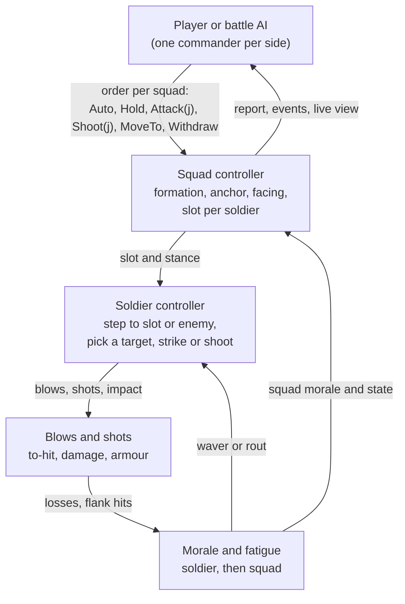

# Per-soldier battles

Design note for Phase 6, step 1: a headless battle in which every soldier is
simulated. It is written for review, and none of it is built yet.

## Goal

Today's battle (`sim_core/src/battle/`, squad battles since PR #94) moves
squads as discs and settles each step with dice per squad. Flanks, fronts and
formations exist only as flags: a squad is "flanked" when an enemy it does not
face is in contact, and its front is `min(alive, frontage / spacing)`.

The war redesign note ("Econoplex war redesign", 13 Nov) chose squads as the
unit of war, and set direction A aside: "per-fighter duels stay out unless
squads prove too coarse". Phase 6 brings A back as a **second battle model**
under the same squads:

- Squads stay the unit the player and the AI command, raise, feed and pay. Only
  the battle inside them changes.
- Every soldier has a place, a facing, a morale, a fatigue and their own kit.
  A flank attack, a broken line, a tired army and a wedge come out of those
  positions, not out of a flag.
- The model aims at thousands of soldiers (the plan's target) at the speed of
  the live battle.

The rules of the squad model carry over unchanged in spirit: kit gives reach,
damage and armour; experience counts heavily; morale starts from needs; a
braced spear wall turns a charge; walls narrow the front to the breach. The
existing matchup tests must still pass on the new model.

## Where it sits

The new model lives in `sim_core/src/battle/soldiers/`, next to the squad model.
It takes the same inputs and gives the same outputs:

- **In:** `BattleParams`, `Field`, `Vec<SquadSpec>`, a seed, and orders between
  steps.
- **Out:** `Report`, `ReplayFrame`, `LiveView` and the members read back with
  their health and experience.

So `systems/military` (raids, the planner, live battles), `--battle` and both
clients do not change in step 1.

`models.ron` chooses the model with `battle.model: Squads | Soldiers`. This
follows the standing rule that a component stays swappable, so a seed sweep can
compare the two models. The default stays `Squads` until the budget below has
been measured on real raids.

`Battle` becomes an enum over the two models with the same methods. That is not
a compatibility shim: both models stay real options.

## Data per soldier

Soldiers are stored as plain arrays, one entry per soldier and one array per
field, indexed by soldier. A soldier is never an ECS entity: the battle runs
outside the world, as today.

| Field | Type | Meaning |
| --- | --- | --- |
| `pos` | `Vec2` (m) | position on the field |
| `facing` | `Vec2`, unit | where they look. Kept as a vector, so the hot path needs no `sin` or `cos`. |
| `vel` | `Vec2` (m/s) | last step's velocity, used for charges and impact |
| `health` | `f32` | 1 is unhurt, ≤ 0 is down, ≤ `death_below` is dead (as `Member.health`) |
| `morale` | `f32` 0..1 | the soldier's own nerve. It starts at the squad's morale. |
| `fatigue` | `f32` 0..1 | 0 is rested, 1 is spent. It starts from the person's `fatigue` state. |
| `kit` | `u16` | index into the battle's kit table (below) |
| `squad` | `u16` | the squad they belong to |
| `slot` | `u16` | their place in the squad's formation (file and rank) |
| `skill` | `f32` | effective skill: skill + `experience_weight` · ln(1 + battles) |
| `target` | `u32` or none | the enemy they are fighting |
| `cooldown` | `f32` (s) | time until their next blow or shot |
| `arrows` | `u16` | arrows left |
| `state` | `u8` | Formed, Engaged, Wavering, Routing, Down, Fled |

That is about 72 bytes a soldier, so 4,000 soldiers take under 300 KB.

**Kit.** Each person's kit comes from their own items through
`Kit::from_gear`, as `setup_field_battle` already reads them per person. Kits
that are the same are stored once in a kit table, so a squad with mixed
equipment keeps the difference. A squad then has the best and worst swords, not
an average. The kit table also holds:

- **weight**, which feeds fatigue;
- **mass**, for charges: a horse and rider is about 600 kg, a man about 80 kg.

**Damage types.** The soldier model uses the same split as the squad model,
from the content's `fight` values (PR #178):

- **A blow and a shot have a type.** A weapon's melee `damage_type` and its
  missile `shot_type` are each `Pierce`, `Slash` or `Blunt`. Spears, lances
  and arrows pierce, swords slash, clubs and maces are blunt. Fists are blunt.
- **Armour stops each type by its own share:**
  `armour: (pierce, slash, blunt)`. Layers multiply per type, as in
  `Kit::from_gear`.
- **The damage of a hit** is the sum over types of damage_t × (1 − armour_t),
  as in `Kit::blow` and `Kit::shot`. A charge's extra damage splits in the same
  shares as the blow.

The squad model has to average a squad's weapons into one share per type. The
soldier model needs no average: each soldier's blow carries their own
weapon's type and lands on one target's own armour. Each kit-table entry holds:

- `damage: [pierce, slash, blunt]`, with one non-zero entry for a single weapon;
- `shot_damage` in the same form;
- `armour` per type.

Phase 4 of a substep takes the striker's damage and the target's armour from
the kit table, so per-type damage costs three multiplications and no more
lookups. The tests in the squad model ("mail turns swords better than spears",
"blunt beats slash against plate") also run on the soldier model.

**Fatigue.** This is new, because the squad model has none. It rises each
second by:

- `fatigue_run` × (1 + weight / `carry_kg`) while running;
- `fatigue_fight` while striking;
- `fatigue_walk` while marching.

It falls by `fatigue_rest` while standing out of contact.

Fatigue slows a soldier: their top speed, strike rate and parry are multiplied
by (1 − `fatigue_effect` · fatigue). A spent soldier also loses morale faster.

An army that arrives after a forced march, or one whose soldiers did not sleep,
starts tired. This comes from the store's `fatigue` state, which
`setup_field_battle` passes through a new `Member.fatigue` field.

## The time step

- The soldier model steps in **substeps of 0.25 battle seconds**. A blow takes
  about a second, and a running man covers 0.75 m in a substep, less than the
  1 m spacing between soldiers. With 1 s substeps, runners would pass through
  each other.
- `Battle::step()` still advances one battle second: 4 substeps. `params.dt`
  stays the battle second that callers count in.
- The live battle (`live_battle.rs` in the 2D client, `BATTLE_SPEED = 6`)
  still steps 6 battle seconds per real second: 24 substeps. A paused game steps
  nothing, as today.
- Replays still record a frame every 5 battle seconds (`run_recorded(5.0)`).
  Each frame holds each squad's centre and the soldiers it has left, so the
  clients keep working. A later step can add per-soldier frames for the 3D
  crowd.

One substep runs in six phases. Phases 2 to 4 only read last substep's state
and write into per-soldier buffers, so they can run in parallel.

1. **Grid.** Rebuild the spatial grid (below).
2. **Squad controllers.** Each squad's controller sets its formation, anchor and
   facing from its order, and gives every soldier their slot.
3. **Soldier controllers.** Each soldier picks where to step (their slot, an
   enemy, or away from the enemy) and whom to strike.
4. **Blows and shots.** Each strike rolls to hit and adds its damage to the
   target's incoming buffer. The roll uses the striker's own random stream.
5. **Apply.** In soldier order: damage, movement with collision, morale,
   fatigue and state.
6. **Squads.** Recount each squad's soldiers and morale, and give events to the
   `Report` (contact, charge, wavering, routing, out of arrows, fled).

## The spatial grid

A uniform grid of **4 m cells** covers the field: 600 × 400 m is 150 × 100
cells. A 3 m spear reaches no further than the neighbouring cells, so a melee
query reads at most 3 × 3 cells.

The grid is rebuilt every substep by a counting sort:

- count the soldiers in each cell;
- turn the counts into prefix sums;
- write the soldier indices into one array.

This costs O(n), needs no allocation after the first substep, and visits each
cell's soldiers in index order, so the result never depends on hashing or
thread timing.

The grid answers three queries:

- **Neighbours within 1 m**, for collision: soldiers push apart, and friends
  give way to the front rank.
- **The nearest enemy within reach**, for melee. Each cell is split by side,
  with the enemy side stored first.
- **Who stands where an arrow lands**, for shots. A shot aims at a point with
  scatter that grows with range and falls with skill, then hits whoever is in
  that cell. A shot into a melee can then hit friends. That replaces today's
  "never shoot into a melee" rule. It can be switched off with
  `friendly_fire: false`.

Walls are a line of blocked cells with a gap of `breach_width`. Attackers can
only reach the defenders through the gap. So the breach narrows the front
because the attackers cannot fit through it, not because a front count is
capped.

## Controllers and formations

Command has four levels. Each level only sets goals for the level below it, and
the soldier level is where blows land.



**Commander, one per side.** This is the player in a live battle, or the auto
commander, which is today's `auto_goal` judgment lifted to the side. Orders are
`Order` as today, so the battle panels in both clients and
`order_live_battle` work unchanged. Two orders are added later, for the panels
to offer:

- `Flank(j)` goes round squad `j` and then attacks;
- `Form(Formation)` sets a squad's formation by hand.

**Squad controller.** It turns the order into an **anchor** (the centre of the
front rank), a **facing** and a **formation**. Each soldier's slot is then:

> anchor + rotate(facing) · (file · spacing, −rank · spacing)

| Formation | Shape | Who uses it on Auto |
| --- | --- | --- |
| Line | `frontage` wide, as many ranks as it takes | infantry |
| Column | 4 wide | marching to a goal far away |
| Wedge | a triangle, point at the front | cavalry charging |
| Braced | Line, with the front ranks kneeling and facing the threat | spears under `Hold`, or when riders come within 200 m |
| Loose | Line at 3 m spacing | archers and skirmishers |

When soldiers fall, the controller fills the front from the rear rank: slots are
reassigned by a stable sort on rank, then on file. So a squad gets thinner and
shorter, but no gap stays open in its front unless the whole squad is gone.

The squad controller also judges as today: archers stand and shoot in range,
riders steer clear of a spear wall, a routing squad runs for its edge of the
field.

**Soldier controller.** This is a small state machine per soldier:

- **Formed.** Steer to the slot.
- **Engaged.** An enemy is within reach, or within 2 m of the slot. Turn to them
  and strike when the cooldown allows. Hold the slot within 2 m unless the
  enemy steps back.
- **Wavering.** Fight at the morale factor, as today.
- **Routing.** Turn and run from the nearest enemy, toward their own edge of the
  field. A routing soldier does not parry.
- **Down.** Lie where they fell. The squad keeps their health for
  `settle_field_battle`.

**Where flanks come from.** A blow is a flank blow when it comes from more than
90° off the target's facing, and a rear blow beyond 135°:

- a flank blow meets no shield and no parry;
- a rear blow also does more damage;
- each blow from the side or rear drains the target's morale by `flank_drain`.

There is no "flanked" flag. A squad hit in the side loses its outer files and
its nerve from that side inward.

**Charges.** On first contact, the impact comes from the charger's mass and
closing speed. A braced spear in front of the charger strikes first, with that
speed: today's rule, but per soldier, and only where a spear point actually
meets the horse. So a charge that hits a braced wall in the flank goes through.

**Morale.** A soldier's morale falls when:

- they are hit, or hit from the side;
- friends within 5 m fall or rout;
- their fatigue rises.

It rises again when they stand quiet next to formed friends, or within 15 m of
the squad's leader (its most experienced member).

The squad's morale is the mean of its soldiers' morale. A squad routs when it
falls below `rout_at`, as today. Single soldiers can also break earlier, so a
squad frays before it breaks.

## Randomness

- Every random draw comes from a counter-based stream: SplitMix64, as
  `AgentRng` already is. It is seeded by battle seed, substep, soldier index
  and purpose (to-hit, damage, scatter, where they step). A ChaCha stream is no
  longer shared across the battle.
- So a draw depends only on who draws it and when, never on the order soldiers
  are processed in or on threads. Phases 2 to 4 can run on rayon and give the
  same battle as a single thread. A test checks this.
- Damage is summed into per-soldier buffers and applied in soldier order in
  phase 5. Two blows on one soldier in the same substep give the same result in
  any order.
- Floats stay deterministic on one binary and one platform. The hot path uses
  only `+ − × ÷`, `sqrt`, `min` and `max`. The to-hit curve uses `exp`, as
  today, which can differ between platforms in the last bit. The state hash is
  compared on the same platform, as today.
- Same seed and same orders give the same battle. Tests run many seeds, never
  one lucky seed.

## Performance budget

**Today's squad model, measured.** These are release builds of
`econoplex-sim --battle`, 50 seeds each, wall time per battle including start-up:

| Line-up | Soldiers | Battle lasts | Per battle | Per battle second |
| --- | --- | --- | --- | --- |
| `swordsmen*30 vs spearmen*30` | 60 | 4 min | 0.2 ms | ~1 µs |
| 3 mixed squads of 40 a side | 240 | 6 min | 0.7 ms | ~2 µs |
| 5 squads of 40 swordsmen a side | 400 | 4 min | 1.5 ms | ~6 µs |
| `swordsmen*400 vs swordsmen*400` | 800 | 8 min | 3.8 ms | ~8 µs |
| `swordsmen*2000 vs swordsmen*2000` | 4,000 | 27 min | 77 ms | ~48 µs |

The squad model's cost grows with the hits, because `hit()` collects the
standing members for each one. That is why 4,000 soldiers cost 48 µs a second,
not 8.

The table also shows something the soldier model should fix. Equal single
squads of 400 or 2,000 are not even: the defenders win 48 and 49 of 50,
although both sides advance on `Auto`. The cause is not known yet. Five squads
of 40 a side split 23 to 27.

**Budget for the soldier model.** It must hold these on one core, with a
4,000-soldier battle (2,000 a side, about 50 squads of 40) as the yardstick:

| Use | Battle time | Budget | Per soldier per substep |
| --- | --- | --- | --- |
| Live battle, 6 battle s per real s | 1 battle s | **≤ 1 ms** (6 ms of every real second) | ≤ 60 ns |
| `--battle`, one auto-resolved battle | about 30 min | ≤ 2 s | same |
| `--battle --seeds 50` | 50 × 30 min | ≤ 2 min single-threaded, ≤ 20 s on 8 threads | same |

So the soldier model may cost about 20 times the squad model at 4,000 soldiers.
It must not cost more than 1 ms per battle second.

**What stays on the squad model.** The war planner's forecasts (`FORECASTS =
3` per possible raid, every muster) and the economy's auto-resolved raids stay
on squads, because they are cheap. A forecast is a guess, so it may use the
cheaper model. Whether auto-resolve moves to soldiers waits for a 40-year
comparison of time per tick and of outcomes.

**How it is measured.** `econoplex-sim --battle L --profile` prints:

- soldiers;
- substeps;
- ms per battle second, for each of the six phases;
- the squad model's figure for the same line-up.

A test marked `#[ignore]` checks the 4,000-soldier budget. It is run by hand on a
release build.

## `--battle`

- The line-up syntax stays as it is. `--battle-model squads|soldiers`
  overrides `models.ron`.
- `--compare` runs both models on the same seeds and prints both win rates.
  That is the tool for checking that the soldier model keeps the squad model's
  matchups.
- Two new squad suffixes:
  - `%F`, starting fatigue 0..1 (`swordsmen*100%0.8` is a tired squad);
  - `#flank` or `#rear`, which deploys the squad on the enemy's side or behind
    them, already facing in.
- `--profile` prints the timings above. `--seeds N` prints win rates, as today.

Example:

```
econoplex-sim --battle "swordsmen*100,swordsmen*100#flank vs swordsmen*100,swordsmen*100" \
              --battle-model soldiers --seeds 50 --compare
```

## Tests

These are new, in `battle/soldiers/tests.rs`. Each runs many seeds and checks a
rate with room for chance:

- **Equal armies win about half the time.**
  - `swordsmen*200 vs swordsmen*200`, both sides on `Auto`, deployed as mirror
    images: over 100 seeds, side 0 wins 35 to 65.
  - With the sides swapped, the rate stays within 10 of that.
  - The same holds at 2,000 a side, which the squad model fails today.
- **A flank beats a frontal attack.** Two squads of 100 swordsmen a side.
  - Frontal: side 0's second squad attacks beside its first.
  - Flank: it starts with `#flank` and attacks into the enemy's side.
  - Over 50 seeds, side 0 wins at least 40 battles with the flank and at
    least 15 more than frontally on the same seeds, and the enemy loses more
    soldiers. (The frontal attack is a mirror, so it wins about 25 of 50; a
    margin of 25 would ask the flank to win every battle.)
- **Rested beats exhausted.** `swordsmen*100 vs swordsmen*100%0.8`: the rested
  side wins at least 40 of 50. At fatigue 0.4 it still wins more than half.
- **The squad model's matchups still hold on the soldier model:**
  - a spear wall stops a charge;
  - cavalry rides down archers;
  - arrows break a levy;
  - swords get inside spears;
  - veterans beat more recruits;
  - walls hold the breach;
  - hungry squads break first;
  - routed squads leave the field;
  - orders change the battle.

  These are today's tests in `battle/tests.rs`, run on both models.
- **Determinism:**
  - same seed, same battle;
  - the same battle on 1 thread and on 8;
  - stepping 1 s at a time gives the same battle as `run()`.
- **Formations:** a squad that loses its front rank refills it from the rear. A
  braced line facing riders turns to face them.
- **Budget:** 4,000 soldiers stay within 1 ms per battle second
  (`#[ignore]`, release only).

## Build order

1. **This note.** Then the model on its own: data, grid, controllers, blows,
   morale and fatigue, behind `battle.model`. Add `--battle-model`, `--compare`
   and `--profile`, and the tests above. No client changes.
2. Tune until `--compare` keeps the squad model's matchups and the equal-armies
   test holds at every size.
3. Live battles on the soldier model, in both clients: the panels stay, and the
   squads are drawn from their soldiers' positions.
4. Per-soldier replay frames, for the 3D crowd (`crowd.rs` can take one
   record per soldier).
5. The `Flank` and `Form` orders in the battle panels.
6. A 40-year comparison of auto-resolve on soldiers against squads. Switch the
   default only if it is affordable and the outcomes make sense.

## Where steps 1 and 2 stand

The model is in `battle/soldiers/`, behind `battle.model` (default `Squads`).
Tuning added a few rules that the note above did not name:

- A squad starts facing the enemy army as a whole, not the nearest squad, so
  `#flank` meets an enemy that has to wheel.
- A soldier turns at `soldier_turn` radians per second. A blow from a side
  they have not turned to yet is a flank blow.
- Any steady soldier who arrives at a run charges, not only one who is still
  formed. Before this, only the point of a wedge charged.
- Seeing a foe break gives a soldier heart (`foe_breaks`). Without it, two
  squads often broke together, and a draw goes to the defenders: mirror images
  split 37 to 63.
- Two counts per squad. Cohesion counts only the fallen, so a rout does not
  feed on itself. Refilling the ranks counts everyone who left the line.
- Defenders on a wall strike over twice the breach width, and a man climbing
  through it cannot parry.

`--compare`, 50 seeds, side 0's wins (squads / soldiers):

| Line-up | Squads | Soldiers |
| --- | --- | --- |
| `cavalry*20 vs spearmen*30` | 0 | 1 |
| `cavalry*20 vs archers*30` | 50 | 47 |
| `levy*40 vs archers*30` | 0 | 0 |
| `swordsmen*30 vs spearmen*30` | 50 | 50 |
| `swordsmen*25+20 vs swordsmen*30` | 50 | 50 |
| `swordsmen*45 vs walls spearmen*30` | 0 | 0 |
| `swordsmen*30!0.3 vs swordsmen*30!0.9` | 0 | 0 |
| `swordsmen*100 vs swordsmen*100%0.8` | 22 | 50 |
| two squads a side, frontal | 29 | 24 |
| the same with `#flank` | 19 | 48 |
| `swordsmen*200 vs swordsmen*200` | 25 | 24 |
| `swordsmen*2000 vs swordsmen*2000` | 26 | 27 |

The equal-armies test holds at 200 and at 2,000 a side, also with the sides
swapped. The flank wins 46 to 48 of 50, 19 to 25 more than frontally, over
four sets of 50 seeds. The first bar, a margin of 25, could not be met: with the
frontal mirror near 25 of 50 it asked the flank to win every battle, so the
test now asks for 40 of 50 and a margin of 15.

**Cost.** Measured on a shared 4-core VM, timings vary about 15% from run to
run. The yardstick is 50 squads of 40 a side, a 6.4-minute battle:

| Measure | Budget | Measured |
| --- | --- | --- |
| ms per battle second, one core | ≤ 1 | 1.39 (best of 3) |
| ns per soldier per substep | ≤ 60 | 87 |
| one battle | ≤ 2 s | 0.53 s |

The soldier controllers take 40% of the time. Apply, the grid and the blows
take about 15% each. The model is not yet within 1 ms per battle second.

## Open questions

- Should auto-resolved raids ever use the soldier model, or only battles the
  player watches? It depends on the step 6 measurement.
- Should friendly fire from arrows be on by default?
- Should a soldier who is down but alive be carried off (captives, or the
  wounded saved by their side), or does that wait for the aftermath?
