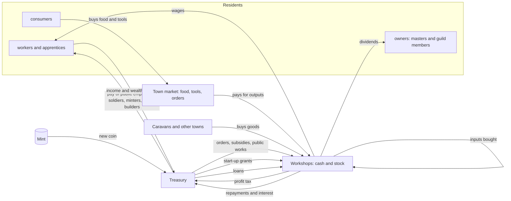

# Workshops that pay from their own sales (design note, 2026-11-09)

Status: **chosen by Nils (2026-11-09); being built behind a switch.** The other two
options (the treasury recycles more, or towns lend on credit) are kept below for the
record.

## The problem

Today the town market is the only firm. It buys every finished output at the town
price and pays the team its wage share out of the **treasury**. It sells food and
tools back to residents. Wages and subsidies flow out of the treasury; food and tool
sales, taxes, rent and estates flow back in.

When residents save, or food is in glut at its floor price, the treasury drains:
- In the default model at year 5, three of four treasuries hold 4–26 coins against
  10–15 thousand in wages a year.
- Fair rationing then pays every claim a fraction. In Ironhold, wood-choppers get
  0.5 a day against a posted 4.2.
- Prices then can't steer labour. A scarce good's price can rise, but the money to
  pay its makers isn't there (#38).

## The option: workshops are firms

Money moves only between purses (residents, workshops, the market, the treasury,
other towns); the mint is the only source of new coin.

A **workshop** is a town's workplaces of one kind: its smithies, or its fields for
farming. Recipes without a building or a nature site belong to the guild of their
domain. Each workshop is a firm with its own cash and stock.

### Cash and accounts

- Each workshop holds **cash** (coins), starting with a grant from the treasury at
  town founding (moved, not created).
- It holds **stock** of its inputs and outputs. The town market keeps only what it
  bought from workshops: food and tools for residents, goods for government orders.
- Ledger: new firm accounts beside the treasury. The flows:
  - sales to the market, to other workshops and to caravans
  - input purchases
  - wages
  - profit tax to the treasury
  - dividends to the masters/members

  Money stays conserved: every flow moves coin between purses, and the mint is still
  the only source.

### Selling

- **Who sells:** workshops sell outputs to the town market (essentials and tools for
  residents) and to other workshops that need them as inputs, at the town price.
  Caravans buy from the cheaper town's workshops.
- **Who buys:** the market only buys what residents and orders need (the demand
  targets of #38). Beyond that a workshop keeps its stock, and its price falls.
- **What it earns:** a workshop's revenue is what it actually sold, not what it
  made. A glut means unsold stock, not pay for goods nobody wants.

### Buying inputs

A workshop buys inputs before a run, from the market or other workshops, out of its
cash. If it can't pay, the run doesn't start. That is the "blocked" demand of the
demand-driven price, now with money behind it.

### Wages

- **Offer:** each workshop posts a wage per worker-day. It starts at the town's
  current posted pay and moves with its own queue (the `ExcessDemand` rule): up when
  places stay empty, down when applicants queue. Labour's sticky inertia applies,
  so wages fall more slowly than they rise.
- **Payment:** wages are paid out of the workshop's cash at the end of each step,
  in full if it has the cash, else pro rata (as today, but per firm).
- **Expectations:** realised pay feeds agents' pay expectations and the town's
  public pay rate, unchanged.
- **Apprentices:** apprentice places and wages (`decision.matching`) become each
  workshop's own choice, as designed.

### Start-up capital, closure

- **Start-up capital:** a new workshop (a building just finished, or a guild opening
  a trade) gets its start-up cash from a treasury grant, or from its owners' wealth
  (the guild's masters) when the treasury can't pay.
- **Closure:** a workshop whose cash stays below one day's wages for a month (it
  can't pay its people) closes. It pays out what it can, its stock goes to the
  town market at the floor price, and its building stands idle until a new owner
  puts up start-up capital.

### Credit to firms (town loans)

- **The lever:** the town government can lend treasury coin to a workshop:
  - an amount, an interest rate and a term in days;
  - the player orders a loan in the policy panel (or `loan TOWN FIRM AMOUNT RATE DAYS`);
  - AI governors lend to firms in short trades with good expected margins, capping
    total lending at a share of the treasury.
- **Accounting:** a loan moves treasury coin to the firm's cash, so money is
  conserved.
  - The firm repays in equal daily instalments with interest out of its cash.
  - A firm that closes with debt left books the rest as a default, a loss to the
    treasury.
- **Tracking:** loans are kept per firm and per town (outstanding, repaid, interest,
  defaulted). They show in the economy panel and the CSV.

### Profit and taxes

- **Profit** = sales − inputs − wages.
- **Profit tax:** a share goes to the treasury, replacing the market's margin. It
  becomes a lever beside the wealth and income taxes.
- **Dividends:** the rest stays as cash up to a reserve (a few weeks of wages), and
  the excess is paid to the workshop's masters and guild members.
- **The treasury** taxes (income, wealth, rent, profit), takes estates and
  tribute, and runs the mint. It spends on government orders, subsidies, schools,
  public spending and start-up grants. Its own employees are the only workers it
  pays: soldiers, minters, and the builders of public buildings. It no longer pays
  other wages.

### Migration path behind a switch

- **Switch:** `market.firms: Treasury` (today's rule, default) or `Workshops(...)`.
  Firms come with their own params block: starting grant, wage step, reserve weeks,
  profit tax.
- **Steps, one PR each:**
  1. firm accounts and ledger flows, with no behaviour change (the market still pays)
  2. workshops sell to the market and pay wages from sales
  3. input purchases between workshops; caravans buy from workshops
  4. start-up capital from owners, and closure when cash stays short (posted wages per workshop and apprentice places as its choice follow later)
  5. treasury loans to firms (player order, AI rule, panel, CSV)
  6. profit tax and dividends; AI governors gain the profit-tax lever
- **Tests:**
  - money conserved across all purses
  - a workshop with no buyers stops paying, and its workers move on
  - a scarce input's makers get paid more
  - the treasury no longer rations wages
- **Comparison:** the 6-seed, 40-year runs with both decision models, before any
  default switch.

## Trade-offs against the other options

| | Workshops pay from sales | Treasury recycles more | Town credit |
| --- | --- | --- | --- |
| Fixes the cause | yes: pay follows real sales | partly: more money, same signals | no: postpones the drain |
| Price signals reach labour | directly | through the treasury | through the treasury |
| Scope | large (5 PRs) | small (1 PR) | medium (2 PRs) |
| New player levers | profit tax, workshop grants | spending rate | borrowing limit, rate |
| Risk | firm failures, cash hoarding | inflation if overdone | debt spirals |

## Results: 40-year comparison (2026-11-09)

Six seeds (42–47), 40 years, mean ± sd. The workshop setup is
`Workshops(start_cash: 50, reserve_days: 5, payout_rate: 0.2, profit_tax: 0.2, close_days: 30, credit_days: 30)`
with `pricing: Demand(cover_days: 10, blocked_workers: 2)`. Consumption is the
example basket in models.ron (clothes, pots, ale).

| | A Features, treasury (default) | B A + consumption | C Features, workshops + consumption | D Utility, treasury + consumption | E Utility, workshops + consumption |
| --- | --- | --- | --- | --- | --- |
| population | 4016 ± 117 | 3916 ± 300 | 3044 ± 201 | 4028 ± 256 | 2975 ± 234 |
| starvation % | 0 | 0 | 0.04 | 0 | 0.07 |
| kinds of goods | 23.1 ± 2.0 | 21.9 ± 2.9 | 8.3 ± 2.1 | 19.2 ± 0.9 | 10.4 ± 1.6 |
| swords | 4137 ± 733 | 4221 ± 729 | 0 | 140 ± 297 | 0 |
| mean wealth | 46 | 44 | 6.5 | 15 | 7.2 |
| wealth Gini | 0.59 | 0.70 | 0.38 | 0.38 | 0.23 |
| moves | 218 | 184 | 116 | 343 | 2222 |
| ms per tick (6 runs sharing the CPU) | 4.9 | 5.0 | 3.0 | 10.8 | 5.0 |

**Decision: no default changes.**
- Workshops (C, E) lose a quarter of the population, about two-thirds of the
  variety and all swords, so `market.firms` stays `Treasury`.
- Household consumption under the treasury market (B) is roughly neutral: variety
  and swords within the seed spread, slightly lower population, higher
  inequality. It stays off as well.
- The utility model with consumption (D) has more swords than before (140, up
  from 34) but still far fewer than Features, so `decision.model` stays
  `Features`.

**Why workshops fall short.** Their money is too thin for the chains. Most of a
town's coin ends up as working capital spread over about 40 workshops.
Input-using workshops can't pay for a batch, and households are too poor to buy
much (mean wealth 6–7 against 46). Trade credit, loans and place caps each helped
a little.

The remaining options:
- fewer, larger firms (one per building instance or per guild, not per kind);
- prices that adjust the money supply's purchasing power (the price indices show
  strong deflation in glutted towns);
- letting the mint respond to firms' demand for money (it only answers the
  treasury today).

