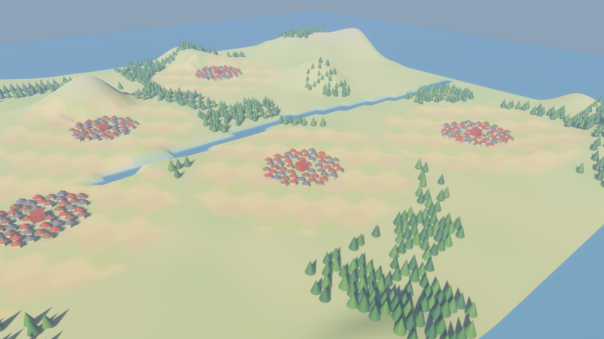
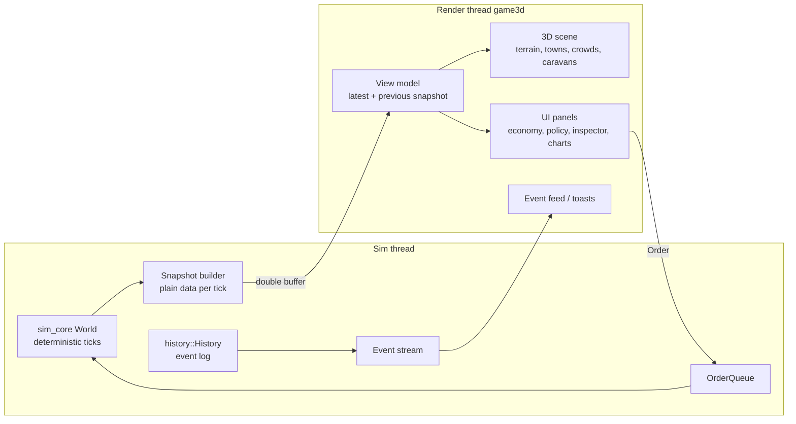
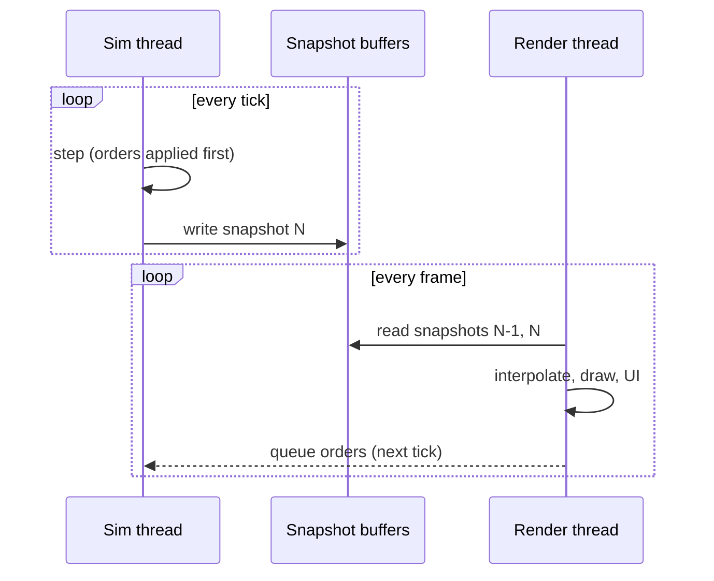

# Graphics and UI subproject: design proposal (2026-11-10)

Status: **proposal for Nils's review.** Nothing here changes the simulation. The
only code in this PR is a throwaway preview (`crates/game3d`, "M0") that renders
a generated world in 3D, so we can talk about something visible.

*M0 preview (seed 23): a generated world with five towns, a river, hills, fields
and forest, under a low sun with distance fog. Stock Bevy PBR, no custom shaders
yet. Everything in the "visual direction" section below is still to come.*

## 1. Architecture: the renderer can't touch the simulation

The simulation (`sim_core`) stays exactly as it is: deterministic, headless,
tested. The 3D client is a separate crate (`game3d`) that sees the simulation in
only three ways:

1. **A snapshot per tick (read-only view model).** After each tick, the sim
   thread copies what the screen needs into a plain struct:
   - per town: position, population, buildings, stock and prices, treasury, culture;
   - per agent: position, activity, job, town (as flat arrays, for instancing);
   - caravans and raids in progress;
   - terrain (once).

   The renderer reads only snapshots. It never holds a `&mut` into the sim world.
2. **An event stream.** The event log (`sim_core::history`) is already data. The
   client reads new events since the last frame: a building finished, a raid, a
   famine, an order.
3. **Commands.** The player acts only through the existing order API
   (`policy::Order`, the same one the AI governors use). Orders are queued and
   applied at the start of the next tick, exactly as in the 2D game and the CLI.

Because nothing else crosses the boundary, rendering can't affect determinism: the
same seed and orders give the same state hash with or without a renderer.

**Implemented in M2:**
- `sim_core::view::ViewSnapshot` is the per-tick snapshot. It carries the
  calendar, per-town population, treasury, ruler and buildings (with stable
  ids), plus the events since the last capture. A test checks that capturing
  leaves the state hash unchanged.
- `crates/game3d/src/live.rs` runs the `Simulation` on its own thread at the
  game speed and publishes a snapshot after each tick. The view diffs
  snapshots: buildings appear and go, houses follow population, and the
  calendar sets the season.
- Orders go back through a queue into the sim's `OrderQueue`.
- Interpolation is not needed yet, because nothing moves between ticks. It
  arrives with agents and caravans (M4).

**Data flow per frame:**
- The sim runs at its own rate (1–60 ticks per second, by game speed) on its own
  thread.
- The renderer runs at the display's rate and **interpolates** agent and caravan
  positions between the last two snapshots, so motion is smooth at any game
  speed.
- Snapshots are double-buffered: the sim writes one while the renderer reads the
  other.

## 2. Technology options

| | Bevy 3D (new `game3d` crate) | Godot 4 + gdext (Rust bindings) | Web front end (wgpu/WebGL) + headless sim |
| --- | --- | --- | --- |
| Language | Rust only, shares types with sim_core | Rust for glue, GDScript/scene editor for content | Rust sim (native or wasm), TS/Rust renderer |
| Shaders | WGSL, hand-written materials, compute | Godot shading language (GLSL-like), visual shader editor | WGSL (wgpu) or GLSL (WebGL) |
| Learning shaders in detail | **excellent**: you write every pipeline stage | good, but the engine hides more | excellent, but you also build the engine |
| Editor / tooling | none (code-driven) | strong editor, animation tools | browser dev tools |
| Effort to first picture | low (M0 took an hour) | medium (bindings, scene setup) | high (renderer from scratch) |
| Risk | Bevy changes every release (API churn) | two languages, FFI boundary | most work, weakest tooling for 3D |

**Recommendation: Bevy 3D in `game3d`.**
- Same language and data types as the sim; the snapshot boundary is just a Rust
  struct.
- WGSL with Bevy's `Material` / `ExtendedMaterial` / compute pipelines lets us
  write every shader by hand, which fits the shader learning track (section 7).
- The 2D game already runs on Bevy, so its UI code and panels can be ported.

**One practical note.** Bevy 0.19.1's 3D renderer can't be built today (one of its
crates, `bevy_anti_alias` 0.19.1, isn't on crates.io), so M0 uses **Bevy 0.20** on
its own. M1 should move the whole workspace (sim_core's `bevy_ecs`, the 2D game)
to 0.20, so everything shares one version.

## 3. Visual direction: painterly, soft toon, procedural

Our own style, no borrowed assets: a soft cel-shaded, painterly open-world look,
built almost entirely from procedural geometry and shaders.

- **Lighting:** soft toon ramp shading.
  - Diffuse is quantised through a smooth ramp, with *wrap lighting* so shadows
    stay soft and coloured.
  - A rim light (fresnel) separates silhouettes.
  - Implemented as an `ExtendedMaterial<StandardMaterial, ToonExt>`, so we keep
    Bevy's shadows and fog.
- **Albedo:** flat or vertex colours driven by biome and world-space noise
  (meadow, field, scree, snow, river bank) instead of detailed textures. Large
  soft colour patches read like paint.
- **Atmosphere:**
  - strong distance and height fog;
  - a gradient sky with a sun disc;
  - **day/night and seasons tied to the sim calendar** (the sim already counts
    days and years);
  - gentle bloom.
- **Terrain:** from the generated world (`worldgen` plus `terrain`).
  - Heightmap from hills and noise; river beds sunk, fords as shallow bars.
  - Triplanar/biome colouring.
  - **Fields drawn by crop** (grain gold, flax blue-green, pasture), changing with
    the seasons.
- **Vegetation:** instanced grass and trees with vertex-shader wind. Forests sit
  where the sim's forest sites are; felled trees regrow as the sites regrow.
- **Buildings:** procedural, assembled from modules (walls, roofs, chimneys,
  waterwheels, furnaces, kilns) by building type. Era and town wealth choose the
  materials: timber, then stone, then brick and slate.
- **Agents:**
  - GPU-instanced crowds with procedural animation: a simple gait and bob, plus
    job-specific tool motions (scythe, hammer, axe).
  - Level of detail: mesh close up, impostor cards in the middle distance, dots
    far away. **Implemented (shader step 10):** figures within 28 units, SDF
    silhouette cards to 260, nothing beyond; dithered cross-fades. Over a town:
    91 fps against 38 without (release, 3,500 people).
  - Colour by trade or culture on demand.
- **Movement:** caravans as little carts on the roads; armies marching on raids.
- **Overlays**, each a toggle with a legend:
  - money flows between towns (animated ribbons, width = value);
  - prices (town billboards);
  - culture (tinting by the town culture vector);
    **Implemented:** `V` → culture. The terrain around each town takes its
    culture's colour (tradition red, faith green, liberty blue, neutral grey;
    a uniform array of town centres and colours in the terrain shader), and
    every person is drawn in their own beliefs' colour, so newcomers and
    minorities stand out. A legend shows the selected town's three axes.
  - the product space (as in the 2D game, now a floating graph);
    **Implemented** as a panel rather than a floating graph (labels read
    better): `V` → product space. The selected town's skills on a circle
    grouped by domain, links by embedding similarity, lit where the town made
    something with the skill last year or its people know it, sized by its
    residents' mean level; hover for name and level. The sim answers per tick
    for the selected town (`sim_core::view::town_skills`, read-only).
  - shortages and gluts (pulsing icons).

## 4. UI

Panels to port and add:
- **Economy:** money flows, prices and indices, jobs, shortages.
- **Policy:** all levers, as today.
- **Inspector:** an agent's skills, mind, needs, culture fit.
- **Event log:** filterable, click to jump the camera.
- **History charts:** time series from `history::Sample` and yearly metrics, per
  town or empire.
- **A "why" view:** select a symptom ("bread is short in Greenvale", "Ironhold's
  treasury is empty") and see the chain behind it. It is built from data the sim
  already has:
  - recipe inputs and blocked jobs;
  - wage rationing;
  - price pressure;
  - ledger flows;
  - migration.

  It starts as a rule-based explainer that walks the dependency graph of goods,
  jobs and money, highlighting each link on the map.

  **Implemented (M7):**
  - `sim_core::explain::explain(world, town)` returns findings as a tree:
    - hunger;
    - shortages, explained by their recipes:
      - a missing or full building;
      - missing or worn-out land;
      - short inputs, followed recursively;
      - nobody working at it, and its pay;
    - a low treasury, with its biggest flows and tribute;
    - people leaving.
  - The CLI prints it with `--why TOWN`.
  - The 3D view asks the sim thread for the selected town and shows a "Why"
    window. Building types it names are ringed on the map.

**Framework:**

| | bevy_egui | bevy_ui | other (iced, Dioxus, web overlay) |
| --- | --- | --- | --- |
| Dense data panels, tables, charts | **excellent** (egui_plot for charts) | verbose, no charts built in | good, but a second toolkit |
| Look and theming | immediate-mode, can be styled | full control, retained | full control |
| Effort | lowest | medium–high | high |

**Recommendation:** `bevy_egui` for the data-heavy panels (economy, charts, event
log, why view), and `bevy_ui` / world-space labels for the few diegetic elements
(town nameplates, price billboards) that should match the painterly style.

## 5. Performance budget

**Target:**
- a mid-range laptop (integrated Iris Xe / Radeon 780M class, or a GTX 1650);
- 1080p at 60 fps with 12,500 agents;
- 30+ fps at 50,000 agents, with a game speed at which the sim keeps up.

| item | budget (ms per frame at 60 fps) | how |
| --- | --- | --- |
| terrain | 1.5 | one chunked mesh, LOD by distance, vertex shader displacement |
| vegetation | 2.0 | GPU instancing, wind in the vertex shader, distance fade, culling |
| buildings | 1.0 | instanced modules, a few hundred per town |
| agents | 2.5 | one instanced draw per LOD; positions from a storage buffer filled by compute from the snapshot |
| shadows | 2.0 | one cascade-limited directional light |
| fog, sky, toon | 1.0 | in the material plus a sky pass |
| post (bloom, tonemap) | 1.0 | half-resolution bloom chain |
| UI (egui) | 1.5 | redraw panels only on change |
| headroom | ~4 | |

**The simulation runs on its own thread.**
- **Today:** about 5 ms per tick at 4,000 agents.
- **Scaling:** at 12,500 agents, roughly 15 ms per tick, which is still about 60
  ticks per second on one core. At 50,000, about 60 ms per tick, so roughly 15
  ticks per second.
- **Effect:** the fastest game speed may slow down at 50k, but rendering stays
  smooth thanks to interpolation.
- **Snapshot cost:** about 50k × 24 bytes ≈ 1.2 MB per tick, copied once.

### Level of detail (LOD) pipeline

Distant things are drawn with fewer triangles. Every LOD comes from one of three
sources, all prepared before the frame, never per frame:

1. **The generators themselves.** Every procedural generator takes a detail
   parameter, so a far LOD is the same thing generated simpler:
   - terrain: grid resolution per chunk;
   - buildings: the same modules at lower detail (no window frames, a plain
     roof);
   - trees: the number of leaf clumps.

   This keeps LODs consistent (same colours and silhouette), costs no extra
   assets, and fits the procedural style.
2. **Mesh simplification** for any meshes that aren't procedural (hand-made
   props, imported models): [meshoptimizer](https://github.com/zeux/meshoptimizer)
   through the `meshopt` crate. It runs at build or load time.
   - It cuts each mesh to fixed shares of its triangles (e.g. 50 %, 20 %, 5 %),
     with an error limit that keeps the silhouette, and saves them as LOD1–LOD3.
   - It also reorders vertices and indices for the GPU's vertex cache, which is
     worth doing for every mesh.
   - It's the same simplifier that Bevy's virtual-geometry preprocessing uses,
     but it produces ordinary meshes for the normal pipeline.
3. **Impostors** for trees and buildings far away. Each kind is rendered once, from a
   few angles, into a texture (render to texture). Far away it's drawn as a
   camera-facing card with that picture. They're baked offline or when the game
   loads.

On top of that:
- the GPU instancing of section 3 (one draw per kind and LOD);
- distance fade with dithering between LODs, so they don't pop;
- fog hides the far edge.

**Virtual geometry (meshlets, Nanite-style) is shelved.**
- **Why:** our meshes are low-poly; most geometry moves (grass, people) or is
  generated; Bevy's version is experimental and needs GPU features (64-bit
  atomics) that many laptops lack.
- **Where it goes:** an optional late milestone (M9), only if dense static
  meshes ever become a bottleneck. No live virtual geometry before that.

## 6. Roadmap

Each milestone ends in something visible, and each introduces one GPU concept of
the shader learning track (section 7):

| milestone | what you see | shader step |
| --- | --- | --- |
| **M0** | generated world in 3D, stock materials | none |
| **M1** | terrain + gradient sky + toon lighting + fog + town blocks from a seed, free camera; workspace on Bevy 0.20 | 01 sky, 02 toon, 03 terrain, 04 fog |
| **M2** | the sim runs behind it: snapshot boundary, towns grow, buildings appear by type, day/night from the calendar | 05 rim and outlines |
| **M3** | grass and trees with wind, fields by crop and season | 06 instanced grass |
| **M4** | agents as instanced crowds with LOD, caravans on roads, raids | 07 compute crowds |
| **M5** | UI panels ported (bevy_egui): economy, policy, inspector, event log | none |
| **M6** | overlays (money flows, prices, culture, product space), history charts | 08 bloom (glow for overlays) |
| **M7** | the "why" view | none |
| **M8** | procedural buildings by era and wealth, procedural animation polish | **Implemented (buildings):** a town builds in its newest era's style (timber and thatch → plaster and tiles → brick → stone and slate); its houses follow residents' mean wealth (cottages <6, houses, two-storey with chimneys ≥30, 15 % hysteresis). A change rebuilds the town. **Implemented (animation, shader step 09):** legs and arms turn about their joints; the stride follows the distance walked; heading and walking blend are eased on the GPU; workers make their trade's motion (scythe, hammer, axe, craft), soldiers stand guard, the idle look around. |
| M9 (optional) | virtual geometry (meshlets), only if dense static meshes become a bottleneck | |

## 7. Shader learning track

Nils wants to understand shaders in detail, so the key shaders are **written by
hand in WGSL** (custom `Material`, `ExtendedMaterial`, compute pipelines), not
hidden behind built-ins. They are ordered so each introduces one GPU concept. Each
has its own doc in `docs/shaders/` covering:
- what the shader does;
- the math, mapped to WGSL line by line;
- a pipeline-stage diagram;
- debug views;
- 1–2 exercises to try yourself.

| # | shader | concept introduced | doc |
| --- | --- | --- | --- |
| 0 | playground | how a shader gets from a file to the screen: materials, bind groups, hot reload | [00-playground](../shaders/00-playground.md) |
| 1 | gradient sky | full-screen fragment shader: fragment stage, UVs, uniforms | [01-sky](../shaders/01-sky.md) |
| 2 | soft toon lighting | normals, dot products, light uniforms, ramp lookup | [02-toon](../shaders/02-toon.md) |
| 3 | terrain | vertex stage: attributes, displacement, varyings, noise | [03-terrain](../shaders/03-terrain.md) |
| 4 | distance and height fog | depth, view space, position reconstruction | [04-fog](../shaders/04-fog.md) |
| 5 | rim light and outlines | fresnel, view vector, inverted-hull outlines | [05-rim-outline](../shaders/05-rim-outline.md) |
| 6 | instanced grass with wind | instancing, per-instance data, storage buffers | [06-grass](../shaders/06-grass.md) |
| 7 | crowds from snapshots | compute: workgroups, storage buffers, synchronisation | [07-crowds-compute](../shaders/07-crowds-compute.md) |
| 8 | bloom | render targets, multiple passes, mip chains | [08-bloom](../shaders/08-bloom.md) |

The shader sources in the docs are drafts to read and discuss. Each becomes a
`.wesl` file in `crates/game3d/assets/shaders/` in its milestone, with a debug
view switch in the client.
- **WESL** is WGSL plus `import` statements. Bevy 0.20 writes its own shaders in
  it, so ours import Bevy's types the same way; below the imports it's plain
  WGSL.
- **The shader playground** (`cargo run -p game3d -- --playground`) is where
  each step is tried first: one scene, hot-reloading shaders, debug views. See
  [00-playground](../shaders/00-playground.md).

## 8. Decisions for Nils

**Decided on 2026-11-10: all four as recommended.** That means Bevy 3D in `game3d`, the
workspace on Bevy 0.20, bevy_egui for data panels, and M1 first.

1. **Technology:** Bevy 3D in a new `game3d` crate (recommended), Godot + gdext,
   or a web front end?
2. **Bevy version:** move the whole workspace to Bevy 0.20 in M1 (needed for 3D;
   recommended)?
3. **UI framework:** bevy_egui for data panels plus bevy_ui for in-world labels
   (recommended), or one of them only?
4. **Scope of M1:** terrain, sky, toon, fog and town blocks, with the shader track
   steps 1–4 written by hand. Or start with the sim running behind the 3D view
   (M2 first)?

## Performance (2026-11-12)

Target: at least 60 fps. Measured with `--fps`: frame times, GPU time per
render pass (timestamp queries) and, once, the number of mesh entities. Bevy's
`trace_chrome` feature gives a per-system CPU profile. Always measure the
release build: the dev profile is about 3× slower on the CPU side.

**What a frame cost** (release, about 3,500 people, 10-year world, RTX 3060
laptop): about 9.6 ms, limited by the CPU's render thread (about 9.5 ms):
Bevy's per-entity work for 6,645 mesh entities (2,730 trees, about 1,900
building parts and as many outline hulls), once per view and per shadow
cascade. Our own systems were all small.

**Changes:**
- The sky clock and fog state were written every frame, which made Bevy
  prepare every material again every frame; they are now written only when
  they change.
- Trees and buildings are baked (`bake.rs`): one mesh per forest chunk, one per
  building plus its outline, vertex colours instead of a material per colour.
  6,645 mesh entities became 1,519.
- Grass chunks have real bounds (frustum culling) and are hidden beyond the
  fade distance: vertex shader invocations went from 2.7M to 0.85M.
- Shadows: 3 cascades to 200 units, a 2,048 map (was 4 to 260 and 4,096).
  GPU shadow work fell by about 70 %.

**Result:** 6.0 ms per frame (about 170 fps) with the GPU at full clock,
against 9.7 ms. With the GPU thermally throttled (the laptop drops to about
820 MHz at 74 °C; full-screen passes then take about 3.7× longer), about 17 ms
(58 fps) close over a running town, against 25.5 ms (39 fps) before.

**What is left:** fragment work (about 10M fragments for a 2400×1350 screen,
3× overdraw), and the crowd's 186 vertices per slot (`10-lod.md`, exercise 3).
A render-scale option would help a hot laptop most.

