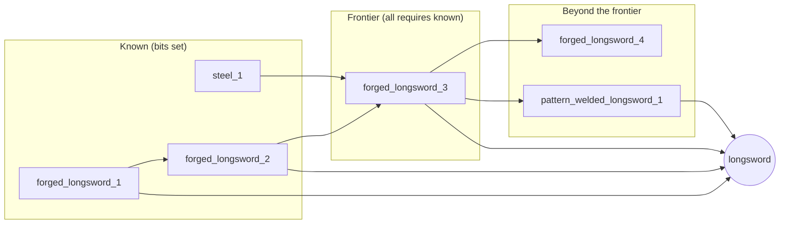

# Inventions and knowledge

Design note, agreed in discussion with Nils on 2026-11-26. No code yet.

## Goal

Recipes are not all known from the start. They are discovered by people, passed on by
apprenticeship and schooling, kept secret by guilds, and lost when the last person who
knows them dies. This gives the tree a time axis that comes from the agents, not from eras
(eras stay a label). The tree should eventually reach light-fantasy, steampunk-like technology.

## Core idea

Every person has two separate things:

| | What it is | Type | Changes by |
| --- | --- | --- | --- |
| **Knowledge** | which recipe-skills the person knows | bit array, one bit per recipe-skill | invention, apprenticeship, schooling, (later) books |
| **Capability** | how well the person works | the existing capability vector | practice, diffusion, forgetting (as today) |

A person can only work on a recipe-skill they know. How well they do it still follows from
their capability, as it does today. So whoever invents "forged longsword 3" is not good at it yet
and still has to practise.

### Recipe-skills

A recipe-skill is one way of making a good, at one level, for example `forged_longsword_3`.
It corresponds 1-to-1 to one recipe and one node of the tree. Recipes to goods are many-to-1:
the same good can be made in different ways, for example

| Good | Ways (recipe-skills) |
| --- | --- |
| iron | bloomery iron (charcoal, small batches), blast furnace iron (coke, bricks, large batches) |
| longsword | forged longsword, pattern-welded longsword (more work, higher quality) |
| bread | hearth bread, oven bread |

Different ways can need different inputs, buildings and skills, so a town picks the way that
fits what it knows and holds, and a new way can make an old one obsolete without removing it.
Levels are successive improvements of one way: each higher level raises the quality you can
reach, saves inputs or time, or does more than one of these. A new way usually builds on an
older way of making the same good plus knowledge from another trade.

Each recipe-skill names the recipe-skills it builds on, in the content:

```ron
(id: "forged_longsword_3", output: "longsword", level: 3,
 requires: ["forged_longsword_2", "steel_1"],
 difficulty: 2.4, invent_difficulty: 3.0, ...)
```

This is the existing skill DAG (`SkillDef.prereqs`) made fine grained. The embedding in
`sim_data/src/embed.rs` already maps any number of skills into a fixed number of
capability dimensions (closure vectors, NMF when there are more skills than dimensions,
`embedding.dims` in models.ron). So hundreds of recipe-skills do not grow the capability vector.
Each recipe-skill gets its vector `v` from that embedding. Practice along `v` raises the
capability that neighbouring recipe-skills share, so being good at forged longsword 2 helps with
level 3, with pattern welding and with spears.

### Frontier

A person's frontier is every recipe-skill they do not know whose `requires` they all know.
The frontier only changes when the person learns something, so it is cached per person and
recomputed on learning.



## Dreaming: the nightly invention check

Every night each adult checks a few frontier items and may invent one of them:

```
p = rate × sigmoid(k · (c · v − invent_difficulty)) × context
```

- `c` is the person's capability vector, `v` the recipe-skill's vector, so `c · v` is how
  close the person's craft is to the new idea. An invention whose `v` spans two trades
  (smithing and carpentry) favours people good at both.
- `rate` is low. Inventions are rare events, about a handful per town per decade. Each one
  goes to the event log with the inventor, town and date.
- `context` comes from the day:
  - **related work:** only frontier items near what the person worked on that day are checked
    (cosine of `v` with today's step skill above a threshold, at most `max_checks` items)
  - **materials at hand:** the inputs exist in the town's stock
  - **need:** the output, or what it improves, is scarce or expensive in the town
  - **time to tinker:** a person who is not exhausted or starving dreams better
  - **contact:** having seen a good made with this recipe-skill (traded in, or carried by
    strangers or enemies) raises the chance, like copying from an example
- Several towns can invent the same thing independently.

## Spreading

- **Apprenticeship:** each day an apprentice works next to a master who knows the recipe-skill,
  the apprentice learns it with probability `apprentice_rate`. Capability diffusion stays as today.
- **Schooling:** a school building with a teacher passes on the teacher's known recipe-skills
  in their domain to many pupils at once, at a lower rate per pupil.
- **Migration and capture:** knowledge moves with people: immigrants, captured craftsmen,
  poached masters.
- **Secrets:** a guild can refuse to teach its recipe-skills to non-members (guild policy lever).
- **Books (later):** writing is itself a recipe-skill. A library holds written recipe-skills and
  teaches them without a living master, and keeps them after their holders die.

## Loss

Knowledge lives in people. When the last person in a town who knows a recipe-skill dies or
leaves, the town can no longer make it. Forgetting of capability stays as today. Knowledge bits
are not forgotten (open: maybe forget a bit after long disuse, to be decided).

## Starting knowledge

At world creation each town gets a knowledge profile from its trades and resources: for each
recipe-skill, the share of people who know it. Every person samples their bits from that
profile, weighted by age and by the trades of their household. Starter recipe-skills are
known by almost everyone in the trade; higher levels by a few masters; everything past the
start set by nobody. The profile is a distribution set in the scenario and content, so worlds
differ by seed.

## What the player sees

The tree starts hidden. A node becomes visible to the player, permanently, the first time any
of the player's people knows it: by inventing it, or by learning it from an immigrant or a
captured smith. Open: whether the frontier of visible nodes is shown as "being worked on".

## Cost

With a few hundred recipe-skills, the bit array is a few `u64` words per person. The frontier
is cached. The nightly pass checks at most `max_checks` related items per working adult, so at
50k agents it is a few hundred thousand dot products per day, well below a tick's cost.

## Build steps

1. Content: recipe-skills with output good, level and `requires` (several ways per good); split today's recipes into level 1
   recipe-skills; validation (every node reachable, no cycles)
2. Knowledge bits per person, starting profiles, gating job choice by knowledge (save format)
3. Apprenticeship and migration carry knowledge; loss on death; town knowledge = union of residents
4. Nightly invention check with context factors; event log
5. Player reveal and the hidden tree in the UI
6. Schools and guild secrets
7. New levels and new items toward the steampunk end; writing and libraries

## Open questions

- Do knowledge bits fade after long disuse?
- Is the frontier shown to the player?
- How does a level change a recipe: quality ceiling, input savings, time, or a mix per item?
