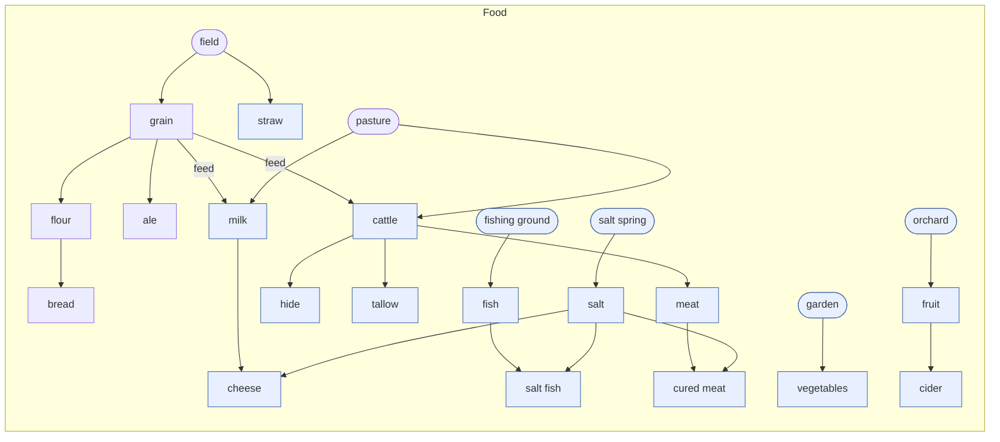
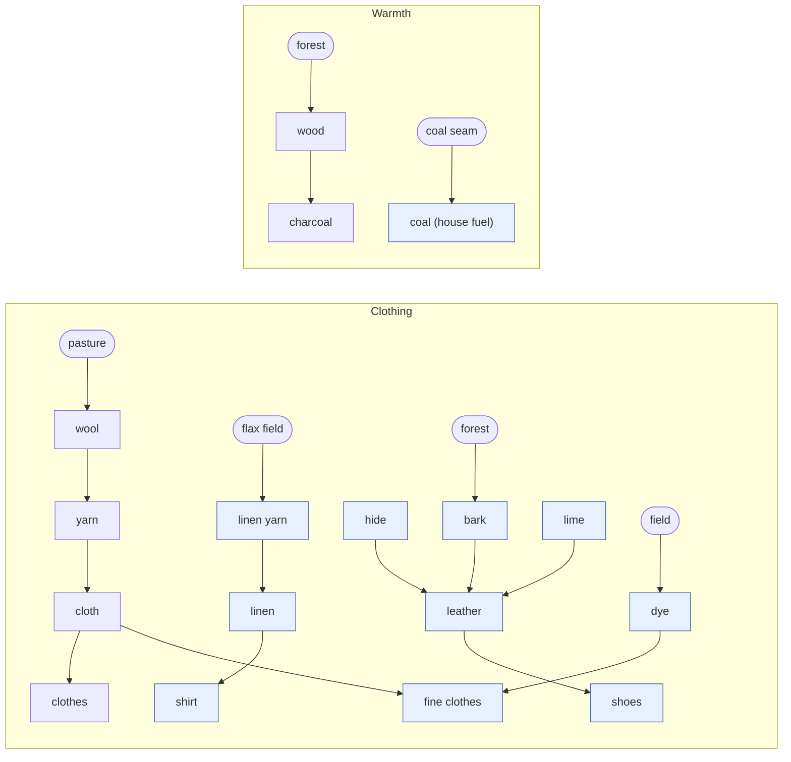
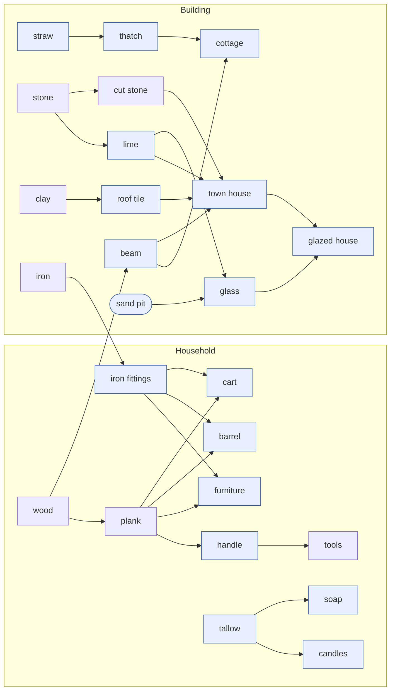
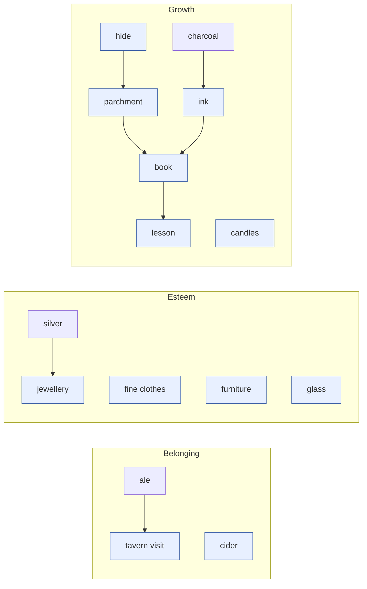

# Wider tech tree (plan Phase 4, step 1)

This is a proposal for the owner to review. No content has been added yet.
It lists every good, recipe and building planned for the needs in the plan,
starting from what is already in `assets/content`. Yields here are first
guesses; the content step calibrates them the way `food-yields.md` did.

## How to read the tables

- **Status:** *exists* is in content today, *change* edits an existing
  entry, and *new* is to be added.
- **Recipe:** inputs → outputs, then workers (`max_team`) and days
  (`duration`). An empty input means the recipe works a natural resource.
- **Era:** 0 Wood and grain, 1 Stone, clay and cloth, 2 Bronze, 3 Iron and
  steel, 4 Early industry.
- **Trade:** a trade is a skill domain, and its guild. Ranks are apprentice,
  member and master (`organize.master_years`). The rank shown is a loose
  suggestion: *any* is simple work, *member* is skilled work, and *master*
  is fine work, which matches a difficulty of 0.6 or more. No rank gates a
  recipe today.
- **New trades:** fishing, leatherworking, chandlery and learning. All other
  rows use the existing trades: agriculture, food, textiles, masonry,
  forestry, woodworking, mining, metallurgy, smithing, construction and
  engineering.
- **New natural resources:**
  - `fishing_ground`, on rivers and coasts;
  - `salt_spring`;
  - `sand_pit`;
  - `garden` and `orchard`, which towns open with land plots, as they do
    `field` today.

## Food

| Status | Need | Good (food value) | Recipe | Building | Era | Resource | Trade · rank |
|---|---|---|---|---|---|---|---|
| exists | food | grain (0.3), flour, bread (1.0) | farm, mill and bake, as now | mill, bakery | 0 | field | agriculture, food · any |
| exists | food, belonging | ale (0.7) | grain 3 + pot + wood → ale 5; 1 worker, 1 day | brewery | 1 | | food · member |
| change | food, building | straw | farm_grain → grain 4 + **straw 2** | | 0 | field | agriculture · any |
| new | food | fish (0.6) | → fish 3; 3 workers, 1 day | | 0 | fishing_ground | fishing · any |
| new | food | net (tool, fishing +25 %) | yarn 3 → net 1; 1 worker, 1 day | weaving shed | 1 | | textiles · member |
| new | food | vegetables (0.4) | → vegetables 5; 3 workers, 1 day; summer and autumn only | | 0 | garden | agriculture · any |
| new | land | garden plot | → garden plot; 4 workers, 10 days | | 0 | | agriculture · any |
| new | food | fruit (0.3) | → fruit 4; 4 workers, 1 day; autumn only | | 1 | orchard | agriculture · any |
| new | land | orchard plot | plank 4 → orchard plot; 4 workers, 20 days; bears after 3 years | | 1 | | agriculture · any |
| new | food (feed) | cattle (livestock) | **grain 4** → cattle 1; 2 workers, 10 days | byre | 0 | pasture | agriculture · member |
| new | food | milk (0.3) | grain 1 → milk 4; 2 workers, 1 day; spoils in days | byre | 0 | pasture | agriculture · any |
| new | food, chain | meat (0.8), hide, tallow | cattle 1 → meat 8 + hide 2 + tallow 2; 2 workers, 1 day | butchery | 0 | | food · member |
| new | food | salt | wood 2 → salt 3; 2 workers, 1 day | saltern | 1 | salt_spring | food · any |
| new | food | cheese (0.9) | milk 6 + salt 1 → cheese 2; 1 worker, 1 day; keeps a year | dairy | 1 | | food · member |
| new | food | salt fish (0.6) | fish 4 + salt 1 → salt fish 4; 1 worker, 0.5 days; keeps a year | smokehouse | 1 | | fishing · any |
| new | food | cured meat (0.8) | meat 4 + salt 1 + wood 1 → cured meat 4; 1 worker, 0.5 days | smokehouse | 1 | | food · member |
| new | food, belonging | cider (0.5) | fruit 5 + barrel 1 → cider 6; 1 worker, 1 day | brewery | 1 | | food · member |

**Grain as a surplus sink:**
- *Livestock feed:* cattle eat 4 grain per head raised, and milk takes 1 grain
  a day. That gives a lean year a buffer: a town can feed less and slaughter
  more.
- *Ale:* ale exists and already takes 3 grain per 5 ale. Cider adds a second
  drink without grain.

## Clothing

| Status | Need | Good | Recipe | Building | Era | Resource | Trade · rank |
|---|---|---|---|---|---|---|---|
| exists | warmth, esteem | wool, yarn, cloth, clothes | shear → spin → weave → sew | weaving shed, workshop | 0–1 | pasture | agriculture, textiles · any to member |
| change | warmth, health | linen yarn, linen | spin_flax → **linen yarn** 2; linen yarn 3 → linen 1; 1 worker, 1 day | weaving shed | 1 | flax_field | textiles · member |
| new | warmth, health | shirt (warmth 1 °C, health 0.1) | linen 2 → shirt 1; 2 workers, 1 day | workshop | 1 | | textiles · member |
| new | chain | bark | → bark 3; 2 workers, 1 day | | 0 | forest | forestry · any |
| new | warmth, chain | leather | hide 2 + bark 1 + lime 1 → leather 2; 2 workers, 2 days | tannery | 1 | | leatherworking · member |
| new | warmth, health | shoes (warmth 1 °C, health 0.15) | leather 1 → shoes 1; 1 worker, 1 day | workshop | 1 | | leatherworking · member |
| new | esteem | dye | → dye 2 (woad); 3 workers, 1 day | | 1 | field | agriculture · any |
| new | esteem | fine clothes (warmth 3 °C, esteem 0.5) | cloth 2 + dye 1 → fine clothes 1; 1 worker, 1.5 days | workshop | 2 | | textiles · master |

## Warmth

| Status | Need | Good | Recipe | Building | Era | Resource | Trade · rank |
|---|---|---|---|---|---|---|---|
| exists | warmth | wood (firewood, 15 per unit) | → wood 3; 4 workers, 1 day | | 0 | forest | forestry · any |
| exists | warmth | charcoal (30 per unit) | wood 3 → charcoal 2; 1 worker, 1 day | furnace | 0 | | forestry · any |
| change | warmth | coal (house fuel, 35 per unit) | add `household` Burn to coal | | 4 | coal_seam | mining · any |

## Shelter and household

| Status | Need | Good | Recipe | Building | Era | Resource | Trade · rank |
|---|---|---|---|---|---|---|---|
| exists | shelter | plank, pot, cloth | as now | workshop, kiln | 0–1 | | woodworking, masonry · any |
| new | chain | handle | plank 1 → handle 2; 1 worker, 0.5 days | workshop | 0 | | woodworking · any |
| change | chain | tools | forge_hammer, forge_pickaxe, forge_axe, forge_plough: plank → **handle** | smithy | 3 | | smithing · member |
| new | shelter, esteem | furniture (shelter 0.3, esteem 0.1) | plank 6 + fittings 1 → furniture 1; 2 workers, 2 days | workshop | 1 | | woodworking · member |
| new | chain | barrel | plank 4 + fittings 1 → barrel 2; 1 worker, 1 day | workshop | 1 | | woodworking · member |
| new | trade | cart (caravan load +50 %) | plank 8 + handle 2 + fittings 2 → cart 1; 3 workers, 3 days | workshop | 1 | | woodworking · master |
| new | growth, shelter | candles (growth 0.1, shelter 0.05) | tallow 2 + yarn 1 → candles 6; 1 worker, 1 day | workshop | 1 | | chandlery · any |
| new | health | soap (health 0.2) | tallow 2 + wood 1 → soap 4; 1 worker, 1 day | workshop | 1 | | chandlery · any |
| new | shelter | house (raises `house_c`) | see Building | | 0–3 | | construction · member |

## Building materials

| Status | Need | Good | Recipe | Building | Era | Resource | Trade · rank |
|---|---|---|---|---|---|---|---|
| exists | building | plank, cut stone, brick | as now | workshop, mason's yard, kiln | 0–1 | | woodworking, masonry · any |
| new | building | thatch | straw 4 → thatch 2; 2 workers, 1 day | | 0 | | construction · any |
| new | building | beam | wood 4 → beam 1; 2 workers, 1 day | workshop | 0 | | woodworking · any |
| new | building, leather | lime | stone 3 + charcoal 1 → lime 2; 1 worker, 1 day | kiln | 1 | quarry | masonry · any |
| new | building | roof tile | clay 3 + charcoal 1 → tile 4; 1 worker, 1 day | kiln | 1 | clay_pit | masonry · member |
| new | building | sand | → sand 4; 3 workers, 1 day | | 1 | sand_pit | masonry · any |
| new | building, esteem | glass (esteem 0.2 at home) | sand 3 + lime 1 + charcoal 2 → glass 1; 2 workers, 1.5 days | glasshouse | 3 | | masonry · master |
| new | building, chain | iron fittings | iron 1 → fittings 6; 1 worker, 1 day | smithy | 3 (bronze fittings in era 2) | | smithing · any |
| new | shelter | cottage (house_c +0) | beam 6 + thatch 10 + wood 10 → cottage; 4 workers, 20 days | | 0 | | construction · any |
| new | shelter | town house (house_c +3) | beam 8 + cut stone 12 + tile 20 + lime 4 → town house; 6 workers, 40 days | | 1 | | construction · member |
| new | shelter, esteem | glazed house (house_c +5, esteem 0.2) | town house + glass 6 + fittings 6 → glazed house; 6 workers, 15 days | | 3 | | construction · master |

## Belonging, esteem and growth

| Status | Need | Good | Recipe | Building | Era | Resource | Trade · rank |
|---|---|---|---|---|---|---|---|
| exists | belonging | ale | as above | brewery | 1 | | food · member |
| exists | esteem | silver (0.5) | refine silver | furnace | 2 | silver_vein | metallurgy · member |
| new | belonging | cider (0.3) | as above | brewery | 1 | | food · member |
| new | belonging | tavern visit (service, 0.4) | ale 1 → visit 4; 1 worker, 0.5 days | tavern | 1 | | food · any |
| new | esteem | jewellery (0.8) | silver 1 → jewellery 2; 1 worker, 2 days | smithy | 2 | | smithing · master |
| new | esteem | fine clothes, furniture, glass | see above | | 1–3 | | |
| new | growth | parchment | hide 1 + lime 1 → parchment 4; 1 worker, 1 day | tannery | 1 | | leatherworking · member |
| new | growth | ink | charcoal 1 + pot 1 → ink 4; 1 worker, 0.5 days | workshop | 1 | | learning · any |
| new | growth | book (growth 0.5, lasts years) | parchment 8 + ink 1 + leather 1 → book 1; 1 worker, 10 days | scriptorium | 2 | | learning · master |
| new | growth | lesson (service, growth 0.3) | → lesson 6, with a book in the school (not used up); 1 worker, 1 day | school | 2 | | learning · member |

Services (the tavern visit and the lesson) are made and used on the spot, so
they are not stocked. They need a small mechanic (see Open questions).

## New buildings

| Building | Slots | Build from | Era |
|---|---|---|---|
| byre | 12 | plank 8 + wood 10 | 0 |
| butchery | 8 | plank 8 + wood 6 | 0 |
| dairy | 8 | plank 8 + stone 6 | 1 |
| smokehouse | 8 | brick 8 + plank 6 | 1 |
| saltern | 8 | brick 6 + plank 6 + pot 6 | 1 |
| tannery | 10 | plank 10 + wood 6 + stone 6 | 1 |
| tavern | 6 | beam 6 + plank 10 + thatch 8 | 1 |
| glasshouse | 6 | brick 20 + cut stone 6 | 3 |
| scriptorium | 4 | cut stone 12 + plank 8 + glass 2 | 2 |
| school | 6 | cut stone 8 + beam 6 + tile 10 | 2 |

## Chains per need

New nodes are shaded.

## Food variety (proposal)

Today the food need is `1 - hunger`, and people eat the most valuable food
first. Bread alone satisfies it fully, so no one has a reason to buy fish,
cheese or vegetables.

**Proposal:** keep hunger as it is, counted in food values, so the yields of
`food-yields.md` still hold. Add a variety factor to the food satisfaction:

- **Food groups:**
  - grain: bread, grain, ale;
  - dairy: milk, cheese;
  - meat: meat, cured meat;
  - fish: fish, salt fish;
  - vegetables;
  - fruit, cider.
- **Diet:** each person keeps a fading record of the food value eaten per
  group over about 10 days, with shares p_g.
- **Variety:** v = exp(−Σ p_g ln p_g), the effective number of groups:
  1 for bread alone and 3 for three groups in equal parts.
- **Satisfaction:** food = (1 − hunger) × (0.7 + 0.3 × min(1, (v − 1) / 2)).
  - Bread alone scores 0.7.
  - Two groups in equal parts score 0.85.
  - Three or more groups score 1.0.
- **Health (optional):** v below 1.5 for a season costs a little health.
  This models scurvy.

The ladder buys whatever raises satisfaction most per coin. A town fed on
bread then values its first cheese or fish highly, and a second loaf of bread
little. The eating rule changes too: people eat from the groups they hold in
proportion, not best-first.

## Open questions and mechanics this needs

1. **Spoilage per good.**
   - Today one food spoilage rate covers all food.
   - Preserving (salt fish, cured meat, cheese) only matters if fresh fish,
     meat and milk spoil much faster than grain.
   - This needs a `spoils_per_year` field on each product.
2. **Seasonal yields.**
   - Vegetables and fruit should come only in their seasons.
   - Daylight already shapes outdoor work, but the yield itself needs a
     seasonal curve.
3. **Services.**
   - A tavern visit or a lesson is used where it is made.
   - Either it is made to order, or it is a stock that perishes the same day.
4. **Houses.**
   - `house_c` (6 °C) is one constant for every town.
   - Houses would make it per household, which makes roofs and glass worth
     building.
5. **Carts.**
   - The cart needs caravans to use a vehicle that raises their load.
   - Without that, drop the cart.
6. **Trades.**
   - The four new trades (fishing, leatherworking, chandlery, learning) are
     new guilds. The other option is to fold them into food, textiles and
     woodworking to keep guilds large enough to train apprentices.
   - Phase 3 decides how trades and ranks work. This table only labels the
     rows.
7. **Order of work.**
   - Suggested first: food (fish, vegetables, cattle, salt, the variety
     score), because it uses the grain surplus.
   - Then clothing and building materials.
   - Belonging, esteem and growth goods last, once services exist.
