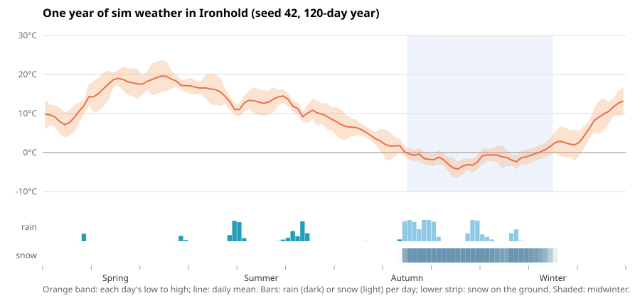

# Time, seasons and weather

Step 1 of the economy redesign (items, time, needs). The full design note is a
Claude Doc: "Econoplex economy redesign: items, time, needs".

## Clock

- A year is `time.months_per_year` simulated days (12). Each simulated day is
  the representative day of a month and stands for `time.days_per_month` days
  (10, so a year is still 120 days of economy and yearly totals stay put). The
  economy runs in steps through it (below); there is no loop over the days
  of a month.
- `SimClock.tick` counts simulated days (months): `year()` is
  `tick / months_per_year`, `day_of_year()` is the month. Agents' ages are in
  months (`AgentStore::age_months`).
- `time.steps_per_day` (300 by default, at least 1; `--set
  time.steps_per_day=N`) cuts the simulated day into economy steps, and the
  whole economy runs every step (`EconomyStep`): work, production, market,
  prices, eating, choices, migration, the military and governors.
  `SimClock.step` is the step within the day, `SimClock::steps()` the step
  count since the start (every system's RNG stream is seeded with it). A step
  stands for `days_per_month / steps_per_day` days of time (1/30 day, 48
  minutes, at the defaults); `Calendar::days()` is that, `Calendar::steps(d)`
  turns a span in days into steps.
- Season and weather are those of the middle of the month: the continuous day
  is `(tick - 1) * days_per_month + (days_per_month - 1) / 2 + hour / 24`. The
  ground (snow, wet soil) steps `Calendar::days()` days a step, so it melts and
  dries over the month.
- Work follows the hour of the representative day: indoor work runs 6:00 to
  18:00 (the equinox hours), outdoor work (nature, fields, building sites,
  new land, marching) from sunrise to sunset, 8 hours in midwinter and 16 in
  midsummer (`env::work_hours`). A step does the share of a working day that
  falls in its hours times the days it stands for
  (`env::work_days_this_step`), so a day of steps does a month of work, and
  night steps do none.
- `Simulation::step()` runs a whole simulated day; `Simulation::step_tick()`
  runs one step.

### What runs when

| Cadence | What |
| --- | --- |
| every step | needs and eating, going back to the day's job, team assignment, production flows, pay, the market's use and spoilage, caravans, loans, the military's march and fights, deaths of the sick, the residents' list |
| once per day of time (`SimClock::day_of_time()`, on its first step) | body (capacity, training, disuse), the household ladder's wear, fuel, cold and happiness, social ties fading, culture following neighbours, random contacts |
| first step of each day of time (`SimClock::work_day_start`) | job choice (capacity, scoring, matching, pay); prices, scarcity caps and the market's purchases from workshops, by the day's move (run every step, gluts grew from 4% at 10 steps a day to 17% at 300; once a day they stay at 7-10% at 10, 24 and 300, 16 seeds over 30 years) |
| first step of the simulated day (`env::day_start`) | ageing, births, partnering, hazards, starving counts, governors, metrics, history samples, goals, the ledger's year end |
| every N months, on the first step (`SimClock::every_months(n)`) | trade rounds, organize, muster, raid plans, tribute, migration |

A day of time is one of the `days_per_month` equal stretches of the
simulated day's 24 hours (2.4 hours at 10 days a month), the same span of
game time at any step size: a step belongs to the day of time its start
falls in, so at 24 steps a day the days of time are two or three steps
long, and ten of them make the day (rounding `steps(1)` gave twelve,
twenty per cent more choices and places).

The slow processes moved to once per day of time are those whose state
changes only by a few hundredths a day: running them every step cost about a
third of a step's time and changed nothing measurable.

### Rates scaled to the step

- Work and production: the working days that fall in the step's hours
  (`work_days_this_step`), and inputs, nature and output flowing with them,
  so a day of steps does the same work at any `steps_per_day`.
- Tiredness: work adds `fatigue_per_work_day` per working day done; everyone
  recovers `fatigue_idle_recovery` a day of time, at work or not, as when a
  step was a day. A rest recovers `fatigue_rest_recovery` for each day of
  work it skips, from the step it is chosen in (decide) to the last step
  before the next choices, so it covers the same hours at any step size.
- Job choice, places and pay: once a day of time
  (`SimClock::work_day_start`), with that day's calendar; places count a day's
  inputs per worker. At `steps_per_day = days_per_month` (10) a step is a day
  of time and the economy runs as it did when a tick was an economy day. Every job starts out showing what it
  would pay at the starting prices (a rate that starts at nothing kept
  everyone idle on the first day). A rest lasts until the next day's
  choices.
- Flows per day (hunger, health, rent, wages, regrowth): `flow`, times the
  step's days. Shares, decay and smoothing: `share`, `keep`, `smoothing`
  (compounded, `1 - (1 - r)^days`). Memories and spans in days: `steps(d)`.
- Probabilities per whole run delivered (success) and per event (contacts, fights) are
  per piece of work or meeting, not per step; contacts per step are
  `flow(daily_contacts)`.
- Ageing, births, hazards, governors, metrics: on the first step of the
  simulated day; intervals in months: `every_months`.

### Production as a flow, and the progress bar

Every step, each team at work turns its work into runs of its recipe as a
flow: `n^0.85 * work days / duration` runs, with the inputs (and the nature
harvested) taken at the same rate in fractional amounts, and firms paying for
them as they flow. When inputs, nature or the buyer's money run short, the
team works at that fraction of its rate. Runs accumulate in `Task::progress`;
each whole run's output goes to market (in whole units) when it is done,
with its pay, its success roll and its practice, and the fraction carries
on. That fraction is the progress bar (`BuildingView::progress`, 0..1), drawn
over the building in both clients. Teams break up at the end of each day of
time (`SimClock::work_day_end`; what is under way is
kept: `Town::wip` carries the runs under way to the next team on the recipe,
so work longer than a day is not lost) and everyone chooses again the next
day of time. The sum over a day is the same at any step size.

A step longer than `time.production_hours` (0.2 hours) is worked in slices
of at most that long, each delivering its finished runs before the next, so
what one trade makes reaches the next within the step as it would at a finer
step. Without the slices a chain moved one stage a step: at 24 steps a day
bread and flour came out about a quarter lower than at 120 or 300 (36 small
seeds over two years). With them 24, 120 and 300 agree to about ten per cent
on the bulk goods.

### Real time in the clients

Both clients run steps from real time: the speeds are 5 minutes, 1 minute and
12 seconds of real time per simulated day, then 1 and 4 days a second (the 3D
client also 12, 30, 60 and 120). At the default 5 minutes a day, 300 steps a
day come about once a real second. The labels come from
`calendar::speed_label`.

- The clients show dates as year and month (`calendar::date`, "y3 Mar").
- Outdoor work (nature, buildings, new land; then `work_hours: Daylight`, now
  always) is scaled by today's daylight against the equinox: 8/12 in midwinter, 16/12 in midsummer.
  Against the full working day all year (`AllDay`, then the default, removed
  2026-11-15), over 6 seeds and 20 years: population 1918 to 1876, food per
  head 8.9 to 6.1 days, swords 1373 to 1046, no starvation either way.
- Hosts that run the schedules themselves call `sim_core::add_schedules` and
  run `SimTick` once per step (the 2D game does).
- The calendar year starts at the spring equinox (`year_starts_at: 0.25`).
- Daylight is 12 hours at the equinoxes, 8 in midwinter and 16 in midsummer,
  with 2 hours each of dawn and dusk (`day_length`).

## Converting daily rates to the step

All conversions go through `sim_core::calendar::Calendar` (built from `time`,
`ModelParams::calendar()`, `SimClock::calendar()`):

| Kind | Helper | Rule |
| --- | --- | --- |
| a daily flow | `flow(x)` | `x * days` |
| a daily share (0..1) | `share(r)` | `1 - (1 - r)^days` |
| what a daily keep leaves | `keep(k)` | `k^days` |
| a moving average with a memory in days | `smoothing(m)` | `share(1 / m)` |
| a kick against relaxation | `kick(x, r)` | `x * share(r) / r` (same balance) |
| a time constant in days | `steps(d)` | `d / days` steps |
| a yearly rate | `per_year()` | divide by the steps in a year |

`days` is the days of time a step stands for. Work done in a step is the
working days that fall in its hours (`Calendar::work_share`,
`work_step_days`).

What converts how (config units stay as written unless named):

| Quantity | Where | Conversion |
| --- | --- | --- |
| hunger per day, eating | needs.rs | `flow`; then meals until back at `eat_threshold` (at most 64) |
| fatigue | needs.rs | unchanged: the representative day's |
| starvation damage, health regrowth | needs.rs | `flow` |
| rent; rent stickiness | needs.rs | `flow`; `smoothing` |
| happiness relaxation | needs.rs, ladder.rs | `share` |
| ladder wear, fuel, cold damage, cold days | ladder.rs | `keep`, `flow`, `flow`, `whole_days` |
| ladder `interval`, shopping size | ladder.rs, models.ron | days (7), as `steps(interval)` steps; units bought scale with the days |
| expected temperatures over the year | ladder.rs | `days_per_year()` |
| adaptive expectations | decision/expectations.rs | each run's pay weighs by the days of work it stands for (compounded), not by the step; a run cut into more pieces moves the expectation as far |
| excess-demand wage step | decision/wages.rs | once a day of time, with the day's choices: unscaled |
| culture memory | decision/culture.rs, social.rs | `steps(memory_days)` steps |
| price classes: speeds, max daily move, memory | pricing.rs | times days; `months` |
| legacy price adjust | market.rs | `flow` |
| scarcity cap | market.rs | `(1 + r)^days` up, `keep` down |
| input and goods use | market.rs | per day (divided by days), `smoothing(30)` |
| firm input stocks, short days | market.rs | per day; `days()` a step |
| loans: interest, instalments | firms.rs | yearly rate per step; spread over the `steps(days_left)` steps left |
| firm payout, import repayment | market.rs | `share` |
| bills, ledger figures | firms.rs, ledger.rs | kept as daily averages of the month |
| food reserve | decide.rs, models.ron | `food_reserve_days` times a day of hunger (as on main: one day, not a month) |
| job places | decide.rs | a day's inputs and nature per worker, as when a step was a day; none in a day of time with no working hours |
| apprentice share reconsidered | decide.rs | first choices of every 30th day |
| labour max daily, building load | decide.rs | `flow`; `smoothing(30)` |
| team output rate | work/teams.rs | times days; harvests can draw on several sites |
| work progress, tool wear | work/mod.rs | times days; `uses` = days on the task |
| work mood | work/mod.rs | `kick` |
| practice, diffusion, forgetting | models.rs, learning.rs | compounded over the days of practice |
| posted pay, pay rate smoothing | work/pay.rs | `smoothing`, `share` |
| school fees and practice | learning.rs | `flow`; over `days()` |
| body capacity, training, disuse | body.rs | over days; `share` |
| soldiers' pay, drill, march speed | military | `flow`; over `days()`; `flow` |
| war planner's year | military/planner.rs | `days_per_year()` |
| migration knowledge fade | migrate.rs | interval times days |
| food trend | life.rs | per day, `smoothing(60)` |
| governor flows and memories | governor.rs | per day; `smoothing` |
| granary profile | granary.rs | `share` |
| regrowth, frost, rot | farming.rs | times days; `keep` |
| history samples, quiet spell | history.rs | `SAMPLE_MONTHS = 1`, `QUIET_MONTHS = 3` |
| starving share | metrics.rs | per person-month |
| ages, birth and death rates per year | store.rs, life.rs | `months_per_year` |
| intervals and cooldowns (partner, trade, organize, muster, raid, tribute, migration, governor) | models.ron | counted in months: 1, 1, 2, 1, 12, 3, 3, 3 |

## Weather

- `climate: Seasonal(...)` sets the averages: mean temperature, seasonal and
  daily swing, how often it rains and in which season most.
- `weather: Fronts(...)` is seeded 3D value noise drifting east across the map,
  so fronts form, pass over towns and break up. Where the field passes the rain
  line it rains, or snows below about 1 °C. Warm and cold spells last a few days.
- Weather is a pure function of seed, time and place (`env::weather_at`), so
  it can be asked for anywhere, for example under the 3D camera. Only the
  ground (snow cover, wet soil) keeps state; it is saved.
- `Constant(temperature)` and `Clear` turn seasons and fronts off for tests.

## Interface for the 3D view

`sim_core::env::Environment` has the same fields as the stand-in in
`game3d/src/env.rs`: `hour`, `season` (0 = midwinter, 0.5 = midsummer),
continuous `day`, and per town `weather { temperature, wind, cloud, precip,
haze }` and `ground { snow, wet }`. Wind is `(f32, f32)` in world x, y.

## Looking at it

`sim_cli --years 1 --weather weather.csv` writes one row per step and town.

