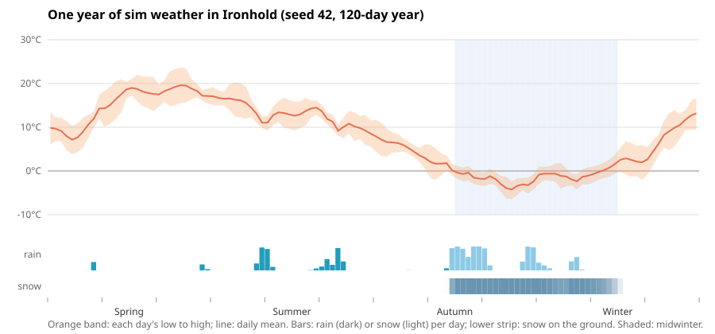

# Time, seasons and weather

Step 1 of the economy redesign (items, time, needs). The full design note is a
Claude Doc: "Econoplex economy redesign: items, time, needs".

## Clock

- `time.ticks_per_day` (12 by default) cuts each day into ticks; `SimClock.tick`
  still counts days and `SimClock.sub` is the tick within the day.
- The economy runs on the day's first tick. The other ticks only move the
  hours and the weather on, so the state hash is the same at any number of
  ticks per day.
- `Simulation::step()` runs a whole day; `Simulation::step_tick()` runs one tick.
- `days_per_month * months_per_year * economy_days_per_day` must equal
  `life.days_per_year`.
- Time compression: `economy_days_per_day` runs that many days of economy on
  each game day's first tick (`EconomyDay` schedule, run by `env::run_economy`).
  For play, 12 game days a year: `days_per_month: 1`, `economy_days_per_day: 10`;
  each game day then stands for 10 days of making, eating and growing, and the
  economy's rates stay per day. The default stays 1 (120 game days a year).
- `work_hours: Daylight` (off by default) scales outdoor work (nature, buildings,
  new land) by today's daylight against the equinox: 8/12 in midwinter, 16/12 in
  midsummer. Over 6 seeds and 20 years: population 1918 to 1876, food per head
  8.9 to 6.1 days, swords 1373 to 1046, no starvation either way.
- Hosts that run the schedules themselves call `sim_core::add_schedules` and
  `sim_core::run_day` (the 2D game does).
- The calendar year starts at the spring equinox (`year_starts_at: 0.25`).
- Daylight is 12 hours at the equinoxes, 8 in midwinter and 16 in midsummer,
  with 2 hours each of dawn and dusk (`day_length`).

## Weather

- `climate: Seasonal(...)` sets the averages: mean temperature, seasonal and
  daily swing, how often it rains and in which season most.
- `weather: Fronts(...)` is seeded 3D value noise drifting east across the map,
  so fronts form, pass over towns and break up. Where the field passes the rain
  line it rains, or snows below about 1 °C. Warm and cold spells last a few days.
- Weather is a pure function of seed, time and place (`env::weather_at`), so
  it can be asked for anywhere, for example under the 3D camera. Only the
  ground (snow cover, wet soil) keeps state; it is saved.
- `Constant(temperature)` and `Clear` turn seasons and fronts off for tests.

## Interface for the 3D view

`sim_core::env::Environment` has the same fields as the stand-in in
`game3d/src/env.rs`: `hour`, `season` (0 = midwinter, 0.5 = midsummer),
continuous `day`, and per town `weather { temperature, wind, cloud, precip,
haze }` and `ground { snow, wet }`. Wind is `(f32, f32)` in world x, y.

## Looking at it

`sim_cli --years 1 --weather weather.csv` writes one row per tick and town.

