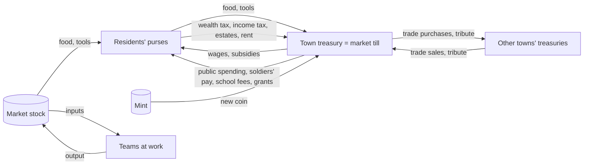

# How the town market works (default settings, 2026-11-10)

This describes the market as the code runs it with the default `models.ron`
(`market.firms: Treasury`, `pricing: StockTarget`, no price classes, no household
consumption). The optional variants are summarised at the end. The numbers come
from a run with seed 42 at the end of year 10.

## Who holds what

- **Each town has one market.** Its stock (`Town::stock`) is the town's warehouse,
  and its till is the **town treasury**. The market is the only buyer of what
  people make and the only seller of food and tools to residents. There are no
  private firms by default.
- **Residents** hold coin (`AgentStore::wealth`). It can go negative when they buy
  tools on credit (up to `tool_credit` = 40).
- **Money only moves between purses**: residents, the town treasuries, and other
  towns' treasuries. The **mint** is the only source of new coin. The ledger books
  every treasury flow by kind, and money conservation is tested.

## The daily order of operations

Each tick (day) runs the systems in this order:

1. `apply_orders`: player and AI orders take effect (taxes, subsidies, government
   orders, buildings, imports, ...).
2. `needs::sense`: hunger and fatigue; **residents eat** from the market's stock
   and pay for it; optional rent.
3. `decide`: idle adults choose a job among those with open places, or rest.
4. `work::assign`: teams form; **inputs are taken from the market's stock**.
5. `work::produce`: a day's work. When a run finishes, its **output goes into the
   market's stock**, and the team's **wage claim** is paid from the treasury.
6. `learn`, `socialize`, `body`: skills, social ties, health.
7. `market::settle`: **prices** update, food spoils, **wealth tax**, **public
   spending**, food imports (if on), **caravans** every 10 days, nature regrows.
8. `organize`: guilds and schools (school fees), and **residents buy tools** from
   the armory.
9. `military`: soldiers' pay, **tribute** every 30 days, raids and loot.
10. `migrate`, then `lifecycle`: moves (settlement grants), births, deaths
    (**estates** without heirs go to the treasury).
11. `ledger::close_day`, `metrics`, `history`, `goal`, then **AI governors** set
    the levers for the next day.

## How goods reach the market and who pays the maker

- **Job places:**
  - A job (recipe) has places only while its inputs are in the market's stock
    (beyond a one-day reserve kept for food chains), there's land left to work,
    and its building has room.
  - Nobody makes a good once the market holds more than `glut_factor` (10) × its
    target stock.
- **Inputs:** they leave the market's stock at the start of a run. Nobody pays for
  them directly; their value is subtracted from the team's claim.
- **The claim:** when a run succeeds, the output is added to the market's stock and
  the team claims

  `wage share` (0.5, the town's `wages` lever) × `market pay factor` (1 by default)
  × (value of the output at today's price × (0.5 + quality) − value of the inputs)

  plus any **subsidy** (the subsidised share × base price per unit). Failed runs
  claim nothing.
- **Paying out:** all of the day's claims in a town are paid from the treasury.
  - If the treasury can't cover them all, every claim gets the same fraction
    (`settle_wages`, "fair rationing"). Subsidies are paid from what is left.
  - **Income tax** (the town's lever, 0 by default) takes its share straight
    back.
  - Each worker gets an equal share; an apprentice gets `apprentice_wage` of a
    share when matching is on.
- **Public pay rate:** realised pay per worker-day updates each job's public pay
  rate, which agents use when they choose jobs.
- **Government orders** (`procure`) raise the market's target stock for a good, so
  its price and its makers' pay rise. Delivered units leave the stock for public
  use.

## How residents buy, and at which price

- **Food:** when an agent's hunger passes `eat_threshold`, it eats one unit of the
  best food the market holds (seed grain for the mills is held back).
  - It pays the town price, or all its coin if that's less, into the treasury
    (flow `food`).
  - Food spoils at `food_spoilage` (0.5) a year.
- **Tools:** a worker without a tool buys the best one it can afford from the
  armory, at price × (0.5 + quality), on credit if needed (flow `tools`).
- **Other goods:** nothing. With the defaults, households buy only food and tools.
  The optional household consumption (`market.consumption`) adds clothes, pots,
  ale and so on.

## How prices are set (default: `pricing: StockTarget`)

Each day, for every ordinary good:

- **Target stock** = `target_per_capita` (0.3) × residents, or
  `food_target_per_capita` (3) × residents for food, plus open government orders.
- **Pressure** = (target − stock) / target, clamped to −1..1.
- **Price** × exp(`price_adjust` (0.05) × pressure): at most about 5 % a day,
  within `min_price_factor` (0.2) and `max_price_factor` (5) × base price.

Some goods have their own rules:
- **Buildings:** priced by how full the town's existing ones are, and how scarce
  their goods are (`build_threshold` 0.75); a town's first of a kind sells at
  `new_building_appeal` (0.3) × base.
- **Land:** priced by how worn the town's sites are (`land_threshold` 0.7), until
  `free_land` (6) plots are used.
- **Coin:** worth its face value while the town wants coin, otherwise nothing.

**Optional, demand-driven** (`pricing: Demand(cover_days, blocked_workers)`):
- Goods used as inputs aim for `cover_days` of what the town's trades use a day,
  plus what profitable trades blocked only by their shortage would use.
- Final goods keep the per-resident target.
- Price classes (`price_classes`) can add inertia, daily caps and wider bounds per
  class.

## Taxes, spending and where they go

All of these are treasury flows (in the ledger):

| flow | direction | rule |
| --- | --- | --- |
| wealth tax | resident → treasury | daily share of savings above `tax_free_wealth` (10), at `wealth_tax` (0.5) a year (town lever) |
| income tax | resident → treasury | share of every wage (town lever, 0 by default) |
| estates | resident → treasury | wealth of the dead without partner or children |
| public spending | treasury → residents | `public_spending` (2) a year of the treasury above its reserve (3 per resident), split equally |
| soldiers' pay | treasury → soldier | `soldier_pay` (0.8) a day |
| school fees | treasury → teacher | `school_fee` (0.02) per pupil-day |
| settlement grants | treasury → newcomers | `settlement_grant` (2) per person, with immigration encouraged |
| subsidies | treasury → makers | per unit made, with the wages |

## Trade, tribute and the mint

- **Caravans** run every `trade_interval` (10) days, for each good and each pair of
  towns.
  - A caravan goes when the destination price beats the source price plus
    transport (`transport_cost` 0.28 per 1000 road units). No caravan goes where no
    road leads.
  - It carries up to `trade_amount` (6) units, at most half the seller's stock,
    and only what the buyer's treasury can pay.
  - The buyer's treasury pays the destination price to the seller's treasury
    (flows `trade purchases` / `trade sales`). Tools travel as items.
- **Tribute:** every 30 days a conquered town pays its ruler `tribute_share` (20 %)
  of its treasury. It can revolt when its soldiers outfight the ruler's hold.
- **Loot:** a won raid takes a share of the loser's treasury and goods.
- **Mint:** on auto, a town wants coin while its treasury is below
  `mint_below_per_capita` (3) per resident. A mint (building) then strikes coin
  from silver or copper at face value. Coin goes straight into the treasury as new
  money (flow `minted`); the minters are paid like any other workers.

## Numbers from a typical run (seed 42, end of year 10)

Two towns at the end of year 10. Ironhold rules Greenvale and Timberwick.

| | Ironhold (ruler) | Greenvale (tributary) |
| --- | --- | --- |
| residents | 443 | 371 |
| treasury | 978 | 9 |
| residents' coin | 37,138 (top tenth hold 23,888) | 3,649 (debts −350) |
| wages paid | 135,965 a year (1,133 a day) | 4,613 a year (38 a day) |
| wealth tax taken | 103,393 (862 a day) | 1,612 (13 a day) |
| income tax | 3,209 | 0 |
| food sales | 23,395 | 2,649 |
| tool sales | 2,065 | 427 |
| trade sales / purchases | 25,808 / 23,365 | 6,282 / 6,385 |
| minted | 840 | 0 |
| bread: price, stock, target | 12.50 (cap 5×), 18, 1,329 | 0.66 (0.26×), 1,649, 1,113 |
| grain: price, stock, target | 0.20 (floor), 1,533, 1,329 | 0.20 (floor), 2,030, 1,113 |
| clothes: price, stock, target | 5.60 (floor), 461, 133 | 5.60 (floor), 577, 111 |

The other two towns:
- **Brassmoor:** 383 residents, treasury 1,803, residents' coin 11,756, wages
  57,000 a year, minted 5,100.
- **Timberwick:** 401 residents, treasury 649, residents' coin 448 net (debts
  −2,643, mostly tools bought on credit).

## Where money piles up and why treasuries run dry

1. **The treasury is the only buyer.**
   - Its income is food and tool sales, taxes, trade sales and the mint. Its
     spending is mostly wages.
   - Every coin of wages has to come back as purchases or taxes before it can pay
     the next wage. In Ironhold most of it comes back through the **wealth tax**
     (103k of 136k), not through purchases (25k).
   - The treasury works more like a bank recycling savings than a shop.
2. **Households only buy food and tools.**
   - A glut drives food to its floor (Greenvale's bread at 0.26× base), and then
     food sales bring in little.
   - Nobody buys clothes, pots or most goods. They pile up at their floor price,
     yet their makers were still paid when they made them.
3. **Money flows to strong towns and stays there.**
   - Trade surpluses, tribute, loot and migrants carrying their savings move coin
     to the strongest town.
   - By year 10, Ironhold's residents hold about two-thirds of all the coin in
     the world. Greenvale's treasury holds 9.
   - A poor town can't pay its makers, so it makes less, so it earns less. The
     mint helps only towns that have a mint and silver or copper.
4. **Within a town, money piles up with the rich.**
   - The top tenth of Ironhold's residents hold 64 % of its residents' coin.
   - The wealth tax pulls savings above 10 back each year, which is why it carries
     so much.
5. **Rationing then hides prices from labour.**
   - When the treasury can't pay the day's claims, every claim is cut by the same
     fraction.
   - A scarce good's high price raises its makers' claim, but not the money behind
     it.
   - The current decision model doesn't choose jobs by pay, so it barely notices.
     The utility model does, which is why its sword chain collapses.

Optional fixes in `models.ron`, all off by default and compared in
`agent-decisions.md` and `firms.md`:
- demand-driven price targets;
- price classes with inertia;
- scarcity caps that loosen;
- household consumption;
- workshops as firms (with loans, trade credit and profit tax);
- emergency food imports;
- a money-supply rule for the mint.

## Measured: labour spent on piles (2026-11-12)

Two new diagnostics (the state hash is unchanged):
- `glut%` in the batch report: the share of last year's production value made
  while the town already held more than its target stock **and** the good sat at
  its floor price.
- `gwork%`: the share of worker-days spent on recipes whose every output was in
  that state.

`cargo run --release -p sim_cli --example market_audit -- YEARS SEED` lists the
glutted goods per town.

**Defaults, 6 seeds × 20 years:** glut 28.7 % ± 9, gwork **39 % ± 9**. Seed 42 at
year 10, by town (glut%):

| town | glut | biggest piles (made a year, stock vs target) |
| --- | --- | --- |
| Ironhold | 9 % | flour, iron longswords, stone |
| Greenvale (tributary, farming) | 66 % | ale 5,360 (5,519 vs 1,113), grain 11,112 (2,030 vs 1,113), flour, yarn, wool, bricks |
| Timberwick | 13 % | ale, bricks, clay |
| Brassmoor | 10 % | grain, flour, copper ore |

Prices already pay little for glutted goods (0.2× base), so the money lost is
small. The real loss is labour. Work on a good stops only at `glut_factor` (10)
× target, and for food that is 30 per resident.

**Tried (6 seeds × 20 years; all off by default):**

| setting | food/cap | kinds | swords | gwork |
| --- | --- | --- | --- | --- |
| defaults | 13.6 | 28.5 | 1024 ± 236 | 39 % |
| `glut_factor: 2` | 9.3 | 27.2 | 758 ± 71 | 54 % |
| `trade_amount: 60` | 12.0 | 27.5 | 1346 ± 385 | 33 % |
| `stop_at_floor: true` (new) | 5.9 | 23.6 | 552 ± 111 | 28 % |

What this says:
- **A lower cap moves the waste, it doesn't remove it.** Stocks then hover
  between 1× and 2× target at the floor price, and the work goes on.
- **Refusing work on glutted goods frees labour, but it doesn't reach the
  complex chains.** Variety and swords fall. The freed workers rest or crowd
  the next simple job; the sword chain is held back by other things (inputs,
  buildings, skills), not by hands.
- **Bigger caravans help the most** (swords +31 %, less waste) by moving piles
  to towns that lack them.

Next: find what holds the complex chains back when labour is free (the "why"
view's explainer, per chain), and test caravans that ship in proportion to the
price gap.

### Caravans that balance (2026-11-12)

`market.caravans: Balance(max_load: N)` (off by default; `Fixed` keeps the old
rule). A caravan carries the seller's surplus over its own target, up to what
the buyer lacks of its target and can pay for, at most N units. Before, it
carried a fixed 6 units, at most half the seller's stock.

**6 seeds × 20 years:**

| caravans | `stop_at_floor` | food/cap | kinds | swords | gini | gwork |
| --- | --- | --- | --- | --- | --- | --- |
| Fixed (default) | off | 13.6 | 28.5 | 1024 ± 236 | 0.66 | 39 % |
| Balance 100 | off | 9.9 | 28.5 | 1076 ± 350 | 0.59 | 26 % |
| Balance 400 | off | 10.7 | 28.3 | 1435 ± 450 | 0.61 | 36 % |
| Balance 1000 | off | 10.2 | 28.5 | 1514 ± 426 | 0.61 | 35 % |
| Balance 400 | on | 5.9 | 25.2 | 596 ± 109 | 0.59 | 17 % |

- **Balancing caravans help on every measure:** more swords, less inequality
  between towns, less wasted work. Variety is unchanged. Food per head falls
  from 13.6 to about 10, still more than three times the target, and nobody
  starves.
- **With `stop_at_floor`, swords fall by more than half.** Swords are a pile
  themselves: Ironhold makes longswords at the floor price with 253 in stock
  against a target of 133, and only armies use them. So "swords" partly
  measures waste, and "kinds made last year" drops when a town stops making
  something it already has plenty of.

**Open question:** what counts as success. Capability (what a town *can* make),
use (what people and trades actually consume), or output (what is made)?

## Judging the market by use (2026-11-12)

Nils's choice: an economy is judged by **use**, not by piles. The batch report
(and its CSV) now carries:
- **`hh use`:** goods households consumed last year, per resident, at base
  prices: food eaten, tools bought and household goods.
- **`in use`:** inputs the town's trades used up, per resident.
- **`happy`:** residents' mean happiness.
- **`capab`:** capability, the kinds of goods a town made at least once in the
  last five years (town mean).

Swords and "kinds made last year" stay in the report, but they partly measure
piles.

**6 seeds × 20 years:**

| basket | caravans | stop_at_floor | pop | hh use | in use | happy | capab | gwork |
| --- | --- | --- | --- | --- | --- | --- | --- | --- |
| off | Fixed | off (defaults) | 1964 | 64.5 | 166 | 0.76 | 33.4 | 39 % |
| off | Fixed | on | 1931 | 63.0 | 139 | 0.73 | 29.4 | 28 % |
| off | Balance 400 | off | 1942 | 62.9 | 171 | 0.76 | 32.3 | 36 % |
| on | Fixed | off | 1903 | 73.7 | 171 | 0.69 | 33.5 | 32 % |
| on | Balance 400 | off | 1886 | **80.5** | **180** | 0.68 | 33.3 | **14 %** |
| on | Balance 400 | on | 1910 | 76.6 | 182 | 0.67 | 32.6 | 12 % |

The basket here is models.ron's example (clothes, pots, ale).

- **Without a basket, household use can't move:** people buy only food and
  tools.
- **With the basket and balancing caravans,** household use is +25 % and
  trade use +9 %, capability is unchanged, and wasted work falls from 39 % to
  14 %. Population is 4 % lower.
- **Happiness isn't comparable** between basket on and off: the basket adds a
  want, and an unmet want lowers happiness.
- **Next:** a fuller basket, declared per good in the content files, so new
  goods become household goods by saying so.

### Household goods declared in the content (2026-11-12)

A product can now say how households use it:
`household: Some((want, life_days, taste, elasticity))`.
`market.consumption: Basket(..., goods: [])` (no goods listed) takes every good
that declares it, so new goods join the basket by saying so.

Declared so far:

| good | want | lasts | taste | note |
| --- | --- | --- | --- | --- |
| clothes | 2 | 240 days | ambition | |
| pot | 3 | 360 days | tradition | |
| ale | 2 | 7 days | sociability | |
| cloth | 1 | 360 days | tradition | bedding and linen |
| charcoal | 3 | 15 days | none | hearth fuel |
| silver | 0.2 | 3,000 days | ambition | elasticity 1.5: a luxury |

**6 seeds × 20 years** (the use measures above):

| basket | caravans | pop | hh use | in use | happy | capab | wealth | gini | gwork |
| --- | --- | --- | --- | --- | --- | --- | --- | --- | --- |
| none (defaults) | Fixed | 1964 | 64.5 | 166 | 0.76 | 33.4 | 52.8 | 0.66 | 39 % |
| none | Balance 400 | 1942 | 62.9 | 171 | 0.76 | 32.3 | 52.7 | 0.61 | 36 % |
| clothes, pots, ale | Balance 400 | 1886 | 80.5 | 180 | 0.68 | 33.3 | 47.7 | 0.66 | 14 % |
| content (6 goods) | Fixed | 1915 | 81.9 | 124 | 0.69 | 33.8 | 26.7 | 0.79 | 38 % |
| content (6 goods) | Balance 400 | 1929 | **95.6** | 130 | 0.70 | **35.8** | 26.9 | 0.61 | 24 % |

- **The content basket with balancing caravans** gives the most household use
  (+48 %) and the highest capability (+2.4 kinds), with population −2 %.
- **Trade use falls** (charcoal goes to hearths, and smelters need it too), and
  residents' savings halve (spending, silver).
- **Balancing caravans matter with the bigger basket:** without them,
  inequality between towns rises (0.79).

## Final comparison and the new default (2026-11-13)

**6 seeds × 40 years.** Features is the default decision model.

| setting | pop | starve | hh use | in use | capab | kinds/yr | swords | gini | gwork |
| --- | --- | --- | --- | --- | --- | --- | --- | --- | --- |
| old defaults (Fixed caravans) | 4016 ± 117 | 0 | 61.3 | 74.4 | 28.3 | 23.1 | 4137 | 0.59 | 52 % |
| **Balance 400 (new default)** | 3967 ± 226 | 0 | 61.3 | **76.4** | **29.0** | 18.7 | **5841** | 0.61 | **45 %** |
| Balance 100 | 3970 ± 149 | 0 | 61.6 | 77.2 | 27.8 | 21.0 | 5141 | 0.59 | 45 % |
| basket (clothes, pots, ale), Fixed | 3916 ± 300 | 0 | 68.8 | 81.0 | 28.5 | 21.9 | 4221 | 0.70 | 43 % |
| basket (clothes, pots, ale), Balance 400 | 3874 ± 178 | 0 | 73.4 | 81.9 | 27.2 | 16.5 | 3865 | 0.56 | 36 % |
| content basket, Balance 400 | 3885 ± 230 | 0 | 73.5 | 78.6 | 25.2 | 17.1 | 2153 | 0.53 | 43 % |

The utility model starves in every variant (1.4–2 %) and loses most of its
population, so it stays off.

**Decision: `market.caravans: Balance(max_load: 400.0)` is the new default.**
- By use, nothing gets worse: trade use rises 3 % and capability by 0.7
  kinds. Population is −1 %, within the seed spread, and nobody starves.
- Wasted work falls from 52 % to 45 %, and swords rise 41 %.
- "Kinds made last year" falls (23 → 19) because towns specialise and import
  what neighbours make; capability (kinds made in five years) holds.

**Households' basket stays off.** Over 40 years it raises household use 12–20 %,
but it costs capability, most with charcoal and silver: hearths take the
smelters' charcoal, and spending drains savings.

**Next for the basket:** a hearth fuel of its own (firewood) instead of
charcoal, and luxuries that wait for spare money.

The state hash changes with the default. Two calibrated behaviour tests
(governor stability, the learning value) now pin `Fixed` caravans.

## The other dormant options, judged by use (2026-11-13)

Each option alone against the new default (balancing caravans), 6 seeds × 40
years, Features model:

| option | pop | hh use | in use | happy | capab | kinds/yr | gini | swords |
| --- | --- | --- | --- | --- | --- | --- | --- | --- |
| default (Balance 400) | 3967 | 61.3 | 76.4 | 0.69 | 29.0 | 18.7 | 0.61 | 5841 |
| demand pricing (`Demand(10, 2)`) | 3765 | 60.3 | 71.8 | 0.69 | 27.6 | 19.8 | 0.55 | 1416 |
| wage factors (`ExcessDemand`) | 3906 | 61.3 | 79.3 | 0.70 | 29.0 | 20.3 | 0.63 | 5667 |
| **matching with apprentices** | **3978** | **62.1** | **86.8** | **0.71** | **31.2** | **21.4** | **0.51** | 5680 |
| rent and crowding | 3934 | 61.4 | 80.3 | 0.71 | 29.5 | 20.0 | 0.67 | 6399 |
| loosening price caps | 3770 | 60.3 | 78.8 | 0.69 | 27.4 | 20.5 | 0.49 | 1751 |

Matching combined with the others:

| combination | pop | hh use | in use | capab | gini |
| --- | --- | --- | --- | --- | --- |
| matching | 3978 | 62.1 | 86.8 ± 15 | **31.2** | **0.51** |
| matching + wage factors | 4012 | 62.4 | 91.5 ± 28 | 30.8 | 0.61 |
| matching + rent | 4082 | 61.6 | 75.2 | 30.0 | 0.62 |
| all three | 4044 | 62.3 | 88.2 | 30.3 | 0.57 |
| matching, utility model | 1310 | 63.9 | 108.7 | 28.7 | 0.34 (starving 1.1 %) |

**Decision: `decision.matching: DeferredAcceptance` is the new default.**
- It is better on every use measure: trade use +14 %, capability +2.2 kinds,
  happiness up, and inequality between towns down (0.61 → 0.51). Population
  holds.
- Skilled applicants get the regular places; apprentices learn on the job.
  Experts make the complex goods and the young train up.
- Wage factors and rent add little on top. Demand pricing and loosening caps
  cost population and capability. All stay off.

Four calibrated tests now pin `FirstCome` (the hungry-town subsidy and import
scenarios, the one-year caravan test, the learning value): skilled matching
keeps their towns fed or already steers the young to learning. The state hash
changes.

### The basket, second try (2026-11-13)

Against today's defaults (balancing caravans, skilled matching), 6 seeds × 40
years:

| basket | pop | hh use | in use | happy | capab | gini | swords | gwork |
| --- | --- | --- | --- | --- | --- | --- | --- | --- |
| off (defaults) | 3978 | 62.1 | 86.8 | 0.71 | 31.2 | 0.51 | 5680 | 49 % |
| 6 goods with firewood instead of charcoal, spend 0.3 | 3676 | 66.5 | 65.8 | 0.61 | 22.5 | 0.72 | 1245 | 53 % |
| same, spend 0.15 | 3721 | 68.9 | 66.4 | 0.61 | 22.5 | 0.70 | 1629 | 54 % |
| clothes, pots, ale, cloth, silver (luxury from spare money), spend 0.15 | 3927 | 79.3 | 84.4 | 0.63 | 27.5 | 0.52 | 4456 | 39 % |
| **clothes, pots, spend 0.15** | 3886 ± 263 | **71.5** | **87.6** | 0.64 | **33.5** | **0.49** | 5386 | 44 % |

- **Hearth fuel competes with everything.** Wood is the base of planks,
  charcoal and building, and 4 units per household every 15 days starved those
  chains. Charcoal starved the smelters before.
- **Ale, cloth and silver each compete with a chain:** bread for grain, clothes
  for cloth, the mint for silver. Together they cost 3.7 kinds of capability.
- **Clothes and pots hold up:** household use +15 %, trade use +1 %, capability
  +2.3 kinds, inequality down. Population is −2 %, within the seed spread.
- **Happiness falls** (0.71 → 0.64): the basket adds wants, and unmet wants
  lower happiness. That is the model's choice, not a measured loss elsewhere.

The content now declares only clothes and pots as household goods. A listed
basket can still hold anything, and `min_wealth` (new) makes a good a luxury
bought only from spare money. Consumption stays off pending Nils's decision.
