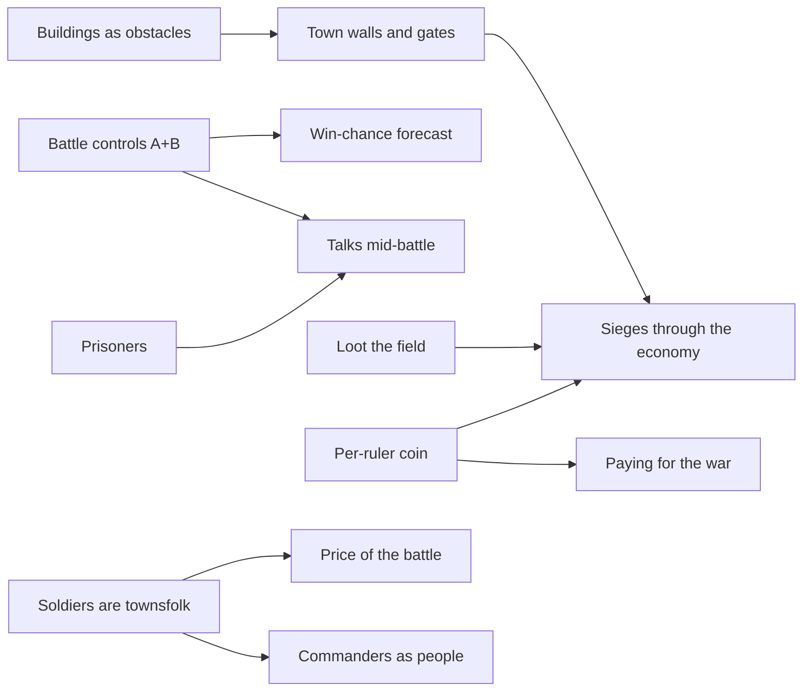

# War ideas for later

Nils approved these on 2026-11-27 as the backlog for war and battles. None of
them is built yet. They come after battle controls B and buildings as
obstacles (see `battle-per-soldier.md`). Most of them only work because every
soldier is a townsperson in a real economy; that is what should make
Econoplex's wars play differently from other RTS games.

Each idea notes what it builds on and roughly how big it is.

## 1. Win-chance forecast

The squad model is fast enough to run about 20 short simulations of the rest
of a live battle in the background, from the current state and a proposed
order. The panel shows, for example, "if you charge now: 70% win, about 40
dead".

- **Builds on:** both battle models (`battle.model`, `battle.live_model`),
  and converting a soldier-model state into squad specs.
- **Watch:** the run must stay off the frame budget (a worker thread, a few
  seeds at a time), and the result must say how sure it is.
- **Size:** small to medium.
- **Built** (`battle/forecast.rs`, `systems/military/live.rs`
  `feed_forecast`):
  - **The state.** `Battle::snapshot` turns a live battle on either model
    into squad specs: each squad where it stands, with its morale, and its
    members as they are. Who is out of play (downed, taken, fled, or of a
    squad no longer on the field) has no health left, so the squad model
    leaves them out. Orders, stances and doctrines carry over, and the
    snapshot runs for the battle time left.
  - **The proposals.** The orders as given, and for each of the side's
    fighting squads: "charge now" (attack the nearest fighting enemy
    squad), "hold" and "withdraw". The enemy keeps its orders.
  - **The runs.** 20 runs per proposal on the squad model, each on its
    own seed, so a snapshot always gives the same forecast. A run counts a
    win for the side, and who of those in play dies on each side.
  - **How sure.** The chance of a win comes with a 90% range (Wilson), and
    the heading says how many runs it rests on: "Forecast (20 of 20 runs
    each on the squad model; 90% range):", then for example "if you charge
    now: 70% win (52-84%), about 40 of yours dead, 25 of theirs".
  - **Off the frame.** A `Forecaster` runs them on a thread of its own, two
    runs per proposal at a time, so the forecast firms up as it is read. It
    takes a new snapshot every 10 battle seconds once the deployment is
    over, and a newer snapshot starts over. 80 runs take 10–90 ms.
  - **In both clients.** A box at the lower left while the player's battle
    is fought.
  - **In `econoplex-sim`.** `--battle LINEUP --forecast T` fights the
    line-up T battle seconds, prints the attackers' forecast, then fights
    it out as ordered.

## 2. The price of the battle

Every soldier is a person with a trade. Clicking one shows, for example,
"Mara, baker, 3 battles". A ticker shows what the battle costs in work so far:
"lost: 2 smiths, 5 farmers, about 300 loaves a week".

- **Builds on:** members' ids, skills and jobs, and the town's production per
  worker.
- **Size:** small.
- **Built** (`battle/price.rs`, `systems/military/price.rs`):
  - **The person.** A name follows from their index in the agent store
    (`names.rs`). Their trade is the worker of their last job's skill
    (`SkillDef::worker`: baking gives "baker"); someone who never worked a
    trade is a "soldier". The battles they have fought are counted per
    person (`AgentStore::battles`, save version 18), this one included.
  - **What a fighter's week is worth.** Seven days of the value a
    worker-day at their job adds: outputs less inputs, at a typical
    worker's success rate. It is given in loaves. Everything is valued at
    the goods' base prices, not at the town's. A town's prices swing too
    far: with iron capped at five times its base and bread at a quarter of
    its base, one herder and one smelter came to 380 loaves a week. At base
    prices a smelter's week is about 10 loaves, a baker's 12, a farmer's 6.
  - **Who counts as lost.** The dead of the battle and the taken. The
    wounded who live go back to work. Who of the downed dies is only rolled
    at the end, so while a live battle goes on its ticker counts everyone
    out of the fight ("fallen: ..."), and once it is over the dead and the
    taken ("lost: ..."). A replay knows the end, so its ticker counts each
    of the lost from the moment they fell (`Replay::lost`).
  - **In both clients.** The soldier tip names the person first, in a live
    battle and in a replay: on the squad model, the first of the squad
    under the pointer who is still fighting. A ticker at the foot of the
    screen gives each side's losses.
  - **In `econoplex-sim`.** A run ends with the newest battles' costs and
    each town's losses over the run (`BattleLog::costs`).

## 3. Loot the field

Weapons and armour stay where soldiers fell. The side that holds the field
afterwards gathers them, and they go into that town's stores as real goods.
A war can arm you, or arm your enemy.

- **Builds on:** kit goods (`52_military_gear.ron`), the armory, and capture
  (PR 201 already sends prisoners' kit to the winner).
- **Watch:** this adds supply of gear, which the market and the health bands
  will feel.
- **Size:** small to medium.
- **Built** (`battle/loot.rs`, `systems/military/loot.rs`):
  - **What is left.** The weapon, armour and shield of everyone who dies of
    a field battle: the killed, and the downed who lose their roll at the
    end. The wounded who live and the taken keep theirs (the taken's goes
    to the winners already, PR 201). A dead rider's horse goes home, as
    before.
  - **Who gathers.** The side that holds the field: the raiders' town if
    the raid won, the defenders' if it was beaten back. It gathers from
    both sides' dead, its own included. With no side holding the field,
    everyone's kit goes home with them, as before.
  - **Broken.** A `military.loot_broken` share (0.3) is too broken to use
    and is thrown away. Which pieces follows from the battle's seed, so a
    live battle can say what will be gathered before it is settled.
  - **Real goods.** The rest goes into the town's armory as the same
    items, with their wear. The market counts the armory as its stock of
    kit, so gathered gear lowers its price and can arm the town's own
    soldiers at the next muster, or be sold.
  - **In both clients.** Once a battle is over, the price ticker adds a
    line: "Ashford gathered: 12 iron spears, 4 mail shirts". It shows for a
    live battle once the fighting is over, and at the end of a replay.
  - **In `econoplex-sim`.** The Battles section gives each battle's
    gathering and each town's over the run.

## 4. Talks in the middle of a battle

Pause and offer terms: tribute, a prisoner swap, or giving up a town. The
other side decides from its morale, its losses and how its economy is doing.
Battles can end without a massacre.

- **Builds on:** the live-battle pause, prisoners, per-ruler coin, and the
  planner's view of a town's strength.
- **Size:** medium to large, because it needs a simple diplomacy model.

## 5. Sieges through the economy

Cut a town's caravans and its granary decides how long it holds out. You build
siege works from building materials, and the town's coin loses value as it
starves.

- **Builds on:** town walls (below), caravans, granaries, building materials
  and per-ruler exchange rates.
- **Size:** large.

## 6. Commanders as people

A captain raises the morale of the squads around them. If they fall, the line
wavers. A ruler can lead in person, which is a big bonus and a big risk.

- **Builds on:** soldier-model morale (it is per soldier, so a morale aura
  is natural), and rulers.
- **Size:** medium.

## 7. Weather and terrain that bite

Rain spoils bowstrings, mud slows horses, and night shortens how far soldiers
can see.

- **Builds on:** the existing weather, ground and night systems; battles
  would just read them.
- **Size:** small to medium.

## 8. Paying for the war

Hire mercenaries with coin, or borrow from your own citizens through war
bonds. Lose the war, and your currency and your citizens' trust both drop.

- **Builds on:** per-ruler currencies and exchange rates.
- **Size:** medium.

## 9. Ride along with a soldier

In 3D, follow one soldier at eye level through the fight. It's mostly for show
(and a trailer), but cheap.

- **Builds on:** per-soldier live positions and the 3D camera.
- **Size:** small.

## 10. Town walls and gates

A buildable structure: a timber palisade first, a stone wall later, with
gates. It costs materials and labour to build and upkeep to maintain. In
battle the wall and its gates are obstacles: attackers breach it, climb it or
force a gate, and defenders on it get cover (`battle.wall_cover` already
exists). Today walls exist only inside the battle engine (a straight
`Field.wall_x` with a breach, used by test line-ups); no town builds one, and
every real raid is fought on open ground.

- **Builds on:** buildings as obstacles, building materials, and the
  existing wall rules in the battle model.
- **Size:** medium. It is the first step toward sieges (5).

## Dropped

- **Orders carried by messenger.** Orders would reach squads after a delay
  that grows with distance from the commander. Nils dropped it on
  2026-11-27, because it would frustrate many players.

## Suggested order

1. Town walls (10), right after buildings as obstacles.
2. Price of the battle (2), loot (3) and the win-chance forecast (1): small,
   and unlike other games.
3. Weather and terrain (7) and ride-along (9).
4. Commanders (6) and paying for the war (8).
5. Talks (4), then sieges (5).
