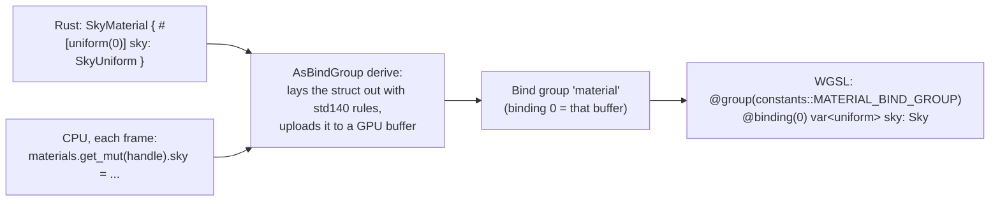

# 00: The shader playground, and how a shader gets from a file to the screen

Before step 01, this page covers the plumbing: how Bevy 0.20 finds a shader,
feeds it data, compiles it, and reloads it while the app runs. The plumbing is
the same for every later step.

## Running it

```bash
cargo run --release -p game3d -- --playground
```

| key / input | does |
| --- | --- |
| drag with left mouse, arrow keys | orbit the camera |
| mouse wheel, `+` / `-` | zoom |
| `[` / `]` | move the time of day |
| `T` | let time run |
| `Tab` | which shader the number keys control (sky, toon, terrain, fog) |
| `F` | fog on or off |
| `0`–`4` | debug views of that shader (0 = final image) |
| `M` | toon lighting or Bevy's PBR lighting |
| `R` / `O` | rim light / outlines on or off (step 05) |

Options: `--hour H` starts at another time, `--view N` starts in a debug view,
`--face-sun` starts looking toward the sun, and `--shot FILE` saves a screenshot after 60 frames and quits.

The same sky also runs in the world view (`cargo run --release -p game3d`).

## Hot reload

The shaders live in `crates/game3d/assets/shaders/`. With the app running, edit
`sky.wesl` and save: Bevy's file watcher (the `file_watcher` feature) notices,
recompiles the shader and swaps the pipeline. You don't need to restart.

If the new version doesn't compile, the error (file, line and column) is printed
in the terminal, and the last working version stays on screen. Fix it and save
again.

Rust changes (uniforms, the material struct) still need a rebuild. Only the
`.wesl` files reload live.

## WGSL and WESL

- **WGSL** is the WebGPU shading language: what the GPU driver finally compiles
  (via wgpu, to DirectX 12, Vulkan or Metal).
- **WESL** is WGSL plus a module system: `import` statements and `@if(...)`
  conditions. Bevy 0.20 writes its own shaders in WESL, and our shaders import
  Bevy's types from them.
- So our `.wesl` files are plain WGSL below the import lines. Bevy links the
  imports and hands the GPU one plain WGSL program.

Imports used so far:

```wgsl
import bevy_pbr::render::forward_io::VertexOutput;       // what the vertex stage outputs
import bevy_pbr::render::mesh_view_bindings::view;       // camera uniform
import bevy_pbr::render::mesh_view_bindings::globals;    // globals.time (seconds)
```

## From a Rust struct to a WGSL variable



1. **The material struct** (`SkyMaterial` in `crates/game3d/src/sky.rs`)
   derives `AsBindGroup`. `#[uniform(0)]` puts a field into binding 0.
2. **The uniform's type** (`SkyUniform`) derives `ShaderType`. That derive knows
   the GPU's alignment rules: a `vec3` takes 16 bytes like a `vec4`, so we use
   `vec4`s throughout to make the layout obvious.
3. **The WGSL side** declares a struct with the same fields in the same order,
   and binds it at the same binding number. Bevy decides which bind group number
   materials get; `constants::MATERIAL_BIND_GROUP` fills it in.
4. **Updating it:** changing the material asset (`materials.get_mut`) makes Bevy
   re-upload the buffer before the next frame.

Bevy's other bind groups:
- **group 0:** the view (camera, matrices, lights, `globals.time`);
- **group 1:** per-mesh data (transforms);
- **the material group:** ours.

## The `Material` trait

`impl Material for SkyMaterial` tells Bevy:
- `fragment_shader()`: which file the fragment stage uses. (`vertex_shader()`
  would replace the vertex stage; that comes in step 03.)
- `specialize(...)`: a hook to change the render pipeline itself. The sky turns
  back-face culling off there, because we look at the sphere from inside.

Everything else (the vertex shader, depth test, MSAA, HDR target) is Bevy's
default mesh pipeline.

## Debug views

A shader can't print. To see an intermediate value, return it as a colour:
- a direction or normal `n` (each component −1..1) → `n * 0.5 + 0.5`;
- a scalar in 0..1 → `vec4(vec3(x), 1)`;
- a value outside 0..1 → scale it first, or use `fract(x)` to see contour bands.

Debug colours still go through tonemapping (the HDR → screen curve) like
everything else, so a 1.0 shows as light grey rather than pure white. Compare
values with each other, not with exact screen colours.

The playground passes a "debug view" number in the uniform. The shader returns
early for views 1–3. Branching on a uniform is cheap: every pixel takes the same
side, so the GPU never has to run both.

## What comes next

- **Step 01:** the sky ([01-sky](01-sky.md)), live now.
- **Step 02:** soft toon lighting ([02-toon](02-toon.md)), live now. `M`
  compares it with Bevy's PBR lighting; `Tab` switches the number keys between
  the sky's and the toon shader's debug views.
- **Step 03:** the terrain's vertex shader ([03-terrain](03-terrain.md)), live
  in the world view (`cargo run --release -p game3d`), not in the playground.
- **Step 04:** distance and height fog ([04-fog](04-fog.md)), in the world view
  and the playground. `F` switches it on and off.
- **Step 05:** rim light and outlines ([05-rim-outline](05-rim-outline.md)).
- **Step 06:** grass and trees in the wind ([06-grass](06-grass.md)), in the world
  view. `G` hides the grass.
- **Step 07:** the crowd walks in a compute shader ([07-crowds-compute](07-crowds-compute.md)).
  `P` hides the people.
- **Step 08:** bloom by hand ([08-bloom](08-bloom.md)): render targets and a mip
  chain. `B` bloom on or off, `N` the glow alone.
- **Step 09:** procedural animation ([09-procedural-animation](09-procedural-animation.md)):
  limbs turned about joints, the stride phase kept on the GPU, work motions by
  trade. `H` hides the UI.
- **Step 10:** level of detail ([10-lod](10-lod.md)): impostor cards drawn with
  distance functions, dithered cross-fades. `K` tints people by level.
