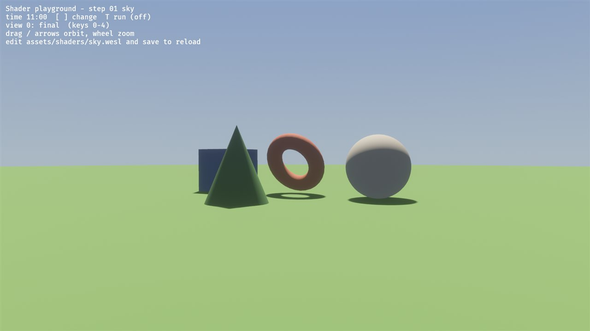
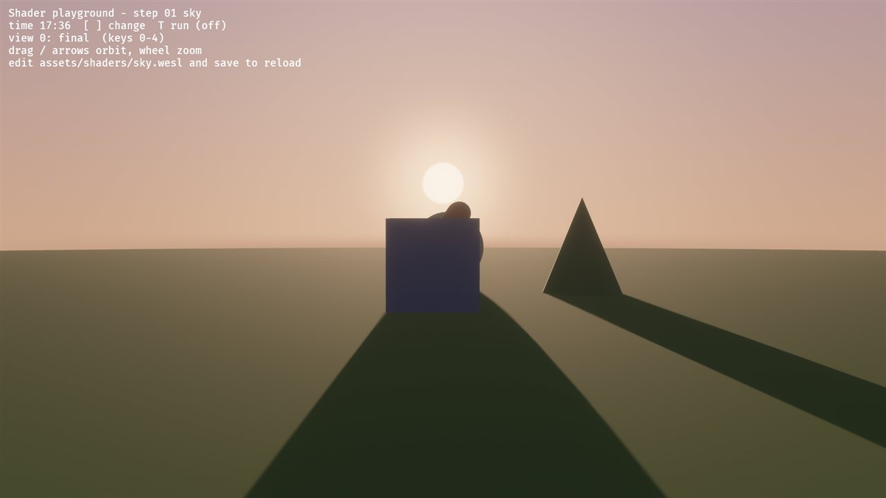
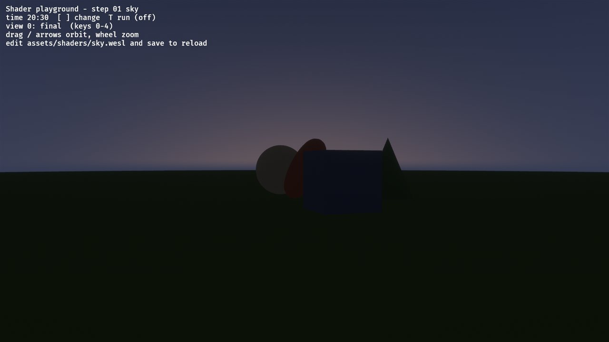
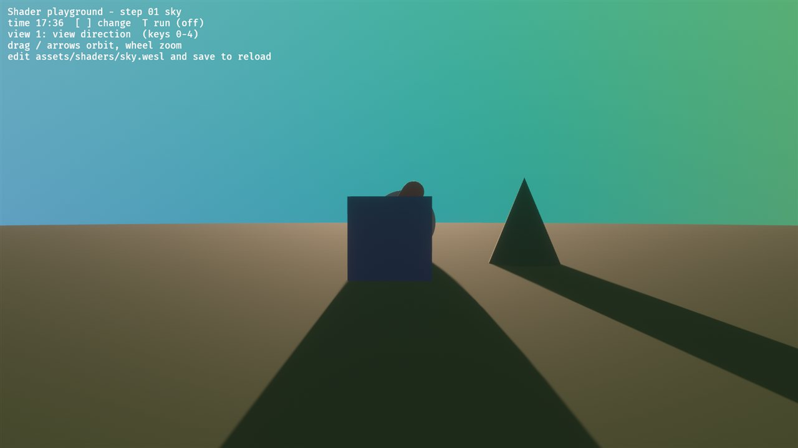
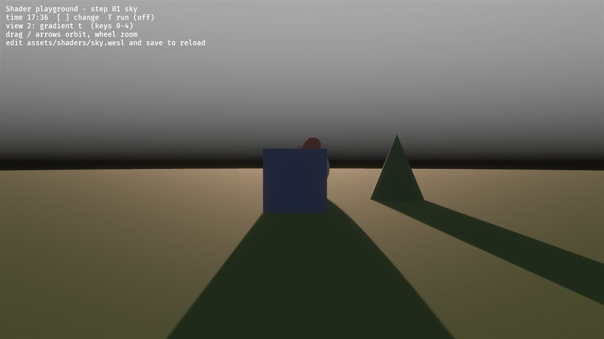
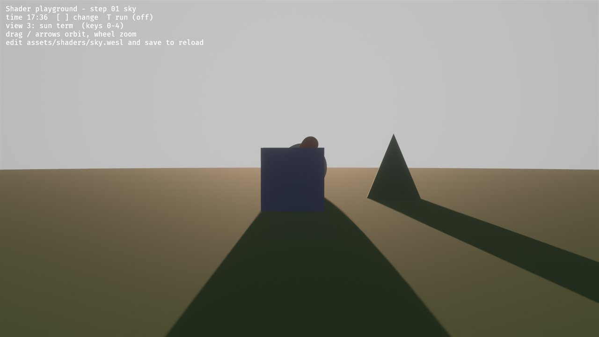
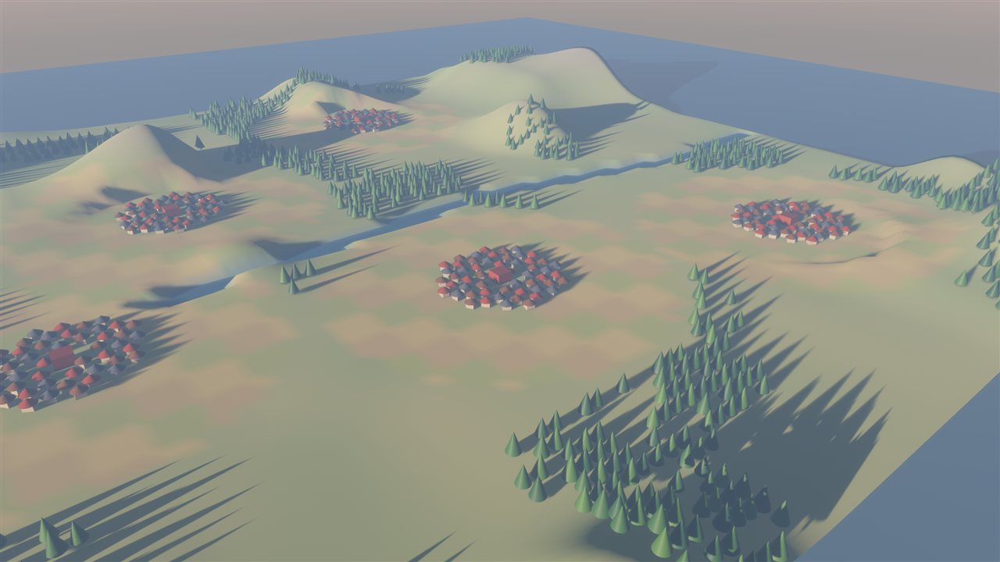
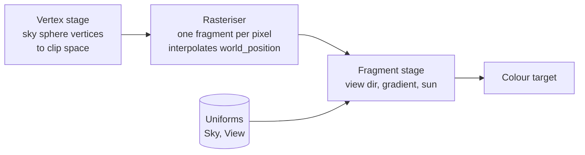

# 01: Gradient sky (the fragment stage)

**Concept:** the fragment stage. A shader runs once per pixel and has to answer
one question: what colour is this pixel? Its inputs are interpolated values
(here, the view direction) and uniforms (here, the sun and the time of day).

## What it does

It draws the sky behind everything:
- a vertical gradient from horizon to zenith;
- a soft sun disc with a glow;
- colours that change with the time of day.

For now the time of day comes from the keyboard (`[` / `]`, `T`). In M2 the sim
calendar drives it: the tick gives the hour, and `day_of_year` gives the season.

It's drawn as a big sphere around the camera (radius 800, re-centred on the
camera every frame) with a custom `Material`. Each pixel gets the **world-space
view direction** from the camera through it, and the colour depends only on
that direction.

**Where the code is:**
- `crates/game3d/assets/shaders/sky.wesl`: the shader (hot-reloads; see
  [00-playground](00-playground.md));
- `crates/game3d/src/sky.rs`: the material, the uniform block, and the CPU side.

**The CPU / GPU split:**
- **CPU, once per frame:** everything that is the same for every pixel. That's
  the sun direction from the time of day, and the horizon, zenith and ground
  colours for that sun height (day, dusk and night palettes blended by
  `sun_dir.y`).
- **GPU, once per pixel:** everything that depends on the view direction.

Rule of thumb: never compute per pixel what you could compute once.

The sun's path: `a = (hour − 6) / 24 · 2π` and `s = normalize(cos a, 0.85 sin a, 0.45 sin a)`.
It rises in the east (+x) at 6, stands highest at 12 and sets in the west at 18.

| noon | sunset | night |
| --- | --- | --- |
|  |  |  |

Debug views at sunset: 1 view direction, 2 gradient parameter, 3 sun term.

| 1 | 2 | 3 |
| --- | --- | --- |
|  |  |  |

In the world view: 

## The math

For the unit view direction `d` and the unit sun direction `s`:

- **Height above the horizon:** `h = d.y`, from −1 (straight down) to 1 (straight
  up).
- **Gradient:** `t = smoothstep(0, 1, h^0.6)`. The power widens the bright band
  near the horizon. `sky = mix(horizon, zenith, t)`.
- **Below the horizon:** `mix(sky, ground, smoothstep(0, −0.15, h))`.
- **Sun:** the angle between `d` and `s` is `cos θ = d · s`.
  - The **disc** is where `θ < r`, i.e. `cos θ > cos r`. `smoothstep(cos 1.2r, cos r, cos θ)`
    softens its edge.
  - The **glow** is `max(cos θ, 0)^k`, a cheap stand-in for light scattered
    around the sun. A large `k` (300) gives a bright core; a small `k` (12)
    gives a wide halo. We add both.
  - Below the horizon the sun is hidden: the disc and glow are multiplied by
    `smoothstep(−0.02, 0.01, h)`.

## The shader, line by line

The comments map each line to the math above. This is the file as it runs:

```wgsl
// Shader step 01: gradient sky. Explained line by line in docs/shaders/01-sky.md.
//
// This is WESL: WGSL plus `import` statements (and `@if` conditions). Everything
// below the imports is plain WGSL. Save this file while econoplex3d runs and the
// sky recompiles on the fly; a compile error is printed to the console and the
// last working version stays on screen.

// What Bevy's vertex shader hands to every fragment: the interpolated world
// position (and normal, UV, ...). We only use the world position.
import bevy_pbr::render::forward_io::VertexOutput;
// The view uniform: camera position and matrices, the same for every pixel.
import bevy_pbr::render::mesh_view_bindings::view;

// Our uniform block. Its layout matches `SkyUniform` in src/sky.rs field by field.
struct Sky {
    horizon: vec4<f32>,   // colour at the horizon (linear RGB)
    zenith: vec4<f32>,    // colour straight up
    ground: vec4<f32>,    // haze below the horizon
    sun_dir: vec4<f32>,   // xyz: unit vector toward the sun
    sun_color: vec4<f32>, // rgb: sun colour, a: disc radius (radians)
    debug: vec4<f32>,     // x: debug view
};

// Bind group "material" (Bevy picks its number), binding 0 = `#[uniform(0)]`.
@group(constants::MATERIAL_BIND_GROUP) @binding(0) var<uniform> sky: Sky;

@fragment
fn fragment(in: VertexOutput) -> @location(0) vec4<f32> {
    // View direction: from the camera to this point of the sky sphere.
    // normalize() makes it unit length, so dot products below are cosines.
    let d = normalize(in.world_position.xyz - view.world_position);

    // How far above the horizon we look: -1 straight down, 1 straight up.
    let h = d.y;

    // Gradient parameter t: 0 at the horizon, 1 at the zenith. pow(h, 0.6)
    // lifts small values, so the pale band near the horizon gets wider.
    let t = smoothstep(0.0, 1.0, pow(max(h, 0.0), 0.6));
    var col = mix(sky.horizon.rgb, sky.zenith.rgb, t);

    // Below the horizon: blend toward the ground haze over a narrow band.
    // (smoothstep with edge0 > edge1 runs "backwards": 0 at h=0, 1 at h=-0.15.)
    col = mix(col, sky.ground.rgb, smoothstep(0.0, -0.15, h));

    // Sun: cosine of the angle between where we look and where the sun is.
    let cos_t = dot(d, sky.sun_dir.xyz);
    // Disc: 1 inside the radius r, 0 outside, with a soft rim. cos() is
    // decreasing, so cos(1.2 r) < cos(r): the edge goes from 1.2 r in to r.
    let r = sky.sun_color.a;
    let disc = smoothstep(cos(r * 1.2), cos(r), cos_t);
    // Glow: a cheap scattering lobe. A larger exponent gives a tighter glow;
    // two lobes give a bright core and a wide soft halo.
    let glow = pow(max(cos_t, 0.0), 300.0) * 0.5 + pow(max(cos_t, 0.0), 12.0) * 0.12;
    // Hide the sun below the horizon (no sun shining through the ground).
    let above = smoothstep(-0.02, 0.01, h);
    col += sky.sun_color.rgb * (disc + glow) * above;

    // Debug views (keys 0-3): show an intermediate value as a colour.
    // A uniform is the same for every pixel, so this branch costs almost nothing:
    // all neighbouring pixels take the same side.
    let view_id = u32(sky.debug.x);
    if view_id == 1u {
        // Direction as colour: red = +x, green = up, blue = +z.
        return vec4<f32>(d * 0.5 + 0.5, 1.0);
    } else if view_id == 2u {
        return vec4<f32>(vec3<f32>(t), 1.0);
    } else if view_id == 3u {
        return vec4<f32>(vec3<f32>(max(cos_t, 0.0)), 1.0);
    }
    return vec4<f32>(col, 1.0);
}
```



## Debug views

Keys `0`–`4` in the playground and in the world view:
- **1, direction:** `d * 0.5 + 0.5` as colour. Red is +x, green is up, blue is
  +z. At the horizon, green is 0.5 (mid-grey-green).
- **2, gradient parameter:** `t` alone. Black at the horizon, white straight up.
  Compare it with and without the `pow(h, 0.6)` to see what the power does.
- **3, sun term:** `max(cos θ, 0)`, a brightness field around the sun. It's
  white toward the sun and black 90° or more away. This is the dot product that
  every lighting model in step 02 is built on.

## Exercises

Edit `sky.wesl` with the playground running, and save after each change.

1. **Sunset glow on one side:** at dusk, the horizon should be warm only on the
   side of the sun.
   - Take the horizontal parts of `d` and `s`, normalise them, and use their dot
     product to mix toward orange near the horizon.
   - Fade it out as `sky.sun_dir.y` rises.
2. **Stars:** at night (sun below the horizon), add stars.
   - Hash the view direction into a grid:
     `fract(sin(dot(floor(d * 300.0), vec3(12.9, 78.2, 37.7))) * 43758.5)`.
   - Light the cells above 0.998.
   - Why do the stars shimmer when you orbit the camera? (Hint: what happens to
     a cell that is smaller than a pixel?)
3. **Debug view of your own:** add view 4 showing `fract(h * 10.0)`, i.e.
   contour bands of the height above the horizon. Where are they evenly spaced,
   and why?
