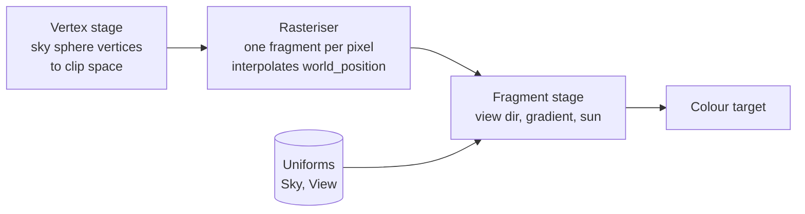

# 01: Gradient sky (a full-screen fragment shader)

**Concept:** the fragment stage. A shader runs once per pixel and has to answer
one question: what colour is this pixel? Its inputs are interpolated values
(here, the view direction) and uniforms (here, the sun and the time of day).

## What it does

It draws the sky behind everything:
- a vertical gradient from horizon to zenith;
- a soft sun disc with a glow;
- colours that change with the time of day.

The sim calendar drives it: `day_of_year` and the tick give the sun's elevation
and the season.

We draw it as a big inside-out sphere (or a full-screen triangle at the far
plane) with a custom `Material`. Each pixel gets the **world-space view
direction** from the camera through it, and the colour depends only on that
direction.

## The math

For the unit view direction `d` and the unit sun direction `s`:

- **Height above the horizon:** `h = d.y`, from −1 (straight down) to 1 (straight
  up).
- **Gradient:** `t = smoothstep(0, 1, h^0.6)` (the power widens the bright band
  near the horizon). `sky = mix(horizon, zenith, t)`.
- **Sun:** the angle between `d` and `s` is `cos θ = d · s`.
  - The disc is where `cos θ > cos(r_sun)`; we soften its edge with `smoothstep`.
  - The glow is `pow(max(d · s, 0), k)`, a cheap scattering lobe (larger `k`
    gives a tighter glow).
- **Below the horizon:** fade to a ground haze colour.

## WGSL, line by line

```wgsl
// Bevy gives every mesh material the interpolated vertex outputs: world
// position, normal, UV. We only need the world position.
#import bevy_pbr::forward_io::VertexOutput
// The view uniform: camera position, matrices. Same for every pixel.
#import bevy_pbr::mesh_view_bindings::view

// Our uniforms, set from Rust each frame (SkyMaterial in game3d).
// @group / @binding say where the GPU finds them; Bevy fills in the group.
struct Sky {
    horizon: vec4<f32>,   // colour at the horizon (linear RGB)
    zenith: vec4<f32>,    // colour straight up
    ground: vec4<f32>,    // haze below the horizon
    sun_dir: vec4<f32>,   // xyz: unit vector toward the sun
    sun_color: vec4<f32>, // rgb: sun colour, a: disc size (radians)
};
@group(#{MATERIAL_BIND_GROUP}) @binding(0) var<uniform> sky: Sky;

@fragment
fn fragment(in: VertexOutput) -> @location(0) vec4<f32> {
    // View direction: from the camera to this point on the sky sphere.
    // normalize() makes it unit length so dot products are cosines.
    let d = normalize(in.world_position.xyz - view.world_position);

    // h = d.y: how far above the horizon we look (-1..1).
    let h = d.y;

    // Gradient: t goes 0 -> 1 from horizon to zenith. pow(h, 0.6) lifts the
    // low values, so the pale band near the horizon is wider (like real skies).
    let t = smoothstep(0.0, 1.0, pow(max(h, 0.0), 0.6));
    var col = mix(sky.horizon.rgb, sky.zenith.rgb, t);

    // Below the horizon: blend toward the ground haze over a small band.
    col = mix(col, sky.ground.rgb, smoothstep(0.0, -0.15, h));

    // Sun: cos of the angle between where we look and where the sun is.
    let cos_t = dot(d, sky.sun_dir.xyz);
    // Disc: 1 inside the disc, 0 outside, with a soft edge of 20% of its size.
    let r = sky.sun_color.a;
    let disc = smoothstep(cos(r * 1.2), cos(r), cos_t);
    // Glow: a lobe around the sun; the exponent sets how tight it is.
    let glow = pow(max(cos_t, 0.0), 64.0) * 0.6;
    col += sky.sun_color.rgb * (disc + glow);

    return vec4<f32>(col, 1.0);
}
```



## Debug views

The client gets a `--debug-sky` switch with these views:
- **Direction:** return `vec4(d * 0.5 + 0.5, 1)` to show the view direction as
  colour. Red is +x, green is up, blue is +z. Check the horizon is where green
  is 0.5.
- **Gradient parameter:** return `vec4(vec3(t), 1)` to show the gradient alone.
- **Sun term:** return `vec4(vec3(cos_t), 1)` to see the dot product as a
  brightness field around the sun.

## Exercises

1. **Sunset:** make `horizon` warmer the lower the sun is. Use
   `sky.sun_dir.y` to mix toward orange when it nears 0.
2. **Stars:** at night (sun below the horizon), add stars. Hash the view
   direction into a grid, `fract(sin(dot(floor(d * 300), vec3(12.9, 78.2, 37.7))) * 43758.5)`,
   and light the cells above 0.998.
