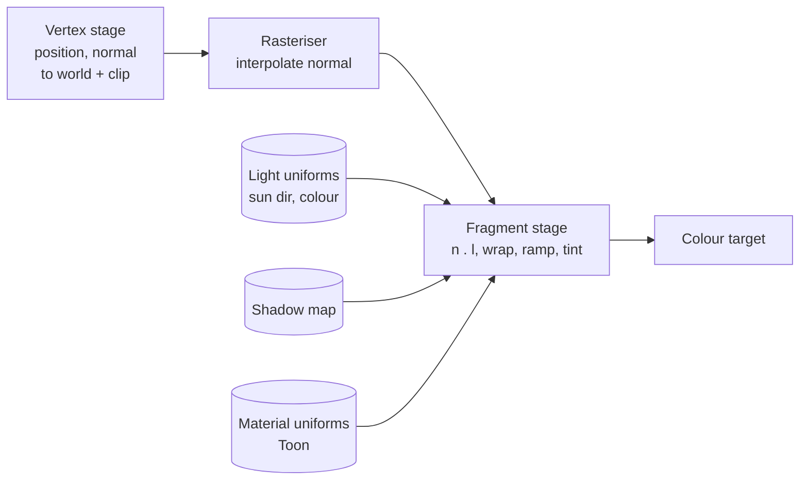

# 02: Soft toon lighting (normals, dot products, a ramp)

**Concept:** lighting in a fragment shader. The surface normal and the light
direction meet in a dot product (Lambert's cosine law). We then *re-map* that
cosine through a ramp to get the painterly, banded look.

## What it does

It replaces Bevy's physically based diffuse with soft toon shading:
- **Wrap lighting:** the light reaches a little past the terminator, so the shadow
  side stays soft and coloured, not black.
- **Ramp:** the result is quantised into 3 soft bands (shadow, midtone, lit),
  with smooth edges.
- **Shadow tint:** shadows are tinted toward a cool colour instead of being
  darkened.
- **Shadows:** Bevy's shadow maps still apply. We extend `StandardMaterial`, so
  we keep shadows, fog and the light uniforms for free.

## The math

For the unit normal `n` and the unit direction to the light `l`:

- **Lambert:** `L = max(n · l, 0)`.
- **Wrap lighting:** `W = (n · l + w) / (1 + w)`, clamped to 0..1, with
  `w ≈ 0.4`. This shifts the terminator past 90°.
- **Ramp:** `R = smoothstep(a, a+ε, W) * 0.5 + smoothstep(b, b+ε, W) * 0.5`,
  where `a, b` are the band edges and `ε` their softness. A texture lookup
  `ramp(W)` works too: a 1D gradient image that artists can paint.
- **Colour:** `albedo * mix(shadow_tint, light_color, R * shadow_map)` plus a
  small ambient term.

## WGSL, line by line

```wgsl
// We extend Bevy's StandardMaterial: its PBR inputs (albedo, normal, shadows)
// come in through `pbr_input`, and we replace only the lighting.
#import bevy_pbr::{
    pbr_fragment::pbr_input_from_standard_material,
    forward_io::{VertexOutput, FragmentOutput},
    mesh_view_bindings::lights,
    shadows::fetch_directional_shadow,
}

// Our extension's uniforms (ToonExt in game3d), next to StandardMaterial's.
struct Toon {
    shadow_tint: vec4<f32>,  // colour of the shadow side
    wrap: f32,               // how far light wraps past 90 degrees (0..1)
    band_a: f32,             // first band edge (shadow -> mid)
    band_b: f32,             // second band edge (mid -> lit)
    softness: f32,           // width of a band edge
};
@group(#{MATERIAL_BIND_GROUP}) @binding(100) var<uniform> toon: Toon;

@fragment
fn fragment(in: VertexOutput, @builtin(front_facing) front: bool) -> FragmentOutput {
    // Albedo, world normal etc. as Bevy computed them (vertex colours included).
    let pbr = pbr_input_from_standard_material(in, front);
    let n = normalize(pbr.N);                // unit surface normal (world space)
    let albedo = pbr.material.base_color.rgb;

    // The first directional light (the sun). direction_to_light points from
    // the surface toward the light, so n . l > 0 means "facing the sun".
    let sun = lights.directional_lights[0];
    let l = normalize(sun.direction_to_light);
    let ndl = dot(n, l);                     // the cosine of Lambert's law

    // Wrap lighting: shift and rescale so ndl = -wrap already gives 0.
    let w = clamp((ndl + toon.wrap) / (1.0 + toon.wrap), 0.0, 1.0);

    // Two soft steps make three bands: 0, 0.5, 1.
    let e = toon.softness;
    let ramp = 0.5 * smoothstep(toon.band_a, toon.band_a + e, w)
             + 0.5 * smoothstep(toon.band_b, toon.band_b + e, w);

    // Shadow maps: 1 lit, 0 in shadow (cascade 0). Toon-ify it too.
    let shadow = fetch_directional_shadow(0u, pbr.world_position, n, pbr.frag_coord.z);
    let lit = ramp * smoothstep(0.3, 0.6, shadow);

    // Shadows are a cool tint, not black; the lit side takes the sun's colour.
    let light = mix(toon.shadow_tint.rgb, sun.color.rgb, lit);
    var out: FragmentOutput;
    out.color = vec4<f32>(albedo * light, 1.0);
    return out;
}
```



## Debug views

- **Normals:** `out.color = vec4(n * 0.5 + 0.5, 1)`. Faces pointing up are green,
  east red, south blue. Check smooth normals across the terrain.
- **n·l:** `vec4(vec3(ndl * 0.5 + 0.5), 1)`. Grey 0.5 marks the terminator.
- **Ramp alone:** `vec4(vec3(ramp), 1)`. You should see exactly three tones.
- **Shadow map term:** `vec4(vec3(shadow), 1)`.

## Exercises

1. Replace the two `smoothstep`s by a **ramp texture**: a 64×1 gradient image
   sampled at `w`. Paint your own ramp and see the mood change.
2. Add a second, weaker **fill light** from the sky (`n.y * 0.5 + 0.5` times a
   sky colour) before the ramp, and watch the shadow side pick up colour from
   above.
