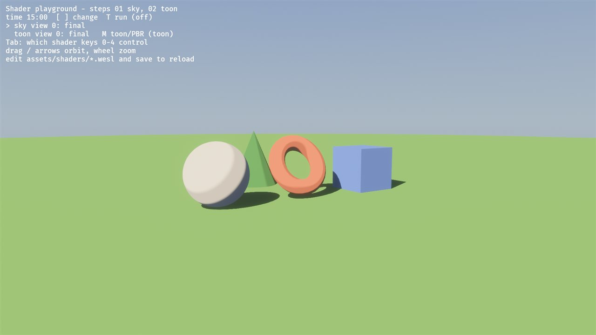
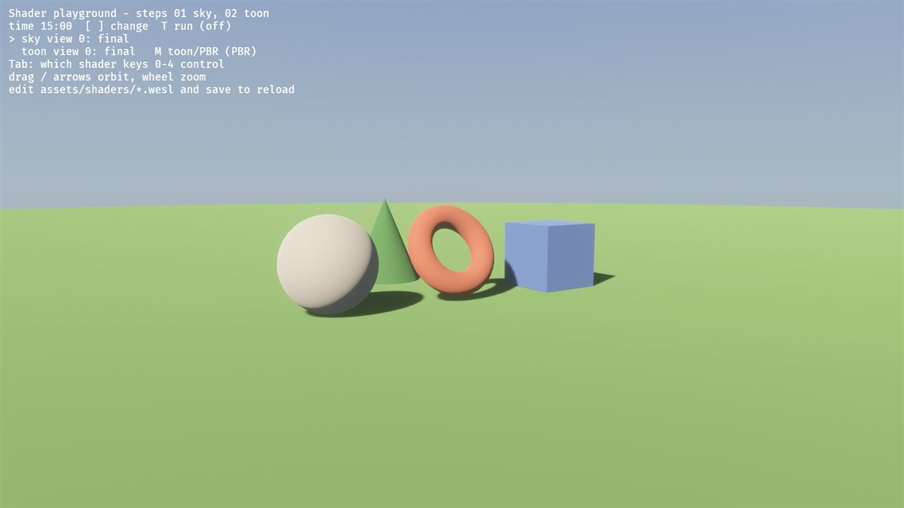
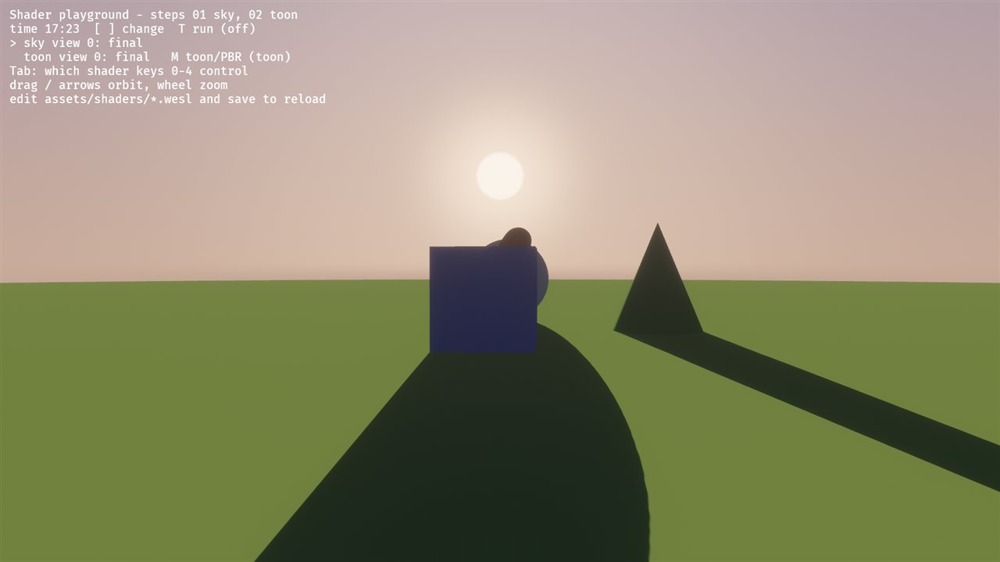
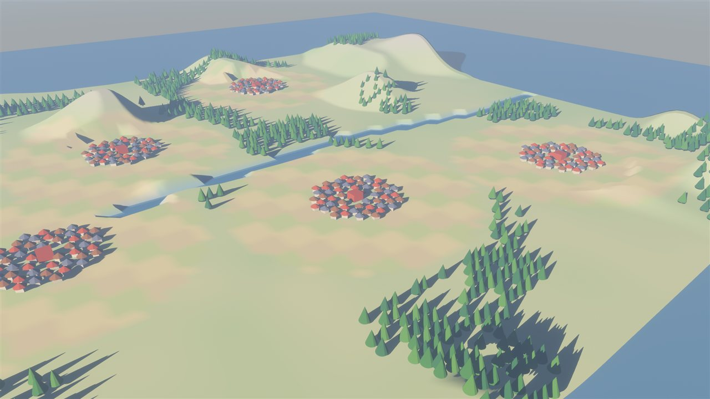
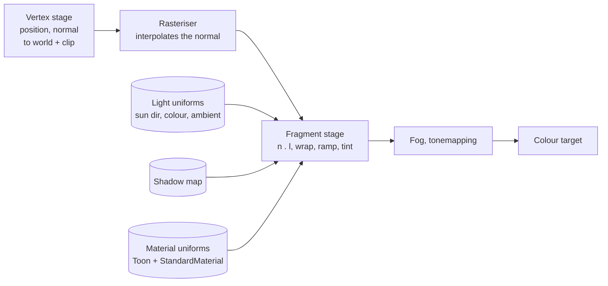
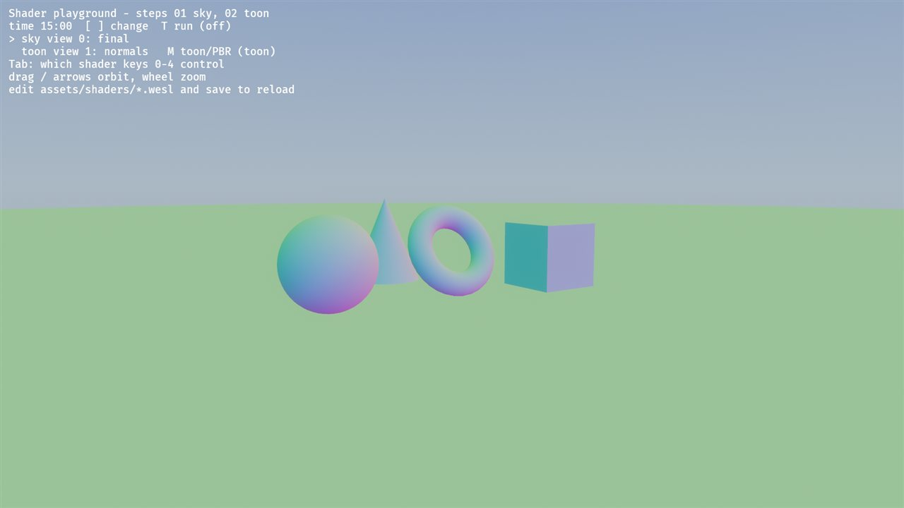
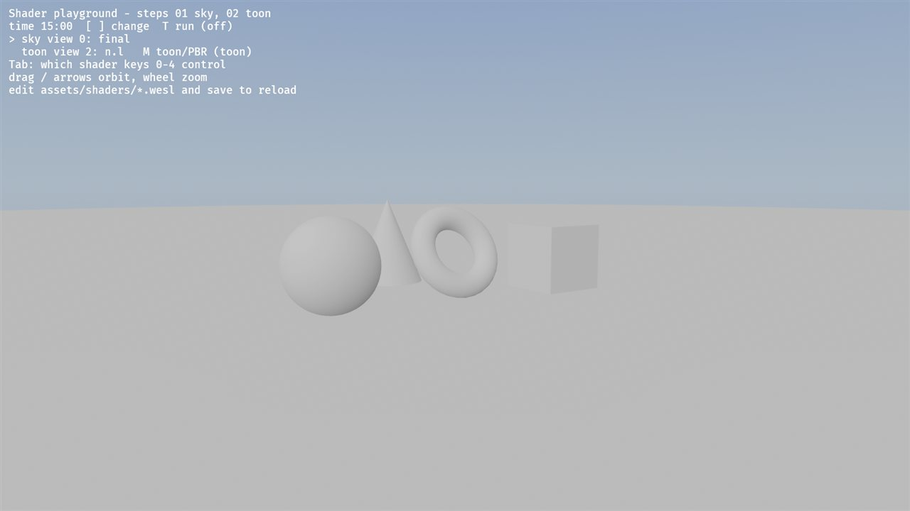
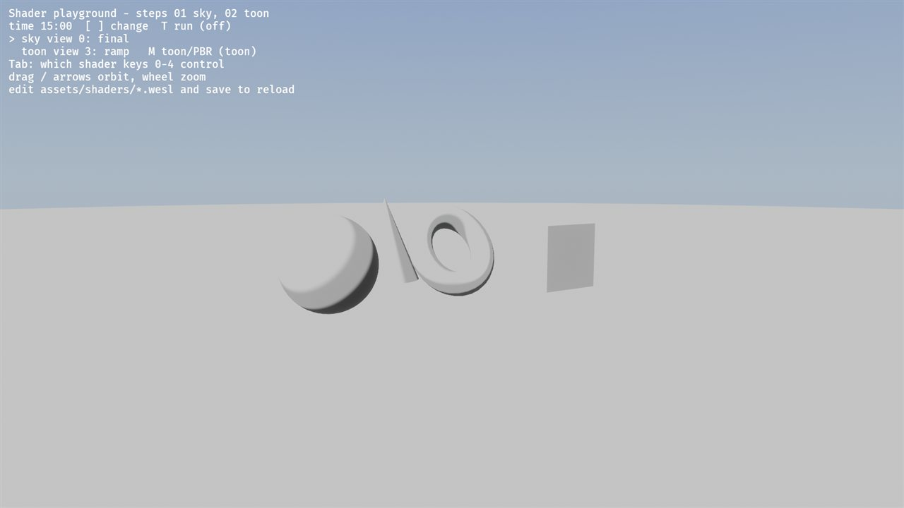
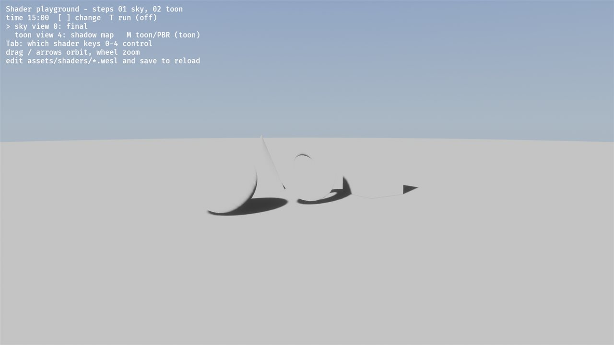

# 02: Soft toon lighting (normals, dot products, a ramp)

**Concept:** lighting in a fragment shader. The surface normal and the light
direction meet in a dot product (Lambert's cosine law). We then *re-map* that
cosine through a ramp to get the painterly, banded look.

**Where the code is:**
- `crates/game3d/assets/shaders/toon.wesl`: the shader (hot-reloads);
- `crates/game3d/src/toon.rs`: `ToonMaterial`, the uniform block, the keys.

**Try it:**
- `cargo run --release -p game3d -- --playground`.
- `M` switches between toon and Bevy's physically based lighting.
- `Tab` makes the number keys control the toon views.

## What it does

It replaces Bevy's physically based diffuse lighting with soft toon shading:
- **Wrap lighting:** the light reaches a little past the terminator (the line
  between lit and dark), so the shadow side stays soft and coloured, not black.
- **Ramp:** the result is quantised into 3 soft bands (shadow, midtone, lit).
- **Shadow tint:** the shadow side is lit by the ambient light tinted cool blue,
  not just darkened.
- **Shadow maps:** Bevy's shadow maps still apply, with the same soft edge.

| toon | Bevy PBR (`M`) | toon at dusk |
| --- | --- | --- |
|  |  |  |

In the world view: 

## How it plugs into Bevy: extending a material

We don't write a material from scratch. `ToonMaterial` is
`ExtendedMaterial<StandardMaterial, ToonExt>`:

- **The `StandardMaterial` half** still does everything around the lighting:
  - base colour times vertex colour (the terrain's biome colours);
  - normals;
  - the shadow-map passes.
- **Our `ToonExt` half** adds one uniform block, at binding 100 (the standard
  half uses the low numbers), and replaces the fragment shader.
- **In the shader:**
  - `pbr_input_from_standard_material(in, is_front)` returns everything the
    standard half computed: albedo, normal, world position;
  - we light it ourselves;
  - `main_pass_post_lighting_processing` then applies fog and tonemapping, as
    for any Bevy material.

That's the usual pattern for a stylised look: keep the engine's inputs and
outputs, and replace the middle.

## The math

For the unit normal `n` and the unit direction to the light `l`:

- **Lambert:** `L = max(n · l, 0)`. This is the cosine of the angle between the
  surface and the light: 1 facing the sun, 0 edge-on.
- **Wrap lighting:** `W = clamp((n · l + w) / (1 + w), 0, 1)`, with `w = 0.4`.
  - At `n · l = −w` (a bit past 90°), W is already 0.
  - So the terminator moves round the back, and the light falls off more gently.
- **Ramp:** `R = ½ smoothstep(a−ε, a+ε, W) + ½ smoothstep(b−ε, b+ε, W)`.
  - `a = 0.28` and `b = 0.62` are the band edges; `ε = 0.05` is the softness.
  - Two soft steps make three tones: 0, ½, 1.
  - (Exercise 1 replaces this with a painted ramp texture.)
- **Shadow map:** `S` is 1 in light and 0 in shadow. It's softened the same way
  (`smoothstep(0.35, 0.65, S)`), so shadow edges match the bands.
- **Colour:** `albedo × (ambient × tint + sun × R × S) × exposure`.
  - On the shadow side only the cool-tinted ambient remains. That's the
    painterly "shadows are a colour" trick.
- **Units:** Bevy's light colours are physical (lux), so we use the same scale
  as its PBR lighting: the sun divided by π, everything times the camera
  exposure. That makes `M` a fair comparison.

## The shader, line by line

```wgsl
// Shader step 02: soft toon lighting. Explained line by line in docs/shaders/02-toon.md.
//
// We extend Bevy's StandardMaterial: its inputs (albedo, vertex colours, the
// world normal) come in through `pbr_input_from_standard_material`, and we
// replace only the lighting. Bevy still applies fog and tonemapping afterwards.

import bevy_pbr::render::{
    pbr_fragment::pbr_input_from_standard_material,
    pbr_functions::{apply_pbr_lighting, main_pass_post_lighting_processing},
    forward_io::{VertexOutput, FragmentOutput},
    mesh_view_bindings::{lights, view},
    mesh_view_types::DIRECTIONAL_LIGHT_FLAGS_SHADOWS_ENABLED_BIT,
    mesh_types::MESH_FLAGS_SHADOW_RECEIVER_BIT,
    shadows::fetch_directional_shadow,
};

// Our uniform block; matches `ToonUniform` in src/toon.rs. Binding 100, because
// the StandardMaterial part of the material uses the low binding numbers.
struct Toon {
    shadow_tint: vec4<f32>, // rgb: colour of the shadow side
    ramp: vec4<f32>,        // x: wrap, y: band edge a, z: band edge b, w: softness
    debug: vec4<f32>,       // x: debug view, y: 1 = toon, 0 = Bevy's PBR lighting
};
@group(constants::MATERIAL_BIND_GROUP) @binding(100) var<uniform> toon: Toon;

const PI: f32 = 3.14159265;

@fragment
fn fragment(in: VertexOutput, @builtin(front_facing) is_front: bool) -> FragmentOutput {
    // Albedo, normal, world position etc. as Bevy computes them for any
    // StandardMaterial (base colour times vertex colour, normal maps, ...).
    let pbr = pbr_input_from_standard_material(in, is_front);
    var out: FragmentOutput;

    // M key: Bevy's own physically based lighting, for comparison.
    if toon.debug.y < 0.5 {
        out.color = main_pass_post_lighting_processing(pbr, apply_pbr_lighting(pbr));
        return out;
    }

    let n = pbr.N;                           // unit surface normal, world space
    let albedo = pbr.material.base_color.rgb;

    // The first directional light: the sun. `direction_to_light` points from
    // the surface toward the light, so n . l > 0 means "facing the sun".
    let sun = lights.directional_lights[0];
    let l = sun.direction_to_light;
    let ndl = dot(n, l);                     // Lambert's cosine

    // Wrap lighting: shift and rescale, so the light reaches past 90 degrees
    // (ndl = -wrap already gives 0) and the terminator moves round the back.
    let wrap = toon.ramp.x;
    let w = clamp((ndl + wrap) / (1.0 + wrap), 0.0, 1.0);

    // The ramp: two soft steps give three bands (0, 0.5, 1).
    let a = toon.ramp.y;
    let b = toon.ramp.z;
    let e = toon.ramp.w;
    let ramp = 0.5 * smoothstep(a - e, a + e, w) + 0.5 * smoothstep(b - e, b + e, w);

    // Shadow maps: 1 = lit, 0 = in shadow. The cascade is picked by view-space
    // depth, which we get from the world position and the view matrix row z.
    var shadow = 1.0;
    if (pbr.flags & MESH_FLAGS_SHADOW_RECEIVER_BIT) != 0u
        && (sun.flags & DIRECTIONAL_LIGHT_FLAGS_SHADOWS_ENABLED_BIT) != 0u {
        let view_z = dot(vec4<f32>(
            view.view_from_world[0].z,
            view.view_from_world[1].z,
            view.view_from_world[2].z,
            view.view_from_world[3].z,
        ), pbr.world_position);
        shadow = fetch_directional_shadow(0u, pbr.world_position, pbr.world_normal, view_z, pbr.frag_coord.xy);
    }
    // The shadow edge gets the same soft step as the bands.
    let lit = ramp * smoothstep(0.35, 0.65, shadow);

    // Light: the shadow side gets the ambient light tinted cool; the lit side
    // adds the sun. Bevy's light colours are physical (lux), so we use the same
    // scale as its PBR lighting: sun / pi, everything times the camera exposure.
    let ambient = lights.ambient_color.rgb * toon.shadow_tint.rgb;
    let sunlight = sun.color.rgb / PI;
    let light = (ambient + sunlight * lit) * view.exposure;

    // Debug views (Tab to "toon", then keys 0-4).
    let id = u32(toon.debug.x);
    if id == 1u {
        out.color = vec4<f32>(n * 0.5 + 0.5, 1.0);           // normals as colour
    } else if id == 2u {
        out.color = vec4<f32>(vec3<f32>(ndl * 0.5 + 0.5), 1.0); // 0.5 = terminator
    } else if id == 3u {
        out.color = vec4<f32>(vec3<f32>(ramp), 1.0);         // three tones
    } else if id == 4u {
        out.color = vec4<f32>(vec3<f32>(shadow), 1.0);       // shadow map term
    } else {
        // Fog and (if needed) tonemapping, as for any Bevy material.
        out.color = main_pass_post_lighting_processing(pbr, vec4<f32>(albedo * light, 1.0));
    }
    return out;
}
```



**Why the normal looks smooth on a sphere made of flat triangles:** the vertex
stage outputs one normal per vertex, and the rasteriser *interpolates* it across
each triangle. The fragment shader then sees a smoothly varying normal.
- An interpolated unit vector is slightly shorter than 1, so it must be
  normalised again. Bevy's `pbr_input_from_standard_material` does that for us
  (`pbr.N`). In a fragment shader of your own, call `normalize` first.
- The cube has separate vertices per face, each with that face's normal, so its
  faces stay flat.

## Debug views

`Tab` until the toon line is marked, then `0`–`4`:

| 1 normals | 2 n·l | 3 ramp | 4 shadow map |
| --- | --- | --- | --- |
|  |  |  |  |

- **1, normals:** `n * 0.5 + 0.5`. Faces pointing up are green, +x red, +z
  blue. The ground is flat green; the sphere shows every direction.
- **2, n·l:** `ndl * 0.5 + 0.5`, so mid-grey marks the terminator. It's a smooth
  gradient, before any ramp.
- **3, ramp:** exactly three tones. Compare with view 2 to see where the band
  edges `a` and `b` fall.
- **4, shadow map:** white in light, black in cast shadows. The ground shows the
  shapes' shadows; the shapes' own dark sides are *not* black here (that's
  `n · l`, not the shadow map).

## Exercises

Edit `toon.wesl` with the playground running, and save after each change.

1. **Band edges:** move `a` and `b` (in `ToonUniform::default`, or hard-code
   them in the shader) and watch view 3.
   - Then make it two bands instead of three.
   - Then four: add a third `smoothstep` and change the weights to ⅓.
2. **Sky fill light:** the shadow side only gets flat ambient light. Add a fill
   from the sky that depends on how much the surface faces up:
   `fill = mix(ground_colour, sky_colour, n.y * 0.5 + 0.5)`.
   Add it to `ambient`, and watch the undersides of the torus turn warmer than
   the tops.
3. **Ramp texture (harder; needs Rust):** replace the two `smoothstep`s with a
   64×1 gradient image sampled at `W`.
   - Add `#[texture(101)] #[sampler(102)] ramp: Handle<Image>` to `ToonExt`, and
     the matching bindings in the shader.
   - `textureSample(ramp_tex, ramp_smp, vec2(w, 0.5))` returns the colour.
   - Paint your own ramp and see the mood change.
