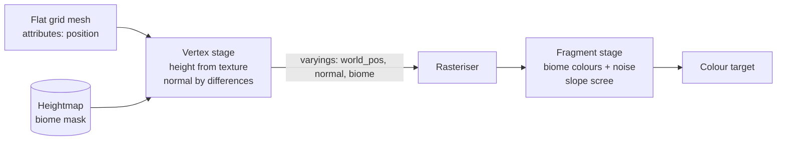

# 03: Terrain (the vertex stage: displacement and biome colours)

**Concept:** the vertex shader. It runs once per vertex, before the rasteriser.
- **Inputs:** attributes (position, UV) and uniforms.
- **Outputs:** the clip-space position, plus *varyings* that are interpolated
  across each triangle for the fragment stage.

## What it does

It turns a flat grid mesh into the world's terrain:
- **Height:** each vertex's height comes from a heightmap texture (built once
  from the generated world: hills, river beds, roll noise) and is displaced
  upward.
- **Normal:** recomputed from neighbouring heights (central differences).
- **Biome:** a biome mask (meadow, field, river bank, scree, snow) is passed to
  the fragment stage, which blends colours with world-space noise into painterly
  patches.

One flat grid can be reused for every chunk and LOD. Only the heightmap and the
chunk offset change.

## The math

For a grid vertex at world position `(x, z)`, with the heightmap `H` sampled at
UV `u = (x, z) / size`:

- **Height:** `y = H(u) * height_scale`.
- **Normal by central differences:** with texel step `e`,
  `dx = H(u+ex) − H(u−ex)` and `dz = H(u+ez) − H(u−ez)`, then
  `n = normalize(vec3(−dx * s, 2e, −dz * s))`, with `s = height_scale / size`.
- **Slope** `= 1 − n.y` (0 flat, 1 vertical) drives scree on steep ground.
- **Colour noise:** value noise `N(p / 40)` mixes two shades per biome, so large
  patches look painted.

## WGSL, line by line

```wgsl
#import bevy_pbr::mesh_functions::{get_world_from_local, mesh_position_local_to_clip}
#import bevy_pbr::mesh_view_bindings::view

struct Terrain {
    size: vec2<f32>,        // world size the heightmap covers
    height_scale: f32,      // metres per heightmap unit
    texel: f32,             // 1 / heightmap resolution
};
@group(#{MATERIAL_BIND_GROUP}) @binding(0) var<uniform> terrain: Terrain;
@group(#{MATERIAL_BIND_GROUP}) @binding(1) var height_tex: texture_2d<f32>;
@group(#{MATERIAL_BIND_GROUP}) @binding(2) var height_smp: sampler;
@group(#{MATERIAL_BIND_GROUP}) @binding(3) var biome_tex: texture_2d<f32>; // rgba = 4 biome weights

// What the vertex stage gets per vertex (from the grid mesh).
struct Vertex {
    @builtin(instance_index) instance: u32,
    @location(0) position: vec3<f32>,   // flat grid: y = 0
};

// What it hands to the rasteriser; everything but clip_position is a varying,
// interpolated across the triangle for the fragment stage.
struct VOut {
    @builtin(position) clip_position: vec4<f32>,
    @location(0) world_pos: vec3<f32>,
    @location(1) normal: vec3<f32>,
    @location(2) biome: vec4<f32>,
};

fn height_at(uv: vec2<f32>) -> f32 {
    // textureSampleLevel: in the vertex stage there are no derivatives,
    // so we must give the mip level (0) explicitly.
    return textureSampleLevel(height_tex, height_smp, uv, 0.0).r * terrain.height_scale;
}

@vertex
fn vertex(v: Vertex) -> VOut {
    // Local grid position to world (chunk offset is in the mesh transform).
    let world = get_world_from_local(v.instance) * vec4<f32>(v.position, 1.0);
    let uv = world.xz / terrain.size + 0.5;

    // Displace: lift the vertex to the terrain height.
    let y = height_at(uv);
    let p = vec3<f32>(world.x, y, world.z);

    // Normal from the slope: compare heights one texel left/right, up/down.
    let e = terrain.texel;
    let dx = height_at(uv + vec2(e, 0.0)) - height_at(uv - vec2(e, 0.0));
    let dz = height_at(uv + vec2(0.0, e)) - height_at(uv - vec2(0.0, e));
    let step = 2.0 * e * terrain.size.x;     // world distance between samples
    let n = normalize(vec3<f32>(-dx, step, -dz));

    var out: VOut;
    out.clip_position = view.clip_from_world * vec4<f32>(p, 1.0);
    out.world_pos = p;
    out.normal = n;
    out.biome = textureSampleLevel(biome_tex, height_smp, uv, 0.0);
    return out;
}

// Value noise, as in sim_core::worldgen (hash at lattice points, smooth blend).
fn hash(p: vec2<f32>) -> f32 { return fract(sin(dot(p, vec2(127.1, 311.7))) * 43758.5453); }
fn noise(p: vec2<f32>) -> f32 {
    let i = floor(p); let f = fract(p);
    let u = f * f * (3.0 - 2.0 * f);
    return mix(mix(hash(i), hash(i + vec2(1.0, 0.0)), u.x),
               mix(hash(i + vec2(0.0, 1.0)), hash(i + vec2(1.0, 1.0)), u.x), u.y);
}

@fragment
fn fragment(in: VOut) -> @location(0) vec4<f32> {
    // Painterly patches: two shades per biome, blended by large-scale noise.
    let k = noise(in.world_pos.xz / 40.0);
    let meadow = mix(vec3(0.45, 0.62, 0.30), vec3(0.62, 0.70, 0.36), k);
    let field  = mix(vec3(0.86, 0.76, 0.36), vec3(0.74, 0.62, 0.34), k);
    let bank   = vec3(0.70, 0.66, 0.50);
    let snow   = vec3(0.92, 0.94, 0.96);
    var albedo = meadow * in.biome.r + field * in.biome.g + bank * in.biome.b + snow * in.biome.a;
    // Steep ground shows scree, whatever the biome.
    let slope = 1.0 - normalize(in.normal).y;
    albedo = mix(albedo, vec3(0.55, 0.52, 0.48), smoothstep(0.35, 0.6, slope));
    return vec4<f32>(albedo, 1.0);   // lighting: combine with 02-toon
}
```



## Debug views

- **Height:** colour by `y / height_scale` (black low, white high).
- **Normals:** `normal * 0.5 + 0.5`. Hills should show smooth gradients, no seams
  between chunks.
- **Biome weights:** output `in.biome` directly as RGBA.
- **Wireframe:** Bevy's `WireframePlugin`, to see the grid and the LOD.

## Exercises

1. **Terraces:** quantise the height with `y = floor(y / 2.0) * 2.0` and watch the
   normals break into steps. Then smooth the steps:
   `y = (floor(y/2) + smoothstep(0.4, 0.6, fract(y/2))) * 2`.
2. **Seasons:** add a `season` uniform (0..1 over the year) and shift `field` from
   green (spring) to gold (late summer) to brown (after harvest).
