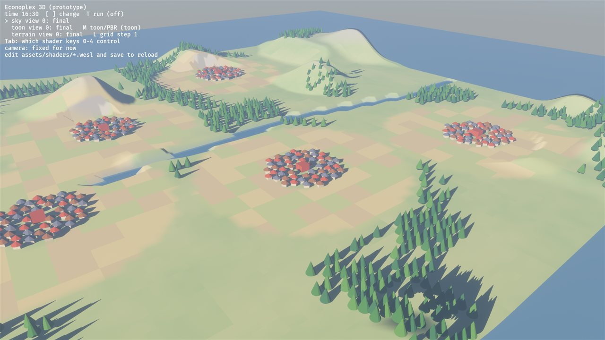
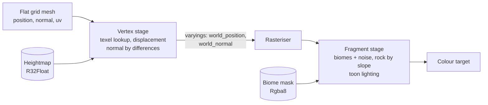
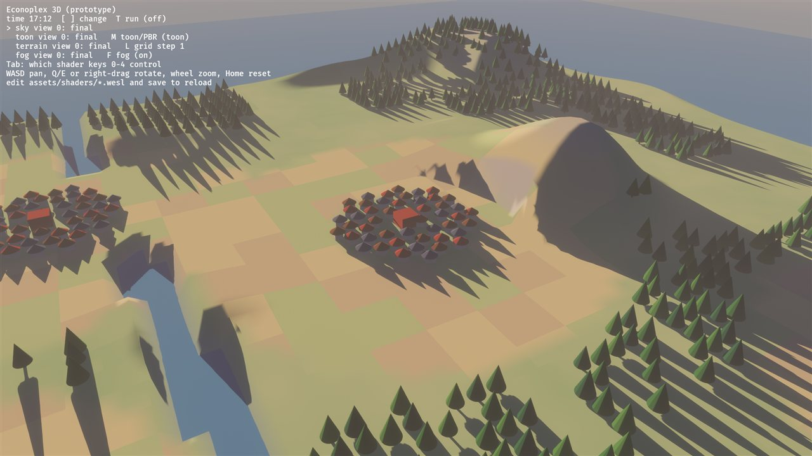
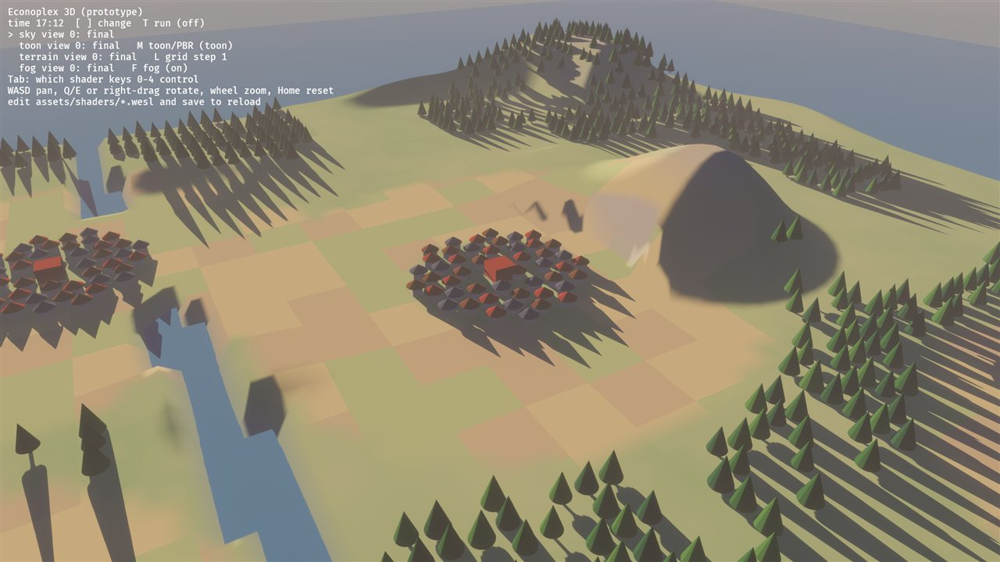
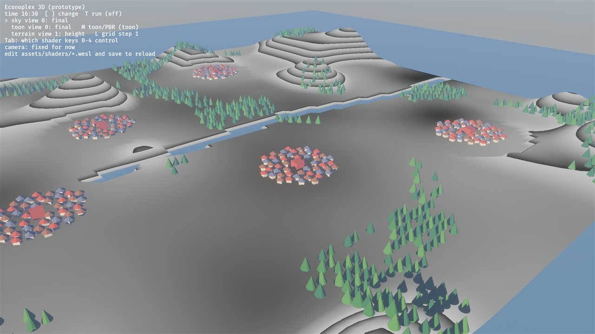
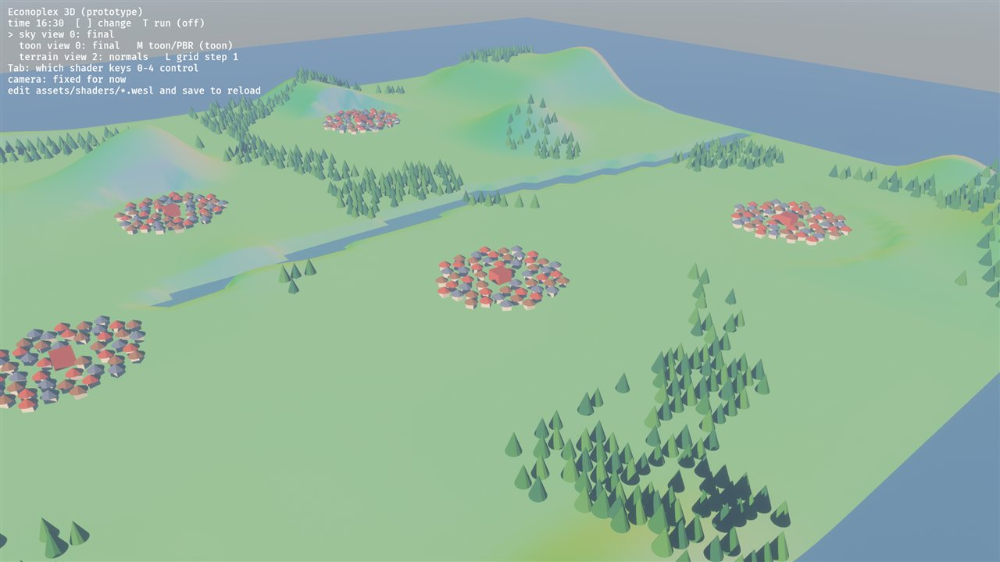
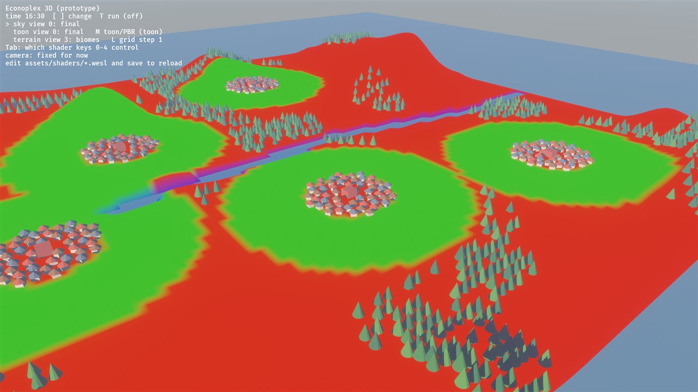
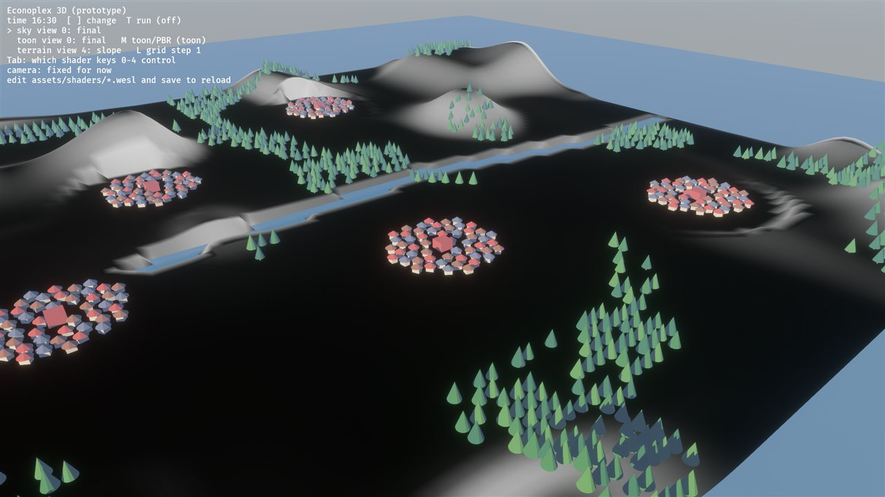
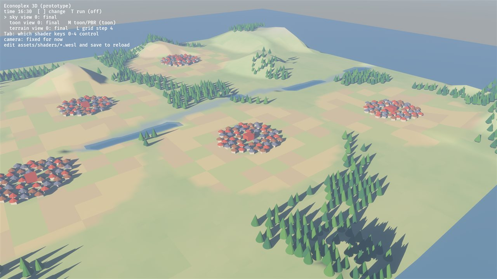

# 03: Terrain (the vertex stage: displacement and procedural biomes)

**Concept:** the vertex shader. It runs once per vertex, before the rasteriser.
- **Inputs:** vertex attributes (position, normal, UV), uniforms and textures.
- **Outputs:** the clip-space position, plus *varyings* (world position, normal)
  that the rasteriser interpolates across each triangle for the fragment stage.

**Where the code is:**
- `crates/game3d/assets/shaders/terrain.wesl`: the vertex and fragment shaders
  (hot-reload);
- `terrain_common.wesl`: the uniform block, the textures and the height lookup,
  shared with `terrain_prepass.wesl`, the vertex shader of the shadow pass;
- `crates/game3d/src/terrain.rs`: the material, the textures, the flat grid;
- `crates/game3d/src/main.rs`: fills the textures from the generated world.

**Try it:** `cargo run --release -p game3d -- --seed 23`.
- `L` cycles the grid step (1, 2, 4).
- `Tab` until "terrain" is marked, then `0`–`4` pick a debug view.



## What it does

The terrain mesh is a **flat grid**: every vertex at y = 0, every normal
straight up. The shape comes entirely from the GPU:

1. **Heights:** the CPU writes the world's height at every cell corner into a
   small texture (`R32Float`), once. The vertex shader looks up its own texel
   and lifts the vertex to that height.
2. **Normals:** the vertex shader compares the heights of the neighbouring
   texels (central differences) to get the slope, and from it the normal.
3. **Biomes:** a second texture holds biome weights (meadow, fields, water).
   The fragment shader paints them with procedural noise:
   - meadows in soft patches;
   - fields as a patchwork of crops;
   - rock wherever the slope is steep or the ground high.
4. **Lighting:** the toon lighting of step 02. It now lives in a shared module,
   `toon_lighting.wesl`, which both shaders import.

**Why do it this way?**
- **The grid is generic.** The same flat grid works at any resolution, so a
  coarser grid is a cheaper level of detail of the *same* terrain. `L` shows
  this: at step 4 the hills keep their shape, and the shading still uses
  full-resolution normals, but the river bed gets cut off.
- **The data is small and editable.** In M2 the sim can change the ground (new
  fields, cleared forest) by rewriting a few texels instead of rebuilding a mesh.

## The math

The heightmap has texels `(i, j)`. `i` grows with +x, `j` grows toward −z
(north on the sim's map). Texel `(0, 0)` sits at world `(x₀, z₀)`, and texels
are `c` apart.

- **World → texel:** `i = (x − x₀) / c` and `j = (z₀ − z) / c`. A grid vertex
  lands exactly on a texel, so we round.
- **Height:** `y = H(i, j) × height_scale`.
- **Normal by central differences:**
  - The surface is `y = h(x, z)`. Its normal is `normalize(−∂h/∂x, 1, −∂h/∂z)`.
  - `∂h/∂x ≈ (H(i+1, j) − H(i−1, j)) / 2c`.
  - `∂h/∂z ≈ −(H(i, j+1) − H(i, j−1)) / 2c`: the minus sign is there because j
    runs toward −z.
- **Slope:** `1 − n.y`, which is 0 on flat ground and 1 on a vertical wall.
- **Value noise:** random values at lattice points, smoothly blended between
  them with `3f² − 2f³` weights. We sum two scales (12 and 3 units) for big soft
  patches with a little detail.
- **Bilinear filtering by hand:**
  - Biome weights between texels are mixed from the 4 nearest:
    `mix(mix(a, b, fx), mix(c, d, fx), fy)`.
  - That's exactly what a GPU sampler does for you. We do it ourselves because
    we read the texture with `textureLoad`, which returns raw texels.

## The shader, line by line

`terrain_common.wesl`, shared by both passes:

```wgsl
// Shared by terrain.wesl (the main pass) and terrain_prepass.wesl (the shadow
// pass): the terrain's uniform block, its textures, and the height lookup.
// Both passes must lift the grid in exactly the same way, or the shadows
// would not match the ground they fall on.

import super::toon_lighting::Toon;

// Matches `TerrainUniform` (with the nested `ToonUniform`) in src/terrain.rs.
struct Terrain {
    grid: vec4<f32>, // x, z of texel (0,0); distance between texels; height scale
    dims: vec4<f32>, // texels across (i, +x), texels deep (j, -z); -; debug view
    toon: Toon,
};
@group(constants::MATERIAL_BIND_GROUP) @binding(100) var<uniform> terrain: Terrain;
// Heights, read texel by texel with textureLoad (32-bit floats aren't
// filterable everywhere, and we don't need filtering at the grid's vertices).
@group(constants::MATERIAL_BIND_GROUP) @binding(101) var heights: texture_2d<f32>;
// Biome weights: r meadow, g fields, b water.
@group(constants::MATERIAL_BIND_GROUP) @binding(102) var biomes: texture_2d<f32>;

// ---------------------------------------------------------------- helpers

// Which texel a world position falls on, as a continuous coordinate:
// i grows with +x, j grows with -z (north in the simulation's map).
fn texel_coord(xz: vec2<f32>) -> vec2<f32> {
    return vec2<f32>(xz.x - terrain.grid.x, terrain.grid.y - xz.y) / terrain.grid.z;
}

// Height at an integer texel, clamped to the edge of the map.
fn height_at(t: vec2<i32>) -> f32 {
    let last = vec2<i32>(terrain.dims.xy) - 1;
    let c = clamp(t, vec2<i32>(0), last);
    return textureLoad(heights, c, 0).r * terrain.grid.w;
}

// The normal from central differences: the slope along i and along j, each
// over two texels. Along j the world goes toward -z, hence the sign flip.
fn normal_at(t: vec2<i32>) -> vec3<f32> {
    let dhdi = height_at(t + vec2(1, 0)) - height_at(t - vec2(1, 0));
    let dhdj = height_at(t + vec2(0, 1)) - height_at(t - vec2(0, 1));
    let span = 2.0 * terrain.grid.z;                 // world distance of 2 texels
    // Surface y = h(x, z); its normal is (-dh/dx, 1, -dh/dz), normalised.
    // dh/dx = dhdi / span; dh/dz = -dhdj / span.
    return normalize(vec3<f32>(-dhdi / span, 1.0, dhdj / span));
}

// A flat grid vertex (world position, y = 0) lifted to the terrain height.
fn displaced(flat: vec4<f32>) -> vec4<f32> {
    let t = vec2<i32>(round(texel_coord(flat.xz)));
    return vec4<f32>(flat.x, height_at(t), flat.z, 1.0);
}
```

`terrain.wesl`, the main pass:

```wgsl
// Shader step 03: terrain from a flat grid. Explained in docs/shaders/03-terrain.md.
//
// The vertex stage lifts each vertex of a flat grid to the height stored in a
// texture and computes its normal from the neighbouring heights. The fragment
// stage paints the biomes procedurally and lights them with the toon lighting
// of step 02.

import bevy_pbr::render::{
    mesh_functions,
    forward_io::{Vertex, VertexOutput, FragmentOutput, decompress_vertex},
    view_transformations::position_world_to_clip,
    pbr_fragment::pbr_input_from_standard_material,
    pbr_functions::{apply_pbr_lighting, main_pass_post_lighting_processing},
};
import super::toon_lighting::{Toon, toon_params, toon_terms};
import super::fog::apply_fog;
// The uniform block, the textures and the height helpers, shared with the
// shadow pass (terrain_prepass.wesl).
import super::terrain_common::{terrain, biomes, texel_coord, height_at, normal_at, displaced};


// ---------------------------------------------------------------- vertex

@vertex
fn vertex(vertex_in: Vertex) -> VertexOutput {
    var out: VertexOutput;
    // Bevy may store positions compressed; this gives plain floats back.
    let v = decompress_vertex(vertex_in, vertex_in.instance_index);
    let world_from_local = mesh_functions::get_world_from_local(vertex_in.instance_index);
    let flat = mesh_functions::mesh_position_local_to_world(world_from_local, vec4<f32>(v.position, 1.0));

    // Displacement: the grid vertex sits exactly on a texel, so we round to it
    // and lift the vertex to that texel's height (terrain_common.wesl).
    let t = vec2<i32>(round(texel_coord(flat.xz)));
    let world = displaced(flat);

    out.world_position = world;
    out.position = position_world_to_clip(world.xyz);   // world -> clip space
    out.world_normal = normal_at(t);
@if(VERTEX_UVS_A)
    out.uv = v.uv;
@if(VERTEX_OUTPUT_INSTANCE_INDEX)
    // The fragment stage looks up this mesh's flags (shadow receiver etc.).
    out.instance_index = vertex_in.instance_index;
    return out;
}

// ---------------------------------------------------------------- fragment

// Value noise: random values at lattice points, smoothly blended between them.
fn hash(p: vec2<f32>) -> f32 {
    return fract(sin(dot(p, vec2<f32>(127.1, 311.7))) * 43758.5453);
}
fn noise(p: vec2<f32>) -> f32 {
    let i = floor(p);
    let f = fract(p);
    let u = f * f * (3.0 - 2.0 * f);                    // smoothstep weights
    return mix(mix(hash(i), hash(i + vec2(1.0, 0.0)), u.x),
               mix(hash(i + vec2(0.0, 1.0)), hash(i + vec2(1.0, 1.0)), u.x), u.y);
}

// One texel of the biome mask, clamped to the edge of the map.
fn biome_texel(t: vec2<i32>) -> vec4<f32> {
    let last = vec2<i32>(terrain.dims.xy) - 1;
    return textureLoad(biomes, clamp(t, vec2<i32>(0), last), 0);
}

// Biome weights at any point: bilinear filtering by hand from 4 texels
// (what a sampler would do for us on a filterable texture).
fn biome_at(xz: vec2<f32>) -> vec4<f32> {
    let tc = texel_coord(xz);
    let t0 = vec2<i32>(floor(tc));
    let f = fract(tc);
    let top = mix(biome_texel(t0), biome_texel(t0 + vec2(1, 0)), f.x);
    let bottom = mix(biome_texel(t0 + vec2(0, 1)), biome_texel(t0 + vec2(1, 1)), f.x);
    return mix(top, bottom, f.y);
}

@fragment
fn fragment(in: VertexOutput, @builtin(front_facing) is_front: bool) -> FragmentOutput {
    var pbr = pbr_input_from_standard_material(in, is_front);
    let p = in.world_position.xyz;
    let n = normalize(in.world_normal);   // interpolated: re-normalise
    pbr.N = n;

    // Painterly biomes: big soft patches from noise, two shades per biome.
    let k = noise(p.xz / 12.0) * 0.7 + noise(p.xz / 3.0) * 0.3;
    let meadow = mix(vec3(0.36, 0.55, 0.24), vec3(0.58, 0.68, 0.32), k);
    // Fields: a patchwork, one crop per 6x6 plot (hash of the plot index).
    let plot = hash(floor(p.xz / 6.0));
    var field = vec3(0.86, 0.74, 0.34);                 // ripe grain
    if plot < 0.33 { field = vec3(0.55, 0.68, 0.28); }  // young crop
    else if plot < 0.66 { field = vec3(0.72, 0.58, 0.32); } // stubble
    let water_bed = vec3(0.30, 0.42, 0.40);
    let b = biome_at(p.xz);
    var albedo = meadow * b.r + field * b.g + water_bed * b.b;
    albedo /= max(b.r + b.g + b.b, 1e-3);                // weights to sum 1

    // Height and slope: rock on steep or high ground, whatever the biome.
    let slope = 1.0 - n.y;                               // 0 flat, 1 vertical
    let rock = vec3(0.60, 0.56, 0.50);
    let high = smoothstep(6.0, 12.0, p.y);
    albedo = mix(albedo, rock, max(smoothstep(0.25, 0.45, slope), high * 0.8));

    // Lighting: the shared toon lighting of step 02 (or PBR with the M key).
    let tp = terrain.toon;
    let t = toon_terms(pbr, toon_params(tp));
    var lit = albedo * t.light;
    if tp.debug.y < 0.5 {
        pbr.material.base_color = vec4<f32>(albedo, 1.0);
        lit = apply_pbr_lighting(pbr).rgb;
    }

    var out: FragmentOutput;
    let id = u32(terrain.dims.w);
    if id == 1u {
        out.color = vec4<f32>(vec3<f32>(fract(p.y / 2.0)), 1.0);  // height contours, 2 apart
    } else if id == 2u {
        out.color = vec4<f32>(n * 0.5 + 0.5, 1.0);                // normals
    } else if id == 3u {
        out.color = vec4<f32>(b.rgb, 1.0);                        // biome weights
    } else if id == 4u {
        out.color = vec4<f32>(vec3<f32>(slope * 3.0), 1.0);       // slope (x3)
    } else {
        let fogged = apply_fog(lit, p, tp.fog);              // step 04
        out.color = main_pass_post_lighting_processing(pbr, vec4<f32>(fogged, 1.0));
    }
    return out;
}
```

`terrain_prepass.wesl`, the shadow pass (see *Shadows* below):

```wgsl
// The terrain's vertex shader for Bevy's prepass, which also renders the
// shadow maps: the sun "looks" at the scene from its direction, and this shader
// tells it where the terrain really is. Without it the shadow pass would see
// the flat grid. See docs/shaders/03-terrain.md, exercise 3.

import bevy_pbr::{
    prepass::io::{Vertex, VertexOutput, decompress_vertex},
    render::{mesh_functions, view_transformations::position_world_to_clip},
};
import super::terrain_common::displaced;

@vertex
fn vertex(vertex_in: Vertex) -> VertexOutput {
    var out: VertexOutput;
    let v = decompress_vertex(vertex_in, vertex_in.instance_index);
    let world_from_local = mesh_functions::get_world_from_local(vertex_in.instance_index);
    let flat = mesh_functions::mesh_position_local_to_world(world_from_local, vec4<f32>(v.position, 1.0));

    // The same displacement as the main pass; here `view` is the light's view.
    out.world_position = displaced(flat);
    out.position = position_world_to_clip(out.world_position.xyz);
@if(UNCLIPPED_DEPTH_ORTHO_EMULATION) {
    // Directional-light shadows use an orthographic projection; Bevy keeps
    // casters behind the near plane by clamping depth (as its own prepass does).
    out.unclipped_depth = out.position.z;
    out.position.z = min(out.position.z, 1.0);
}
@if(VERTEX_UVS_A)
    out.uv = v.uv;
@if(VERTEX_OUTPUT_INSTANCE_INDEX)
    out.instance_index = vertex_in.instance_index;
    return out;
}
```



### Points worth noticing

- **`textureLoad` vs `textureSample`:**
  - `textureLoad(tex, coord, level)` reads one texel at integer coordinates: no
    sampler, no filtering.
  - `textureSample` filters, but it needs a filterable format, and in a vertex
    shader you must use `textureSampleLevel`. The vertex stage has no screen-space
    derivatives, so it can't choose a mip level by itself.
  - We store heights as 32-bit floats, which aren't filterable on every GPU, so
    `textureLoad` is the portable choice.
- **`decompress_vertex`:** Bevy may store vertex positions compressed. Reading
  them through Bevy's `Vertex` type and this function gives plain floats either
  way.
- **The `@if(...)` lines (WESL):** some fields of `VertexOutput` exist only when
  the mesh has them (UVs) or the pipeline needs them (the instance index, which
  the fragment stage uses to look up this mesh's shadow flags). `@if` includes
  the line only when the condition holds.
- **Re-normalising in the fragment stage:** the interpolated normal is a blend
  of unit vectors, so it's slightly shorter than 1.
- **Culling:** Bevy culls meshes by their bounding box, and our flat grid's
  box is flat. `NoFrustumCulling` tells it not to.

### Shadows: the same displacement in a second pass

A shadow map is a depth image rendered from the sun's point of view: for each
texel, how far the nearest surface is from the sun. When the main pass lights a
fragment, it looks up its position in that image. If something nearer to the
sun covers it, the fragment is in shadow.

- **The shadow map is rendered by Bevy's *prepass*,** with its own vertex
  shader. That shader knows nothing of our heights: it would draw the flat
  grid into the shadow map, and the hills would cast no shadows.
- **So the terrain gives the prepass its own vertex shader**
  (`MaterialExtension::prepass_vertex_shader`, `terrain_prepass.wesl`). It
  lifts the grid exactly as the main pass does. Both import `displaced` from
  `terrain_common.wesl`, so they can't drift apart.
- **In the shadow pass, `view` is the sun's view.**
  `position_world_to_clip` then projects into the shadow map instead of onto
  the screen. The same code works for both.
- **`UNCLIPPED_DEPTH_ORTHO_EMULATION`:** the sun's projection is orthographic.
  Bevy keeps casters behind the near plane by clamping their depth, and our
  prepass shader must do the same (copied from Bevy's own prepass).

| hills cast shadows | before (the grid cast none) |
| --- | --- |
|  |  |

Look at the right-hand side: the trees behind the hill now stand in its shadow.

The dark round patches on the hills in the high views aren't shadows. They're
the slopes facing away from the low sun, in the dark band of the toon ramp
(view 2 of the toon shader, `n·l`, shows it).

## Debug views

| 1 height contours | 2 normals | 3 biome weights |
| --- | --- | --- |
|  |  |  |

| 4 slope (×3) | grid step 4 (`L`) |
| --- | --- |
|  |  |

- **1, height:** `fract(y / 2)` draws contour bands 2 units apart. Close
  contours mean steep ground.
- **2, normals:** mostly green (pointing up). The hill sides tint toward red or
  blue depending on which way they face.
- **3, biomes:** red meadow, green fields, blue water. The edges are soft
  because of the hand-made bilinear filter.
- **4, slope:** black on flat ground, bright on steep slopes. That's where rock
  appears in the final image.
- **Grid step 4:** the shape survives, but the river bed is cut off between
  vertices. Detail that's smaller than the grid is lost; that's the cost of a
  coarser level of detail.

## Exercises

Edit `terrain.wesl` with the world view running, and save after each change.

1. **Terraces:** in the vertex shader, quantise the height:
   `y = floor(y / 1.5) * 1.5`.
   - The normals still come from the smooth heights. What does the lighting do?
   - Then quantise inside `height_at`, so the normals see the steps too.
2. **Seasons:** add a value that runs from 0 to 1 and shift the fields from
   green (spring) to gold (late summer) to brown stubble (after harvest).
   - Hard-code it first.
   - Then drive it from the time of day (`[` / `]`) through a uniform.
3. **Cheaper shadows:** the shadow map doesn't need the full grid.
   - Give the shadow pass a coarser grid: in `terrain_prepass.wesl`, snap each
     vertex to every second texel before lifting it.
   - Does it show? Where? (Hint: look at shadow edges on steep slopes, and
     think about which vertices the main pass and the shadow pass share.)
