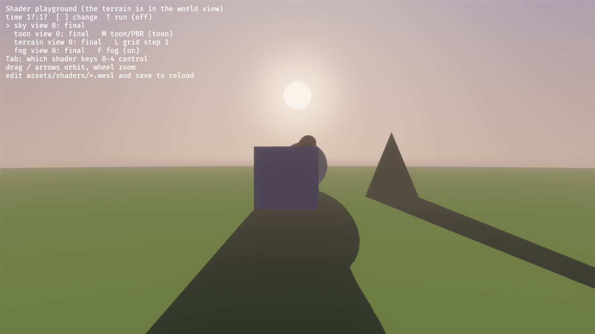
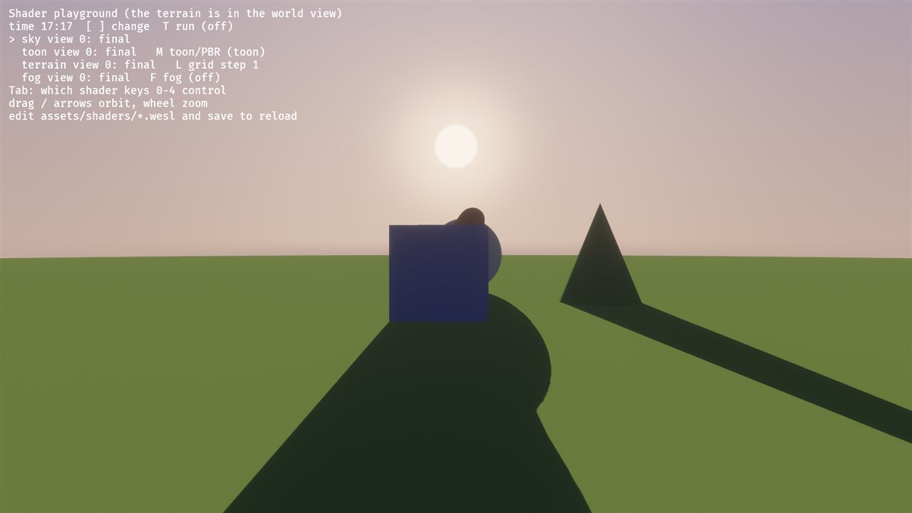
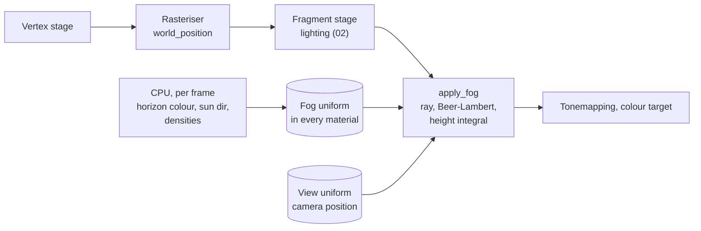
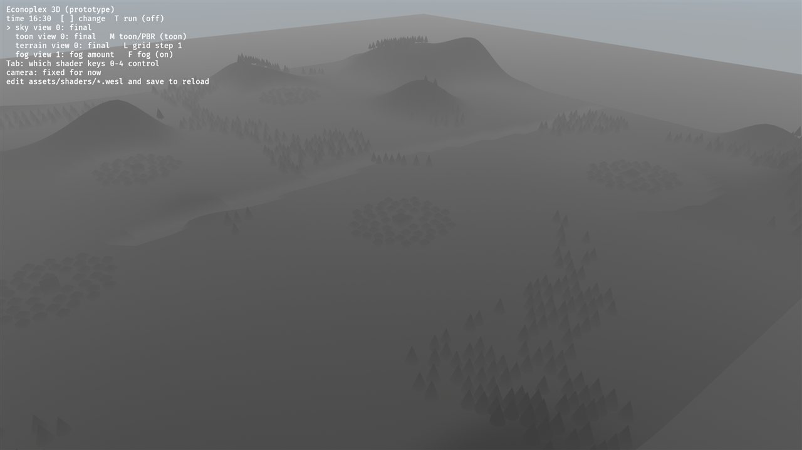
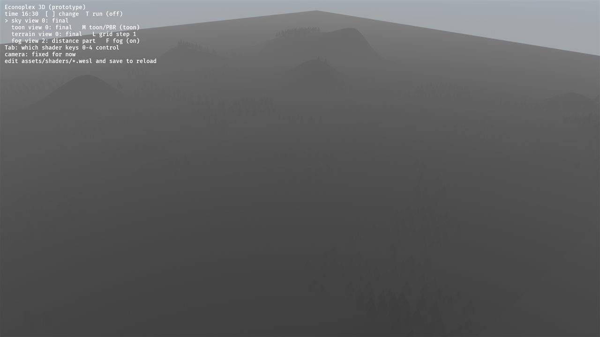
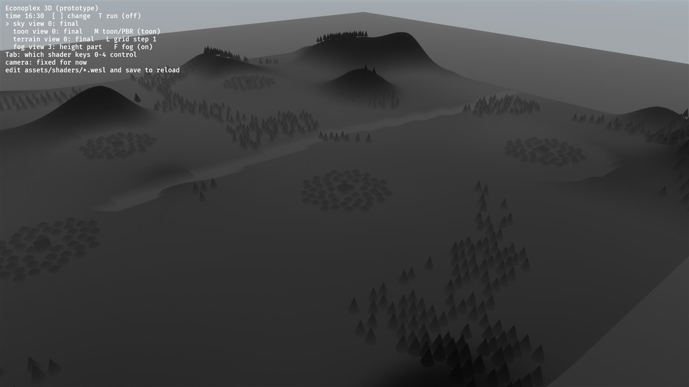
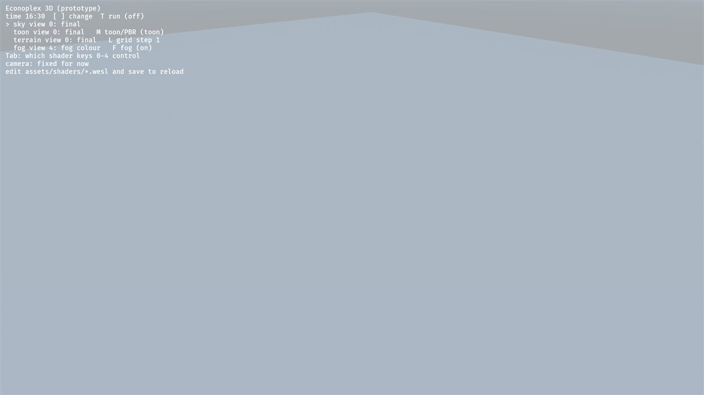
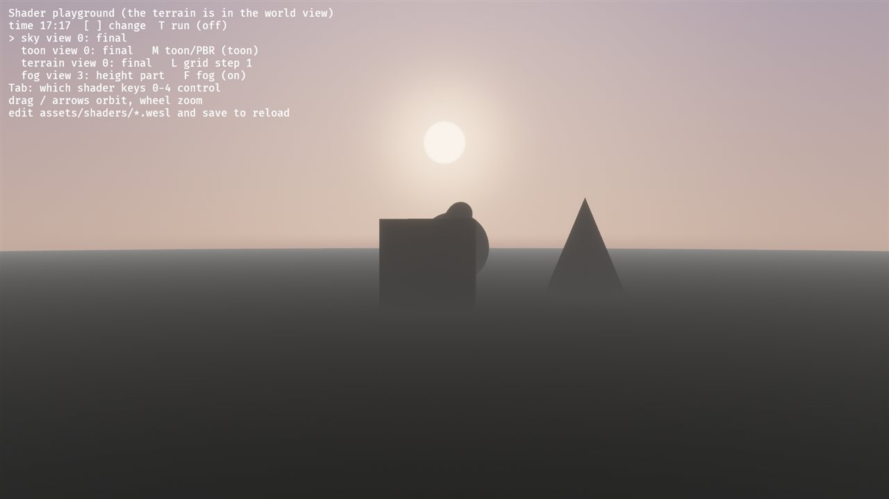
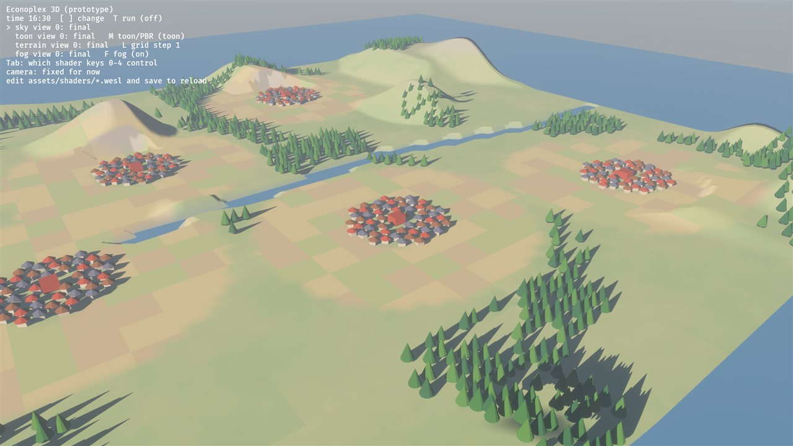
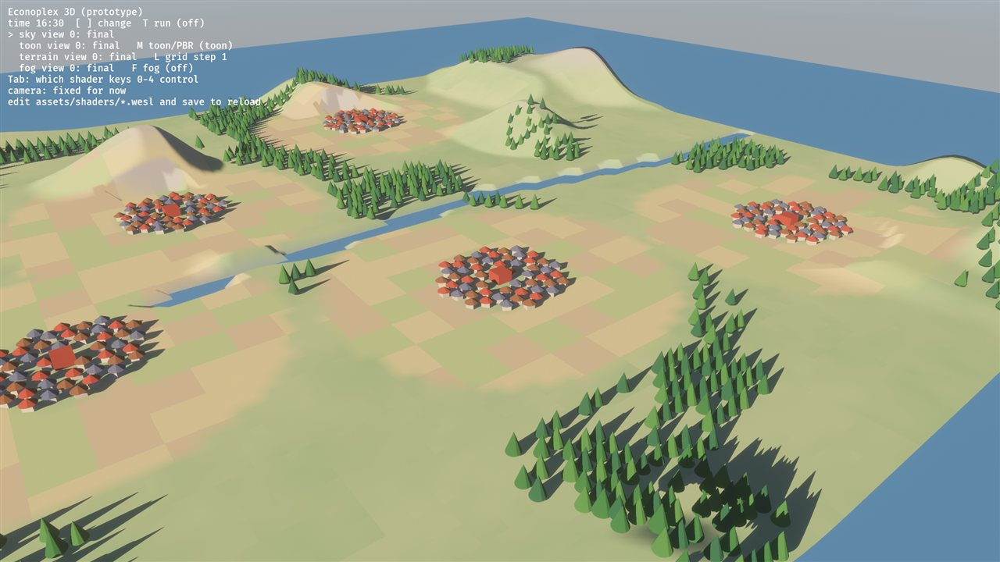

# 04: Distance and height fog (view rays and exponential falloff)

**Concept:** what a fragment knows about its place in the world, and turning a
physical idea into a few lines of shader code.
- Every fragment knows its world position, and the camera position is in the
  view uniform. So the **view ray** (direction and distance) is one subtraction
  away.
- Fog is then **Beer–Lambert's law**: light travelling a distance `d` through
  a medium of density `ρ` keeps `exp(−ρ d)` of itself.
- **Height fog** makes the density depend on height, and we integrate it along
  the ray in closed form.

**Where the code is:**
- `crates/game3d/assets/shaders/fog.wesl`: the fog module (hot-reloads);
- `crates/game3d/src/fog.rs`: the parameters, and the CPU side that picks the
  fog colour from the sky every frame;
- `toon.wesl` and `terrain.wesl` call `apply_fog` after lighting.

**Try it:**
- `cargo run --release -p game3d -- --seed 23`, or the playground at dusk:
  `-- --playground --hour 17.3 --face-sun`.
- `F` switches fog on and off.
- `Tab` until "fog" is marked, then `0`–`4` pick a debug view.

| fog | no fog (`F`) |
| --- | --- |
|  |  |

## What it does

- **Distance fog:** the farther away, the more of the fog colour.
- **Height fog:** denser low down, thinning upward. Valleys fill with haze;
  hill tops stay clear.
- **Fog colour = the sky's horizon colour.** The CPU takes it from the same
  palette as the sky (step 01), so far hills melt into the sky at every time of
  day.
- **In-scattering:** looking toward the sun, the haze glows in the sun's colour
  (the warm glow around the sun at dusk).

The fog runs in our materials' fragment shaders, not as a separate pass. Bevy's
own `DistanceFog` is gone from the camera. The water plane is now a toon
material too, so everything is fogged the same way.

### Why in the material, and not as a post-process pass?

A post-process pass would read the **depth buffer** and rebuild each pixel's
world position: `p = inverse(view_proj) · (x_ndc, y_ndc, depth, 1)`, divided by
`w`. That's the classic approach, and it fogs everything, sky included.

- In Bevy 0.20 that needs a custom render pass with the depth prepass bound
  (the ready-made `FullscreenMaterial` gets only the colour image).
- Our materials already know each fragment's world position, so we can skip the
  reconstruction.

Depth-buffer reconstruction comes back in step 08 (bloom), where we write our
first post-process pass anyway.

## The math

For a fragment at world position `p`, seen from the camera at `c`:

- **The view ray:** `d = |p − c|` and `r = (p − c) / d`.
- **Distance fog:** transmittance `T_d = exp(−ρ_d · d)`, so the fog amount is
  `f_d = 1 − T_d`.
- **Height fog:** the density falls off exponentially with height,
  `ρ(y) = ρ₀ · exp(−(y − h₀) / H)`. Its *optical depth* τ is the integral of ρ
  along the ray. With heights `y_c` (camera) and `y_p` (point), y changes
  linearly along the ray, so

  `τ = ∫₀^d ρ(y(s)) ds = ρ₀ · d · H · (e^{−(y_c−h₀)/H} − e^{−(y_p−h₀)/H}) / (y_p − y_c)`.

  When the ray is level (`y_p ≈ y_c`), this becomes `ρ₀ · e^{−(y_c−h₀)/H} · d`.
  Then `f_h = 1 − exp(−τ)`.
- **Both together:** light has to get through both, so the transmittances
  multiply: `1 − f = (1 − f_d)(1 − f_h)`.
- **Colour:** `fog = mix(horizon, sun_colour, max(r · s, 0)^8 · glow)`, where
  `s` is the direction to the sun.
- **Result:** `mix(lit, fog, f)`.

**Units:** density is per world unit. The map is about 200 units across, and
the default `ρ_d = 0.0008` gives about 15 % fog at 200 units. The height fog
(`ρ₀ = 0.006`, `H = 3`) matters only near the ground.

## The shader, line by line

`fog.wesl`:

```wgsl
// Shader step 04: distance and height fog. Explained in docs/shaders/04-fog.md.
//
// A WESL module used by the toon and terrain shaders: they call `apply_fog`
// with the lit colour and the fragment's world position, after lighting and
// before tonemapping.

import bevy_pbr::render::mesh_view_bindings::view;

// Matches `FogUniform` in src/fog.rs.
struct Fog {
    color: vec4<f32>,     // rgb: fog colour (the sky's horizon); a: 1 on, 0 off
    sun_dir: vec4<f32>,   // xyz: toward the sun; w: exponent of the sun glow
    sun_color: vec4<f32>, // rgb: colour toward the sun; a: glow strength
    params: vec4<f32>,    // x: distance density, y: height density at base,
                          // z: height falloff, w: base height
    debug: vec4<f32>,     // x: debug view
};

// The two parts of the fog and its colour, kept for the debug views.
struct FogTerms {
    distance: f32, // 0..1 from distance alone
    height: f32,   // 0..1 from height fog alone
    amount: f32,   // 0..1 combined
    color: vec3<f32>,
};

fn fog_terms(world_pos: vec3<f32>, fog: Fog) -> FogTerms {
    var t: FogTerms;
    let cam = view.world_position;
    let to_p = world_pos - cam;
    let d = length(to_p);                  // distance camera -> fragment
    let ray = to_p / max(d, 1e-4);         // unit view ray

    // Distance fog: Beer-Lambert, transmittance exp(-density * d).
    t.distance = 1.0 - exp(-fog.params.x * d);

    // Height fog: density rho(y) = rho0 * exp(-(y - h0) / H) along the ray.
    // Integrating rho over the ray from the camera (height yc) to the point
    // (height yp) has a closed form; when the ray is level it is just rho * d.
    let rho0 = fog.params.y;
    let H = fog.params.z;
    let h0 = fog.params.w;
    let yc = cam.y;
    let yp = world_pos.y;
    let ec = exp(-(yc - h0) / H);
    let ep = exp(-(yp - h0) / H);
    var tau: f32;
    if abs(yp - yc) > 1e-3 {
        tau = rho0 * d * H * (ec - ep) / (yp - yc);
    } else {
        tau = rho0 * d * ec;
    }
    t.height = 1.0 - exp(-max(tau, 0.0));

    // Combined: light has to get through both, so the transmittances multiply:
    // (1 - amount) = (1 - distance) * (1 - height).
    t.amount = (1.0 - (1.0 - t.distance) * (1.0 - t.height)) * fog.color.a;

    // In-scattering: looking toward the sun, the haze glows in the sun's colour.
    let toward_sun = pow(max(dot(ray, fog.sun_dir.xyz), 0.0), fog.sun_dir.w);
    t.color = mix(fog.color.rgb, fog.sun_color.rgb, toward_sun * fog.sun_color.a);
    return t;
}

// The lit colour seen through the fog. Debug views 1-4 replace it.
fn apply_fog(lit: vec3<f32>, world_pos: vec3<f32>, fog: Fog) -> vec3<f32> {
    let t = fog_terms(world_pos, fog);
    let id = u32(fog.debug.x);
    if id == 1u { return vec3<f32>(t.amount); }
    if id == 2u { return vec3<f32>(t.distance); }
    if id == 3u { return vec3<f32>(t.height); }
    if id == 4u { return t.color; }
    return mix(lit, t.color, t.amount);
}
```

Where it's called, in `toon.wesl`:

```wgsl
let fogged = apply_fog(albedo * t.light, pbr.world_position.xyz, toon.fog);
out.color = main_pass_post_lighting_processing(pbr, vec4<f32>(fogged, 1.0));
```

**The uniform:**
- `Fog` sits inside the toon block (`Toon.fog`), and the terrain's block nests
  the same `Toon` struct.
- `struct Toon` is now defined once, in `toon_lighting.wesl`, and imported by
  both shaders: one definition, one layout.
- Each frame the CPU writes the same `FogUniform` into every toon and terrain
  material (`update_toon`, `update_terrain`).



## Debug views

`Tab` to "fog", then `0`–`4`. The world view:

| 1 fog amount | 2 distance part | 3 height part | 4 fog colour |
| --- | --- | --- | --- |
|  |  |  |  |

- **1, amount:** the combined `f`. It grows toward the far edge.
- **2, distance part:** depends only on distance. It forms rings around the
  camera.
- **3, height part:** strongest where the ray runs low and long. Compare the
  valleys with the hill tops.
- **4, colour:** the horizon colour, warming toward the sun.

In the playground at dusk, the height part (view 3) shows the ground fog
thickening toward the horizon: 

World view with and without fog:

| fog | no fog |
| --- | --- |
|  |  |

## Exercises

Edit `fog.wesl` with the world view or the playground running, and save after
each change.

1. **Morning mist:** raise the height fog a lot (multiply `rho0` by 10 in the
   shader) and lower the falloff `H` to 1.
   - The valleys fill with milk, and the towns on hills rise out of it.
   - Then make it depend on the time of day: thick at dawn, gone by noon. The
     sun direction is in the uniform; `fog.sun_dir.y` is the sun height.
2. **Aerial perspective:** real distance fog is bluer for far mountains and
   warmer near the sun. Make the fog colour depend on distance: mix toward a
   cooler blue as `t.distance` grows.
3. **Fog in the sky (needs thinking):** the sky shader (01) ignores fog, which
   is fine because its horizon colour is already the fog colour. What would
   you change so the sun disc dims at dusk, when the ray to it crosses lots of
   height fog?
   - Hint: the same height integral, with `d` large and the ray direction to
     the sun.
