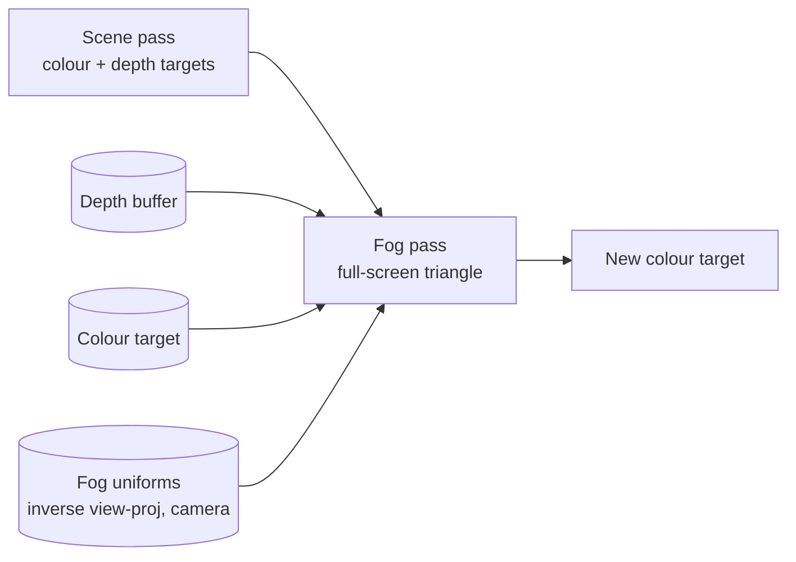

# 04: Distance and height fog (depth and view space)

**Concept:** reconstructing where a pixel is in the world from the depth buffer,
then using that distance (and height) to blend toward the fog colour. Fog that
pools in valleys and thins with altitude is a big part of the painterly look.

## What it does

A post-process pass over the finished image:
- It reads the **depth buffer** and rebuilds each pixel's **world position**.
- It computes **distance fog** (exponential in distance) and **height fog**
  (denser low down, thinning above `fog_height`).
- It blends toward a fog colour that warms toward the sun (in-scattering).

## The math

- **From depth to world:** the depth buffer stores `z_ndc` for the pixel. With UV
  `uv`, NDC is `x_ndc = uv.x * 2 − 1`, `y_ndc = 1 − uv.y * 2`. Then
  `p_world = inverse(view_proj) * vec4(x_ndc, y_ndc, z_ndc, 1)`, divided by `w`.
- **Distance:** `d = |p_world − camera|`.
- **Distance fog:** `f_d = 1 − exp(−d * density)`.
- **Height fog** along the ray, integrated in closed form: for density
  `ρ(y) = ρ0 exp(−(y − h0) / H)`, the optical depth from the camera at height
  `y_c` to the point at `y_p`, over distance `d`, is
  `τ = ρ0 * d * H * (exp(−(y_c−h0)/H) − exp(−(y_p−h0)/H)) / (y_p − y_c)`
  (and `ρ(y_c) * d` when `y_p ≈ y_c`). Then `f_h = 1 − exp(−τ)`.
- **Total:** `f = 1 − (1 − f_d)(1 − f_h)`.
- **Sun in-scattering:** `fog = mix(fog_color, sun_color, pow(max(dot(ray, sun), 0), 8))`.

## WGSL, line by line

```wgsl
// A full-screen post-process pass: one triangle covers the screen, the
// fragment shader runs once per pixel of the finished image.
import bevy_core_pipeline::fullscreen_vertex_shader::FullscreenVertexOutput;

struct Fog {
    world_from_clip: mat4x4<f32>,  // inverse(view_proj), set per frame
    camera: vec4<f32>,             // camera world position
    color: vec4<f32>,              // fog colour
    sun_dir: vec4<f32>,            // xyz: toward the sun; w: in-scatter strength
    density: f32,                  // distance fog per metre
    height_density: f32,           // rho0 at fog_height
    fog_height: f32,               // h0
    falloff: f32,                  // H: how fast height fog thins (metres)
};
@group(0) @binding(0) var screen: texture_2d<f32>;       // the finished image
@group(0) @binding(1) var depth: texture_depth_2d;       // the depth buffer
@group(0) @binding(2) var smp: sampler;
@group(0) @binding(3) var<uniform> fog: Fog;

@fragment
fn fragment(in: FullscreenVertexOutput) -> @location(0) vec4<f32> {
    let color = textureSample(screen, smp, in.uv).rgb;

    // Depth of this pixel (0..1, Bevy uses reverse-Z: 1 near, 0 far).
    let z = textureLoad(depth, vec2<i32>(in.position.xy), 0);
    // UV -> NDC: x right, y up, z from the buffer.
    let ndc = vec4<f32>(in.uv.x * 2.0 - 1.0, 1.0 - in.uv.y * 2.0, z, 1.0);
    // Undo the projection: clip -> world, then the perspective divide.
    let w = fog.world_from_clip * ndc;
    let p = w.xyz / w.w;

    // Distance from the camera, and the unit ray toward the pixel.
    let to_p = p - fog.camera.xyz;
    let d = length(to_p);
    let ray = to_p / d;

    // Distance fog: Beer-Lambert extinction, exp of minus density times length.
    let fd = 1.0 - exp(-d * fog.density);

    // Height fog: closed-form integral of an exponential density along the ray.
    let yc = fog.camera.y - fog.fog_height;
    let yp = p.y - fog.fog_height;
    let H = fog.falloff;
    var tau: f32;
    if abs(yp - yc) < 1e-3 {
        tau = fog.height_density * exp(-yc / H) * d;          // a level ray
    } else {
        tau = fog.height_density * d * H * (exp(-yc / H) - exp(-yp / H)) / (yp - yc);
    }
    let fh = 1.0 - exp(-max(tau, 0.0));

    // Combine: both fogs remove light independently.
    let f = 1.0 - (1.0 - fd) * (1.0 - fh);

    // Fog glows warm toward the sun.
    let scatter = pow(max(dot(ray, fog.sun_dir.xyz), 0.0), 8.0) * fog.sun_dir.w;
    let fog_col = mix(fog.color.rgb, vec3(1.0, 0.85, 0.6), scatter);
    return vec4<f32>(mix(color, fog_col, f), 1.0);
}
```



## Debug views

- **Linear depth:** `vec4(vec3(d / 500.0), 1)`, to check the reconstruction (a
  smooth ramp with distance).
- **World position:** `fract(p / 10.0)`, which draws a 10 m grid on everything.
  If it swims when the camera moves, the matrix is wrong.
- **Fog factors:** `fd`, `fh` and `f` separately, as greyscale.

## Exercises

1. **Valley mist at dawn:** drive `height_density` from the time of day: dense in
   the morning, gone by noon.
2. **Noise in the fog:** modulate the height fog with 3D noise moving with the
   wind, `noise(p.xz / 50 + time * 0.02)`, so the mist drifts.
