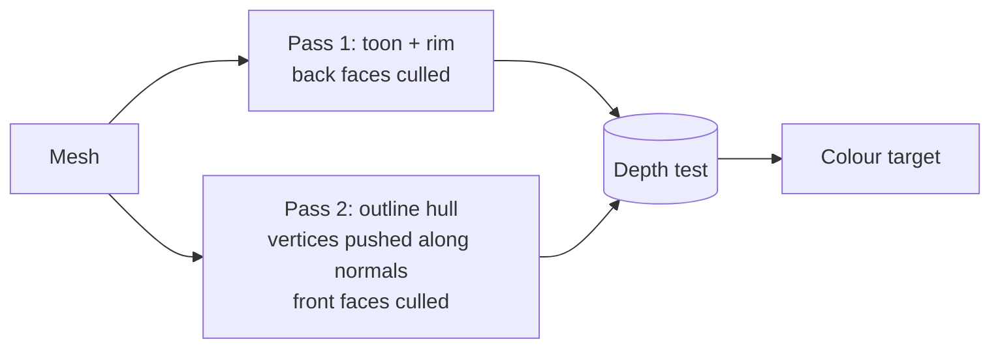

# 05: Rim light and outlines (the view vector)

**Concept:** shading that depends on where the *camera* is, not just the light.
- The **fresnel** term uses the angle between the normal and the view direction.
- **Outlines** are drawn with an "inverted hull": a second pass of the mesh,
  pushed out along its normals, drawn only from behind.

## What it does

- **Rim light:** a soft light along silhouettes, strongest where the surface turns
  away from the camera. It separates houses, trees and people from the ground,
  which matters a lot for readability at RTS distances.
- **Outlines:** thin, slightly darker lines around buildings and units, wider for
  selected ones.

## The math

- **View vector:** `v = normalize(camera − p)`.
- **Fresnel (Schlick-like):** `F = (1 − max(n · v, 0))^p`, which is 0 facing the
  camera and 1 at grazing angles. `p ≈ 3`.
- **Rim, lit side only:** `rim = F * smoothstep(−0.2, 0.4, n · l)`. A rim that
  ignores the light looks like a glow; this keeps it painterly.
- **Inverted hull:** in a second pass, move each vertex
  `p' = p + n * width * dist_scale`, cull **front** faces, and draw a flat colour.
  - Only the back faces poking out past the original silhouette remain visible:
    that's the outline.
  - `dist_scale = distance to camera / reference distance` keeps the width
    constant on screen.

## WGSL, line by line

```wgsl
// --- rim, added inside the toon fragment shader (02-toon) ---
// v: from the surface toward the camera.
let v = normalize(view.world_position - pbr.world_position.xyz);
// Fresnel: 1 - cos(angle between normal and view), sharpened by a power.
let fres = pow(1.0 - max(dot(n, v), 0.0), toon.rim_power);
// Only where the light reaches: rim on the sunlit edge.
let rim = fres * smoothstep(-0.2, 0.4, ndl) * toon.rim_strength;
color += sun.color.rgb * rim;

// --- outline pass: its own material, drawn with front-face culling ---
import bevy_pbr::render::mesh_functions::get_world_from_local;
import bevy_pbr::render::mesh_view_bindings::view;

struct Outline { color: vec4<f32>, width: f32, ref_dist: f32 };
@group(constants::MATERIAL_BIND_GROUP) @binding(0) var<uniform> outline: Outline;

struct Vertex {
    @builtin(instance_index) instance: u32,
    @location(0) position: vec3<f32>,
    @location(1) normal: vec3<f32>,
};

@vertex
fn vertex(v: Vertex) -> @builtin(position) vec4<f32> {
    let model = get_world_from_local(v.instance);
    let world = (model * vec4<f32>(v.position, 1.0)).xyz;
    // Normal to world space (fine for uniform scale; otherwise use the
    // inverse-transpose matrix).
    let n = normalize((model * vec4<f32>(v.normal, 0.0)).xyz);
    // Constant screen width: push further out the further away we are.
    let dist = length(view.world_position - world);
    let pushed = world + n * outline.width * dist / outline.ref_dist;
    return view.clip_from_world * vec4<f32>(pushed, 1.0);
}

@fragment
fn fragment() -> @location(0) vec4<f32> {
    return outline.color;  // flat: only the hull's silhouette shows
}
```

Rust side: the outline material sets `cull_mode: Some(Face::Front)` in
`specialize`, and every outlined mesh gets a second entity with this material.



## Debug views

- **Fresnel alone:** `vec4(vec3(fres), 1)` should show bright edges on every
  silhouette.
- **n·v:** `vec4(vec3(dot(n, v)), 1)`.
- **Outline hull only:** draw pass 2 with back-face culling, so you see the
  "fattened" mesh and understand what the culling removes.

## Exercises

1. **Selection:** make the outline width and colour per instance (white and twice
   as wide for the selected unit).
2. **Depth-based outlines:** detect edges in a post pass instead, using
   discontinuities in depth and normals, and compare the look and cost with the
   inverted hull.
