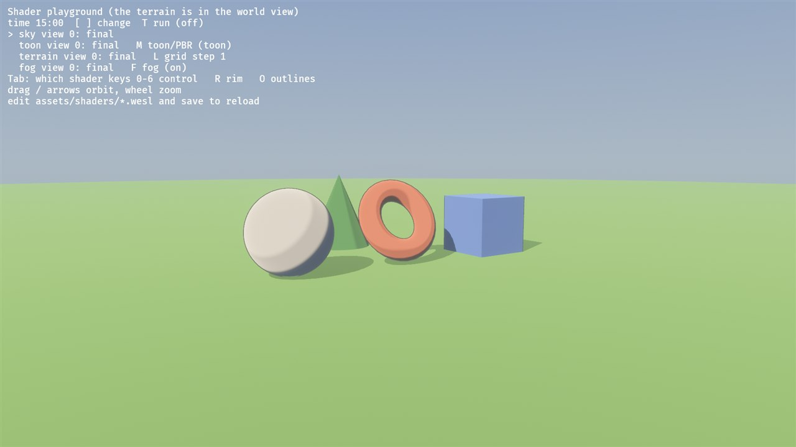
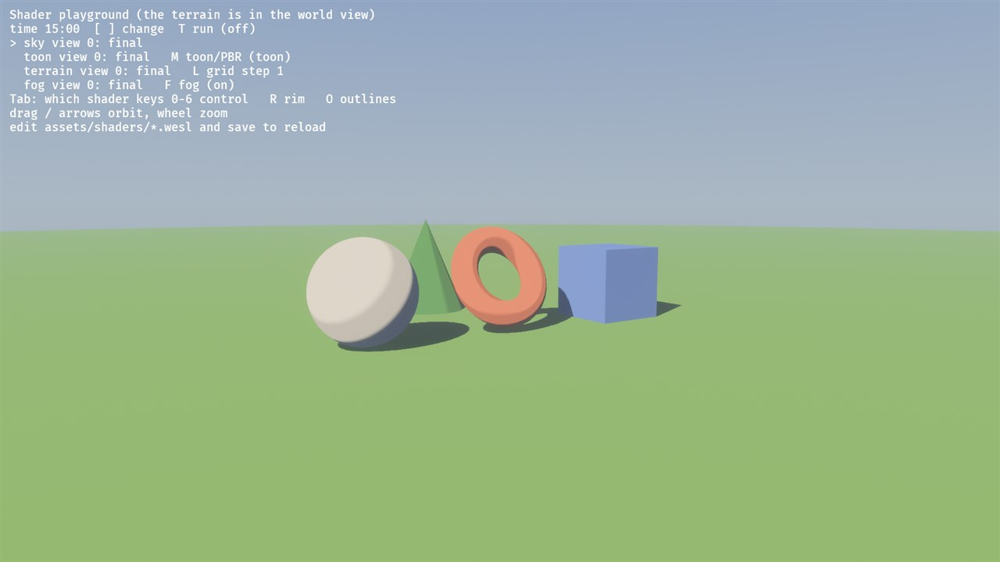
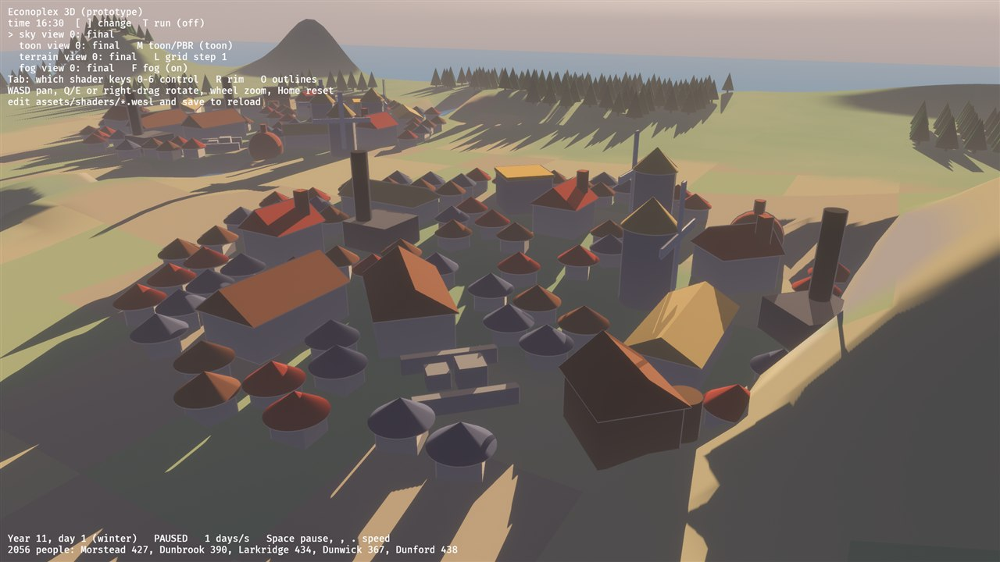
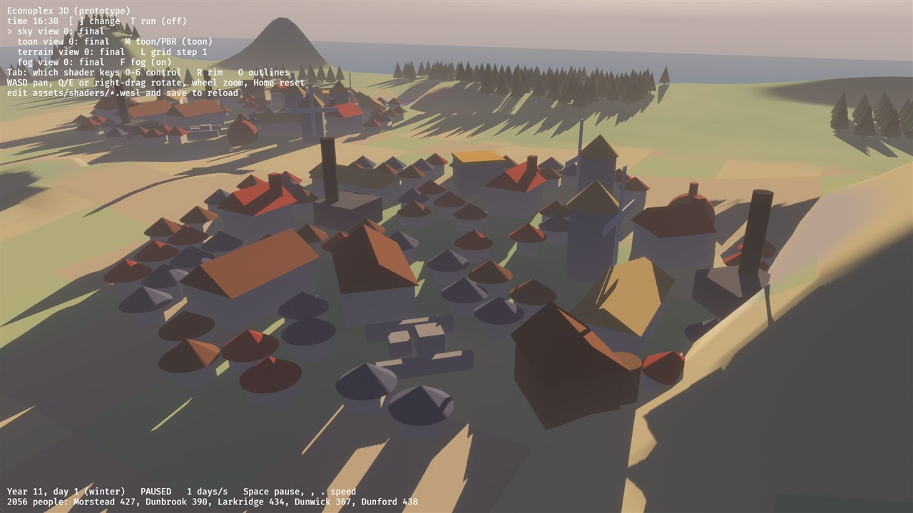
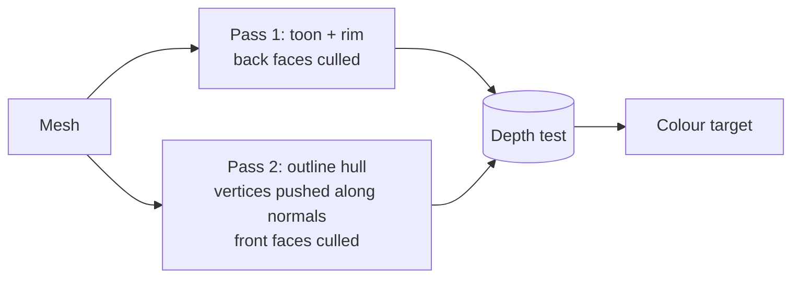
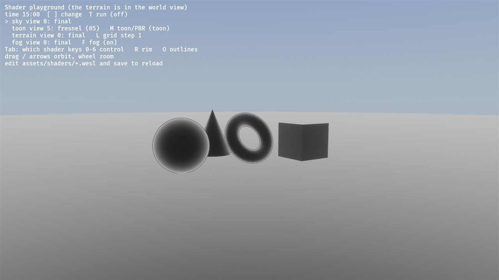
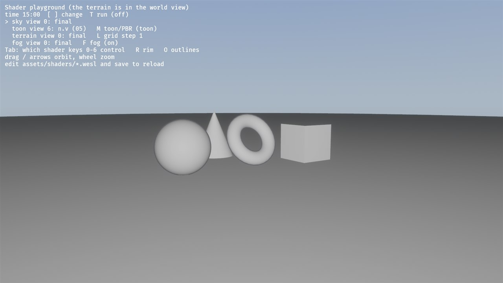

# 05: Rim light and outlines (the view vector, a second pass)

**Concept:** shading that depends on where the *camera* is, not just the light,
and drawing a mesh twice with different pipeline settings.
- The **fresnel** term uses the angle between the surface normal and the
  direction to the camera.
- **Outlines** use an *inverted hull*: a second, slightly fatter copy of the
  mesh, drawn inside out.

**Where the code is:**
- rim light: `toon_lighting.wesl` (in `toon_terms`), parameters in `ToonUniform`
  (`src/toon.rs`);
- outlines: `crates/game3d/assets/shaders/outline.wesl` and `src/outline.rs`.
  Every building part, house and playground shape gets an outline child.

**Try it:** the playground or the world view.
- `R` turns rim light on and off; `O` does the same for outlines.
- `Tab` to "toon": view `5` is the fresnel term, view `6` is n·v.

| rim + outlines | neither |
| --- | --- |
|  |  |
|  |  |

## What it does

- **Rim light:** a thin bright edge along silhouettes, on the sunlit side.
  It separates houses and roofs from the ground behind them, which matters at
  strategy-game distances.
- **Outlines:** a thin dark line around every building part and house. That's
  the "inked" part of the painterly look, and it keeps small shapes readable
  from far away.

## The math

### Rim light (fresnel)

- **View vector:** `v = normalize(camera − p)`, from the surface toward the
  camera.
- **n·v** is 1 where the surface faces the camera and 0 at the silhouette,
  where the surface turns away.
- **Fresnel (Schlick-style):** `F = (1 − n·v)^k`, with `k = 3`. It's near 0 on
  most of the surface and rises steeply at the edge. A larger `k` gives a
  thinner rim.
- **Only where the light reaches:** `rim = F · smoothstep(−0.2, 0.4, n·l) · strength`.
  A rim that ignores the light looks like a glow; this keeps it painterly.
- **Added to the sun's contribution:** `light = ambient + sun · (lit + rim)`.

### Outlines (inverted hull)

1. **Draw the mesh again,** pushing each vertex out along its normal:
   `p' = p + n · width · (distance / reference)`. Scaling by the distance to
   the camera keeps the line about equally thick on screen.
2. **Cull the front faces** (the ones facing the camera) instead of the back
   faces. You see only the *inside* of the fat copy.
3. **The depth test does the rest.** Where the original mesh is in front, it
   hides the hull. Only the rim of the hull that pokes out past the silhouette
   survives: the outline.



## The shaders

The rim, in `toon_terms` (`toon_lighting.wesl`):

```wgsl
    // Step 05, rim light: v points from the surface to the camera. n . v is 1
    // where the surface faces us and 0 at the silhouette; the fresnel term
    // turns that into a thin bright edge. Only on the sunlit side (a rim that
    // ignores the light looks like a glow).
    let v = normalize(view.world_position - pbr.world_position.xyz);
    t.ndv = max(dot(n, v), 0.0);
    t.fresnel = pow(1.0 - t.ndv, p.rim_power);
    let rim = t.fresnel * smoothstep(-0.2, 0.4, t.ndl) * p.rim_strength;

    t.light = (ambient + sunlight * (lit + rim)) * view.exposure;
```

`outline.wesl`:

```wgsl
// Shader step 05: outlines by the "inverted hull". Explained in
// docs/shaders/05-rim-outline.md.
//
// Every outlined mesh is drawn a second time with this material:
// - the vertex shader pushes each vertex out along its normal (a fatter copy);
// - the pipeline culls FRONT faces (see OutlineMaterial::specialize), so only
//   the inside of the fat copy is drawn;
// - the original mesh hides most of it; what pokes out past the silhouette is
//   the outline.

import bevy_pbr::render::{
    mesh_functions,
    forward_io::{Vertex, decompress_vertex},
    mesh_view_bindings::view,
    view_transformations::position_world_to_clip,
};
import super::fog::{Fog, apply_fog};

// Matches `OutlineUniform` in src/outline.rs.
struct Outline {
    color: vec4<f32>,  // the line colour
    params: vec4<f32>, // x: width (world units at the reference distance),
                       // y: reference distance
    fog: Fog,          // so far-away outlines fade into the haze like the rest
};
@group(constants::MATERIAL_BIND_GROUP) @binding(0) var<uniform> outline: Outline;

struct OutlineOut {
    @builtin(position) position: vec4<f32>,
    @location(0) world_position: vec3<f32>,
};

@vertex
fn vertex(vertex_in: Vertex) -> OutlineOut {
    let v = decompress_vertex(vertex_in, vertex_in.instance_index);
    let world_from_local = mesh_functions::get_world_from_local(vertex_in.instance_index);
    let world = mesh_functions::mesh_position_local_to_world(world_from_local, vec4<f32>(v.position, 1.0)).xyz;
    // The normal in world space. Bevy uses the inverse-transpose of the model
    // matrix, so stretched boxes still get normals at right angles to their faces.
    let n = mesh_functions::mesh_normal_local_to_world(v.normal, vertex_in.instance_index);

    // Push out along the normal. Scaling by the distance to the camera keeps the
    // line about equally thick on screen, near or far.
    let dist = length(view.world_position - world);
    let pushed = world + n * outline.params.x * dist / outline.params.y;

    var out: OutlineOut;
    out.position = position_world_to_clip(pushed);
    out.world_position = pushed;
    return out;
}

@fragment
fn fragment(in: OutlineOut) -> @location(0) vec4<f32> {
    // A flat colour: only the silhouette of the hull shows anyway.
    return vec4<f32>(apply_fog(outline.color.rgb, in.world_position, outline.fog), 1.0);
}
```

**The Rust side (`src/outline.rs`):**
- `OutlineMaterial::specialize` sets `cull_mode = Some(Face::Front)`. That one
  line turns a fat copy into an outline: the pipeline state matters as much as
  the shader.
- `enable_prepass` and `enable_shadows` return `false`: the hull is only a look.
  It must not cast shadows or write into the shadow pass.
- `Outlines::hull(mesh)` is the child entity that outlines a mesh. Being a
  child, it inherits the part's transform (position, rotation, stretching).
- All outlines share one material. `O` sets its width to 0, so the hull
  collapses into the mesh and disappears.

**Normals and stretched boxes:** `mesh_normal_local_to_world` uses the
inverse-transpose of the model matrix. For a box stretched to 1.8 × 1 × 3, it
keeps the normals at right angles to the faces; the plain model matrix would
tilt them.

## Debug views

| 5 fresnel | 6 n·v |
| --- | --- |
|  |  |

- **5, fresnel:** dark where the surface faces you, bright at the silhouette.
  The flat cube faces are evenly grey: each face has a single normal.
- **6, n·v:** the opposite, white where the surface faces you.

## Things to notice

- **Corners of boxes:** a cube has separate vertices per face, each with that
  face's normal. Pushing them out moves the faces apart and opens small gaps in
  the hull at the corners. The outline thins out there. (Exercise 2 fixes it.)
- **At a distance:** the outlines go through the fog like everything else
  (`apply_fog` in the outline shader), so far towns don't get black lines.

## Exercises

1. **Selection:** give the selected building a wider, lighter outline.
   - Make a second `OutlineMaterial` with width × 2 and a warm colour.
   - Swap the hull's material when a building is selected (M5 adds picking; for
     now, pick one by its id in the snapshot).
2. **Closed hulls for boxes:** fix the corner gaps.
   - Build the hull from a copy of the mesh with *smoothed* normals
     (`Mesh::compute_smooth_normals` after merging the corner vertices), so the
     pushed faces stay connected.
   - Compare the cube's outline before and after.
3. **Rim colour:** the rim takes the sun's colour. Mix it toward the sky's
   zenith colour instead (pass it in the uniform), so the rim reads as light
   from the sky rather than the sun.
