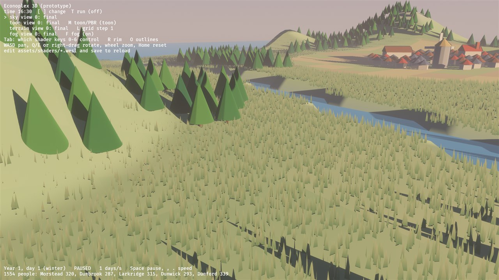
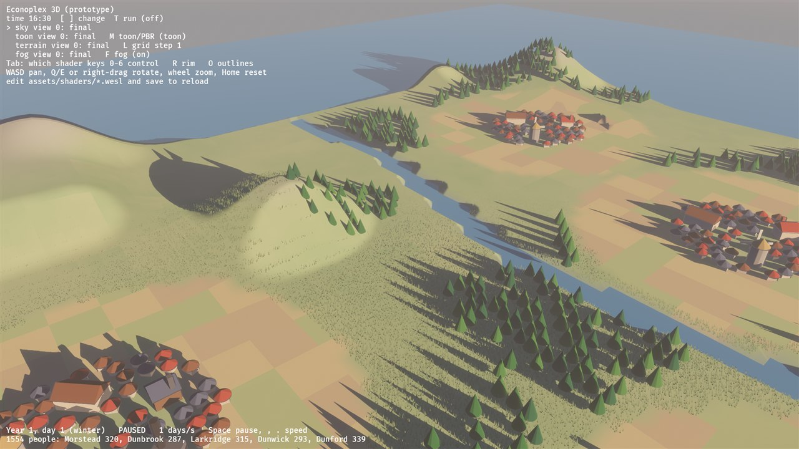
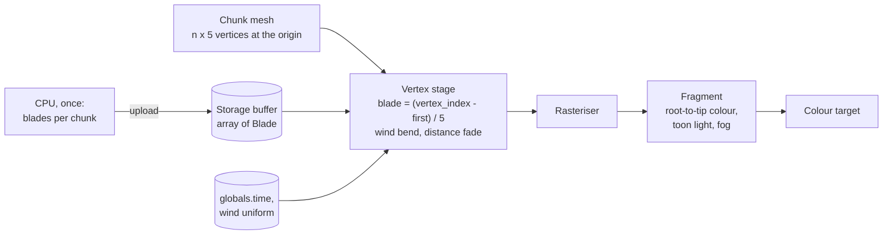
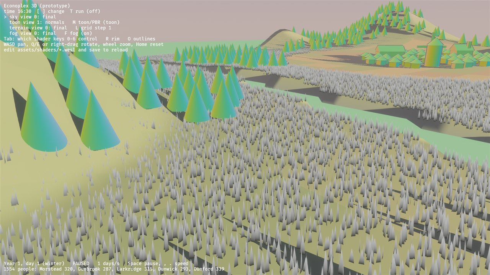

# 06: Grass and trees in the wind (storage buffers, per-instance data)

**Concept:** drawing the same small shape a huge number of times, each copy
with its own data.
- **Grass:** about 340,000 blades. Their data sits in a **storage buffer**, and
  the vertex shader reads it by index ("vertex pulling").
- **Trees:** each crown is an ordinary entity. Bevy draws all crowns with the
  same mesh and material in one **instanced** draw call; each instance finds its
  own transform by `instance_index`.
- **Wind:** in both cases it's computed in the vertex shader from time and
  position. No physics, nothing on the CPU per frame.

**Where the code is:**
- `crates/game3d/assets/shaders/grass.wesl`: the blades;
- `crates/game3d/assets/shaders/sway.wesl`: the trees' vertex shader (their
  fragment shader is `toon.wesl`);
- `crates/game3d/src/nature.rs`: the materials, the blade buffer and chunk
  meshes;
- `main.rs` places the blades over the meadows.

**Try it:** `cargo run --release -p game3d -- --seed 23`, and zoom into a
meadow.
- `G` hides the grass.
- `Tab` to "toon", view `1`: blades are coloured by height along the blade.

| a meadow | from higher up |
| --- | --- |
|  |  |

## How 340,000 blades get drawn

### Instancing vs vertex pulling

- **GPU instancing:** one draw call says "draw this 5-vertex mesh 340,000 times".
  The vertex shader gets `instance_index` and reads that instance's data.
  - Bevy does this automatically for entities that share a mesh and material:
    that's how the tree crowns are drawn.
  - But it needs one entity per instance, and 340,000 entities is a lot of CPU
    bookkeeping for things that never change.
- **Vertex pulling** (what the grass uses): each chunk is **one mesh** holding
  many copies of the same 5-vertex blade, all at the origin.
  - The vertex shader works out which blade it belongs to from its
    `vertex_index`: `blade = (vertex_index − first_vertex) / 5`.
  - It then reads that blade's data from a storage buffer.
  - One entity per chunk (69 chunks), and the same idea as instancing: per-blade
    data in a buffer, indexed in the shader.

### Storage buffers

A **uniform buffer** is small and fixed-size: our `Toon` block, the sky
colours. A **storage buffer** is an array of any length, read (or, in compute
shaders, written) by index:

```wgsl
@group(constants::MATERIAL_BIND_GROUP) @binding(101) var<storage, read> blades: array<Blade>;
```

- **On the Rust side,** each chunk's blades are a `Vec<[f32; 8]>`, wrapped in a
  `ShaderBuffer` asset and bound with `#[storage(101, read_only)]`.
- **Layout:** a blade is 8 floats (32 bytes), which matches the WGSL struct:
  - `pos: vec3` (offset 0), `height: f32` (12), `lean` (16), `tint` (20);
  - 8 bytes of padding, so the size is a multiple of 16.
  - Getting this layout wrong is the classic storage-buffer bug: the data comes
    out shifted and blades fly everywhere.

### `first_vertex_index`

Bevy packs many meshes into one big vertex buffer, so `@builtin(vertex_index)`
counts from where *this* mesh starts in it. The mesh uniform tells us that start
(`mesh[instance_index].first_vertex_index`), and we subtract it.

## The math

For a blade vertex at height fraction `h` (0 root, 1 tip, from the mesh), with
the blade's base `b`, its height `H`, the wind direction `w` (unit, on the
ground), frequency `k` and amplitude `A`:

- **Wave:** `wave = ½ + ½ sin(k (b · w) − 2t)`. This crest rolls across the
  field along `w`, so neighbouring blades bend together.
- **Gusts:** `gust = ½ + ½ sin(0.7 t + 0.05 b.x + 0.03 b.z)`, slower, so the
  wave swells and fades.
- **Bend angle:** `θ = (¼ + wave · gust) · A · h²`. The `h²` makes the root
  stay put and the tip move most, like a cantilever. The ¼ keeps a little lean
  even in calm air.
- **Keep the length:** the tip moves `H sin θ` sideways and `h H cos θ` up, so
  a bending blade doesn't grow.
- **Distance fade:** `H' = H · smoothstep(110, 70, d)`. Beyond 110 units every
  blade collapses to a line, which costs vertices but no pixels. That's the
  cheapest level of detail.
- **Trees:** `sway = 0.12 (0.6 sin(1.3t + φ) + 0.25 sin(2.9t + 1.7φ))`, with the
  phase `φ` from the tree's position, applied as `wind · sway · up²`. Two sines
  of unrelated speeds make the motion look less regular.

## The shaders

`grass.wesl`:

```wgsl
// Shader step 06: grass with wind. Explained in docs/shaders/06-grass.md.
//
// Hundreds of thousands of blades, each made of 5 vertices. The mesh of a chunk
// holds many copies of the same little blade shape; the vertex shader finds out
// WHICH blade it belongs to (from its vertex index) and reads that blade's data
// (position, height, lean, tint) from a storage buffer. This is "vertex
// pulling": per-blade data in a buffer, indexed in the shader, the same idea as
// instancing.

import bevy_pbr::render::{
    mesh_functions,
    mesh_bindings::mesh,
    forward_io::{Vertex, VertexOutput, FragmentOutput, decompress_vertex},
    mesh_view_bindings::{view, globals},
    view_transformations::position_world_to_clip,
    pbr_fragment::pbr_input_from_standard_material,
    pbr_functions::main_pass_post_lighting_processing,
};
import super::toon_lighting::{Toon, toon_params, toon_terms};
import super::fog::apply_fog;

// One blade; matches the 8 floats per blade written in src/nature.rs.
struct Blade {
    pos: vec3<f32>, // base on the terrain (world space)
    height: f32,    // world units
    lean: f32,      // rotation around y (radians)
    tint: f32,      // 0..1 colour variation
    pad: vec2<f32>, // keeps each blade 32 bytes (storage buffer layout)
};

struct Grass {
    toon: Toon,
    wind: vec4<f32>,   // xy: wind direction, z: amplitude, w: wave frequency
    params: vec4<f32>, // x: fade start, y: fade end (distance to camera), z: debug
};
@group(constants::MATERIAL_BIND_GROUP) @binding(100) var<uniform> grass: Grass;
// A storage buffer: a read-only array of any length, indexed in the shader.
@group(constants::MATERIAL_BIND_GROUP) @binding(101) var<storage, read> blades: array<Blade>;

const VERTS_PER_BLADE: u32 = 5u;

@vertex
fn vertex(vertex_in: Vertex, @builtin(vertex_index) vertex_index: u32) -> VertexOutput {
    let v = decompress_vertex(vertex_in, vertex_in.instance_index);
    // Which blade? Bevy packs many meshes into one big vertex buffer, so the
    // index starts at this mesh's first vertex; subtract it, then divide.
    let first = mesh[vertex_in.instance_index].first_vertex_index;
    let b = blades[(vertex_index - first) / VERTS_PER_BLADE];
    let h = v.position.y;                 // 0 at the root, 1 at the tip (mesh shape)

    // Fade out with distance: shrink far blades to nothing, so they cost
    // vertices but no pixels.
    let d = length(view.world_position - b.pos);
    let keep = smoothstep(grass.params.y, grass.params.x, d);
    let height = b.height * keep;

    // The blade's width direction, rotated by its lean.
    let across = vec3<f32>(cos(b.lean), 0.0, sin(b.lean)) * v.position.x * keep;

    // Wind: a wave rolling across the field, times slow gusts. The bend grows
    // with h squared, like a bending stalk: the root stays put.
    let dir = grass.wind.xy;
    let wave = sin(dot(b.pos.xz, dir) * grass.wind.w - globals.time * 2.0) * 0.5 + 0.5;
    let gust = sin(globals.time * 0.7 + b.pos.x * 0.05 + b.pos.z * 0.03) * 0.5 + 0.5;
    let bend = (0.25 + wave * gust) * grass.wind.z * h * h;
    // Keep the blade's length: as the tip moves sideways it also drops.
    let up = h * height * cos(bend);
    let side = sin(bend) * height;
    let world = b.pos + across + vec3<f32>(dir.x * side, up, dir.y * side);

    var out: VertexOutput;
    out.world_position = vec4<f32>(world, 1.0);
    out.position = position_world_to_clip(world);
    // Light the blade as if it faced up, tilted with the wind: soft and even.
    out.world_normal = normalize(vec3<f32>(dir.x * bend, 1.0, dir.y * bend));
@if(VERTEX_UVS_A)
    out.uv = vec2<f32>(h, b.tint);       // the fragment stage needs h and tint
@if(VERTEX_OUTPUT_INSTANCE_INDEX)
    out.instance_index = vertex_in.instance_index;
    return out;
}

@fragment
fn fragment(in: VertexOutput, @builtin(front_facing) is_front: bool) -> FragmentOutput {
    var pbr = pbr_input_from_standard_material(in, is_front);
    pbr.N = normalize(in.world_normal);   // the same on both sides of the blade
    let h = in.uv.x;
    let tint = in.uv.y;
    // Dark at the root, light at the tip, varied per blade.
    let root = vec3<f32>(0.16, 0.30, 0.12);
    let tip = mix(vec3<f32>(0.50, 0.68, 0.26), vec3<f32>(0.70, 0.72, 0.32), tint);
    let albedo = mix(root, tip, h);

    let t = toon_terms(pbr, toon_params(grass.toon));
    var out: FragmentOutput;
    if u32(grass.params.z) == 1u {
        out.color = vec4<f32>(vec3<f32>(h), 1.0);            // debug: height along the blade
    } else {
        let fogged = apply_fog(albedo * t.light, in.world_position.xyz, grass.toon.fog);
        out.color = main_pass_post_lighting_processing(pbr, vec4<f32>(fogged, 1.0));
    }
    return out;
}
```

`sway.wesl`:

```wgsl
// Shader step 06, trees: a vertex shader that sways tree crowns in the wind.
// The fragment shader is the toon shader of step 02 (toon.wesl), unchanged.
//
// Every crown is an ordinary entity with the same mesh and material, so Bevy
// draws them all in one instanced draw call. Each instance finds its own
// transform with `get_world_from_local(instance_index)`; its position gives it
// its own phase, so the forest doesn't sway in lockstep.

import bevy_pbr::render::{
    mesh_functions,
    forward_io::{Vertex, VertexOutput, decompress_vertex},
    mesh_view_bindings::globals,
    view_transformations::position_world_to_clip,
};

@vertex
fn vertex(vertex_in: Vertex) -> VertexOutput {
    var out: VertexOutput;
    let v = decompress_vertex(vertex_in, vertex_in.instance_index);
    let world_from_local = mesh_functions::get_world_from_local(vertex_in.instance_index);
    var world = mesh_functions::mesh_position_local_to_world(world_from_local, vec4<f32>(v.position, 1.0));

    // How far up the crown this vertex is: the cone runs from y = -1 to 1 in
    // its own space, so 0 at the base, 1 at the tip.
    let up = clamp(v.position.y * 0.5 + 0.5, 0.0, 1.0);
    // This tree's position (the translation column of its matrix) sets its phase.
    let root = world_from_local[3].xyz;
    let phase = root.x * 0.37 + root.z * 0.23;
    let t = globals.time;
    // Two sines of different speed make a less regular sway.
    let sway = (sin(t * 1.3 + phase) * 0.6 + sin(t * 2.9 + phase * 1.7) * 0.25) * 0.12;
    let wind_dir = vec3<f32>(0.8, 0.0, 0.6);
    world = vec4<f32>(world.xyz + wind_dir * sway * up * up, 1.0);

    out.world_position = world;
    out.position = position_world_to_clip(world.xyz);
    out.world_normal = mesh_functions::mesh_normal_local_to_world(v.normal, vertex_in.instance_index);
@if(VERTEX_UVS_A)
    out.uv = v.uv;
@if(VERTEX_OUTPUT_INSTANCE_INDEX)
    out.instance_index = vertex_in.instance_index;
    return out;
}
```



## Debug view

`Tab` to "toon", `1`: each blade goes from black at the root to white at the
tip. This is the `h` the wind bend uses.



## Things to notice

- **Grass receives shadows** (the trees' shadows lie across the meadow) **but
  doesn't cast any.** Like the terrain before step 03's shadow pass, it would
  need a prepass vertex shader that bends the same way.
- **The tree crowns' shadows don't sway,** for the same reason: the shadow pass
  uses Bevy's own vertex shader.
- **No grass near towns or on steep slopes:** the CPU skips those cells.
  Fields come with M3's crops.

## Exercises

1. **Wind from the sim:** make the wind direction and strength a uniform
   driven from Rust (it already is for the grass: `GrassUniform::wind`).
   - Change it over time: calm at dawn, gusty in the afternoon.
   - Then do the same for the trees: give `TreeExt` a wind uniform and read it
     in `sway.wesl` instead of the constant.
2. **Trampled paths:** grass near roads and town edges should be shorter.
   - Pass a "trampling" value per blade (use one of the two padding floats in
     `Blade`) and scale the height by it.
   - Compute it on the CPU from the distance to the nearest town.
3. **Swaying shadows (harder):** give `TreeExt` a `prepass_vertex_shader()`
   that applies the same sway (move the sway into a shared WESL module, like
   `terrain_common.wesl`), so the shadows move with the crowns.
