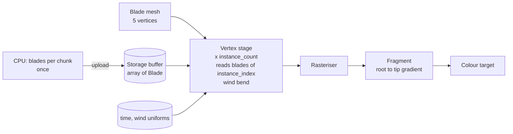

# 06: Instanced grass with wind (instancing and storage buffers)

**Concept:** drawing one mesh many times in a single draw call. Each copy
("instance") reads its own data (position, size, colour) from a **storage
buffer**, indexed by `instance_index`. This is how we draw hundreds of thousands
of grass blades, trees and (later) people.

## What it does

- **Blades:** a field of grass blades over the meadows, each a 5-vertex tapered
  strip.
- **Placement:** generated on the CPU once per terrain chunk and uploaded as one
  storage buffer of `Blade { pos, height, lean, tint }`.
- **Wind:** the vertex shader bends each blade with wind: a travelling sine wave
  plus gust noise. The bend grows with height along the blade, so roots stay put.
- **Colour:** a gradient from dark at the root to light at the tip, tinted per
  blade, so meadows shimmer.

## The math

For a blade vertex at height fraction `h` (0 root, 1 tip), with the blade's base
`b`, the wind direction `w` and the time `t`:

- **Wind strength:** `s = sin(dot(b.xz, w) * k − t * ω) * 0.5 + 0.5`, a wave
  crossing the field, times the gust noise `g = N(b.xz / 30 + w * t * 0.3)`.
- **Bend:** `offset = w * s * g * amp * h²` (quadratic in `h`, like a cantilever).
- **Height kept:** `y = h * height * cos(bend angle)`, so a bending blade doesn't
  stretch.
- **Billboard facing:** rotate the blade around y toward the camera by a random
  per-blade angle, for density without patterns.

## WGSL, line by line

```wgsl
import bevy_pbr::render::mesh_view_bindings::{view, globals};  // globals.time

// One blade's data; the array has one entry per instance.
struct Blade {
    pos: vec3<f32>,     // base position on the terrain
    height: f32,
    lean: f32,          // random rotation around y (radians)
    tint: f32,          // 0..1 colour variation
    _pad: vec2<f32>,    // keep 16-byte alignment for storage buffers
};
// A storage buffer: read-only array, any size, indexed in the shader.
@group(constants::MATERIAL_BIND_GROUP) @binding(0) var<storage, read> blades: array<Blade>;

struct Wind { dir: vec2<f32>, amp: f32, freq: f32 };
@group(constants::MATERIAL_BIND_GROUP) @binding(1) var<uniform> wind: Wind;

struct Vertex {
    @builtin(instance_index) instance: u32,  // which blade
    @location(0) position: vec3<f32>,        // the blade mesh: x across, y = h
};
struct VOut {
    @builtin(position) clip: vec4<f32>,
    @location(0) h: f32,
    @location(1) tint: f32,
};

@vertex
fn vertex(v: Vertex) -> VOut {
    let b = blades[v.instance];               // this instance's data
    let h = v.position.y;                      // 0 at the root, 1 at the tip

    // Rotate the blade's width direction by its lean.
    let c = cos(b.lean); let s = sin(b.lean);
    let across = vec3<f32>(c, 0.0, s) * v.position.x;

    // Wind: a wave over the field times slow gusts, bending with h squared.
    let wave = sin(dot(b.pos.xz, wind.dir) * wind.freq - globals.time * 2.0) * 0.5 + 0.5;
    let gust = sin(globals.time * 0.7 + b.pos.x * 0.05) * 0.5 + 0.5;
    let bend = wave * gust * wind.amp * h * h;
    let offset = vec3<f32>(wind.dir.x, 0.0, wind.dir.y) * bend;

    // Keep the blade's length: lower the tip as it bends.
    let up = vec3<f32>(0.0, h * b.height * cos(bend), 0.0);
    let world = b.pos + across + up + offset * b.height;

    var out: VOut;
    out.clip = view.clip_from_world * vec4<f32>(world, 1.0);
    out.h = h;
    out.tint = b.tint;
    return out;
}

@fragment
fn fragment(in: VOut) -> @location(0) vec4<f32> {
    // Dark at the root, light at the tip, varied per blade.
    let root = vec3(0.20, 0.36, 0.16);
    let tip = mix(vec3(0.55, 0.72, 0.30), vec3(0.70, 0.74, 0.36), in.tint);
    return vec4<f32>(mix(root, tip, in.h), 1.0);
}
```

Rust side:
- one `Mesh` for the blade;
- one entity per chunk, with a material holding the chunk's `Blade` buffer;
- the draw call sets `instance_count = blades.len()`;
- chunks beyond a distance draw fewer blades: take every 2nd, 4th, ... entry by
  scaling the instance count.



## Debug views

- **Instance id:** colour by `f32(v.instance % 7u) / 7.0` to see the instances.
- **Bend amount:** colour by `bend` to see the wind waves crossing the field.
- **LOD rings:** colour by chunk distance band.

## Exercises

1. **Trampling:** pass the positions of nearby agents (a small uniform array) and
   flatten blades within 1 m of them.
2. **Seasons:** turn the tips golden in late summer and shorten the blades after
   the harvest, driven by the sim's day of year.
