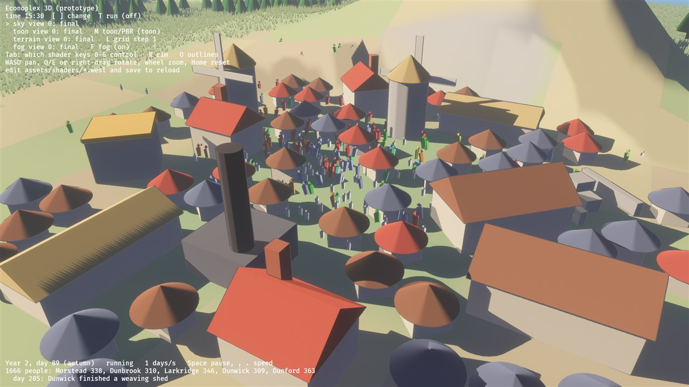
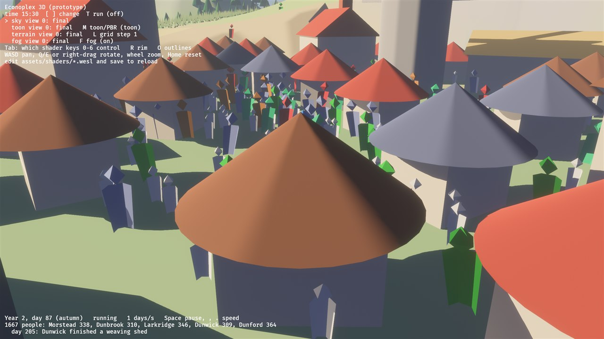
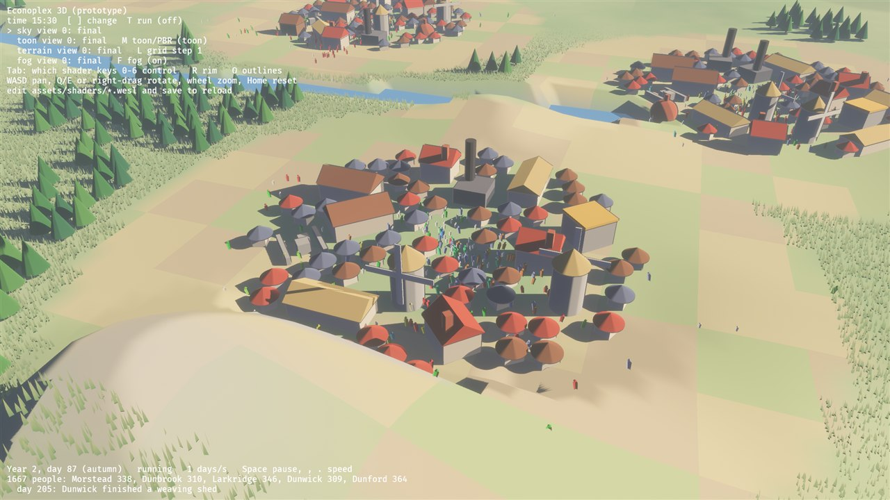
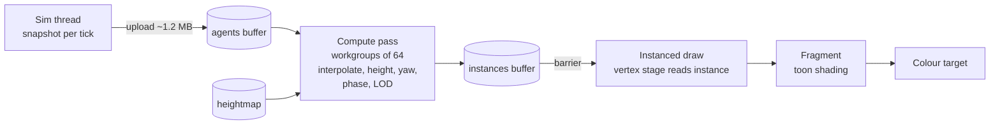

# 07: Crowds from sim snapshots (compute shaders)

> **Status (M4, part 1):** the crowd is drawn, but the walking runs on the CPU.
>
> - Every frame `crates/game3d/src/crowd.rs` moves each person toward their
>   target from the newest snapshot and writes position, heading, colour and
>   size into a storage buffer.
> - `assets/shaders/people.wesl` draws everyone from one mesh, by vertex pulling
>   as for the grass (step 06). It animates the walk procedurally: a bob of
>   `|sin|` per stride, a forward lean, and a phase per person, so a crowd
>   doesn't march in lockstep.
> - Colours: workers by the skill domain of today's work, soldiers dark red,
>   children small and pale, idle people light, resting ones blue-grey.
>
> Part 2, this step proper, moves the walking into a **compute shader**. The
> CPU then only uploads targets when a tick arrives, and the GPU moves the
> people every frame. The draft below is the plan for that.
>
> | a town's people | close up | going out to the fields |
> | --- | --- | --- |
> |  |  |  |


**Concept:** general-purpose work on the GPU.
- A **compute shader** runs in **workgroups** of threads.
- It reads and writes **storage buffers**, and has no vertices or pixels.
- Its writes must be finished before the draw that reads them: **synchronisation**
  between passes.

## What it does

Each sim tick gives us, per agent: the previous and current position, the
activity (walking, working, resting), the job and the town. That's up to 50,000
entries.

- **Compute pass, once per frame:**
  - interpolates every agent between the two snapshots (by the frame's fraction
    of a tick);
  - snaps it to the terrain height;
  - computes a facing direction and an animation phase (gait while walking, tool
    swing while working);
  - picks a LOD (mesh, impostor, dot) by distance to the camera;
  - writes a compact `Instance` per agent into a buffer.
- **Draw:** the instanced crowd reads those `Instance`s, like the grass in 06.
- **Why on the GPU:** the CPU only uploads the two snapshots, about 1.2 MB per
  tick, and never touches 50k instances per frame.

## The math

- **Interpolation:** `p = mix(p_prev, p_curr, α)`, where `α` is the time since
  the last tick divided by the tick length.
- **Facing:** `yaw = atan2(dx, dz)` of `p_curr − p_prev`, smoothed with the
  previous yaw (`mix` on the unit circle).
- **Gait phase:** `φ = fract(distance_walked / stride)`.
  - Bob: `y += |sin(2πφ)| * 0.05`.
  - Limbs swing with `sin(2πφ)` in the vertex shader.
- **LOD:** `d = |p − camera|`; mesh below 60 m, impostor below 250 m, dot beyond.

## WGSL, line by line

```wgsl
// Snapshot data, one entry per agent, uploaded each sim tick.
struct Agent {
    prev: vec2<f32>,     // world xz at the previous tick
    curr: vec2<f32>,     // world xz at this tick
    activity: u32,       // 0 idle, 1 walking, 2 working, 3 resting
    job: u32,            // recipe index (picks the tool animation)
    town: u32,
    _pad: u32,
};
// What the draw reads: one per agent.
struct Instance {
    pos: vec3<f32>,
    yaw: f32,
    phase: f32,          // animation phase 0..1
    lod: u32,            // 0 mesh, 1 impostor, 2 dot
    anim: u32,           // which animation (walk, scythe, hammer, ...)
    _pad: u32,
};
struct Frame { camera: vec4<f32>, alpha: f32, dt: f32, count: u32, _pad: u32 };

@group(0) @binding(0) var<storage, read> agents: array<Agent>;
@group(0) @binding(1) var<storage, read_write> instances: array<Instance>;
@group(0) @binding(2) var<uniform> frame: Frame;
@group(0) @binding(3) var height_tex: texture_2d<f32>;  // terrain heightmap (03)
@group(0) @binding(4) var height_smp: sampler;

// 64 threads per workgroup; Rust dispatches ceil(count / 64) workgroups.
@compute @workgroup_size(64)
fn update(@builtin(global_invocation_id) id: vec3<u32>) {
    let i = id.x;                       // one thread per agent
    if i >= frame.count { return; }     // the last workgroup may overhang
    let a = agents[i];

    // Smooth motion between ticks.
    let xz = mix(a.prev, a.curr, frame.alpha);
    let uv = xz / 2000.0 + 0.5;
    let y = textureSampleLevel(height_tex, height_smp, uv, 0.0).r * 12.0;

    // Facing: where it is going; keep the old yaw when standing still.
    let step = a.curr - a.prev;
    var yaw = instances[i].yaw;
    if dot(step, step) > 1e-6 { yaw = atan2(step.x, step.y); }

    // Animation phase: walking advances with distance, work with time.
    var phase = instances[i].phase;
    if a.activity == 1u { phase = fract(phase + length(step) * frame.dt / 0.8); }
    if a.activity == 2u { phase = fract(phase + frame.dt * 0.9); }

    // LOD by distance to the camera.
    let d = distance(vec3(xz.x, y, xz.y), frame.camera.xyz);
    let lod = select(select(2u, 1u, d < 250.0), 0u, d < 60.0);

    instances[i] = Instance(vec3(xz.x, y, xz.y), yaw, phase, lod, a.job, 0u);
}
```

**Synchronisation:**
- The compute pass runs in its own render-graph node *before* the main 3D pass.
- wgpu inserts the barrier between the compute write and the vertex read of
  `instances`, because both use the same buffer in successive passes.
- The draw then reads `instances[instance_index]`.
- Drawing per LOD needs a separate list per LOD, built with an atomic counter per
  LOD and an indirect draw. That is exercise 2.



## Debug views

- **LOD bands:** colour instances by `lod` (red mesh, yellow impostor, blue dot).
- **Phase:** colour by `phase`, so walkers flicker in step and workers pulse.
- **Interpolation off:** set `alpha = 1`, to see agents jump once per tick.

## Exercises

1. **Separation:** in a second compute pass, push agents apart when closer than
   0.5 m, using a spatial hash grid built with atomics. It's purely visual, so the
   sim stays deterministic.
2. **Indirect draw per LOD:** count instances per LOD with `atomicAdd`, write
   compacted lists, and draw each with `draw_indirect`, so impostors and dots
   don't run the full mesh vertex shader.
