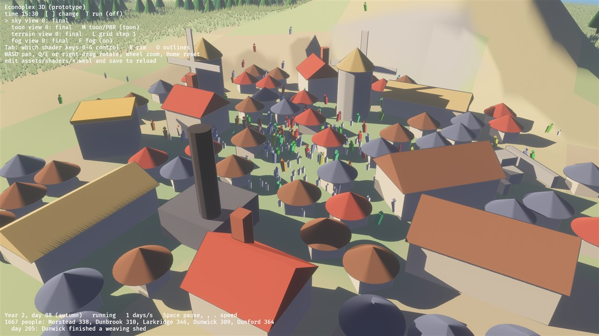
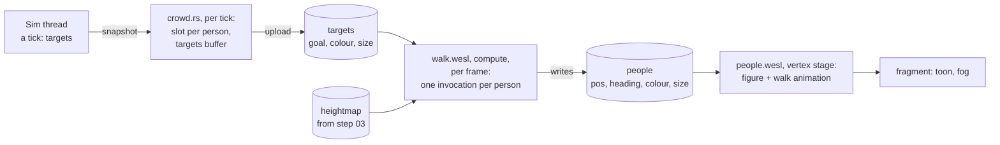

# 07: The crowd walks on the GPU (compute shaders)

**Concept:** a compute shader is a function run thousands of times in parallel,
with no triangles and no pixels. It reads and writes buffers; that's all.
- Here it moves every person of the simulation, every frame, and writes the
  results straight into the buffer the people are drawn from.
- The CPU only says where people are heading, once per sim tick.


> **Since step 09** ([09-procedural-animation](09-procedural-animation.md)), a person
> is 12 floats (a `motion` vec4 was added) and the figure has legs and arms
> (180 vertices). The code below is the step-07 version; the ideas are the same.

**Where the code is:**
- `crates/game3d/assets/shaders/walk.wesl`: the compute shader (hot-reloads);
- `crates/game3d/src/crowd_compute.rs`: the pipeline, the bind group and the
  dispatch;
- `crates/game3d/src/crowd.rs`: slots, the targets buffer, the crowd mesh;
- `crates/game3d/assets/shaders/people.wesl`: draws the people and animates
  the walk (from M4 part 1).

**Try it:** `cargo run --release -p game3d -- --seed 23`, and zoom into a
town. `P` hides the people.



## The data flow



- **Per tick (CPU):** each person (by their agent id) keeps a fixed *slot*.
  When a snapshot arrives, the CPU writes each slot's goal, colour and size into
  the targets buffer and uploads it.
- **Per frame (GPU):** `walk.wesl` runs once per slot:
  1. read the slot's target and the person's last position;
  2. step toward the goal;
  3. look up the ground height in the terrain's heightmap;
  4. write the new position, heading, colour and size.
- **Drawing:** the people shader reads that same buffer. No copy back to the
  CPU, ever. The CPU never even learns where anyone is.

### Why slots

The GPU keeps each person's position from one frame to the next, so a person
must stay in the same buffer entry while they live. `Slots` maps agent id to
slot.
- When someone dies, their slot is freed, but only reusable from the *next*
  tick.
- So the GPU sees it empty for at least a frame, and the next person to get it
  appears at their goal instead of sliding over from where the old occupant
  stood.

## Compute shaders in Bevy (the plumbing)

Bevy has two worlds. The game runs in the *main world*; rendering happens in
the *render world*, which gets a copy of what it needs every frame.

1. **Main world:** `crowd.rs` keeps a `CrowdCompute` resource:
   - the two buffers (as `ShaderBuffer` assets);
   - the heightmap (an `Image` asset);
   - the parameters (`dt`, speed, slot count, the terrain's placement).
2. **Extract:** `ExtractResourcePlugin::<CrowdCompute>` copies it into the
   render world each frame.
3. **Pipeline, once (`RenderStartup`):** a bind group layout and a compute
   pipeline:
   - storage read-write (people);
   - storage read (targets);
   - texture (heightmap);
   - uniform (params).
4. **Bind group, every frame (`PrepareBindGroups`):** look up the GPU buffers
   and texture behind the asset handles (`RenderAssets<GpuShaderBuffer>`,
   `RenderAssets<GpuImage>`). Write the parameters into a uniform buffer, and
   bind it all.
5. **Dispatch (`RenderGraph`, before `camera_driver`):** begin a compute pass,
   set pipeline and bind group, `dispatch_workgroups(ceil(count / 64), 1, 1)`.
   - It runs before the camera draws, so the people shader sees this frame's
     positions.
   - wgpu inserts the barrier between the compute write and the vertex read.

## The math (and the GPU details)

- **Workgroups:** `@workgroup_size(64)` means invocations run in groups of
  64. `global_invocation_id.x` numbers them 0, 1, 2, … across all groups:
  that's our slot.
  - We dispatch `ceil(count / 64)` groups, so the last group may run past the
    end of the array. Hence `if i >= params.count { return; }`.
- **No races:** each invocation reads and writes only its own slot, so no two
  invocations touch the same memory. That's what makes this trivially parallel.
  - Shared memory and barriers come into play when invocations cooperate; the
    exercises go there.
- **Walking:** `step = min(max(walk, 0.3·d)·dt, d)`. Normally 3 units per
  second; far-off goals are reached faster; never overshoot.
  `heading = atan2(Δx, Δz)`.
- **Ground height:** the heightmap of step 03, filtered bilinearly by hand,
  exactly as in the terrain shader. People's feet stay on the hills.
- **`size` carries three things:** its magnitude is the scale (children 0.65),
  its sign says walking (negative) or standing, and 0 means an empty slot.
  The people shader animates only walking figures.
- **Reserved words:** `active` can't be a field name in WGSL. It's reserved,
  hence `occupied`.

## The shaders

`walk.wesl`:

```wgsl
// Shader step 07: the crowd walks on the GPU. Explained in
// docs/shaders/07-crowds-compute.md.
//
// A compute shader: no triangles, no pixels, just a function run once per
// person, in parallel, in groups of 64 ("workgroups"). Every frame it moves
// each person toward their target and writes the result straight into the
// buffer that people.wesl draws from. The CPU only uploads new targets when the
// simulation finishes a tick.

// One person as people.wesl reads it (8 floats).
struct Person {
    pos: vec3<f32>,
    heading: f32,
    color: vec3<f32>,
    size: f32, // 1 adult, 0.65 child; negative = walking; 0 = empty slot
};

// One target, written by the CPU per tick (8 floats).
struct Target {
    goal: vec2<f32>,   // where to walk to (3D x, z)
    occupied: f32,     // 1 = someone lives in this slot, 0 = empty (`active` is a
                       // reserved word in WGSL)
    size: f32,
    color: vec3<f32>,
    pad: f32,
};

struct Params {
    dt: f32,           // seconds since the last frame
    walk: f32,         // walking speed (units per second)
    count: u32,        // slots in the buffers
    pad: u32,
    grid: vec4<f32>,   // terrain: x, z of texel (0,0); texel spacing; height scale
    dims: vec4<f32>,   // terrain: texels across (i), deep (j)
};

@group(0) @binding(0) var<storage, read_write> people: array<Person>;
@group(0) @binding(1) var<storage, read> targets: array<Target>;
@group(0) @binding(2) var heights: texture_2d<f32>;
@group(0) @binding(3) var<uniform> params: Params;

// Terrain height at a ground point: the heightmap of step 03, filtered
// bilinearly by hand (the same mapping as terrain_common.wesl).
fn texel(t: vec2<i32>) -> f32 {
    let last = vec2<i32>(params.dims.xy) - 1;
    return textureLoad(heights, clamp(t, vec2<i32>(0), last), 0).r * params.grid.w;
}
fn ground(xz: vec2<f32>) -> f32 {
    let tc = vec2<f32>(xz.x - params.grid.x, params.grid.y - xz.y) / params.grid.z;
    let t0 = vec2<i32>(floor(tc));
    let f = fract(tc);
    let top = mix(texel(t0), texel(t0 + vec2(1, 0)), f.x);
    let bottom = mix(texel(t0 + vec2(0, 1)), texel(t0 + vec2(1, 1)), f.x);
    return mix(top, bottom, f.y);
}

// 64 people per workgroup; the CPU dispatches ceil(count / 64) workgroups.
@compute @workgroup_size(64)
fn walk(@builtin(global_invocation_id) id: vec3<u32>) {
    let i = id.x;
    if i >= params.count {
        return;                       // the last workgroup may run past the end
    }
    let t = targets[i];
    var p = people[i];
    if t.occupied < 0.5 {
        p.size = 0.0;                 // empty slot: nothing to draw
        people[i] = p;
        return;
    }
    // Someone new in this slot (it was empty last frame): appear at the goal.
    var here = p.pos.xz;
    if p.size == 0.0 {
        here = t.goal;
    }
    let to = t.goal - here;
    let dist = length(to);
    // Walk; far-off goals (a new home, a raid) are reached quicker.
    let step = min(max(params.walk, dist * 0.3) * params.dt, dist);
    let walking = dist > 0.05;
    if walking {
        here += to / dist * step;
        p.heading = atan2(to.x, to.y);
    }
    p.pos = vec3<f32>(here.x, ground(here), here.y);
    p.color = t.color;
    p.size = select(t.size, -t.size, walking);
    people[i] = p;                    // each invocation writes only its own slot
}
```

`people.wesl` (drawing and the walk animation):

```wgsl
// M4: people as one crowd, with procedural walking. See docs/shaders/07-crowds-compute.md.
//
// Like the grass (step 06): one mesh holds many copies of a small figure, and
// the vertex shader reads each figure's data from a storage buffer by
// `(vertex_index - first_vertex) / VERTS_PER_PERSON`. The CPU writes the buffer
// every frame (position, heading, colour, size, walking or not); the shader
// animates the walk: a bob and a forward lean, out of step from person to
// person.

import bevy_pbr::render::{
    mesh_functions,
    mesh_bindings::mesh,
    forward_io::{Vertex, VertexOutput, FragmentOutput, decompress_vertex},
    mesh_view_bindings::globals,
    view_transformations::position_world_to_clip,
    pbr_fragment::pbr_input_from_standard_material,
    pbr_functions::main_pass_post_lighting_processing,
};
import super::toon_lighting::{Toon, toon_params, toon_terms};
import super::fog::apply_fog;

// One person; matches the 8 floats per person written in src/crowd.rs.
struct Person {
    pos: vec3<f32>, // feet, world space
    heading: f32,   // direction of travel (radians around y)
    color: vec3<f32>,
    size: f32,      // 1 adult, 0.65 child; negative = walking; 0 = nobody
};

struct Crowd {
    toon: Toon,
};
@group(constants::MATERIAL_BIND_GROUP) @binding(100) var<uniform> crowd: Crowd;
@group(constants::MATERIAL_BIND_GROUP) @binding(101) var<storage, read> people: array<Person>;

const VERTS_PER_PERSON: u32 = 60u;

@vertex
fn vertex(vertex_in: Vertex, @builtin(vertex_index) vertex_index: u32) -> VertexOutput {
    let v = decompress_vertex(vertex_in, vertex_in.instance_index);
    let first = mesh[vertex_in.instance_index].first_vertex_index;
    let index = (vertex_index - first) / VERTS_PER_PERSON;
    let p = people[index];
    let walking = p.size < 0.0;
    let size = abs(p.size);

    // Procedural walk: each step lifts the body (|sin| makes two bumps per
    // stride) and the body leans into the direction of travel. The phase comes
    // from the person's index, so a crowd doesn't march in lockstep.
    let phase = f32(index) * 1.618;
    let stride = globals.time * 9.0 + phase;
    let bob = select(0.0, abs(sin(stride)) * 0.06, walking);
    let lean = select(0.0, 0.18, walking);

    // The figure in its own space: x across, y up, z forward. Lean forward
    // (rotate around x by `lean`, more at the top), then turn to the heading.
    var local = v.position * size;
    local.z += local.y * lean;
    local.y += bob;
    let c = cos(p.heading);
    let s = sin(p.heading);
    let turned = vec3<f32>(local.x * c + local.z * s, local.y, -local.x * s + local.z * c);
    let n = v.normal;
    let normal = vec3<f32>(n.x * c + n.z * s, n.y, -n.x * s + n.z * c);

    let world = p.pos + turned;
    var out: VertexOutput;
    out.world_position = vec4<f32>(world, 1.0);
    out.position = position_world_to_clip(world);
    out.world_normal = normalize(normal);
@if(VERTEX_UVS_A)
    out.uv = vec2<f32>(f32(index), 0.0);  // the fragment stage looks the colour up
@if(VERTEX_OUTPUT_INSTANCE_INDEX)
    out.instance_index = vertex_in.instance_index;
    return out;
}

@fragment
fn fragment(in: VertexOutput, @builtin(front_facing) is_front: bool) -> FragmentOutput {
    var pbr = pbr_input_from_standard_material(in, is_front);
    pbr.N = normalize(in.world_normal);
    let albedo = people[u32(in.uv.x + 0.5)].color;
    let t = toon_terms(pbr, toon_params(crowd.toon));
    let fogged = apply_fog(albedo * t.light, in.world_position.xyz, crowd.toon.fog);
    var out: FragmentOutput;
    out.color = main_pass_post_lighting_processing(pbr, vec4<f32>(fogged, 1.0));
    return out;
}
```

## Exercises

1. **Separation:** people bunch up at the same goal. Push them apart: each
   invocation looks at its neighbours in the buffer (say, 16 slots on either
   side) and steps away from anyone closer than 0.3 units.
   - Why does this introduce a *race*? (Hint: neighbours read positions that
     other invocations are writing in the same pass.)
   - Fix it with two buffers, read from one and write the other, and swap
     them each frame.
2. **Shared memory:** do exercise 1 with `var<workgroup>`.
   - Each workgroup loads its 64 people into workgroup memory.
   - `workgroupBarrier()`, then each invocation compares itself only with those
     64.
   - Measure the difference with more people (`--days 3000`).
3. **Roads:** make people walk along roads. Bake a "cost" texture from the
   terrain (water expensive, fords cheap) and steer along its gradient.
   That's the first step toward flow-field pathfinding, which is a classic
   compute-shader job.
