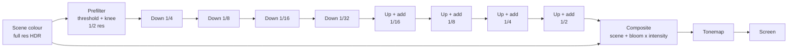

# 08: Bloom (render targets and multiple passes)

**Concept:** post-processing with several passes and intermediate textures
(render targets). Each pass reads one texture and writes another. A chain of
smaller and smaller textures (a mip chain) makes a wide blur cheap.

## What it does

- **Glow:** bright areas (the sun in the sky, lit windows at night, overlay
  ribbons, highlighted selections) bleed a soft glow into their surroundings.
- **Passes:**
  1. **Prefilter:** extract what is brighter than a threshold, with a soft knee,
     at half resolution.
  2. **Downsample** 5–6 times, each to half size, with a 13-tap filter (stable,
     no flicker).
  3. **Upsample** back up, adding each level with a tent filter (blur radius grows
     at every step).
  4. **Composite:** add the result onto the image, scaled by an intensity.

Bevy has a bloom we used in M0. Writing our own shows how multi-pass rendering
works, and lets overlays have their own glow.

## The math

- **Soft threshold:** with luminance `b = max(r, g, b)`, threshold `T` and knee
  `K`,
  `soft = clamp(b − T + K, 0, 2K)² / (4K)` and
  `contrib = max(soft, b − T) / max(b, ε)`. Then `c' = c * contrib`.
  It is smooth around `T`, so no hard edges pop.
- **Downsample:** a weighted average of 13 taps around the pixel: a centre 2×2
  box at 0.5 weight, 4 corner boxes at 0.125. This is roughly a Gaussian of
  radius 1 in the destination's pixels.
- **Upsample:** a 3×3 tent `[1 2 1; 2 4 2; 1 2 1] / 16` at the larger size,
  added to that level.
- **Composite:** `final = scene + bloom * intensity`, then tonemap.

## WGSL, line by line

```wgsl
import bevy_core_pipeline::fullscreen_vertex_shader::FullscreenVertexOutput;

@group(0) @binding(0) var src: texture_2d<f32>;   // the previous pass's output
@group(0) @binding(1) var smp: sampler;            // linear filtering
struct Params { threshold: f32, knee: f32, intensity: f32, _pad: f32 };
@group(0) @binding(2) var<uniform> params: Params;

// Pass 1: keep only what is bright, with a soft knee.
@fragment
fn prefilter(in: FullscreenVertexOutput) -> @location(0) vec4<f32> {
    let c = textureSample(src, smp, in.uv).rgb;
    let b = max(c.r, max(c.g, c.b));
    let t = params.threshold; let k = params.knee;
    let soft = clamp(b - t + k, 0.0, 2.0 * k);
    let contrib = max(soft * soft / (4.0 * k + 1e-4), b - t) / max(b, 1e-4);
    return vec4<f32>(c * contrib, 1.0);
}

// Pass 2 (repeated): half the size, 13 taps (texel = 1 / source size).
@fragment
fn downsample(in: FullscreenVertexOutput) -> @location(0) vec4<f32> {
    let t = 1.0 / vec2<f32>(textureDimensions(src));
    let uv = in.uv;
    // Centre box (4 taps around the middle), weight 0.5 in total.
    var c = (textureSample(src, smp, uv + t * vec2(-1.0, -1.0))
           + textureSample(src, smp, uv + t * vec2( 1.0, -1.0))
           + textureSample(src, smp, uv + t * vec2(-1.0,  1.0))
           + textureSample(src, smp, uv + t * vec2( 1.0,  1.0))) * 0.125;
    // Outer ring: centre, edges and corners at twice the distance.
    let s0 = textureSample(src, smp, uv);
    let s1 = textureSample(src, smp, uv + t * vec2(-2.0, 0.0));
    let s2 = textureSample(src, smp, uv + t * vec2( 2.0, 0.0));
    let s3 = textureSample(src, smp, uv + t * vec2(0.0, -2.0));
    let s4 = textureSample(src, smp, uv + t * vec2(0.0,  2.0));
    let s5 = textureSample(src, smp, uv + t * vec2(-2.0, -2.0));
    let s6 = textureSample(src, smp, uv + t * vec2( 2.0, -2.0));
    let s7 = textureSample(src, smp, uv + t * vec2(-2.0,  2.0));
    let s8 = textureSample(src, smp, uv + t * vec2( 2.0,  2.0));
    c += s0 * 0.125 + (s1 + s2 + s3 + s4) * 0.0625 + (s5 + s6 + s7 + s8) * 0.03125;
    return c;
}

// Pass 3 (repeated, with additive blending onto the next larger level):
// a 3x3 tent filter.
@fragment
fn upsample(in: FullscreenVertexOutput) -> @location(0) vec4<f32> {
    let t = 1.0 / vec2<f32>(textureDimensions(src));
    var c = textureSample(src, smp, in.uv) * 4.0;
    c += (textureSample(src, smp, in.uv + t * vec2(-1.0, 0.0))
        + textureSample(src, smp, in.uv + t * vec2( 1.0, 0.0))
        + textureSample(src, smp, in.uv + t * vec2(0.0, -1.0))
        + textureSample(src, smp, in.uv + t * vec2(0.0,  1.0))) * 2.0;
    c += textureSample(src, smp, in.uv + t * vec2(-1.0, -1.0))
       + textureSample(src, smp, in.uv + t * vec2( 1.0, -1.0))
       + textureSample(src, smp, in.uv + t * vec2(-1.0,  1.0))
       + textureSample(src, smp, in.uv + t * vec2( 1.0,  1.0));
    return c / 16.0;
}
```

Rust side:
- a render-graph node that owns a mip chain of `Rgba16Float` textures;
- it runs prefilter, then N downsamples (each binding the previous mip as `src`),
  then N upsamples with additive blending;
- finally a composite pass adds the result onto the view target before
  tonemapping.



## Debug views

- **Prefilter output:** show what counts as bright (it should be the sun and the
  highlights, not the whole sky).
- **One mip level:** draw any level of the chain full-screen to see the blur
  grow.
- **Bloom only:** composite with the scene set to 0.

## Exercises

1. **Overlay glow:** render the money-flow ribbons into their own target, and
   bloom only that, with its own colour and intensity. The world stays crisp, the
   overlay glows.
2. **Flicker:** replace the 13-tap downsample with a plain 2×2 box, move the
   camera slowly over bright windows, and watch the shimmer the better filter
   avoids.
