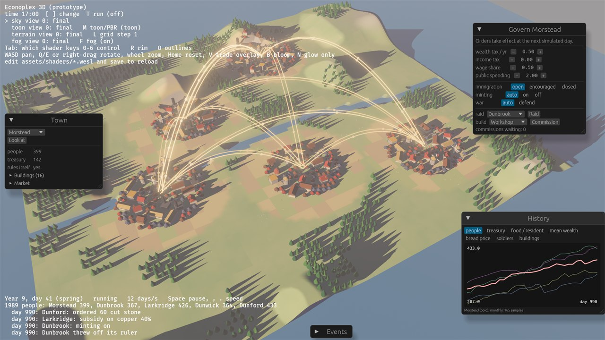
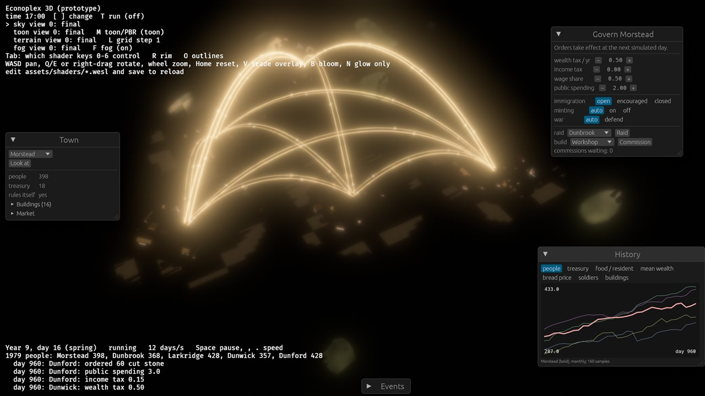
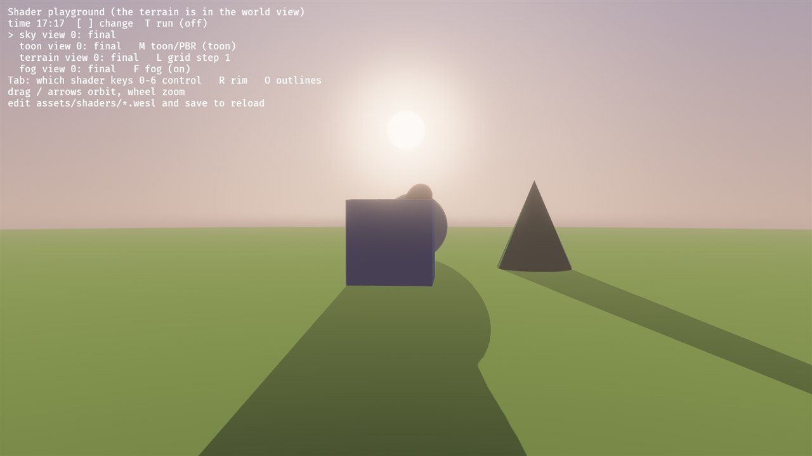
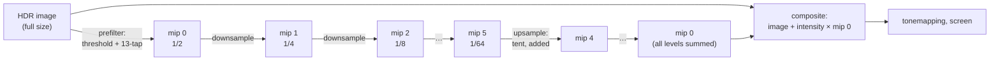

# 08: Bloom by hand (render targets, a mip chain, several passes)

**Concept:** rendering into textures of our own and chaining passes. Each pass
reads what the previous one wrote. Bloom is the classic example: bright parts
of the image bleed light into their surroundings, as they do in a camera lens
or the eye.
- Here it makes the sun, the dusk sky and the trade arcs glow.
- It replaces Bevy's built-in bloom, which we used until now.

**Where the code is:**
- `crates/game3d/assets/shaders/bloom.wesl`: the four passes (hot-reloads);
- `crates/game3d/src/bloom.rs`: the textures, pipelines and passes in Bevy's
  render world.

**Try it:** `cargo run --release -p game3d -- --seed 23 --trade` (or the
playground at dusk).
- `B` turns bloom on and off.
- `N` shows the glow alone.

| with bloom | the glow alone (`N`) | the sun at dusk (playground) |
| --- | --- | --- |
|  |  |  |

## The passes



1. **Prefilter (image → mip 0, half size):** average 13 taps and keep only
   what is brighter than the threshold.
2. **Downsample (mip k → mip k+1):** the same 13-tap average, each level half
   the size of the one before. Six levels: 1/2 down to 1/64 of the screen.
3. **Upsample (mip k+1 → mip k):** a 3×3 tent filter of the smaller mip,
   **added** onto the larger one. The pipeline's blend state is
   `One + One`; the pass loads the target instead of clearing it.
4. **Composite (image + glow → next image):**
   `out = image + intensity × mip 0`, still in HDR. Tonemapping comes after.

**Why a mip chain?** A blur's cost grows with its radius. Blurring a 1/64-size
texture by one texel blurs the screen by 64 pixels, for the cost of a handful
of samples on a tiny texture. Adding the levels back up from small to large
mixes wide, soft glow with tight glow near the source.

## The math

- **Soft threshold (knee):** with brightness `b = max(r, g, b)`, threshold `t`
  and knee `k`:
  - `soft = clamp(b − t + k, 0, 2k)² / 4k`, a quadratic ramp from `t − k` to
    `t + k`;
  - `contribution = max(soft, b − t) / b`.

  We multiply the colour by `contribution`, so the colour's hue is kept and
  only its strength is cut. A hard `b > t` would make glow pop on and off.
- **13-tap downsample:**
  - a centre box of 4 bilinear taps (weight ½ together);
  - four overlapping corner boxes (⅛ each), sharing taps.

  Bilinear taps placed between texels average 4 texels each for free, so 13
  taps read 36 texels. The overlap keeps small bright points from flickering
  as they move.
- **Tent upsample:** the 3×3 weights `1 2 1 / 2 4 2 / 1 2 1`, divided by 16.
- **Units:** this all happens on the HDR image before tonemapping, so
  "brighter than 1.2" means real light values: the sun, the HDR trade arcs
  (colours up to 6), the brightest sky.

## The plumbing (Bevy's render world)

- **Settings:** `BloomSettings` is a component on the camera, copied to the
  render world each frame (`ExtractComponent`). The camera also needs `Hdr`,
  so its image is `Rgba16Float`.
- **Textures:** `prepare_mips` asks the `TextureCache` for six textures per
  camera at 1/2 … 1/64 of the image size. The cache hands back the same
  textures every frame while the size stays the same.
- **Pipelines:** four render pipelines from one shader file, one entry point
  each, all with Bevy's full-screen-triangle vertex shader. The upsample
  pipeline has additive blending.
- **The pass system:** `bloom_pass` runs in the `Core3d` schedule, in
  `Core3dSystems::PostProcess`, **before tonemapping**.
  - `ViewTarget::post_process_write()` gives a source (the image so far) and a
    destination (the camera's other main texture).
  - Prefilter reads the source; composite writes the destination, and Bevy
    swaps them, so the next pass sees our result.
- **Bind groups:** made inside the pass, one per draw, because each draw reads
  a different texture. That's cheap; creating textures is what must not
  happen every frame.

## The shader

`bloom.wesl`:

```wgsl
// Shader step 08: bloom, by hand. Explained in docs/shaders/08-bloom.md.
//
// Four kinds of full-screen pass, each drawing one triangle that covers its
// target texture; the fragment shader runs once per target pixel:
//
//   prefilter   HDR image -> mip 0 (half size): keep only what is brighter
//               than a threshold (a soft knee, so it doesn't snap on)
//   downsample  mip k -> mip k+1 (half again): average 13 taps, a wide blur
//   upsample    mip k+1 -> mip k, ADDED to what is there: a 3x3 tent filter
//   composite   image + intensity * mip 0 -> the final HDR image
//
// The chain of ever smaller textures is what makes the glow wide but cheap:
// blurring a 1/32-size texture by a few pixels blurs the screen by a lot.

import bevy_core_pipeline::fullscreen_vertex_shader::FullscreenVertexOutput;

struct Bloom {
    threshold: f32, // brightness where the glow starts
    knee: f32,      // softness of that start
    intensity: f32, // how much glow is added back
    debug: f32,     // 1: show only the glow
};

@group(0) @binding(0) var input: texture_2d<f32>;
@group(0) @binding(1) var input_sampler: sampler;
@group(0) @binding(2) var<uniform> bloom: Bloom;
// Only the composite pass binds this: the finished glow (mip 0).
@group(0) @binding(3) var glow: texture_2d<f32>;

fn luma(c: vec3<f32>) -> f32 {
    return dot(c, vec3<f32>(0.2126, 0.7152, 0.0722));
}

// 13 bilinear taps (the "Call of Duty" downsample): a centre box and four
// overlapping corner boxes, weighted so the result doesn't flicker as bright
// pixels move.
fn downsample13(uv: vec2<f32>) -> vec3<f32> {
    let px = 1.0 / vec2<f32>(textureDimensions(input));
    let a = textureSample(input, input_sampler, uv + vec2(-2.0, -2.0) * px).rgb;
    let b = textureSample(input, input_sampler, uv + vec2( 0.0, -2.0) * px).rgb;
    let c = textureSample(input, input_sampler, uv + vec2( 2.0, -2.0) * px).rgb;
    let d = textureSample(input, input_sampler, uv + vec2(-2.0,  0.0) * px).rgb;
    let e = textureSample(input, input_sampler, uv).rgb;
    let f = textureSample(input, input_sampler, uv + vec2( 2.0,  0.0) * px).rgb;
    let g = textureSample(input, input_sampler, uv + vec2(-2.0,  2.0) * px).rgb;
    let h = textureSample(input, input_sampler, uv + vec2( 0.0,  2.0) * px).rgb;
    let i = textureSample(input, input_sampler, uv + vec2( 2.0,  2.0) * px).rgb;
    let j = textureSample(input, input_sampler, uv + vec2(-1.0, -1.0) * px).rgb;
    let k = textureSample(input, input_sampler, uv + vec2( 1.0, -1.0) * px).rgb;
    let l = textureSample(input, input_sampler, uv + vec2(-1.0,  1.0) * px).rgb;
    let m = textureSample(input, input_sampler, uv + vec2( 1.0,  1.0) * px).rgb;
    // Weights: the inner box j k l m counts 0.5, the four corner boxes 0.125 each.
    return e * 0.125
        + (a + c + g + i) * 0.03125
        + (b + d + f + h) * 0.0625
        + (j + k + l + m) * 0.125;
}

@fragment
fn prefilter(in: FullscreenVertexOutput) -> @location(0) vec4<f32> {
    let c = downsample13(in.uv);
    // Soft threshold: a quadratic ramp over [threshold - knee, threshold + knee],
    // then linear. Divide by the brightness to scale the colour, not clip it.
    let br = max(max(c.r, c.g), c.b);
    let t = bloom.threshold;
    let k = max(bloom.knee, 1e-4);
    var soft = clamp(br - t + k, 0.0, 2.0 * k);
    soft = soft * soft / (4.0 * k);
    let contribution = max(soft, br - t) / max(br, 1e-4);
    return vec4<f32>(c * contribution, 1.0);
}

@fragment
fn downsample(in: FullscreenVertexOutput) -> @location(0) vec4<f32> {
    return vec4<f32>(downsample13(in.uv), 1.0);
}

// A 3x3 tent filter (1 2 1 / 2 4 2 / 1 2 1, divided by 16) on the smaller mip.
// The pipeline adds the result to the larger mip (additive blending), so each
// level keeps its own detail plus the wider glow from below.
@fragment
fn upsample(in: FullscreenVertexOutput) -> @location(0) vec4<f32> {
    let px = 1.0 / vec2<f32>(textureDimensions(input));
    var c = vec3<f32>(0.0);
    for (var y = -1; y <= 1; y++) {
        for (var x = -1; x <= 1; x++) {
            let w = f32((2 - abs(x)) * (2 - abs(y)));
            c += textureSample(input, input_sampler, in.uv + vec2<f32>(f32(x), f32(y)) * px).rgb * w;
        }
    }
    return vec4<f32>(c / 16.0, 1.0);
}

@fragment
fn composite(in: FullscreenVertexOutput) -> @location(0) vec4<f32> {
    let image = textureSample(input, input_sampler, in.uv);
    let g = textureSample(glow, input_sampler, in.uv).rgb;
    if bloom.debug > 0.5 {
        return vec4<f32>(g, 1.0);          // debug: the glow alone
    }
    return vec4<f32>(image.rgb + g * bloom.intensity, image.a);
}
```

## Things to notice

- **The order matters:** the glow must be added **before** tonemapping. After
  it, the image is in 0..1 and nothing is "brighter than white" any more.
- **Edges:** the sampler clamps at the texture edges, so glow doesn't wrap
  around from the other side of the screen.
- **Odd sizes:** each mip is the previous size halved and rounded down, so a
  texel of mip k isn't exactly 2 texels of mip k−1 at the right and bottom
  edges. The bilinear sampling hides it.

## Exercises

1. **Lens dirt:** multiply the glow by a texture of smudges before adding it
   (in `composite`). Bright lights then show the "dirty lens" look.
2. **Anamorphic streaks:** make the downsample average more horizontally than
   vertically (taps at ±3 texels in x, ±1 in y). Bright lights get horizontal
   streaks, like a film lens.
3. **Depth: fog as a post-process pass.** This is the step-04 alternative,
   promised there.
   - Add a depth prepass to the camera (`DepthPrepass`).
   - Bind the depth texture in a new pass before the bloom.
   - Rebuild each pixel's world position: `uv → ndc → inverse(view_proj) →
     divide by w`.
   - Apply `fog.wesl`'s formula. Unlike the material version, it fogs
     everything, the sky included.
