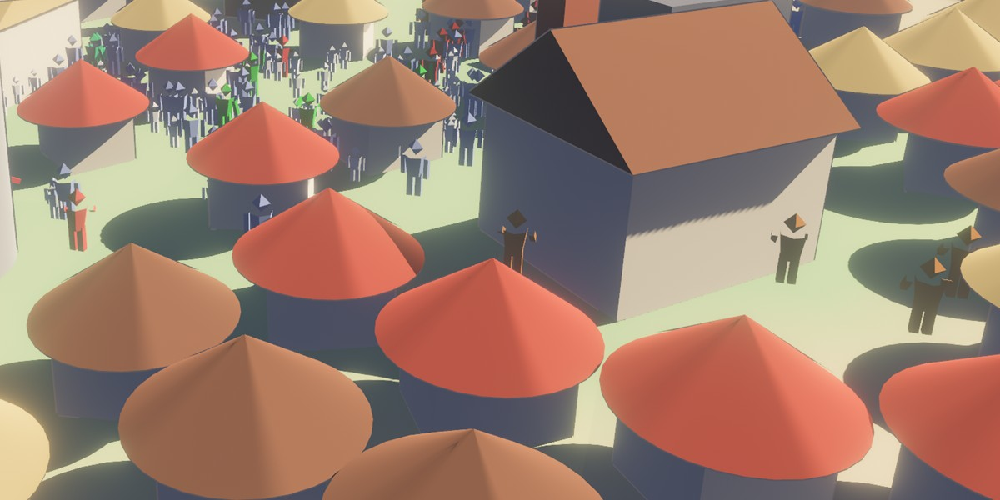

# 09: Procedural animation (rigid parts, joints, state on the GPU)

**Concept:** animating figures with a few lines of math per vertex, instead of
skeletons and animation clips.
- The figure is rigid parts (body, head, two legs, two arms). Each limb turns
  about its joint (hip or shoulder) by an angle that the vertex shader computes
  from the person's state.
- Walkers swing their legs and arms in step with the distance they cover. The
  compute pass of step 07 keeps each person's stride phase, so feet don't slide.
- Workers standing at their workplace make their trade's motion: a scythe sweep,
  a hammer blow, an axe chop or busy hands. Soldiers stand guard, and the idle
  look around.

**Where the code is:**
- `crates/game3d/assets/shaders/people.wesl`: the poses (hot-reloads);
- `crates/game3d/assets/shaders/walk.wesl`: the stride phase, the turning and
  the walking blend (hot-reloads);
- `crates/game3d/src/crowd.rs`: the figure (`figure`) and which trade gets which
  motion (`Motion`).

**Try it:** `cargo run --release -p game3d -- --days 20 --view-from 200,20,18`,
then zoom in on a town with the mouse wheel.
- `H` hides the panels and the text (or start with `--no-ui`).
- `P` hides the people.



## Which part is a vertex in?

All people share one mesh, 180 vertices per person (step 06's vertex pulling).
The figure is built in a fixed order, so the vertex number within the person
tells the part:

| vertices | part | joint |
|---|---|---|
| 0..36 | body (a tapered six-sided tube) | none |
| 36..60 | head (an octahedron) | none |
| 60..90, 90..120 | left and right leg | hip, y 0.32 |
| 120..150, 150..180 | left and right arm | shoulder, y 0.53 |

```wgsl
let corner = (vertex_index - first) % VERTS_PER_PERSON;
let part = select(0u, (corner - 60u) / 30u + 1u, corner >= 60u);
```

No extra vertex attribute is needed: the layout is the data. Another way would
be a per-vertex "bone index" attribute, which is what skinned meshes do.

## Turning a limb about its joint

To turn a point about a joint: subtract the joint, rotate, add the joint back.
The normal is only rotated, since it is a direction:

```wgsl
var local = pivot + swing(v.position - pivot, angle);
var normal = swing(v.normal, angle);
```

`swing` is a rotation about the x axis (across the body). Its sign is chosen so
that a limb hanging down swings forward (+z) for a positive angle:

```text
y' =  y·cos a + z·sin a
z' = -y·sin a + z·cos a        a hanging limb (0, -L, 0) → (0, -L·cos a, L·sin a)
```

After the limbs, the upper body (body, head and arms, not the legs) can twist
about y, and everything above the hips leans forward (a shear: `z += (y - hip) ·
lean`). Then comes the person's heading and position, as in step 07.

## Walking: the stride phase lives on the GPU

The legs swing with `sin(phase)`, opposite each other, and each arm swings with
the opposite leg. Where does `phase` come from?

- **Step 07's way:** `time · speed`. Feet slide whenever the actual walking
  speed differs from what the animation assumes.
- **Now:** the compute pass adds the distance walked each frame:
  `phase += step / STRIDE · 2π`. A slow walker steps slowly, a stopped one
  stops mid-stride. The phase is *state*, kept per person in the buffer
  between frames: the vertex shader can't keep anything, the compute shader
  can.

Two more pieces of state, both eased so nothing pops:
- **Heading:** turns toward the goal at most `TURN` radians a second instead of
  snapping. The angle difference is wrapped into −π..π with
  `atan2(sin d, cos d)`, so people turn the short way round.
- **Walking blend** `w` (0 standing, 1 walking): follows the target with
  `w += (aim − w) · min(BLEND · dt, 1)`. Limbs blend between the walking angles
  and the work pose with `mix(pose, walk, w)`, so someone who arrives settles
  into work instead of jumping.

The person record grew from 8 to 12 floats: `motion = (work motion, stride
phase, walking blend, unused)`. Storage-buffer structs follow WGSL's alignment
rules. A `vec4<f32>` needs 16-byte alignment, and after `pos, heading, color,
size` (32 bytes) it is aligned. The Rust side (`PERSON_FLOATS`) must match.

## Work motions: a few curves

Each motion is a pose (two arm angles, a twist and a lean) as a function of the
person's own clock `t = time + index · 0.37`, so neighbours are out of step:

- **Scythe:** arms forward; the upper body sweeps, `twist = 0.55 · sin(2.2 t)`.
- **Hammer:** a slow lift and a quick blow. With `u = fract(0.9 t)`:
  `lift = smoothstep(0, 0.65, u) · (1 − smoothstep(0.72, 0.8, u))`. The arms go up
  over 65 % of the cycle and drop in 8 %. Asymmetric timing is what makes a
  motion read as effort.
- **Axe:** the hammer's curve plus a twist, so the chop comes from the side.
- **Craft:** arms in front, alternating quickly (`± 0.2 · sin(9 t)`).

Which trade gets which motion is decided on the CPU from the skill domain's
name (`Motion::of_domain`): agriculture gets the scythe; smithing, metallurgy,
masonry and mining the hammer; forestry, woodworking and construction the axe.
New content with a new domain gets the craft motion until it is added there.

## Things to notice

- **Cost:** 180 vertices × 4096 slots is about 740 000 vertices, each running a
  handful of `sin`/`cos`. It is still far below what the grass costs.
- **No skinning, no clips:** the whole animation system is about 60 lines of
  WGSL. It is the trade-off of procedural animation: cheap and endlessly
  varied, but every motion is hand-written math.
- **Normals and the shear:** the lean is a shear, which a correct normal
  transform would treat with the inverse transpose. We ignore it; at 0.12 it
  doesn't show.
- **A fixed figure:** the old figure's body tube was wound inside out (its
  normals pointed inward and we saw its far inner faces). A test now checks
  that every face points outward.

## Exercises

1. **Knees:** split each leg into thigh and shin (two parts per leg) and bend
   the shin backward only while the leg swings back:
   `knee = max(0, -sin(phase)) · 0.8`. The shin's joint moves with the thigh,
   so turn it about the knee first, then about the hip.
2. **Running:** when a person is far from their goal (the compute pass knows
   `dist`), raise the arm and leg amplitudes and add a bigger bob. Store
   "hurry" in the unused `motion.w`.
3. **A tool:** add a fifth limb, a thin stick held in the right hand (30 more
   vertices). It turns with the right arm's angle and joint. Hide it
   (scale it to zero) for motions without a tool.
4. **Look at the camera:** give the head its own part and turn it toward the
   camera when it is close (`view.world_position` in `mesh_view_bindings`).
   Clamp the angle so nobody turns their head all the way round.
