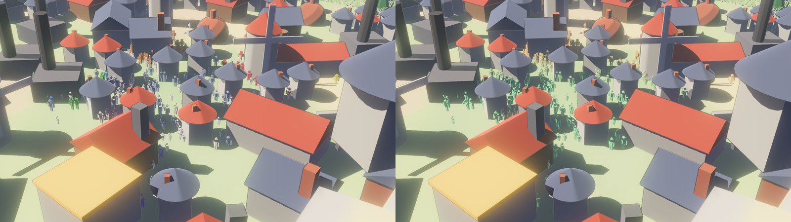

# 10: Level of detail (impostor cards, distance functions, dithered cross-fades)

**Concept:** draw far things more cheaply than near ones, and hide the switch.
- Close up, a person is the full figure of step 09: 180 vertices.
- In the middle distance, a person is a *card*: two triangles turned toward the
  camera. The fragment shader draws the silhouette on it with a signed distance
  function (SDF).
- Beyond the far cut-off, nobody is drawn.
- Where one level hands over to the next, both are drawn, each keeping a
  dithered share of the pixels. A person fades from figure to card instead of
  popping.

**Where the code is:**
- `crates/game3d/assets/shaders/people.wesl`: `lod_shares`, `card_vertex`,
  `bayer`, `silhouette` (hot-reloads);
- `crates/game3d/src/crowd.rs`: the card vertices in the mesh and the
  distances (`LodSettings`).

**Try it:** `cargo run --release -p game3d -- --days 3650 --view-from 40,30,25 --fps`.
- `K` (or `--lod-view`) tints figures green and cards orange.
- `--no-lod` draws full figures everywhere, for comparison.
- `--fps` logs the frame rate.



Left: as seen. Right: tinted by level (`K`): green figures in front, orange
cards behind; the speckled band between them is the cross-fade.

## What it buys

Release build, about 3,500 people, an RTX 3060 laptop GPU, paused:

| view | LOD on | `--no-lod` |
| --- | --- | --- |
| over a town, close (`--view-from 40,30,25`) | 91 fps | 38 fps |
| high overview (`40,35,60`) | 109 fps | 109 fps |

From the overview most people are past the far cut-off or tiny, so the figures
cost little either way. Close over a town, hundreds of people are in the
middle distance, and each card costs 6 vertices and a few pixels instead of 180
vertices.

## Choosing a level per vertex

Each person still owns 186 vertices in the mesh: 180 for the figure, then 6 for
the card. Every vertex first asks how far its person is from the camera:

```wgsl
fn lod_shares(d: f32) -> vec2<f32> {
    let figure = 1.0 - smoothstep(lod.x - lod.z * 0.5, lod.x + lod.z * 0.5, d);
    let far = 1.0 - smoothstep(lod.y - lod.z * 4.0, lod.y, d);
    return vec2<f32>(figure, min(1.0 - figure, far));
}
```

A vertex whose level has a share of 0 returns `nothing()`: a point outside the
screen. All three corners of its triangle land there, so the triangle has zero
area and the rasterizer drops it before any pixel runs.

This saves the pixel work and most of the vertex work (an early return), but the
GPU still *starts* 186 vertex invocations per person. The real fix is to not
submit them at all, which is exercise 3.

## The card: a cylindrical billboard

The card stands on the person's feet and turns about the vertical toward the
camera:

```wgsl
let to_cam = normalize(vec3(cam.x - p.x, 0.0, cam.z - p.z));
let right  = vec3(to_cam.z, 0.0, -to_cam.x);     // 90° from to_cam, in the ground plane
world = feet + right * c.x * half_width + up * c.y * height;
```

A *spherical* billboard would also tilt toward a camera high above. People
seen from above would then lie back like paintings on the floor. The
cylindrical one keeps them upright.

## Drawing the silhouette with distance functions

A signed distance function returns how far a point is from a shape: negative
inside, positive outside. Shapes combine with `min` (union):

```wgsl
fn sd_box(p, c, h) -> f32 {
    let q = abs(p - c) - h;
    return length(max(q, vec2(0.0))) + min(max(q.x, q.y), 0.0);
}
silhouette = min(head_circle, body_box, left_leg, right_leg, left_arm, right_arm);
if silhouette > 0.0 { discard; }
```

The card's pixels inside the union keep the person's colour. The legs' boxes
shift with `sin(stride phase)`, so walking cards still scissor their legs.

**Fake roundness:** a flat card lit with one normal looks like cardboard. The
fragment shader bends the normal sideways toward the card's edges:
`N = right · side + to_cam · sqrt(1 − side²)`. The toon lighting then shades it
like a cylinder.

## The cross-fade: ordered dithering

With alpha blending, crowds would need sorting back to front. Instead each pixel
is kept or discarded against a fixed 4×4 threshold pattern (a Bayer matrix):

```text
 0  8  2 10
12  4 14  6        threshold = (m + 0.5) / 16
 3 11  1  9
15  7 13  5
```

At share 0.5, exactly half the pixels in every 4×4 block pass, spread evenly.
The figure keeps the pixels whose threshold is below its share; the card keeps
those from there up to both shares. Between them every pixel is covered once:
no gap, no double. From a distance the eye averages the pattern into a fade.

## Things to notice

- **Measure before optimising:** the first measurements showed no gain at all.
  The frame was CPU-bound: the sky clock and the fog were written every frame,
  so Bevy prepared every material for the GPU again every frame. Writing them
  only when they change took the dev build from 19 to 35 fps before LOD did
  anything. `--fps` with `--no-lod` is how this was found.
- **Measure the release build:** the dev profile compiles our own crate with
  little optimisation (`opt-level = 1`), so CPU-side numbers are 3–4× worse.
- **Where to switch:** 28 units by default (`LodSettings::near`). Closer, the
  cards' missing arms and pose show. Farther, figures cost more than they add.

## Exercises

1. **A third level, dots:** past 120 units, draw the card as a plain circle
   (`length(p − centre) − r`), with no legs, arms or head. Does it change the
   frame rate? (Probably not: the card's cost is mostly its vertices, which
   points at exercise 3.)
2. **Screen-size switching:** switch by the person's height in pixels instead
   of world distance: `height · proj[1][1] / clip.w · screen_height / 2`. A
   zoomed camera then keeps figures longer, as it should.
3. **Submit less, not just draw less:** in `walk.wesl`, append each person's
   index to a "near" list or a "card" list with `atomicAdd` on a counter. Draw
   the figure mesh for the near list only, using an *indirect draw*: the GPU
   reads the vertex count from a buffer the compute pass wrote. This is how
   real crowd renderers scale to 100 000 people.
4. **Temporal dither:** offset the Bayer pattern by the frame number
   (`globals.frame_count % 4`). With anti-aliasing or a little motion blur the
   speckle becomes a smooth fade.
