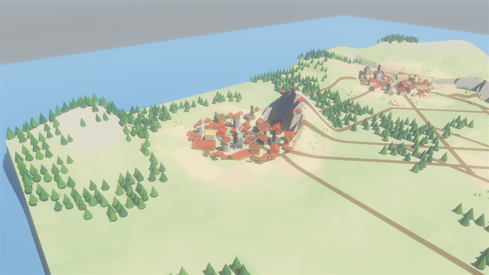
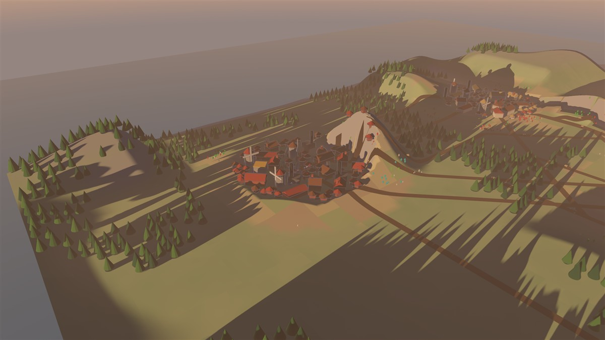
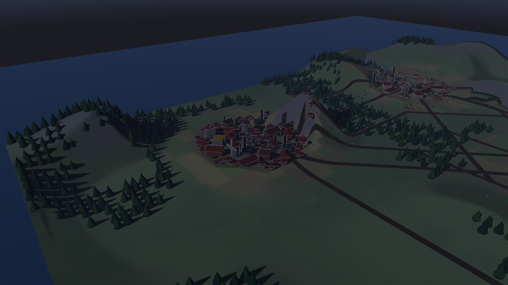
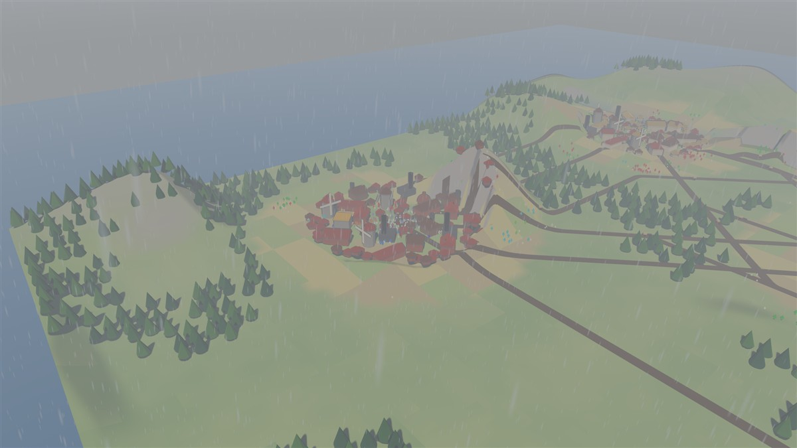
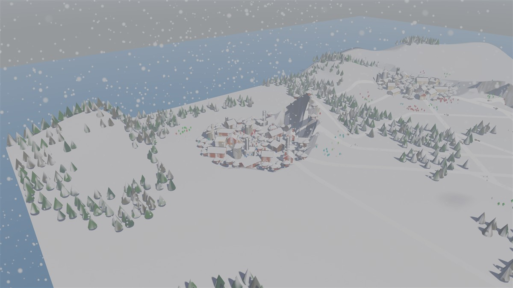
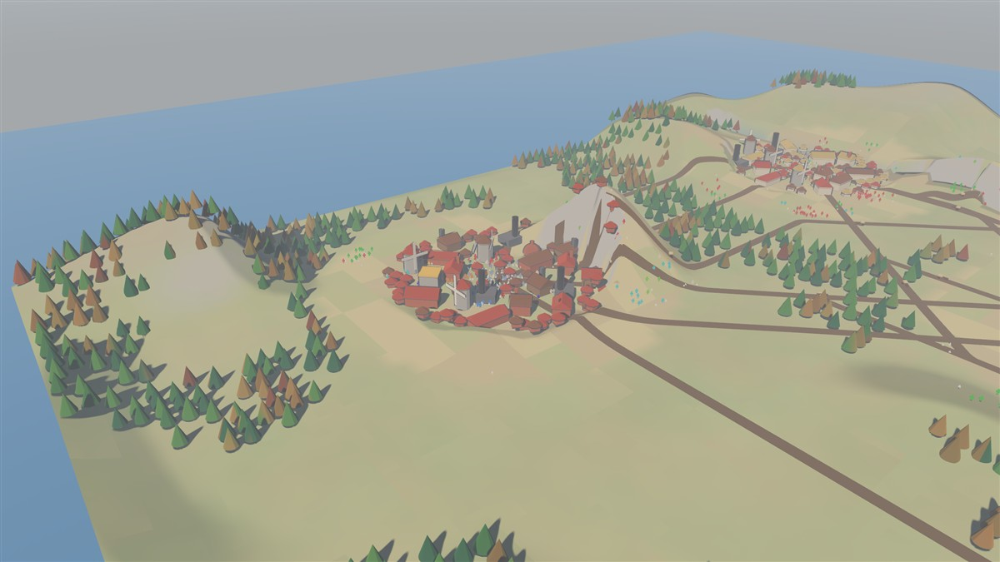
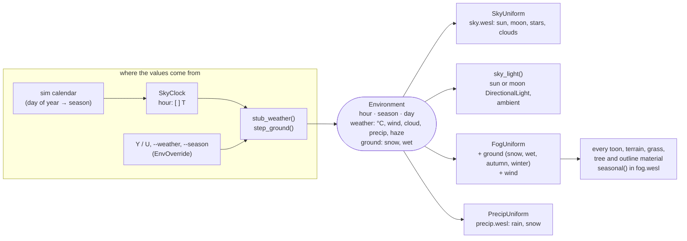
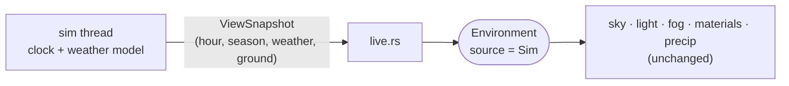

# 11: Day, night, seasons and weather

**Concept:** one small state, the *environment* (hour, season, weather, what the
weather has done to the ground), drives everything that changes with the time
and the weather. Nothing computes its own clock.

- The day is longer than the night: the sun is up 16 hours on average (14 in
  midwinter, 18 at midsummer), so the night is about a third of the day.
- At night the moon lights the land (with phases), the sky fills with stars.
- Clouds drift with the wind; overcast skies are grey and flat, the light soft.
- Rain falls as streaks slanted by the wind, snow as flakes that flutter.
- Snow piles up on everything that faces up and melts above freezing; rain
  darkens wet ground; meadows go straw-gold in autumn and brown in winter; a
  third of the trees (the broadleaves) turn orange, gold and red, then go bare.
- Wind bends the grass and sways the trees harder in a storm.

**Where the code is:**
- `crates/game3d/src/env.rs`: the `Environment` resource and the stand-in
  weather model (`stub_weather`, `step_ground`);
- `crates/game3d/src/sky.rs`: sun path (`day_length`, `sun_direction_in`),
  moon, `sky_light` (which light, how bright), `weathered_palette`;
- `crates/game3d/assets/shaders/sky.wesl`: moon disc and phase, stars, clouds;
- `crates/game3d/assets/shaders/fog.wesl`: `seasonal`, the surface colour in a
  season and weather, used by `toon.wesl`, `terrain.wesl` and `grass.wesl`;
- `crates/game3d/src/precip.rs`, `assets/shaders/precip.wesl`: rain and snow.

**Try it:** `cargo run --release -p game3d -- --days 400`.
- `[` / `]` move the time, `T` lets it run;
- `Y` cycles the weather: auto, clear, cloudy, rain, storm, snow, fog;
- `U` cycles the season: auto (the sim's calendar), spring, summer, autumn, winter;
- or start with `--weather rain --season autumn --hour 20`.

| day | dusk | night |
| --- | --- | --- |
|  |  |  |
| **rain** | **snow** | **autumn** |
|  |  |  |

## How the state flows



The fog block already went to every material each time it changed (step 04),
so it carries the ground state and the wind too: one copy per change, no new
bindings.

### Later: the simulation's clock and weather

Day and night and the weather will change gameplay in the simulation (work
hours, warmth, harvests, travel). Then the view must show the sim's state, not
its own guess. Only the source changes:



`EnvSource::Stub` becomes `EnvSource::Sim`, and `update_environment` copies
the snapshot instead of calling `stub_weather`. The keyboard overrides stay for
looking at one kind of weather.

## The sun's path, and a night a third long

The sun runs a circle once a day, `a = (hour − 12) / 24 · 2π` (0 at noon).
Its height is `y = A (cos a − cos h)`, where `h` is half the day's arc,
`h = day_length / 24 · π`. That is zero exactly at sunrise and sunset
(`a = ±h`), and `A` is chosen so the noon height is what the season allows:

| | day length | sunrise | sunset | night |
| --- | --- | --- | --- | --- |
| midwinter | 14 h | 5:00 | 19:00 | 10 h |
| average | 16 h | 4:00 | 20:00 | 8 h |
| midsummer | 18 h | 3:00 | 21:00 | 6 h |

(`sunrise = 12 − day_length / 2`, `sunset = 12 + day_length / 2`.)

The moon stands roughly opposite the sun. One `DirectionalLight` serves both:
the sun's light fades out around sunset; the moon's fades in only once the sun
is a few degrees below the horizon, so the light (and the shadows) switch over in the
darkest moment, where nobody sees the jump.

## Clouds in the sky shader

A point on the sky dome maps to a point on a flat cloud deck overhead:
`deck = d.xz / d.y`. Near the zenith a step across the dome is a short step on
the deck; near the horizon a long one, so clouds shrink toward the horizon like
real ones. Four octaves of value noise (`fbm`) over the deck, minus a threshold
that falls as the cover rises, give the clouds; the wind slides the deck. A
second noise lookup gives thickness, darker underneath, with a silver edge
toward the sun.

## Snow, wet ground, autumn: one function for every surface

`seasonal(albedo, normal, position, foliage, fog)` in `fog.wesl`:

- **snow** where the normal faces up, growing in from the flattest ground as the
  cover rises, with noisy edges; roofs, roads and trees get it too; not the water;
- **wet**: darker;
- **foliage** says what kind of plant it is: `0` stone, wood, roofs; `0.5`
  grass and meadow (straw-gold, then brown); `1` tree crowns, where soft noise
  picks stands of broadleaves that turn and go bare, while the conifers stay
  green. The tree material passes it in `rim.z`.

## Rain and snow without moving anything on the CPU

The mesh holds 14,000 quads. The four corners of a quad share a random point
`seed` in the unit cube; the vertex shader computes where that drop is now:

```
travelled = seed · size + velocity · time
rel       = (fract((travelled − centre) / size + 0.5) − 0.5) · size
position  = centre + rel
```

`fract` wraps the drop into a box of edge `size` around `centre`, a point in
front of the camera. A drop that falls out of the bottom comes back at the top,
so a few thousand drops fill the view wherever the camera goes. Only the
uniform (centre, velocity, how many show) changes on the CPU. Rain is a streak
along its velocity, as long as the path it covers in 1/30 s; snow is a round
flake facing the camera. Drops fade near the walls of the box and close to the
camera.

## The stand-in weather

Until the simulation has its own, `stub_weather(day, season, hour)` makes one
up: a seasonal temperature (−3 °C in midwinter, 21 °C at midsummer) with a
daily swing, and slow noise for clouds, rain, haze and wind. `step_ground`
integrates the ground: snow piles up while it snows below freezing, melts above;
surfaces get wet in the rain and dry within hours. A jump (a season picked by
hand) settles the ground at once.

## Exercises

1. Make the stars rotate around the pole over the night (rotate `d` by the hour
   before `stars(d)`).
2. Freeze the rivers when the snow cover is high: the water plane is a toon
   material at `y = -0.6`; give it its own `foliage` code.
3. Lightning in a storm: flash the ambient light for a frame or two at random
   times when `precip > 0.9`.
